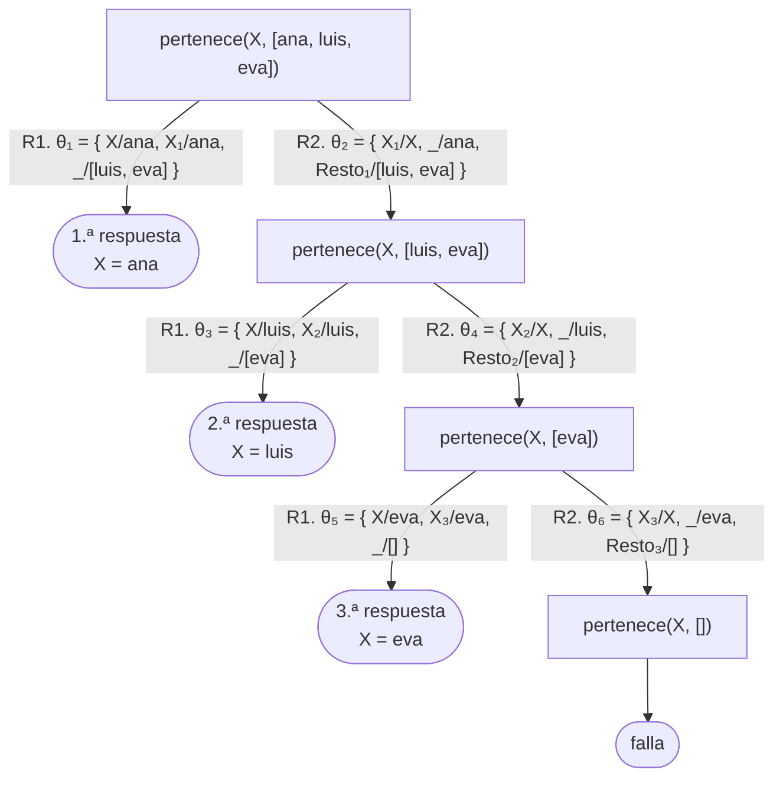
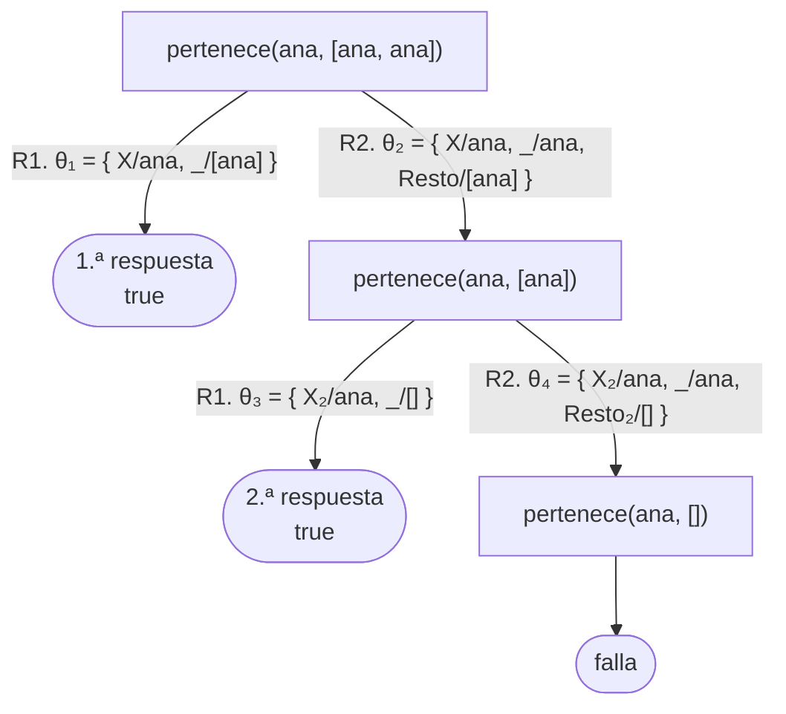
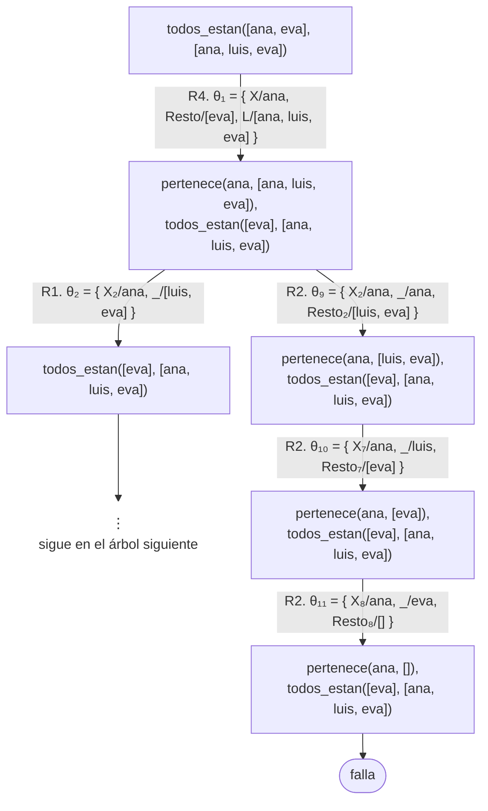
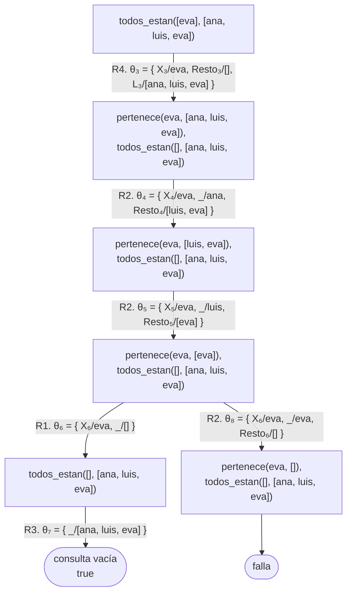
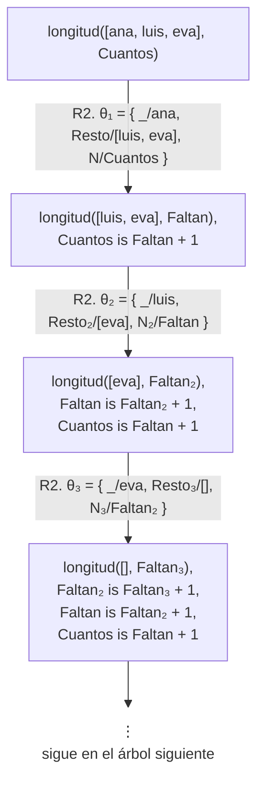
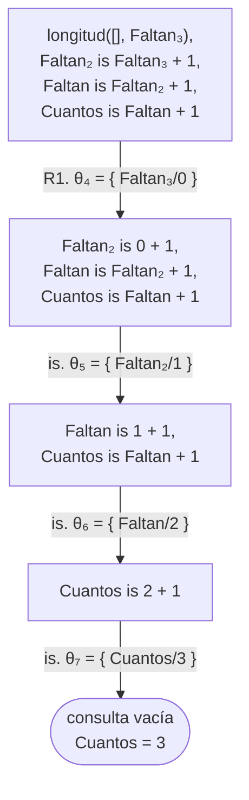
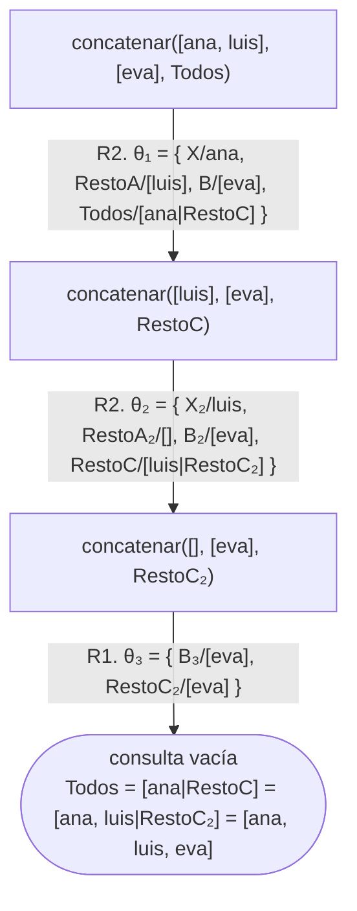
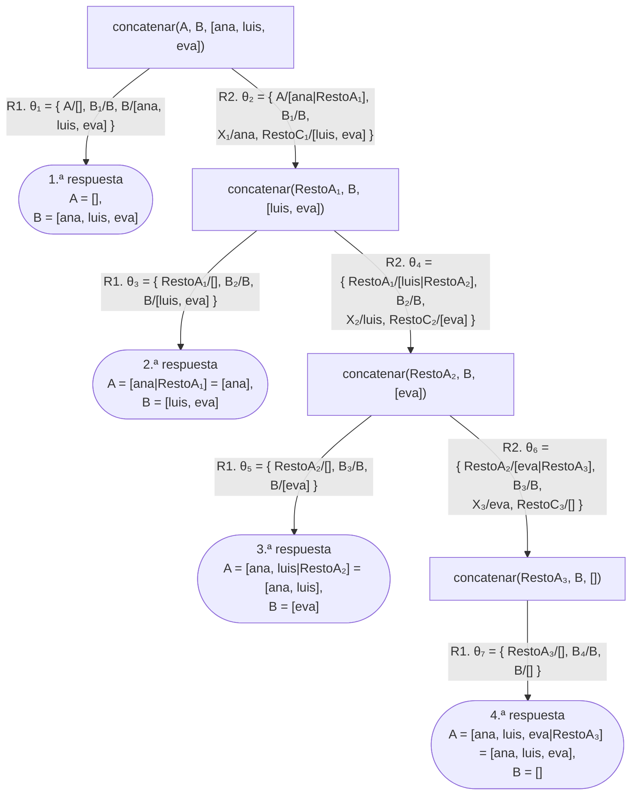
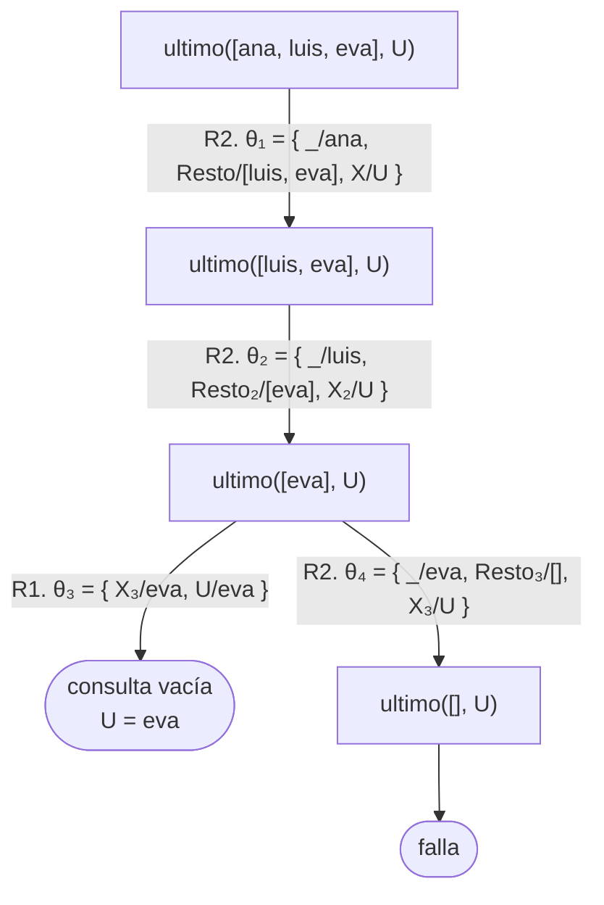
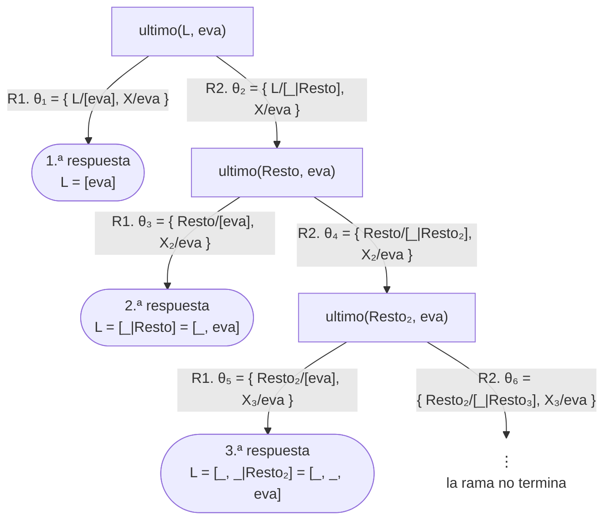

# Capítulo 7 — Listas

Una lista es una secuencia ordenada de elementos, cuya cantidad no se conoce de antemano: los invitados a una fiesta, las materias de un cuatrimestre, las letras de una palabra.

El [capítulo 6](../capitulo-06-recursion/index.md) mostró cómo recorrer una estructura que se reduce en cada llamada.
Una lista es exactamente una estructura de ese tipo, de modo que este capítulo es, en lo esencial, una aplicación de ese capítulo. Los elementos nuevos son la notación y un conjunto de predicados predefinidos de uso frecuente.

## Objetivos del capítulo

Al terminar el capítulo, el lector puede:

- escribir listas y descomponerlas en primer elemento y resto;
- recorrer una lista mediante una recursión de estructura fija;
- construir una lista nueva durante el recorrido de otra;
- usar una misma relación en varios sentidos, que es la propiedad que les da generalidad;
- usar los predicados de listas predefinidos de Prolog, y explicar cómo están definidos.

!!! info "Tiempo estimado"
    Leer el capítulo, ejecutar sus ejemplos y hacer las actividades: **1:15 h**.
    Resolver los 7 ejercicios marcados con ★: **2:00 h**.
    Resolver los 26 ejercicios del final: **8:45 h**.

## 7.1 Una lista es un término

Una lista se escribe entre corchetes, con los elementos separados por comas:

```prolog
[ana, luis, eva]
```

Sus elementos pueden ser términos de cualquier clase: átomos, números, términos compuestos y otras listas. La lista vacía es una constante, se escribe `[]`.

Internamente una lista no es una clase de dato distinta. Es un término compuesto como los del [capítulo 4](../capitulo-04-terminos-y-unificacion/index.md), con dos argumentos: un primer elemento, y una lista con los elementos restantes. Los corchetes son una notación que evita escribir los paréntesis anidados.

## 7.2 Primer elemento y resto

La barra vertical descompone una lista en sus dos componentes:

```prolog
?- [ana, luis, eva] = [Primero|Resto].
Primero = ana,
Resto = [luis, eva].
```

`Primero` es el primer elemento; `Resto` es **una lista** con todos los demás.

Como el resto de una lista es otra lista, se le puede aplicar nuevamente la misma regla.

Cuando la lista tiene un solo elemento, el resto es la lista vacía:

```prolog
?- [ana] = [Primero|Resto].
Primero = ana,
Resto = [].
```

La lista vacía no se puede descomponer, porque no tiene primer elemento:

```prolog
?- [] = [_|_].
false.
```

Estos dos resultados son la base de todas las recursiones del capítulo: `[]` corresponde al final del recorrido —en la mayoría de los predicados, el caso base— y `[X|Resto]` al caso recursivo.

Se puede extraer más de un elemento del comienzo de la lista:

```prolog
?- [Primero, Segundo|Resto] = [ana, luis, eva, sofia].
Primero = ana,
Segundo = luis,
Resto = [eva, sofia].
```

!!! question "Actividad"
    Antes de ejecutarlas, determinar qué responden estas cuatro consultas:
    `[a, b, c] = [X|Y].` · `[a, b, c] = [X, Y|Z].` · `[a] = [X|Y].` ·
    `[] = [X|Y].` Ejecutarlas y explicar por qué la última es la única que responde `false.` Conviene observar que `[X|Y]` es un patrón de término, como los de la plantilla 7 del [capítulo 4](../capitulo-04-terminos-y-unificacion/index.md), y no una operación sobre listas.

## 7.3 Recorrer una lista

Determinar si un elemento pertenece a una lista tiene dos casos: el elemento es
el primero de la lista, o el elemento pertenece al resto.

<!-- ejemplo: capitulo-07/recorrer.pl predicado: pertenece/2 consulta: pertenece(luis, [ana, luis, eva]). -->
```prolog
%!  pertenece(?X, ?L) is nondet.
%
%   X es uno de los elementos de L.
%   X es el primer elemento, o es un elemento del resto. Con L libre, enumera
%   listas cada vez más largas que contienen a X, sin fin.
pertenece(X, [X|_]).
pertenece(X, [_|Resto]) :-
    pertenece(X, Resto).
```

La primera cláusula es un hecho: se cumple cuando el elemento buscado y el primer elemento de la lista son el mismo. Esa condición la resuelve la unificación, porque `X` aparece en las dos posiciones. Al repetir el mismo nombre de variable en la cabeza, la unificación impone la igualdad.

En 7.1 se estableció que hay dos maneras de ser para una lista —la lista vacía, o un primer elemento seguido de una lista—, y por eso un predicado que recorre una lista tiene dos cláusulas, una por cada manera. Es también la razón por la que este capítulo y el 6 comparten plantilla: en los dos casos la estructura del programa reproduce la estructura de aquello que recorre.

La segunda cláusula no necesita examinar el primer elemento —por eso se escribe `_`— y plantea la misma consulta sobre el resto, que es una lista más corta. Como cada llamada reduce la lista y la lista es finita, la recursión termina.

En `pertenece/2` la lista vacía no tiene cláusula propia: una forma de leerlo es "no hay elementos en la lista vacía" o "un elemento dado nunca está en la lista vacía". Ninguna de las dos cláusulas unifica con la lista vacía, de modo que la búsqueda termina por falta de cláusulas aplicables. En algunos predicados el caso base es un hecho; en otros, como en este, es la ausencia de una cláusula aplicable.

Como en los capítulos anteriores, el mismo predicado permite verificar y
enumerar:

```prolog
?- pertenece(X, [ana, luis, eva]).
X = ana ;
X = luis ;
X = eva ;
false.
```

La enumeración termina en `false.` y no en punto: después de `eva` queda
pendiente el recorrido del resto, que es `[]`, y ahí ninguna cláusula unifica.
No indica que algo haya fallado, sino que se agotaron las alternativas.

El árbol de derivación del [capítulo 5](../capitulo-05-como-responde-prolog/index.md#52-el-arbol-de-derivacion)
muestra las tres respuestas y el `false.` final. Con el hecho numerado R1 y la
regla R2, cada arco exhibe cómo la cabeza parte la lista: en R1, `[X|_]` liga
`X` al primer elemento y `_` al resto; en R2, `[_|Resto]` descarta el primer
elemento y deja la consulta sobre `Resto`. Cada uso de una cláusula emplea una
copia con variables nuevas, que llevan un subíndice (`X₂`, `Resto₂`), como
explica la [sección 6.2](../capitulo-06-recursion/index.md#62-caso-base-y-caso-recursivo);
aquí también la copia del primer uso lleva subíndice (`X₁`), porque la consulta
tiene su propia `X`:



En cada nivel, R1 está a la izquierda y produce una respuesta, y R2 a la
derecha reduce la lista en un elemento. Las tres hojas de éxito son las tres
respuestas, en el orden en que aparecen de izquierda a derecha. El cuarto nodo,
`pertenece(X, [])`, es el `false.` final: ni `[X|_]` ni `[_|Resto]` unifican con
`[]`, y la rama falla sin aportar una respuesta.

Conviene además observar que el predicado responde **una vez por cada aparición** del elemento en la lista:

```prolog
?- pertenece(ana, [ana, ana]).
true ;
true ;
false.
```

Hay dos demostraciones, una por cada `ana`, y por eso hay dos respuestas. No es un defecto en el predicado: cada respuesta corresponde a una manera diferente de satisfacer la consulta.

El árbol tiene la misma forma que el anterior, con una hoja de éxito por cada
`ana` y la misma hoja de falla sobre `[]`. La consulta no tiene variables, y
por eso las dos hojas de éxito dicen `true`:



!!! abstract "Plantilla 9 — Recorrer una lista"
    **Cuándo**: se deben examinar los elementos de una lista, de a uno por vez.

    ```prolog
    %!  p(+L) is det.
    %
    %   Procesa cada elemento de L.
    p([]) :-
        caso_de_la_lista_vacia.
    p([Primero|Resto]) :-
        procesar(Primero),
        p(Resto).
    ```

    El caso base es la lista vacía; el caso recursivo extrae el primer elemento y continúa con el resto. En algunos predicados el caso base se escribe como hecho; en otros no es necesario escribirlo.

    **En este capítulo se usa en**: `longitud/2` (7.4). `concatenar/3` (7.5) recorre
    su primera lista de la misma manera, pero construye una lista como resultado: corresponde a la plantilla 12, que es la variante de esta con resultado. Las demás plantillas están en [esta página](../plantillas.md).

`pertenece/2` no responde a esa plantilla porque difiere en el caso base.

!!! abstract "Plantilla 10 — Buscar un elemento que cumple una condición"
    **Cuándo**: alcanza con que **alguno** de los elementos cumpla la
    condición, y no hace falta examinarlos todos.

    ```prolog
    %!  p(+L) is nondet.
    %
    %   Algún elemento de L cumple la condición; una respuesta por cada uno.
    p([Primero|_]) :-
        cumple(Primero).
    p([_|Resto]) :-
        p(Resto).
    ```

    En esta plantilla el caso base **no** es la lista vacía: la primera cláusula tiene éxito sin recursión en cuanto encuentra un elemento que cumple. Sobre la lista vacía no hay cláusula aplicable, y la búsqueda fracasa: ninguno cumplió.

    **En este capítulo se usa en**: `pertenece/2` (7.3).

La condición opuesta —que **todos** los elementos cumplan— tiene su propia
silueta, y es la imagen invertida de la anterior:

<!-- ejemplo: capitulo-07/recorrer.pl predicado: todos_estan/2 consulta: todos_estan([ana, eva], [ana, luis, eva]). -->
```prolog
%!  todos_estan(+Buscados, +L) is nondet.
%
%   Todos los elementos de Buscados son elementos de L.
%   Todos los elementos cumplen una condición: el caso base es la lista vacía y
%   tiene éxito, y el recorrido fracasa en cuanto uno no cumple.
todos_estan([], _).
todos_estan([X|Resto], L) :-
    pertenece(X, L),
    todos_estan(Resto, L).
```

```prolog
?- todos_estan([ana, eva], [ana, luis, eva]).
true ;
false.
```

El árbol de esta consulta combina los dos predicados. Con las cláusulas
numeradas en el orden del programa:

| | |
|---|---|
| R1 | `pertenece(X, [X\|_]).` |
| R2 | `pertenece(X, [_\|Resto]) :- pertenece(X, Resto).` |
| R3 | `todos_estan([], _).` |
| R4 | `todos_estan([X\|Resto], L) :- pertenece(X, L), todos_estan(Resto, L).` |

Cada uso de R4 deja dos objetivos: la pertenencia del primer elemento, que se
resuelve primero, y el recorrido del resto, que espera a la derecha. El
subíndice de las variables numera las copias en el orden en que se usan. El
árbol está dibujado en dos partes por su altura; la primera llega hasta la
pertenencia de `ana`, y muestra completa la rama de la derecha, que recorre el
resto de la lista buscando otra `ana`:



La rama de R1 continúa en el segundo árbol, que empieza en su primer nodo y
sigue con la pertenencia de `eva`:



La hoja de éxito se alcanza cuando `pertenece(eva, [eva])` cierra por R1 y
`todos_estan([], …)` cierra por R3. El `;` y el `false.` del transcripto son
las dos alternativas de `pertenece/2` que quedaron pendientes, en dos niveles
distintos: la rama de R2 sobre `pertenece(eva, [eva])`, en el segundo árbol, y
la rama de R2 sobre `pertenece(ana, [ana, luis, eva])`, en el primero. Las dos
llegan a `pertenece(…, [])` y fallan; los subíndices de sus sustituciones, `θ₈`
a `θ₁₁`, dicen que Prolog las recorre después de la respuesta.

!!! abstract "Plantilla 11 — Todos los elementos cumplen"
    **Cuándo**: la condición se debe verificar sobre **todos** los elementos.

    ```prolog
    %!  p(+L) is semidet.
    %
    %   Todos los elementos de L cumplen la condición.
    p([]).
    p([Primero|Resto]) :-
        cumple(Primero),
        p(Resto).
    ```

    El caso base es la lista vacía: tiene éxito porque sobre una lista sin
    elementos, "todos cumplen" es cierto. El fracaso se produce en cuanto un
    elemento no cumple, y el recorrido se detiene ahí.

    Se distingue de la plantilla 9 en que no procesa cada elemento: lo somete a
    una prueba, y no produce ningún resultado más allá de cumplirse o no.

    **En este capítulo se usa en**: `todos_estan/2` (7.3).

!!! question "Actividad"
    Ejecutar `pertenece(X, [a, b, c]).` y solicitar todas las respuestas con `;`. Después ejecutar `pertenece(c, [a, b, c]).` con `trace` y contar cuántas veces se usa la segunda cláusula. La misma definición sirve para **preguntar** si
    un elemento está y para **enumerar** los que están; una relación consultada de dos maneras.

## 7.4 Contar durante el recorrido

Es la misma plantilla, con un resultado numérico. Corresponde a
`generaciones/3` del [capítulo 6](../capitulo-06-recursion/index.md), con una lista en lugar de una familia:

<!-- ejemplo: capitulo-07/recorrer.pl predicado: longitud/2 consulta: longitud([ana, luis, eva], Cuantos). -->
```prolog
%!  longitud(?L, ?N) is nondet.
%
%   N es la cantidad de elementos de L. Con L libre, enumera listas de
%   variables de largo creciente; con L libre y N ligado, da la lista de N
%   variables y después no termina.
longitud([], 0).
longitud([_|Resto], N) :-
    longitud(Resto, Faltan),
    N is Faltan + 1.
```

La lista vacía tiene cero elementos: es el caso base. Una lista con primer elemento y resto tiene un elemento más que su resto.

`is` se escribe **después** de la llamada recursiva, por la misma razón que en el [capítulo 6](../capitulo-06-recursion/index.md): es necesario que `Faltan` tenga valor para que `is` no dé un error.

```prolog
?- longitud([ana, luis, eva], Cuantos).
Cuantos = 3.
```

El árbol de derivación muestra esa razón. Con el hecho numerado R1 y la regla
R2, cada uso de R2 deja un `is` pendiente a la derecha de la consulta, y los
tres se resuelven de abajo hacia arriba cuando el caso base liga `Faltan₃` a
`0`. Como en la [sección 6.6](../capitulo-06-recursion/index.md#66-recursion-que-produce-un-resultado),
`is` es un objetivo predefinido: su arco no lleva número de cláusula, y la
sustitución registra el valor que produce. El árbol es una sola rama, porque
R1 no unifica con una lista no vacía y R2 no unifica con `[]`; por eso la
respuesta termina en punto. Está dibujado en dos partes: el descenso, en el que
la consulta crece, y el ascenso, en el que se reduce.



Hasta aquí la consulta crece: cada llamada agrega un `is` que no se puede
evaluar todavía, porque su lado derecho tiene una variable sin valor. El
segundo árbol empieza en el último nodo del primero:



A partir del caso base, la consulta se reduce: cada `is` liga la variable del
nivel anterior, y el último liga `Cuantos`. Es la lección de la
[sección 6.6](../capitulo-06-recursion/index.md#66-recursion-que-produce-un-resultado)
en su forma más simple: una sola rama, sin alternativas.

## 7.5 Construir una lista durante el recorrido de otra

En los predicados anteriores, las listas eran datos de entrada. En el siguiente, una lista es el resultado: la concatenación de dos listas.

<!-- ejemplo: capitulo-07/recorrer.pl predicado: concatenar/3 consulta: concatenar([ana, luis], [eva], Todos). -->
```prolog
%!  concatenar(+A, ?B, -C) is det.
%!  concatenar(?A, ?B, +C) is nondet.
%
%   C es la lista A seguida de la lista B.
concatenar([], B, B).
concatenar([X|RestoA], B, [X|RestoC]) :-
    concatenar(RestoA, B, RestoC).
```

Este predicado es el primero en el que la lista se construye en la cabeza de la regla, la técnica llamada **construcción en la cabeza**.

El caso base establece que la concatenación de la lista vacía y `B` es `B`. El caso recursivo establece lo siguiente: si el primer elemento de `A` es `X`, el primer elemento del resultado también es `X`, y el resto del resultado es la concatenación del resto de `A` con `B`.

Durante todo el recorrido, el resultado es una lista **incompleta**: cada llamada fija su primer elemento y deja el resto sin determinar, y recién el caso base cierra la estructura. De esto se sigue una limitación que importa en el capítulo siguiente: en cada paso ya hay un resultado parcial construido, pero **la recursión no puede consultarlo**.

Cuando un predicado necesita saber qué lleva hecho para decidir el paso siguiente, esta forma no alcanza, y es necesario construir el resultado en el otro sentido: llevándolo en un argumento que viaje hacia adelante. Eso es un acumulador, y es el tema de las secciones [8.5](../capitulo-08-aritmetica/index.md#85-acumuladores) y [8.6](../capitulo-08-aritmetica/index.md#86-un-acumulador-que-no-es-un-numero).

```prolog
?- concatenar([ana, luis], [eva], Todos).
Todos = [ana, luis, eva].
```

El árbol de derivación hace visible la construcción en la cabeza. Con el hecho
numerado R1 y la regla R2, cada uso de R2 liga el resultado a una lista
incompleta: `θ₁` liga `Todos` a `[ana|RestoC]`, `θ₂` liga `RestoC` a
`[luis|RestoC₂]`, y recién `θ₃`, en el caso base, cierra `RestoC₂` con `[eva]`.
La hoja compone las tres sustituciones para obtener la respuesta, como en la
[sección 6.4](../capitulo-06-recursion/index.md#64-la-suma):



En el segundo nodo ya existe `[ana|RestoC]`, un resultado parcial con el resto
sin determinar; en el tercero, `[ana, luis|RestoC₂]`. Ninguna de las dos
llamadas recursivas recibe ese resultado parcial como argumento: la recursión
no puede consultarlo, que es la limitación señalada más arriba.

!!! abstract "Plantilla 12 — Construir una lista durante el recorrido de otra"
    **Cuándo**: el resultado es una lista que se obtiene al recorrer otra.

    ```prolog
    %!  p(+L, -R) is det.
    %
    %   R es la lista que resulta de relacionar cada elemento de L con el suyo.
    p([], CasoBase).
    p([X|Resto], [Y|RestoNuevo]) :-
        relacionar(X, Y),
        p(Resto, RestoNuevo).
    ```

    La lista resultante se escribe en la **cabeza**; no se construye en el cuerpo. Es la técnica llamada *construcción en la cabeza*. Cada llamada aporta el primer elemento del resultado, y la recursión completa el resto.

    Las dos partes que cambian de un predicado a otro son el caso base —qué resultado corresponde a la lista vacía— y la relación entre cada elemento y el que ocupa su lugar en el resultado.

    **En este capítulo se usa en**: `concatenar/3` (7.5), que es el caso más simple de la plantilla. Cada elemento pasa al resultado sin modificarse, de modo que no se requiere ningún `relacionar/2`: en la cabeza se escribe dos veces la misma variable. El caso base no entrega la lista vacía sino la segunda lista. El [capítulo 8](../capitulo-08-aritmetica/index.md) la retoma con acumuladores.

## 7.6 Una relación, varios sentidos

Esta sección muestra la ventaja de haber definido `concatenar/3` como una relación y no como un procedimiento.

Con las dos primeras listas instanciadas, el predicado concatena. Con la **tercera** instanciada y las otras dos libres, el resultado es interesante:

```prolog
?- concatenar(A, B, [ana, luis, eva]).
A = [],
B = [ana, luis, eva] ;
A = [ana],
B = [luis, eva] ;
A = [ana, luis],
B = [eva] ;
A = [ana, luis, eva],
B = [] ;
false.
```

Se obtienen **todas las particiones de la lista en dos partes**. No se escribió ningún predicado para particionar listas: es el mismo `concatenar/3`, consultado en otro sentido.

El árbol de derivación muestra de dónde salen las cuatro respuestas y por qué
la consulta termina. Con las mismas R1 y R2 de la [sección 7.5](#75-construir-una-lista-durante-el-recorrido-de-otra),
y las copias de `B` renombradas (`B₁`, `B₂`, …) porque la consulta tiene su
propia `B`:



En cada nivel, R1 está a la izquierda y produce una partición: `A` recibe lo
recorrido hasta allí y `B`, el resto de la tercera lista. R2, a la derecha,
pasa un elemento de la tercera lista a `A` y deja la consulta sobre una lista
más corta. La lista que se recorre es la **tercera**, y por eso la consulta
termina: en el último nodo, `concatenar(RestoA₃, B, [])`, R2 no abre arco porque
`[]` no unifica con `[X|RestoC]`, y después de la cuarta respuesta no queda
nada por intentar. Ese intento sin arco es el `false.` del transcripto. El
árbol tiene exactamente la forma del de `suma(A, B, s(s(cero)))` en la
solución 11 del [capítulo 6](../capitulo-06-recursion/soluciones.md#11): la
misma escalera de respuestas, sobre una lista en lugar de un número.

De esta propiedad se derivan otras operaciones sin código adicional. Para determinar si una lista comienza con otra, se consulta si existe una lista que, concatenada a continuación de la segunda, produce la primera. Para obtener el último elemento, se consulta por una partición cuya segunda parte tenga un solo elemento.

Esta propiedad es la razón por la que en Prolog conviene modelar un problema mediante relaciones antes que mediante secuencias de pasos.

El último elemento también se obtiene con un recorrido propio. `ultimo/2`, definido en `recorrer.pl` junto a los predicados anteriores:

<!-- ejemplo: capitulo-07/recorrer.pl predicado: ultimo/2 consulta: ultimo([ana, luis, eva], U). -->
```prolog
%!  ultimo(?L, ?X) is nondet.
%
%   X es el último elemento de L. Con L libre, enumera listas cada vez más
%   largas que terminan en X, sin fin.
ultimo([X], X).
ultimo([_|Resto], X) :-
    ultimo(Resto, X).
```

La primera cláusula establece que el último elemento de una lista de un solo elemento es ese elemento; la segunda descarta el primer elemento y busca en el resto. Como en la plantilla 10, el caso base no es la lista vacía: sobre `[]` no hay cláusula aplicable, y el predicado fracasa: no hay último elemento en una lista vacía.

```prolog
?- ultimo([ana, luis, eva], U).
U = eva ;
false.
```

La respuesta es una sola, pero la consulta deja una alternativa pendiente: las dos cláusulas aceptan la lista `[eva]`, y después de la primera respuesta queda por intentar la segunda. La [sección 17.3](../capitulo-17-rendimiento/index.md#173-indexacion) explica por qué y cómo se evita.

El árbol lo muestra sin necesidad de esa explicación. Con el hecho numerado R1
y la regla R2, los dos primeros nodos solo admiten R2, porque una lista de tres
o de dos elementos no unifica con `[X]`; el tercero, `ultimo([eva], U)`, admite
las dos cláusulas, y la rama de R2 llega a `ultimo([], U)`, donde ninguna
cabeza unifica:



`ultimo/2` también es una relación. Con la lista libre, enumera listas cada vez más largas que terminan en el elemento dado:

```prolog
?- ultimo(L, eva).
L = [eva] ;
L = [_, eva] ;
L = [_, _, eva] ;
...
```

El árbol de esta consulta es el de `natural(N)` de la
[sección 6.3](../capitulo-06-recursion/index.md#63-los-numeros-naturales-definidos-con-terminos),
sobre listas: en cada nivel R1 produce una respuesta a la izquierda, y R2, a la
derecha, agrega un elemento sin determinar y vuelve a plantear la consulta.
La rama de R2 no termina nunca, y por eso la enumeración tampoco. A
diferencia de la [sección 5.6](../capitulo-05-como-responde-prolog/index.md#56-ramas-infinitas),
la rama infinita está a la derecha, y las respuestas se obtienen una por una
antes de descender por ella:



!!! warning "Usar una relación en varios sentidos tiene un límite"
    Que un predicado admita varios sentidos no significa que todos terminen. La condición, para los predicados de este capítulo, es que haya una lista **completa** por la cual recorrer:

    - `concatenar/3` termina si la primera o la tercera lista está completa. Si las dos están sin determinar, produce particiones sin fin.
    - `pertenece/2` y `ultimo/2` terminan si la lista está completa. Con la lista sin determinar, producen listas cada vez más largas, sin fin.

    Antes de consultar un predicado en un sentido nuevo, conviene preguntarse qué recorre y si eso que recorre es finito.

## 7.7 Predicados predefinidos

Todos los predicados anteriores existen en Prolog con nombres estándar. En adelante, el curso usa los predefinidos, y no las versiones de este capítulo:

| | |
|---|---|
| `member(X, L)` | X es un elemento de L. Equivale a `pertenece/2` |
| `length(L, N)` | N es la cantidad de elementos de L. Equivale a `longitud/2` |
| `append(A, B, C)` | C es A seguida de B. Equivale a `concatenar/3` |
| `reverse(L, R)` | R es L en orden inverso |
| `last(L, X)` | X es el último elemento de L. Equivale a `ultimo/2` |
| `nth1(N, L, X)` | X es el elemento en la posición N de L, contando desde 1 |

Los ejemplos de esta sección están en `invitados.pl`. La lista de invitados se guarda en un hecho, en orden de llegada:

<!-- ejemplo: capitulo-07/invitados.pl predicado: invitados/1 consulta: invitados(L). -->
```prolog
% invitados(L): L es la lista de invitados, en orden de llegada.
invitados([ana, luis, eva, sofia]).
```

Cada regla obtiene la lista de ese hecho y le aplica uno de los predicados de la
tabla. Las tres primeras usan `member/2`, `length/2` y `nth1/3`:

<!-- ejemplo: capitulo-07/invitados.pl predicado: esta_invitado/1 cuantos/1 en_el_puesto/2 consulta: en_el_puesto(2, Quien). -->
```prolog
%!  esta_invitado(?P) is nondet.
%
%   P está en la lista.
esta_invitado(P) :-
    invitados(Lista),
    member(P, Lista).

%!  cuantos(-N) is det.
%
%   N es la cantidad de invitados.
cuantos(N) :-
    invitados(Lista),
    length(Lista, N).

%!  en_el_puesto(?N, ?P) is nondet.
%
%   P es quien llegó en la posición N, contando desde 1.
en_el_puesto(N, P) :-
    invitados(Lista),
    nth1(N, Lista, P).
```

```prolog
?- esta_invitado(Quien).
Quien = ana ;
Quien = luis ;
Quien = eva ;
Quien = sofia.

?- cuantos(N).
N = 4.

?- en_el_puesto(2, Quien).
Quien = luis.
```

La enumeración de `esta_invitado/1` termina en punto, no en `false.` como la de
`pertenece/2`: `member/2` está escrito de modo que, al dar el último elemento, no
deja alternativas pendientes. La [sección 17.3](../capitulo-17-rendimiento/index.md#173-indexacion)
explica cómo se logra.

`nth1/3` también admite la consulta inversa, igual que `append/3`: con la
posición libre, determina en qué posición se encuentra un elemento.

```prolog
?- en_el_puesto(N, eva).
N = 3 ;
false.
```

Las otras tres reglas usan `last/2`, `reverse/2` y `append/3`. La última agrega
un invitado al final: `append/3` concatena la lista con otra de un solo
elemento.

<!-- ejemplo: capitulo-07/invitados.pl predicado: ultimo_en_llegar/1 orden_de_salida/1 con_uno_mas/2 consulta: con_uno_mas(pedro, L). -->
```prolog
%!  ultimo_en_llegar(-P) is det.
%
%   P es el último de la lista.
ultimo_en_llegar(P) :-
    invitados(Lista),
    last(Lista, P).

%!  orden_de_salida(-L) is det.
%
%   L es la lista de invitados en orden inverso.
orden_de_salida(L) :-
    invitados(Lista),
    reverse(Lista, L).

%!  con_uno_mas(?P, -L) is det.
%
%   L es la lista de invitados con P agregado al final.
con_uno_mas(P, L) :-
    invitados(Lista),
    append(Lista, [P], L).
```

```prolog
?- ultimo_en_llegar(P).
P = sofia.

?- orden_de_salida(L).
L = [sofia, eva, luis, ana].

?- con_uno_mas(pedro, L).
L = [ana, luis, eva, sofia, pedro].
```

La existencia de estos predicados no vuelve innecesario el trabajo de las secciones anteriores. La plantilla 9 se usa mucho para recorridos que no corresponden a ninguno de estos seis predicados.

## Ejercicios

Las soluciones están en [la página de soluciones](soluciones.md). La dificultad
va de 1 (se resuelve consultando el capítulo) a 3 (requiere elaboración propia).
Los marcados con ★ son los que no conviene saltear: cubren lo que el capítulo
tiene de propio, y los capítulos siguientes los dan por hechos.

1. ★ **(1)** ¿Qué responde `[a, b, c] = [X|Y].`? ¿Y `[a] = [X, Y].`?
2. **(1)** Escribir una lista con tres materias y una consulta que determine si
   una de ellas pertenece a la lista.
3. **(2)** Escribir `primero_y_ultimo(L, P, U)`: `P` es el primer elemento de
   `L` y `U`, el último. Usar los elementos del capítulo. Después escribir su
   encabezado: qué argumentos deben llegar ligados y cuántas respuestas produce.
4. **(2)** Escribir `sin_el_primero(L, R)`: R es L sin su primer elemento.
   ¿Requiere recursión?
5. ★ **(2)** Escribir `cuantos_gatos(L, N)`, que cuenta las apariciones de `gato`
   en una lista de animales, con el encabezado
   `%! cuantos_gatos(+L, -N) is det.` Es `longitud/2` con una condición.
6. **(2)** Escribir `empieza_con(L, Principio)`, que se cumple cuando `L`
   comienza con los elementos de `Principio`. Usar `append/3`, sin recursión.
7. ★ **(2)** Escribir `reversa(L, R)` sin usar `reverse/2`, con el
   encabezado `%! reversa(+L, -R) is det.` Se requiere `append/3`.
8. **(3)** Escribir `sacar(X, L, R)`: R es L sin la primera aparición de X.
9. **(3)** Escribir `es_sublista(S, L)`: los elementos de `S` aparecen en `L`,
   contiguos y en el mismo orden. Se puede resolver con dos `append/3` y sin
   recursión.
10. ★ **(3)** Ejecutar `?- length(L, 2).` y explicar la respuesta obtenida y por
    qué es correcta.
11. ★ **(1)** Los tres predicados siguientes recorren una lista, y cada uno
    responde a una plantilla distinta: la 9, la 10 o la 11. Indicar cuál
    corresponde a cada uno, sin ejecutarlos:

    ```prolog
    % a
    p([]).
    p([X|Resto]) :- animal(X), p(Resto).

    % b
    q([X|_]) :- animal(X).
    q([_|Resto]) :- q(Resto).

    % c
    r([], []).
    r([X|Resto], [X|Otros]) :- animal(X), r(Resto, Otros).
    ```

12. **(2)** Escribir `todos_gatos(L)`, que se cumple cuando todos los elementos
    de `L` son `gato`, usando la plantilla 11. Después escribir `algun_gato(L)`
    con la plantilla 10. Comparar qué responde cada uno sobre `[]`, y explicar
    por qué las dos respuestas son correctas.
13. ★ **(2)** El predicado siguiente pretende duplicar cada elemento de una lista,
    pero no cumple todo lo que declara su encabezado. Explicar la causa y
    corregirlo:

    ```prolog
    %!  duplicar(+L, -R) is det.
    %!  duplicar(-L, +R) is semidet.
    %
    %   R tiene cada elemento de L repetido dos veces.
    duplicar([], []).
    duplicar([X|Resto], Nueva) :-
        duplicar(Resto, Otros),
        append([X, X], Otros, Nueva).
    ```

    La corrección consiste en escribir el resultado donde corresponde, de
    acuerdo con la plantilla 12.

14. ★ **(2)** Explorar los modos de `concatenar/3`. Para cada una de estas consultas,
    determinar **antes de ejecutarla** si produce una respuesta, varias,
    ninguna, o no termina:
    `concatenar([a], [b], R).` · `concatenar(A, [b], [a, b]).` ·
    `concatenar([a], B, [a, b]).` · `concatenar(A, B, [a, b]).` Verificarlo después.
15. **(2)** Escribir `segundo(L, X)`: `X` es el segundo elemento de `L`. Se
    resuelve con un solo hecho y sin recursión. Después explicar qué responde
    `segundo([ana], X).` y por qué.
16. **(3)** Escribir las pruebas de `sacar/3` del ejercicio 8: una con `all`
    sobre una lista con el elemento repetido, una con `[fail]`, y una que
    verifique qué ocurre cuando el elemento no está en la lista.
17. **(1)** Con el hecho `materias([logica, algebra, fisica, quimica]).`,
    escribir `materia_en(N, M)`: `M` es la materia que ocupa la posición `N`,
    contando desde 1. Usar `nth1/3`, como `en_el_puesto/2` de la
    [sección 7.7](#77-predicados-predefinidos). Consultarlo en los dos sentidos:
    qué materia ocupa la posición 3, y en qué posición está `fisica`. Después
    determinar qué responde `nth1(N, [a, b, a], a).` y por qué.
18. **(1)** Determinar, sin ejecutarlas, qué responde cada una de estas
    consultas, cuyas listas tienen como elementos otras listas o términos
    compuestos. Verificarlas después:
    `[[a, b], c] = [X|Y].` · `[[a, b], c] = [[X|Y]|Z].` ·
    `[fecha(2021, 5, 3), ana] = [fecha(A, M, D)|R].` ·
    `[mascota(gato, felix)] = [mascota(E, N), Otro].` ·
    `[a, b|c] = [X|Y].` · `[a, b|c] = [a, b, c].`
    La penúltima unifica, pero `[a, b|c]` no es una lista: explicar por qué, a
    partir de la definición de la [sección 7.1](#71-una-lista-es-un-termino).
19. **(2)** Escribir con recursión `suffix(Xs, Ys)`: `Xs` es un sufijo de `Ys`,
    es decir, los últimos elementos de `Ys`, en el mismo orden. Determinar qué
    responden `suffix([b1, c1], [a1, b1, c1, d1]).` y
    `suffix(S, [a1, b1, c1, d1]).`, y en qué orden aparecen los sufijos.
20. **(2)** Escribir `adjacent(X, Y, Zs)`: `X` e `Y` son elementos adyacentes
    de `Zs`, con `Y` inmediatamente después de `X`. Se resuelve con un solo
    `append/3` y sin recursión, como `empieza_con/2` del ejercicio 6.
    ¿Cuántas respuestas tiene `adjacent(X, Y, [a, b, c]).`?
21. **(3)** Seleccionar y permutar:

    a. Escribir `selecciona(X, Xs, Ys)`: `Ys` es `Xs` sin **una** de las
       apariciones de `X`. A diferencia de `sacar/3` del ejercicio 8, con un
       elemento repetido debe dar una respuesta por cada aparición:
       `selecciona(E, [a, b, c, d, a], L).` responde primero `E = a`,
       `L = [b, c, d, a]`, después `E = b`, `L = [a, c, d, a]`, y así.

    b. Determinar qué responde `selecciona(x, L, [a, b]).` y explicar la
       respuesta.

    c. Escribir `permuta(Xs, Ys)`: `Ys` es una permutación de `Xs`. Usar
       `selecciona/3` para elegir el primer elemento de `Ys`. Si `Xs` tiene
       n elementos distintos, `permuta/2` debe dar n! respuestas:
       `permuta([a, b, c], P).` da las seis.

22. **(2)** Escribir `substitute(X, Y, Xs, Ys)`: `Ys` es `Xs` con **todas**
    las apariciones de `X` reemplazadas por `Y`. Por ejemplo,
    `substitute(b, 9, [a, b, c, d, b, b, c, 1], L).` responde
    `L = [a, 9, c, d, 9, 9, c, 1]`, y `substitute(a, x, [a, b, a, c],
    [a, b, x, c]).` responde `false.`, porque queda una `a` sin reemplazar.
23. **(2)** Escribir `elimina(Xs, X, Ys)`: `Ys` es `Xs` sin **ninguna** de las
    apariciones de `X`; por ejemplo, `elimina([a, b, c, b, d], b, L).`
    responde `L = [a, c, d]`. Comparar con `sacar/3` del ejercicio 8, que
    elimina solo la primera.
24. **(3)** Escribir `ocurre(X, L)`: `X` aparece en `L` en cualquier nivel,
    porque los elementos de `L` pueden ser a su vez listas, con cualquier
    nivel de anidamiento. Las listas internas también son elementos que
    ocurren: `ocurre(2, [1, [a, b], [d, [a, 2]], 6]).` se cumple, y
    `ocurre(E, [1, [a, b], [d, [a, 2]], 6]).` responde `E = 1`, después
    `E = [a, b]`, después `E = a`, y así. Determinar cuántas respuestas tiene
    `ocurre(a, [1, [a, b], [d, [a, 2]], 6]).`, y por qué.
25. **(3)** Un árbol binario se representa con la constante `void`, el árbol
    vacío, y con términos `tree(Elemento, Izquierdo, Derecho)`, donde
    `Izquierdo` y `Derecho` son a su vez árboles binarios. El árbol

    ```text
            1
          /   \
         2     3
          \   / \
           4 5   6
            /
           7
    ```

    se escribe con el hecho:

    ```prolog
    % arbol_ejemplo(T): T es el árbol binario de ejemplo.
    arbol_ejemplo(tree(1, tree(2, void, tree(4, void, void)),
                       tree(3, tree(5, tree(7, void, void), void),
                            tree(6, void, void)))).
    ```

    a. Escribir `binary_tree(T)`: `T` es un árbol binario.

    b. Escribir `tree_member(X, T)`: `X` es el elemento de alguno de los nodos
       de `T`. ¿En qué orden enumera `tree_member(X, T)` los elementos del
       árbol de ejemplo?

    c. Escribir `lista_hojas(T, Hojas)`: `Hojas` es la lista de los
       elementos de las hojas de `T`, de izquierda a derecha; una hoja es un
       nodo con los dos subárboles vacíos. Para el árbol de ejemplo,
       `Hojas = [4, 7, 6]`, y `lista_hojas(tree(9, void, void), [9]).` se
       cumple. `lista_hojas/2` debe dar una sola respuesta.

26. **(2)** Con la representación del ejercicio 25, escribir los tres
    recorridos de un árbol binario, cada uno como una lista con los elementos
    de todos los nodos:

    a. `preorder(T, Xs)`: el nodo, después el subárbol izquierdo y después el
       derecho. Para el árbol de ejemplo, `Xs = [1, 2, 4, 3, 5, 7, 6]`.

    b. `inorder(T, Xs)`: el subárbol izquierdo, el nodo y el derecho.

    c. `postorder(T, Xs)`: el subárbol izquierdo, el derecho y el nodo.

## Resumen

| | |
|---|---|
| `[]` | la lista vacía; es una constante |
| `[X, Y, Z]` | una lista de tres elementos |
| `[Primero\|Resto]` | descompone una lista en su primer elemento y el resto |
| `[A, B\|Resto]` | lo mismo, con los dos primeros elementos |
| `member/2` | pertenencia de un elemento a una lista |
| `length/2` | cantidad de elementos de una lista |
| `append/3` | concatena dos listas, o particiona una en dos |
| `reverse/2` | invierte el orden de una lista |
| `last/2` | el último elemento |
| `nth1/3` | el elemento en la posición N, contando desde 1 |

## Temas que se retoman

| Tema | Se retoma en |
|---|---|
| Acumuladores, otra forma de recorrer una lista | [capítulo 8](../capitulo-08-aritmetica/index.md) |
| Recorridos que se interrumpen al encontrar el elemento buscado | [capítulo 9](../capitulo-09-backtracking-y-corte/index.md) |
| Reunir en una lista todas las respuestas de una consulta | [capítulo 18](../capitulo-18-todas-las-soluciones/index.md) |
| Recorrer una lista sin escribir la recursión, con `maplist/2` | [capítulo 19](../capitulo-19-orden-superior/index.md) |
| El resto de `library(lists)`, y el ordenamiento | [capítulo 23](../capitulo-23-estructuras-de-datos-de-la-biblioteca/index.md) |
| Listas diferencia, que concatenan en un paso sin recorrer | [capítulo 35](../capitulo-35-estructuras-incompletas-y-listas-diferencia/index.md) |
