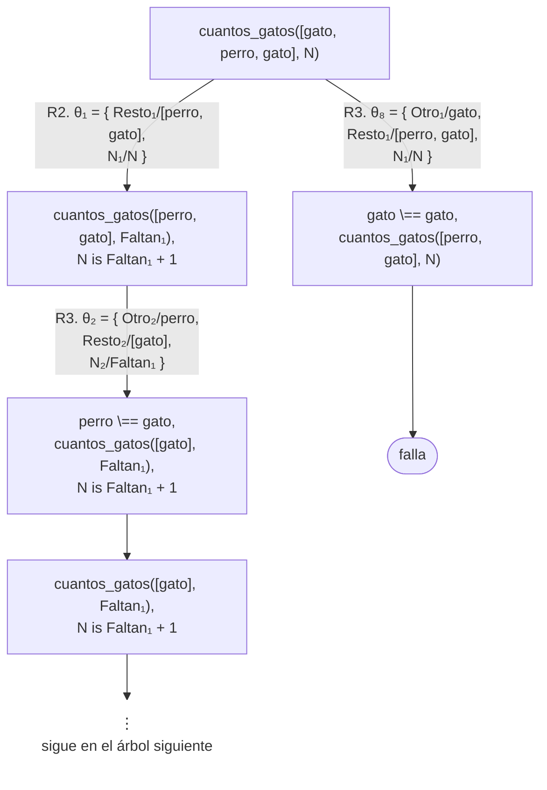
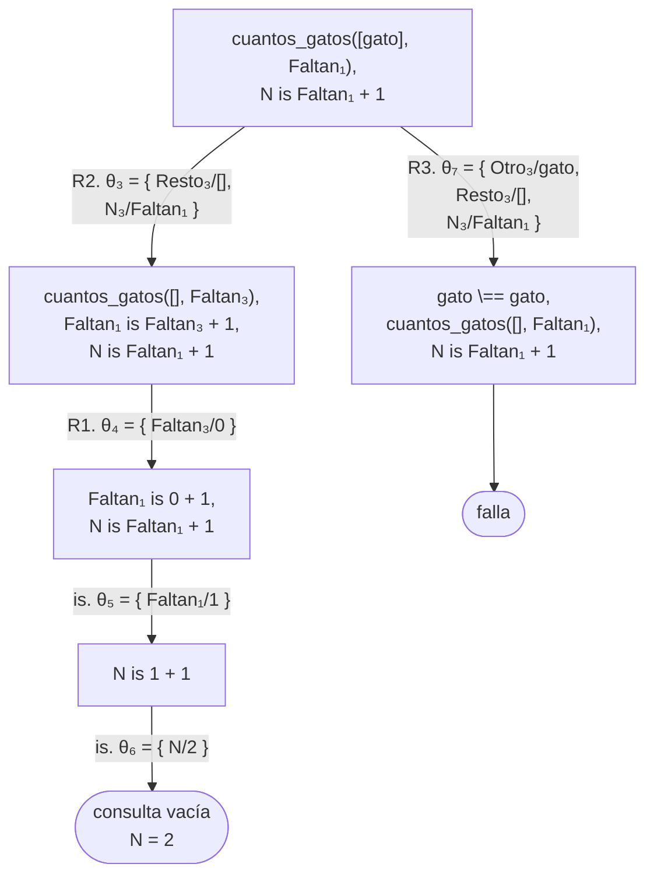
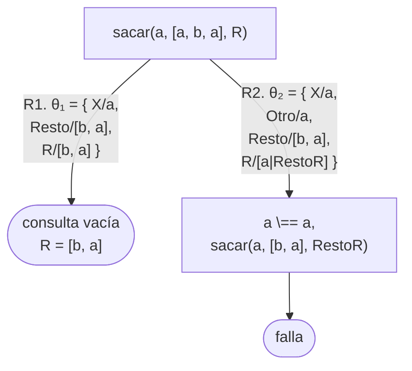
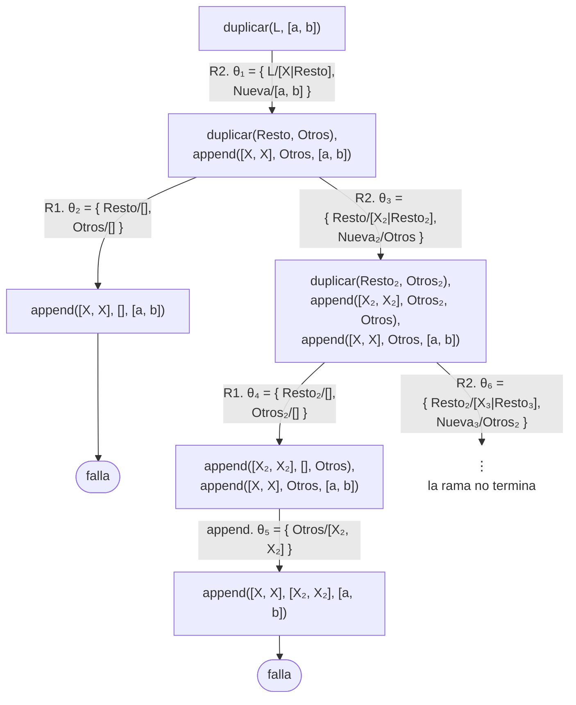
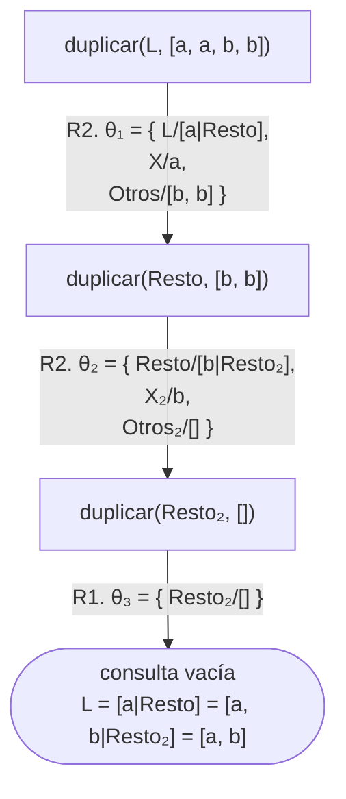
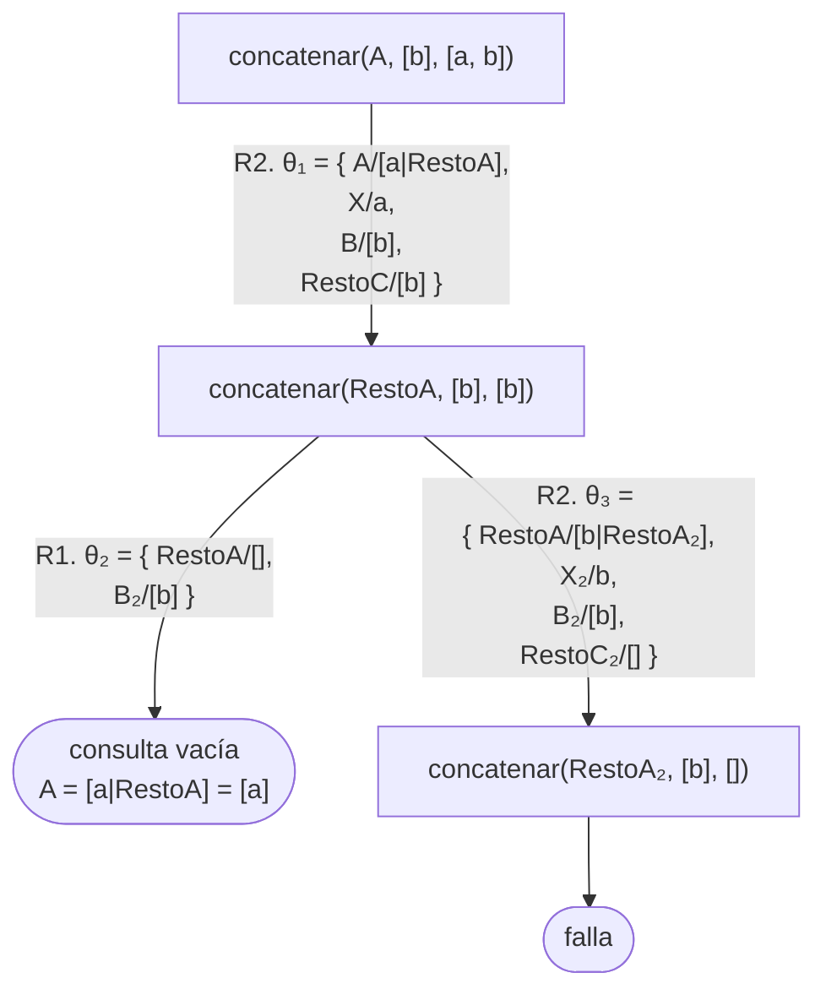

# Soluciones del capítulo 7 — Listas

El código de esta página está en `ejemplos/capitulo-07/soluciones.pl` y pasa sus
pruebas.

## 1

```prolog
?- [a, b, c] = [X|Y].
X = a,
Y = [b, c].

?- [a] = [X, Y].
false.
```

La segunda unificación falla porque `[X, Y]` es una lista de **exactamente dos**
elementos, y `[a]` tiene uno. La coma y la barra no son equivalentes: `[X, Y]`
fija la longitud de la lista; `[X|Y]` no.

## 2

```prolog
?- member(logica, [logica, algebra, analisis]).
true ;
false.
```

## 3

<!-- ejemplo: capitulo-07/soluciones.pl predicado: primero_y_ultimo/3 consulta: primero_y_ultimo([ana, luis, eva], P, U). -->
```prolog
%!  primero_y_ultimo(?L, ?P, ?U) is nondet.
%
%   P es el primero de L y U el último. Con L libre, enumera listas cada vez
%   más largas que empiezan con P y terminan con U, sin fin.
primero_y_ultimo([P|Resto], P, U) :-
    last([P|Resto], U).
```

El primer elemento se obtiene por la unificación de la cabeza; el último, con
`last/2`. La cabeza exige `[P|Resto]` para que el predicado no se cumpla con la
lista vacía, que no tiene primer ni último elemento.

El encabezado es `primero_y_ultimo(?L, ?P, ?U) is nondet`. Con `L` ligada, `P`
y `U` reciben el primero y el último, y la respuesta es una o ninguna: la lista
vacía no tiene ninguno de los dos. Con `L` libre, la relación también tiene
sentido, y el encabezado lo registra con `?`: `last/2` enumera listas cada vez
más largas que empiezan con `P` y terminan con `U`, sin fin, como `pertenece/2` en
la advertencia de la [sección 7.6](index.md#76-una-relacion-varios-sentidos). Por eso el conteo es `nondet`, y la descripción
advierte que en ese modo la enumeración no termina.

## 4

<!-- ejemplo: capitulo-07/soluciones.pl predicado: sin_el_primero/2 consulta: sin_el_primero([ana, luis, eva], R). -->
```prolog
% sin_el_primero(L, R): R es L sin su primer elemento. No requiere recursión:
% la unificación de la cabeza descompone la lista.
sin_el_primero([_|Resto], Resto).
```

No requiere recursión, por la siguiente razón: la lista ya está descompuesta en
la cabeza de la cláusula. Eliminar el primer elemento no implica un recorrido;
es suficiente una unificación.

## 5

<!-- ejemplo: capitulo-07/soluciones.pl predicado: cuantos_gatos/2 consulta: cuantos_gatos([gato, perro, gato], N). -->
```prolog
%!  cuantos_gatos(+L, -N) is det.
%
%   N es la cantidad de apariciones de gato en L.
cuantos_gatos([], 0).
cuantos_gatos([gato|Resto], N) :-
    cuantos_gatos(Resto, Faltan),
    N is Faltan + 1.
cuantos_gatos([Otro|Resto], N) :-
    Otro \== gato,
    cuantos_gatos(Resto, N).
```

Tiene tres cláusulas: la lista vacía, el caso en que el primer elemento es
`gato`, y el caso en que no lo es. La condición `Otro \== gato` de la tercera es
imprescindible: sin ella, cada aparición de `gato` se resolvería por las dos
cláusulas, y se obtendrían respuestas de más.

```prolog
?- cuantos_gatos([gato, perro, gato], N).
N = 2 ;
false.
```

El árbol de derivación muestra el trabajo de esa condición. Con las cláusulas
numeradas en el orden del programa, y las copias de `N` renombradas (`N₁`,
`N₂`, …) porque la consulta tiene su propia `N`:

| | |
|---|---|
| R1 | `cuantos_gatos([], 0).` |
| R2 | `cuantos_gatos([gato\|Resto], N) :- cuantos_gatos(Resto, Faltan), N is Faltan + 1.` |
| R3 | `cuantos_gatos([Otro\|Resto], N) :- Otro \== gato, cuantos_gatos(Resto, N).` |

El árbol está dibujado en dos partes por su altura; la primera llega hasta el
segundo `gato`:



El segundo árbol empieza en el último nodo del primero:



En cada `gato`, las cabezas de R2 y de R3 unifican, y se abren dos ramas. La de
R3 muere de inmediato en `gato \== gato`, una prueba predefinida que no se
cumple: su arco no lleva número de cláusula, y la rama termina en una hoja de
falla. En `perro` solo unifica R3, y la prueba `perro \== gato` se cumple: el
objetivo desaparece de la consulta. Los dos `is` quedan pendientes a la derecha
y se resuelven al cerrar el caso base, como en la
[sección 7.4](index.md#74-contar-durante-el-recorrido). Las dos ramas de R3
sobre un `gato` son las alternativas pendientes que explican el `;` y el
`false.` del transcripto: el predicado tiene una sola respuesta, aunque el
toplevel deba intentar esas ramas para confirmarlo.

Como en la solución 8, `\==` supone que los elementos de la lista ya tienen
valor: compara los términos tal como están escritos, y una variable sin valor se
considera distinta de `gato`.

## 6

<!-- ejemplo: capitulo-07/soluciones.pl predicado: empieza_con/2 consulta: empieza_con([ana, luis, eva], [ana, luis]). -->
```prolog
%!  empieza_con(+L, ?Principio) is nondet.
%
%   L empieza con los elementos de Principio.
empieza_con(L, Principio) :-
    append(Principio, _, L).
```

No usa recursión, y es una aplicación directa de la [sección 7.6](index.md#76-una-relacion-varios-sentidos): "L comienza con
Principio" equivale a "existe una lista que, concatenada a continuación de
Principio, produce L". `append/3` responde esa consulta en sentido inverso.

## 7

<!-- ejemplo: capitulo-07/soluciones.pl predicado: reversa/2 consulta: reversa([ana, luis, eva], R). -->
```prolog
%!  reversa(+L, -R) is det.
%!  reversa(-L, +R) is semidet.
%
%   R es L en orden inverso, sin usar reverse/2. Con L libre, después de la
%   respuesta no termina.
reversa([], []).
reversa([X|Resto], R) :-
    reversa(Resto, RestoAlReves),
    append(RestoAlReves, [X], R).
```

Invierte el resto y concatena el primer elemento **al final**. Es correcta, y es
la versión que se obtiene de manera más directa.

La segunda línea del encabezado registra el otro modo: con `R` ligada y `L`
libre hay una respuesta, `reversa(L, [a, b])` da `L = [b, a]`, pero al pedir
otra el predicado no termina, como `duplicar/2` del ejercicio 13.

Tiene una desventaja, que se analiza en el [capítulo 17](../capitulo-17-rendimiento/index.md): por cada elemento,
`append/3` recorre nuevamente toda la lista para agregarlo al final. Con listas
largas, el costo es significativo. La versión eficiente usa un acumulador, y se
presenta en el [capítulo 8](../capitulo-08-aritmetica/index.md).

## 8

<!-- ejemplo: capitulo-07/soluciones.pl predicado: sacar/3 consulta: sacar(luis, [ana, luis, eva], R). -->
```prolog
%!  sacar(+X, +L, -R) is semidet.
%
%   R es L sin la primera aparición de X.
sacar(X, [X|Resto], Resto).
sacar(X, [Otro|Resto], [Otro|RestoR]) :-
    Otro \== X,
    sacar(X, Resto, RestoR).
```

La primera cláusula elimina el elemento cuando es el primero de la lista. La
segunda lo conserva y continúa la búsqueda. La condición `Otro \== X` garantiza
que se elimine **la primera aparición** y no otra: sin ella, Prolog entregaría
también las soluciones que eliminan las apariciones siguientes.

```prolog
?- sacar(a, [a, b, a], R).
R = [b, a] ;
false.
```

El árbol de derivación, con las dos cláusulas numeradas R1 y R2, muestra que la
segunda `a` nunca llega a eliminarse. Las dos cabezas unifican con la consulta,
pero la rama de R2 muere en la prueba `a \== a`, que no se cumple:



La rama de R2 es la alternativa pendiente que explica el `;` del transcripto;
al pedir otra respuesta, la prueba falla y Prolog responde `false.`. Sin la
condición, esa rama continuaría con `sacar(a, [b, a], RestoR)` y produciría
`R = [a, b]`, la lista sin la segunda `a`.

Este predicado está pensado para consultas en las que los elementos de la lista
ya tienen valor. `\==` compara los términos tal como están escritos en ese
momento, de modo que si la lista contiene una variable sin valor, la comparación
se cumple —una variable y `luis` son términos distintos— y la búsqueda continúa
como si fueran diferentes. Sobre `sacar(luis, [X, luis], R)` eso produce una
respuesta de más, con `X` sin determinar. La [sección 10.6](../capitulo-10-negacion-como-falla/index.md#106-con-variables-libres) explica por qué.

## 9

<!-- ejemplo: capitulo-07/soluciones.pl predicado: es_sublista/2 consulta: es_sublista([luis, eva], [ana, luis, eva, sofia]). -->
```prolog
%!  es_sublista(?S, +L) is nondet.
%
%   Los elementos de S aparecen contiguos y en orden en L.
es_sublista(S, L) :-
    append(_, Atras, L),
    append(S, _, Atras).
```

Usa dos `append/3` y ninguna recursión. El primero descarta un prefijo de `L` y
conserva el resto en `Atras`; el segundo exige que `Atras` comience con `S`. En
conjunto expresan: "en alguna posición de L, de manera contigua, están los
elementos de S".

Si no se exige que los elementos sean contiguos, sino solo que aparezcan en `L`
en el mismo orden, la relación es la de **subsecuencia**, y se escribe con
recursión:

<!-- ejemplo: capitulo-07/soluciones.pl predicado: es_subsecuencia/2 consulta: es_subsecuencia([ana, eva], [ana, luis, eva]). -->
```prolog
%!  es_subsecuencia(?S, +L) is nondet.
%
%   Los elementos de S aparecen en L en el mismo orden, no necesariamente
%   contiguos. Con S libre, enumera cada subsecuencia de L una sola vez.
es_subsecuencia([], []).
es_subsecuencia([X|Resto], [X|Otros]) :-
    es_subsecuencia(Resto, Otros).
es_subsecuencia(S, [_|Otros]) :-
    es_subsecuencia(S, Otros).
```

La primera cláusula dice que la lista vacía es la única subsecuencia de la lista
vacía. La segunda toma el primer elemento de `L` para `S`; la tercera lo
saltea. Recorrer `L` decidiendo, elemento por elemento, si se toma o se saltea
produce cada subsecuencia una sola vez:

```prolog
?- es_subsecuencia([ana, eva], [ana, luis, eva]).
true ;
false.

?- es_subsecuencia([eva, ana], [ana, luis, eva]).
false.

?- es_subsecuencia(S, [a, b]).
S = [a, b] ;
S = [a] ;
S = [b] ;
S = [].
```

## 10

```prolog
?- length(L, 2).
L = [_, _].
```

La respuesta es una lista de dos elementos **sin determinar**: dos variables sin
instanciar. El resultado es correcto: la consulta pregunta qué listas tienen
longitud 2, y la respuesta es cualquier lista de dos elementos, cualesquiera
sean.

Es la misma idea de la [sección 7.6](index.md#76-una-relacion-varios-sentidos). `length/2` no es un procedimiento que
cuenta: es una relación entre una lista y un número, y se la puede consultar
desde cualquiera de sus dos argumentos.

## 11

- **a** es la plantilla 11, "todos los elementos cumplen": el caso base es la
  lista vacía y tiene éxito, y cada elemento se somete a una prueba de la que no
  se obtiene ningún resultado.
- **b** es la plantilla 10, "buscar un elemento que cumple": no tiene caso base
  para `[]`, y la primera cláusula termina la búsqueda en cuanto encuentra un
  elemento que pasa la prueba.
- **c** es la plantilla 12, "construir una lista durante el recorrido": tiene un
  argumento de salida, y la lista resultante se escribe en la cabeza.

Se distinguen mirando dos cosas: si hay una cláusula para `[]` y si hay un
segundo argumento que se construye.

## 12

<!-- ejemplo: capitulo-07/soluciones.pl predicado: todos_gatos/1 algun_gato/1 consulta: todos_gatos([gato, gato]). -->
```prolog
%!  todos_gatos(?L) is nondet.
%
%   Todos los elementos de L son gato. Plantilla 11. Con L libre, enumera
%   listas de gatos de largo creciente, sin fin.
todos_gatos([]).
todos_gatos([gato|Resto]) :-
    todos_gatos(Resto).

%!  algun_gato(?L) is nondet.
%
%   Alguno de los elementos de L es gato. Plantilla 10. Con L libre, enumera
%   listas con gato en cada posición, sin fin.
algun_gato([gato|_]).
algun_gato([_|Resto]) :-
    algun_gato(Resto).
```

En los dos casos la condición "ser gato" se impone por unificación en la cabeza,
escribiendo `gato` en la posición del elemento, sin ningún objetivo en el cuerpo.

Sobre la lista vacía las respuestas son opuestas, y las dos son correctas:

```prolog
?- todos_gatos([]).
true.

?- algun_gato([]).
false.
```

`todos_gatos([])` se cumple porque no hay ningún elemento que incumpla la
condición: sobre una lista sin elementos, "todos cumplen" no afirma nada que
pueda ser falso. `algun_gato([])` falla porque afirma que **existe** un elemento
con cierta propiedad, y no hay ninguno.

La diferencia está escrita en el programa: `todos_gatos/1` tiene una cláusula
para `[]` y `algun_gato/1` no.

Los dos encabezados llevan `?L` y `nondet`: con la lista libre, los dos
predicados enumeran listas sin fin, `todos_gatos/1` las de gatos de largo
creciente y `algun_gato/1` las que tienen `gato` en cada posición. Con la
lista ligada, `todos_gatos/1` responde una vez o ninguna, y `algun_gato/1`
una vez por cada gato.

## 13

El predicado construye la lista **en el cuerpo**, con `append/3`, y para hacerlo
necesita el resultado de la llamada recursiva antes de armar el suyo. No es
incorrecto en cuanto a las respuestas, pero contradice la plantilla 12 y no
cumple la segunda línea de su encabezado: con la primera lista libre, la llamada
recursiva recibe dos listas sin determinar y genera candidatos sin fin, de modo
que `duplicar(L, [a, b])` no termina.

El árbol de derivación de esa consulta, con las dos cláusulas del enunciado
numeradas R1 y R2, lo muestra. `append/3` es predefinido: su arco no lleva
número de cláusula, y cuando no tiene ninguna respuesta la rama termina en una
hoja de falla:



La llamada recursiva `duplicar(Resto, Otros)` recibe dos variables libres, y
por eso admite las dos cláusulas en cada nivel: R1 cierra con listas vacías y
R2 vuelve a plantear la misma consulta con variables nuevas, sin fin. El
`append/3` que debía armar el resultado queda siempre a la derecha, y recién
cuando una rama cierra puede comprobar que su lista no coincide con `[a, b]`:
en la primera rama, `[X, X]` exige dos elementos iguales y `a` y `b` no lo
son; en la segunda, la lista tendría cuatro elementos. La rama de R2 sigue
produciendo candidatos más largos, y ninguno coincide.

<!-- ejemplo: capitulo-07/soluciones.pl predicado: duplicar/2 consulta: duplicar([a, b], R). -->
```prolog
%!  duplicar(+L, -R) is det.
%!  duplicar(-L, +R) is semidet.
%
%   R tiene cada elemento de L repetido dos veces.
%   El resultado se escribe en la cabeza, no se arma en el cuerpo.
duplicar([], []).
duplicar([X|Resto], [X, X|Otros]) :-
    duplicar(Resto, Otros).
```

```prolog
?- duplicar([a, b], R).
R = [a, a, b, b].
```

La cabeza `[X, X|Otros]` aporta los dos elementos de esta llamada y deja el
resto sin determinar, que es exactamente lo que describe la [sección 7.5](index.md#75-construir-una-lista-durante-el-recorrido-de-otra).

Con esta versión, la consulta inversa termina:

```prolog
?- duplicar(L, [a, a, b, b]).
L = [a, b].
```

El árbol es una sola rama. La misma cabeza `[X, X|Otros]` que en el otro modo
construye el resultado, aquí **desarma** el segundo argumento, de a dos
elementos por nivel, y la primera lista se arma en la cabeza a partir de lo que
desarma. En el último nodo R2 no abre arco, porque `[]` no unifica con
`[X, X|Otros]`, y por eso la respuesta termina en punto:



## 14

| Consulta | Resultado |
|---|---|
| `concatenar([a], [b], R).` | una respuesta, `R = [a, b]`, y termina sin alternativas |
| `concatenar(A, [b], [a, b]).` | una respuesta, `A = [a]`, pero deja una alternativa abierta |
| `concatenar([a], B, [a, b]).` | una respuesta, `B = [b]` |
| `concatenar(A, B, [a, b]).` | tres respuestas: las tres particiones |

Las cuatro terminan, porque en todas hay una lista completa por la cual
recorrer: la primera o la tercera. La advertencia de la [sección 7.6](index.md#76-una-relacion-varios-sentidos) se aplica al
caso que no está en esta tabla, `concatenar(A, B, C)` con las tres sin determinar,
que produce particiones sin fin.

La segunda consulta requiere una observación: responde `A = [a] ;` y recién al pedir otra
respuesta contesta `false.` Que quede una alternativa abierta no significa que
haya otra respuesta.

<!-- contexto: capitulo-07/recorrer.pl -->
```prolog
?- concatenar(A, [b], [a, b]).
A = [a] ;
false.
```

El árbol de derivación, con las dos cláusulas de `concatenar/3` numeradas R1 y R2
como en la [sección 7.5](index.md#75-construir-una-lista-durante-el-recorrido-de-otra),
muestra esa alternativa. En la raíz solo unifica R2, porque R1 exigiría que
`[b]` y `[a, b]` fueran la misma lista. En el segundo nodo unifican las dos: R1
da la respuesta, y R2 queda pendiente; al pedir otra respuesta, esa rama llega
a `concatenar(RestoA₂, [b], [])`, donde ninguna cabeza unifica:



La alternativa abierta es una rama del árbol que todavía no se recorrió, no una
respuesta: Prolog no puede saber que fallará hasta que la recorre.

## 15

<!-- ejemplo: capitulo-07/soluciones.pl predicado: segundo/2 consulta: segundo([ana, luis, eva], X). -->
```prolog
% segundo(L, X): X es el segundo elemento de L.
segundo([_, X|_], X).
```

Un solo hecho, sin cuerpo y sin recursión: es la plantilla 7 del [capítulo 4](../capitulo-04-terminos-y-unificacion/index.md)
aplicada a una lista. El patrón `[_, X|_]` describe "una lista con por lo menos
dos elementos, del cual interesa el segundo".

```prolog
?- segundo([ana], X).
false.
```

Responde `false.` porque `[ana]` no unifica con `[_, X|_]`: ese patrón exige dos
elementos antes de la barra, y la lista tiene uno. No es un error ni una lista
mal formada: la lista no tiene segundo elemento.

## 16

```prolog
% Una sola respuesta, aunque el elemento aparezca dos veces: la condición
% Otro \== X impide saltear la primera aparición.
test(sacar_la_primera_aparicion, all(R == [[b, a]])) :-
    sacar(a, [a, b, a], R).

test(sacar_lo_que_no_esta, [fail]) :-
    sacar(z, [a, b], _).

test(sacar_de_la_vacia, [fail]) :-
    sacar(a, [], _).
```

La primera prueba es la que requiere más atención, porque se podría
suponer que `sacar(a, [a, b, a], R)` tiene dos respuestas, una por cada `a`. No
las tiene: la condición `Otro \== X` de la segunda cláusula impide que el
recorrido saltee una aparición del elemento buscado, que es justamente lo que
hace que se elimine **la primera**. El árbol de derivación de esa consulta está
en la [solución 8](#8): la rama que eliminaría la segunda `a` muere en
`a \== a`.

La tercera prueba documenta el caso límite: sobre la lista vacía no hay cláusula
aplicable, y el predicado falla.

## 17

<!-- ejemplo: capitulo-07/soluciones.pl predicado: materias/1 materia_en/2 consulta: materia_en(3, M). -->
```prolog
% materias(L): L es la lista de materias, en orden.
materias([logica, algebra, fisica, quimica]).

%!  materia_en(?N, ?M) is nondet.
%
%   M es la materia que ocupa la posición N de la lista, contando desde 1.
materia_en(N, M) :-
    materias(Lista),
    nth1(N, Lista, M).
```

La regla tiene la misma forma que `en_el_puesto/2`: obtiene la lista del hecho
y deja que `nth1/3` relacione la posición con el elemento. Como `nth1/3` admite
los dos sentidos, `materia_en/2` también los admite, sin ninguna cláusula
adicional:

```prolog
?- materia_en(3, M).
M = fisica.

?- materia_en(N, fisica).
N = 3 ;
false.
```

Con la posición dada, la respuesta es una sola y no quedan alternativas. Con la
materia dada, `nth1/3` recorre la lista comparando cada elemento con `fisica`;
después de encontrarlo en la posición 3 queda por examinar el resto de la
lista, y por eso la respuesta termina en `;` y `false.`

```prolog
?- nth1(N, [a, b, a], a).
N = 1 ;
N = 3.
```

`a` aparece dos veces, y la consulta inversa da una respuesta por cada
aparición, en el orden de la lista. Es la misma situación de `pertenece/2` en la
[sección 7.3](index.md#73-recorrer-una-lista): una respuesta por cada
demostración. Por eso el encabezado declara `nondet` y no `semidet`: con la
materia dada, una lista con repeticiones produce más de una posición.

## 18

```prolog
?- [[a, b], c] = [X|Y].
X = [a, b],
Y = [c].

?- [[a, b], c] = [[X|Y]|Z].
X = a,
Y = [b],
Z = [c].

?- [fecha(2021, 5, 3), ana] = [fecha(A, M, D)|R].
A = 2021,
M = 5,
D = 3,
R = [ana].

?- [mascota(gato, felix)] = [mascota(E, N), Otro].
false.

?- [a, b|c] = [X|Y].
X = a,
Y = [b|c].

?- [a, b|c] = [a, b, c].
false.
```

En la primera, el primer elemento es la lista `[a, b]` completa: la barra separa
el primer elemento del resto sin examinar qué clase de término es ese elemento.
La segunda aplica el patrón `[X|Y]` **dentro** del primer elemento, y por eso
`X` y `Y` descomponen `[a, b]`, mientras `Z` recibe el resto de la lista
exterior. La tercera combina las reglas del
[capítulo 4](../capitulo-04-terminos-y-unificacion/index.md): el primer elemento
unifica como cualquier término compuesto, argumento por argumento. La cuarta
falla por la longitud, igual que `[a] = [X, Y]` del ejercicio 1: la lista de la
izquierda tiene un elemento y el patrón de la derecha exige dos.

Las dos últimas muestran que la unificación no verifica que un término sea una
lista. `[a, b|c]` es el término `'[|]'(a, '[|]'(b, c))`: dos términos
compuestos anidados, con el nombre y la aridad de toda lista no vacía, y la
consulta los unifica con `[X|Y]` como a cualquier otro par de términos. Pero la
definición de la [sección 7.1](index.md#71-una-lista-es-un-termino) exige que el
segundo argumento sea **una lista**, y al final de la cadena el segundo
argumento es `c`, un átomo, en lugar de `[]`. Por eso `[a, b|c]` no es una lista
y no unifica con `[a, b, c]`, cuyo final es `[]`: las dos coinciden en `a` y en
`b`, y la unificación falla al comparar `c` con `[c]`. Un predicado que recorre
listas con las plantillas del capítulo falla sobre ese término, porque al llegar
a `c` no lo alcanza ni el caso base `[]` ni el caso recursivo `[X|Resto]`.

## 19

<!-- ejemplo: capitulo-07/soluciones.pl predicado: suffix/2 consulta: suffix(S, [a1, b1, c1, d1]). -->
```prolog
%!  suffix(?Xs, +Ys) is nondet.
%
%   Xs es un sufijo de Ys: los últimos elementos de Ys, en el mismo orden.
%   Con Xs libre, enumera los sufijos de Ys del más largo al más corto.
suffix(Xs, Xs).
suffix(Xs, [_|Ys]) :-
    suffix(Xs, Ys).
```

El nombre y el orden de los argumentos son los del programa 3.13 de
*The Art of Prolog*, de Sterling y Shapiro. La primera cláusula dice que toda
lista es sufijo de sí misma; la segunda descarta el primer elemento y busca el
sufijo en el resto. Es la plantilla 10 con la condición en la cabeza: la
búsqueda termina cuando `Xs` es igual a la lista que se recorre.

```prolog
?- suffix([b1, c1], [a1, b1, c1, d1]).
false.

?- suffix(S, [a1, b1, c1, d1]).
S = [a1, b1, c1, d1] ;
S = [b1, c1, d1] ;
S = [c1, d1] ;
S = [d1] ;
S = [] ;
false.
```

`[b1, c1]` está en la lista, contiguo y en orden, pero no al final: es una
sublista, como en el ejercicio 9, y no un sufijo. Los sufijos aparecen del más
largo al más corto porque la cláusula que responde, la primera, se intenta en
cada nivel antes de descartar otro elemento. El `false.` final es el intento de
la segunda cláusula sobre `[]`, que no unifica con `[_|Ys]`.

Como `empieza_con/2` del ejercicio 6, el sufijo también se obtiene con
`append/3` y sin recursión: `Xs` es sufijo de `Ys` si alguna lista seguida de
`Xs` da `Ys`, es decir, `append(_, Xs, Ys)`. Sterling y Shapiro dan las dos
versiones; las respuestas son las mismas y en el mismo orden.

## 20

<!-- ejemplo: capitulo-07/soluciones.pl predicado: adjacent/3 consulta: adjacent(X, Y, [a, b, c]). -->
```prolog
%!  adjacent(?X, ?Y, +Zs) is nondet.
%
%   X e Y son elementos adyacentes de Zs: Y está inmediatamente después de X.
adjacent(X, Y, Zs) :-
    append(_, [X, Y|_], Zs).
```

Es la regla que Sterling y Shapiro escriben con `append/3` en
*The Art of Prolog*. El patrón `[X, Y|_]` del segundo argumento exige que la
parte final de `Zs` empiece con `X` seguido de `Y`, y `append/3`, consultado en
sentido inverso, prueba todas las maneras de partir `Zs`:

```prolog
?- adjacent(X, Y, [a, b, c]).
X = a,
Y = b ;
X = b,
Y = c ;
false.
```

Dos respuestas: una lista de tres elementos tiene dos pares de elementos
contiguos. La relación tiene orden, `Y` va después de `X`, de modo que
`adjacent(c, b, [a, b, c])` responde `false.` Para la relación simétrica, se
consulta en los dos órdenes.

## 21

<!-- ejemplo: capitulo-07/soluciones.pl predicado: selecciona/3 permuta/2 consulta: permuta([a, b, c], P). -->
```prolog
%!  selecciona(?X, +Xs, ?Ys) is nondet.
%!  selecciona(?X, ?Xs, +Ys) is nondet.
%
%   Ys es Xs sin una de las apariciones de X: una respuesta por cada
%   aparición. Con Ys dada y Xs libre, inserta X en cada posición de Ys.
selecciona(X, [X|Xs], Xs).
selecciona(X, [Y|Ys], [Y|Zs]) :-
    selecciona(X, Ys, Zs).

%!  permuta(+Xs, ?Ys) is nondet.
%
%   Ys es una permutación de Xs: elige el primer elemento con selecciona/3 y
%   permuta el resto. Una lista de n elementos distintos da n! respuestas.
permuta([], []).
permuta(Xs, [Z|Zs]) :-
    selecciona(Z, Xs, Ys),
    permuta(Ys, Zs).
```

`selecciona/3` es el `select/3` del programa 3.19 de *The Art of Prolog*, con
el mismo orden de argumentos; SWI-Prolog ya tiene un `select/3` predefinido, y
por eso el curso usa el nombre en castellano. Lo mismo ocurre con `permuta/2`,
que es el `permutation/2` del programa 3.20.

**a.** `selecciona/3` es `sacar/3` del ejercicio 8 sin la condición `Otro \== X`.
Sin esa condición, la segunda cláusula también se intenta cuando el primer
elemento es `X`, y el recorrido sigue hasta las apariciones siguientes:

```prolog
?- selecciona(E, [a, b, c, d, a], L).
E = a,
L = [b, c, d, a] ;
E = b,
L = [a, c, d, a] ;
E = c,
L = [a, b, d, a] ;
E = d,
L = [a, b, c, a] ;
E = a,
L = [a, b, c, d] ;
false.
```

`a` aparece dos veces en las respuestas, una por cada aparición en la
lista; las dos listas resultantes son distintas.

**b.** Con la segunda lista dada y la primera libre, `selecciona/3` **inserta** el
elemento en cada posición posible:

```prolog
?- selecciona(x, L, [a, b]).
L = [x, a, b] ;
L = [a, x, b] ;
L = [a, b, x] ;
false.
```

Es la misma relación leída en sentido inverso: `[a, b]` es lo que queda de
`L` al quitarle una `x`. La primera cláusula pone `x` al principio; la
segunda conserva el primer elemento de `[a, b]` y vuelve a plantear la
inserción en el resto. Sterling y Shapiro definen así su `insert/3`.

**c.** `permuta/2` elige con `selecciona/3` qué elemento va primero, de todas las
maneras posibles, y permuta lo que queda. Para tres elementos hay tres
elecciones del primero y, para cada una, dos permutaciones del resto:

```prolog
?- permuta([a, b, c], P).
P = [a, b, c] ;
P = [a, c, b] ;
P = [b, a, c] ;
P = [b, c, a] ;
P = [c, a, b] ;
P = [c, b, a] ;
false.
```

Sterling y Shapiro escriben la cláusula recursiva antes que el caso base;
aquí el caso base va primero, como en el resto del curso, y las respuestas
no cambian, porque `[]` no unifica con una lista no vacía. Si la lista
tiene elementos repetidos, las permutaciones se repiten:
`permuta([a, a], P)` da dos veces `P = [a, a]`, una por cada `a` elegida en
primer lugar. Con la primera lista libre, `selecciona/3` genera listas sin
fin, y por eso el encabezado exige `+Xs`.

## 22

<!-- ejemplo: capitulo-07/soluciones.pl predicado: substitute/4 consulta: substitute(b, 9, [a, b, c, d, b, b, c, 1], L). -->
```prolog
%!  substitute(+X, +Y, +Xs, -Ys) is det.
%
%   Ys es Xs con cada aparición de X reemplazada por Y.
substitute(_, _, [], []).
substitute(X, Y, [X|Xs], [Y|Ys]) :-
    substitute(X, Y, Xs, Ys).
substitute(X, Y, [Z|Xs], [Z|Ys]) :-
    Z \== X,
    substitute(X, Y, Xs, Ys).
```

El nombre y el orden de los argumentos son los del ejercicio 3.3(i) de
*The Art of Prolog*. Es la plantilla 12 con dos casos para cada elemento: si es
`X`, en el resultado va `Y`; si no lo es, va el mismo elemento. La condición
`Z \== X` cumple el mismo papel que en `sacar/3`: sin ella, la tercera cláusula
también aceptaría una aparición de `X` y la dejaría sin reemplazar.

```prolog
?- substitute(b, 9, [a, b, c, d, b, b, c, 1], L).
L = [a, 9, c, d, 9, 9, c, 1] ;
false.

?- substitute(0, a, [a, z], [a, z]).
true ;
false.

?- substitute(a, x, [a, b, a, c], [a, b, x, c]).
false.
```

La segunda consulta se cumple porque `0` no aparece en la lista, y no hay nada
que reemplazar. La tercera falla porque la primera `a` quedó sin reemplazar: es
la respuesta que la condición `\==` impide. El `;` y el `false.` de las dos
primeras no indican otra respuesta: corresponden a la tercera cláusula, que
queda por intentar después de cada uso de la segunda, como la rama de R2 en la
[solución 8](#8).

## 23

<!-- ejemplo: capitulo-07/soluciones.pl predicado: elimina/3 consulta: elimina([a, b, c, b, d], b, L). -->
```prolog
%!  elimina(+Xs, +X, -Ys) is det.
%
%   Ys es Xs sin ninguna aparición de X.
elimina([], _, []).
elimina([X|Xs], X, Ys) :-
    elimina(Xs, X, Ys).
elimina([Y|Xs], X, [Y|Ys]) :-
    Y \== X,
    elimina(Xs, X, Ys).
```

Es el `delete/3` del programa 3.18 de *The Art of Prolog*, con el mismo orden de
argumentos: primero la lista, después el elemento. SWI-Prolog tiene un
`delete/3` predefinido, y por eso el curso usa el nombre en castellano.

```prolog
?- elimina([a, b, c, b, d], b, L).
L = [a, c, d] ;
false.

?- elimina([a, b, c], c, [a, b]).
true ;
false.
```

La diferencia con `sacar/3` del ejercicio 8 está en la segunda cláusula. En
`sacar/3`, cuando el primer elemento es el buscado, el resultado es el resto
**tal como está**, y la recursión termina. En `elimina/3` la recursión continúa
sobre el resto, de modo que también se eliminan las apariciones siguientes; por
eso `elimina/3` necesita el caso base `[]`, que `sacar/3` no tiene: llegar al
final de la lista no es un fracaso, sino el fin del recorrido. Por la misma
razón, `elimina([a, b], z, L)` responde `L = [a, b]`, mientras que
`sacar(z, [a, b], R)` falla.

## 24

<!-- ejemplo: capitulo-07/soluciones.pl predicado: ocurre/2 consulta: ocurre(E, [1, [a, b], [d, [a, 2]], 6]). -->
```prolog
%!  ocurre(?X, +L) is nondet.
%
%   X aparece en algún nivel de L, que puede contener listas anidadas: es
%   un elemento de L o aparece en un elemento de L que es una lista. Una
%   respuesta por cada aparición; las listas internas también son respuestas.
ocurre(X, [X|_]).
ocurre(X, [Lista|_]) :-
    ocurre(X, Lista).
ocurre(X, [_|Resto]) :-
    ocurre(X, Resto).
```

Es `pertenece/2` de la [sección 7.3](index.md#73-recorrer-una-lista) con una
cláusula más, la segunda, que desciende **dentro** del primer elemento. Esa
cláusula no necesita averiguar si el elemento es una lista: si no lo es, como
`1` o `d`, la llamada `ocurre(X, 1)` no unifica con ninguna cabeza, porque las
tres esperan una lista no vacía, y la rama falla. La primera cláusula, por su
parte, responde con el elemento completo, sea o no una lista; por eso las
listas internas también son respuestas:

```prolog
?- ocurre(E, [1, [a, b], [d, [a, 2]], 6]).
E = 1 ;
E = [a, b] ;
E = a ;
E = b ;
E = [d, [a, 2]] ;
E = d ;
E = [a, 2] ;
E = a ;
E = 2 ;
E = 6 ;
false.

?- ocurre(a, [1, [a, b], [d, [a, 2]], 6]).
true ;
true ;
false.
```

El orden de las respuestas es el de las cláusulas: primero el elemento, después
lo que hay dentro de él, después el resto de la lista. `a` tiene dos respuestas
porque aparece dos veces, una en `[a, b]` y otra en `[a, 2]`: cada respuesta es
una demostración distinta, como `pertenece(ana, [ana, ana])` en la
[sección 7.3](index.md#73-recorrer-una-lista). La lista debe llegar completa y
sin variables, como indica el `+L` del encabezado: con una variable como
elemento, la segunda cláusula la trataría como una lista sin determinar y
generaría listas sin fin.

## 25

<!-- ejemplo: capitulo-07/soluciones.pl predicado: arbol_ejemplo/1 binary_tree/1 tree_member/2 lista_hojas/2 consulta: arbol_ejemplo(T), lista_hojas(T, Hojas). -->
```prolog
% arbol_ejemplo(T): T es el árbol binario de ejemplo.
arbol_ejemplo(tree(1, tree(2, void, tree(4, void, void)),
                   tree(3, tree(5, tree(7, void, void), void),
                        tree(6, void, void)))).

%!  binary_tree(+T) is semidet.
%
%   T es un árbol binario: void, o tree(Elemento, Izquierdo, Derecho) con
%   dos árboles binarios como subárboles.
binary_tree(void).
binary_tree(tree(_, Left, Right)) :-
    binary_tree(Left),
    binary_tree(Right).

%!  tree_member(?X, +T) is nondet.
%
%   X es el elemento de alguno de los nodos del árbol binario T. Enumera los
%   elementos en preorden: el nodo, después el subárbol izquierdo y después
%   el derecho.
tree_member(X, tree(X, _, _)).
tree_member(X, tree(_, Left, _)) :-
    tree_member(X, Left).
tree_member(X, tree(_, _, Right)) :-
    tree_member(X, Right).

%!  lista_hojas(+T, -Hojas) is det.
%
%   Hojas es la lista de los elementos de las hojas de T, de izquierda a
%   derecha. Una hoja es un nodo con los dos subárboles vacíos; las dos
%   últimas cláusulas excluyen ese caso con \==.
lista_hojas(void, []).
lista_hojas(tree(X, void, void), [X]).
lista_hojas(tree(_, Left, Right), Hojas) :-
    Left \== void,
    lista_hojas(Left, HojasL),
    lista_hojas(Right, HojasR),
    append(HojasL, HojasR, Hojas).
lista_hojas(tree(_, void, Right), Hojas) :-
    Right \== void,
    lista_hojas(Right, Hojas).
```

La representación, `tree(Elemento, Izquierdo, Derecho)` y `void`, y los nombres
`binary_tree/1` y `tree_member/2` son los de los programas 3.23 y 3.24 de
*The Art of Prolog*. `lista_hojas/2` no está en el
libro.

**a.** `binary_tree/1` tiene un caso por cada forma de un árbol, como un predicado
sobre listas tiene uno por cada forma de una lista. La diferencia es que la
cláusula recursiva hace **dos** llamadas, una por subárbol:

```prolog
?- binary_tree(tree(1, void, hoja)).
false.
```

Falla porque `hoja` no es `void` ni un término `tree/3`.

**b.** `tree_member/2` tiene tres cláusulas: el elemento está en el nodo, en el
subárbol izquierdo o en el derecho. Con `X` libre, la primera cláusula da el
nodo antes de descender, y la segunda se intenta antes que la tercera; por
eso los elementos del árbol de ejemplo aparecen en el orden
1, 2, 4, 3, 5, 7, 6, el del recorrido en preorden del ejercicio 26. Sobre un
árbol más pequeño:

```prolog
?- tree_member(X, tree(a, tree(b, void, void), tree(c, void, void))).
X = a ;
X = b ;
X = c ;
false.
```

**c.** Una hoja es `tree(X, void, void)`, y su lista es `[X]`. Una hoja también
unifica con la cabeza `tree(_, Left, Right)` del caso general, y ese caso,
sobre dos subárboles vacíos, produciría una segunda respuesta, `[]`. Las dos
últimas cláusulas lo impiden con `\==`: la tercera exige un subárbol
izquierdo no vacío, y la cuarta, un izquierdo vacío y un derecho no vacío.
Entre las cuatro cubren cada forma de árbol una sola vez:

```prolog
?- arbol_ejemplo(T), lista_hojas(T, Hojas).
T = tree(1, tree(2, void, tree(4, void, void)), tree(3, tree(5, tree(7, void, void), void), tree(6, void, void))),
Hojas = [4, 7, 6] ;
false.
```

El `;` y el `false.` corresponden a las cláusulas que quedan por intentar
sobre la última hoja, cuyas condiciones `\==` fallan: la respuesta es una
sola.

## 26

<!-- ejemplo: capitulo-07/soluciones.pl predicado: preorder/2 inorder/2 postorder/2 consulta: arbol_ejemplo(T), preorder(T, Pre). -->
```prolog
%!  preorder(+T, -Xs) is det.
%
%   Xs es el recorrido en preorden de T: el nodo, el subárbol izquierdo y el
%   derecho.
preorder(void, []).
preorder(tree(X, L, R), Xs) :-
    preorder(L, Ls),
    preorder(R, Rs),
    append([X|Ls], Rs, Xs).

%!  inorder(+T, -Xs) is det.
%
%   Xs es el recorrido en inorden de T: el subárbol izquierdo, el nodo y el
%   derecho.
inorder(void, []).
inorder(tree(X, L, R), Xs) :-
    inorder(L, Ls),
    inorder(R, Rs),
    append(Ls, [X|Rs], Xs).

%!  postorder(+T, -Xs) is det.
%
%   Xs es el recorrido en postorden de T: el subárbol izquierdo, el derecho
%   y el nodo.
postorder(void, []).
postorder(tree(X, L, R), Xs) :-
    postorder(L, Ls),
    postorder(R, Rs),
    append(Rs, [X], Rs1),
    append(Ls, Rs1, Xs).
```

Son los tres recorridos del programa 3.27 de *The Art of Prolog*, con los mismos
nombres. Los tres tienen la misma estructura: recorren los dos subárboles y unen
los resultados con `append/3`. Solo cambia el lugar del elemento del nodo:
delante de los dos subárboles, entre ellos o detrás de ellos. El recorrido del
árbol vacío es la lista vacía.

```prolog
?- arbol_ejemplo(T), preorder(T, Pre), inorder(T, In), postorder(T, Post).
T = tree(1, tree(2, void, tree(4, void, void)), tree(3, tree(5, tree(7, void, void), void), tree(6, void, void))),
Pre = [1, 2, 4, 3, 5, 7, 6],
In = [2, 4, 1, 7, 5, 3, 6],
Post = [4, 2, 7, 5, 6, 3, 1].
```

La respuesta termina en punto: en cada llamada, `void` y `tree/3` no unifican
entre sí, de modo que solo una cláusula se aplica, y `append/3`, con la primera
lista completa, tiene una sola respuesta. En `postorder/2` el nodo se agrega al
final del recorrido derecho con `append(Rs, [X], Rs1)`, como en `reversa/2`
del ejercicio 7.
