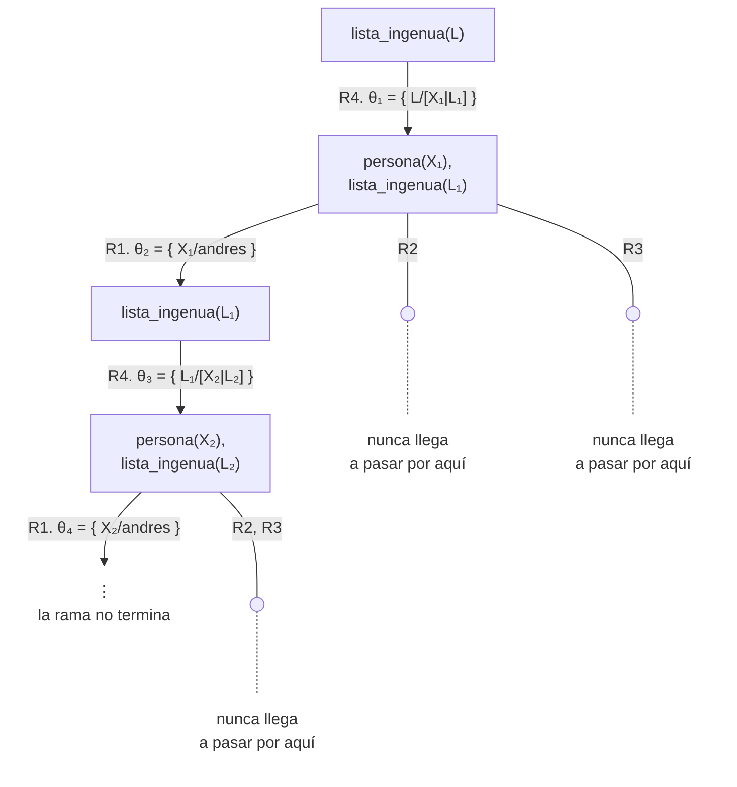
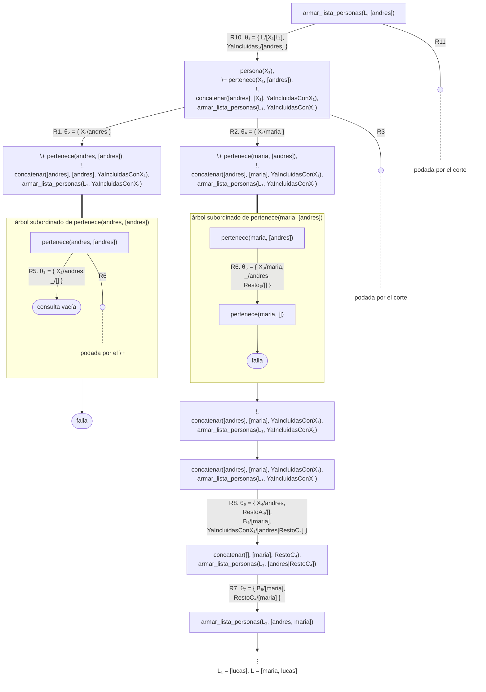

# Recolectar soluciones

Esta página continúa el [capítulo 10](index.md) después de la
[sección 10.8](index.md#108-prescindir-de), con las secciones
[10.9](#109-estrategia-para-recolectar-soluciones) y
[10.10](#1010-todas-las-materias-de-un-ciclo): una estrategia general para armar la lista de todas
las respuestas de una consulta, con un acumulador, `\+`, el corte y una
cláusula de cierre, y su aplicación a los alumnos que aprobaron todas las
materias de un ciclo de la carrera, una condición que se expresa con negación.
El ejemplo está en `recolectar.pl`, en `ejemplos/capitulo-10/`, con sus
pruebas.

## 10.9 Estrategia para recolectar soluciones

Una consulta como `persona(X)` entrega sus respuestas de a una, por
backtracking. Muchos problemas requieren en cambio todas las respuestas
juntas, en una lista: las personas registradas, las que viven en una ciudad,
las editoriales de un catálogo. Esta sección presenta una estrategia para
armar esa lista con lo que el curso presentó hasta aquí. El programa empieza
con tres personas:

<!-- ejemplo: capitulo-10/recolectar.pl predicado: persona/1 consulta: persona(X). -->
```prolog
% persona(P): P es una persona registrada.
persona(andres).
persona(maria).
persona(lucas).
```

Se busca un predicado `lista_personas(L)` que se cumpla con `L` igual a la
lista de todas las respuestas de `persona(X)`:

```prolog
?- lista_personas(L).
L = [andres, maria, lucas].
```

**Un primer intento.** La recursión directa dice que la lista es una persona
seguida de la lista de las demás:

<!-- ejemplo: capitulo-10/recolectar.pl predicado: lista_ingenua/1 consulta: lista_ingenua(L). -->
```prolog
%!  lista_ingenua(-L) is det.
%
%   L es la lista de todas las personas. Primer intento, incorrecto: la
%   recursión no termina y X siempre toma la primera persona.
lista_ingenua([X|L]) :-
    persona(X),
    lista_ingenua(L).
```

La consulta `lista_ingenua(L).` no produce ninguna respuesta. Después de un
tiempo se produce el error de la
[sección 5.6](../capitulo-05-como-responde-prolog/index.md#56-ramas-infinitas):

```text
ERROR: Stack limit (1.0Gb) exceeded
ERROR:   Possible non-terminating recursion:
```

Con los hechos de `persona/1` numerados R1 a R3 y la regla R4, el árbol
muestra los dos defectos a la vez:



La rama de la izquierda es infinita: el nodo `lista_ingenua(L₁)` repite la
consulta inicial salvo el nombre de la variable, y no hay ninguna cláusula que
termine la lista. Además, `persona(X)` toma siempre la primera respuesta,
`andres`, y las ramas de `maria` y `lucas` nunca se recorren: aunque la
recursión terminara, la lista repetiría la misma persona. El predicado no
tiene forma de saber cuáles respuestas ya incluyó.

**El acumulador.** La solución es un argumento más: un acumulador, como los
de la [sección 8.5](../capitulo-08-aritmetica/index.md#85-acumuladores),
llamado `YaIncluidas`, con las respuestas ya incluidas en la lista. A
diferencia del acumulador de la suma, este no da el resultado: registra lo
recolectado para no repetirlo. Cada paso pide una respuesta de `persona(X)`
y la acepta solo si no está en `YaIncluidas`, condición que se escribe
`\+ pertenece(X, YaIncluidas)`, con el `pertenece/2` de la
[sección 7.3](../capitulo-07-listas/index.md#73-recorrer-una-lista), que
`recolectar.pl` copia; si está, el `\+` falla, y el backtracking reingresa a
`persona(X)` para obtener la siguiente. `persona(X)` se escribe antes, de modo
que `X` llega ligada al `\+`, como exige la
[sección 10.4](index.md#104-donde-ubicar). Una respuesta aceptada se agrega al
final de `YaIncluidas` con el `concatenar/3` de la
[sección 7.5](../capitulo-07-listas/index.md#75-construir-una-lista-durante-el-recorrido-de-otra),
también copiado, y así el acumulador conserva el orden en que se
encontraron las respuestas; la llamada siguiente lo recibe como
`YaIncluidasConX`.

Falta la **cláusula de cierre**: cuando ninguna persona supera la prueba, la
regla falla, y la lista que falta recolectar es la vacía. Esa cláusula debe
elegirse solo en ese caso, y de eso se ocupa el corte escrito después del
`\+`:

<!-- ejemplo: capitulo-10/recolectar.pl predicado: lista_personas/1 armar_lista_personas/2 consulta: lista_personas(L). -->
```prolog
%!  lista_personas(-L) is det.
%
%   L es la lista de todas las personas, en el orden de los hechos. L debe
%   llegar libre.
lista_personas(L) :-
    armar_lista_personas(L, []).

%!  armar_lista_personas(-L, +YaIncluidas) is det.
%
%   L es la lista de las personas que no están en YaIncluidas. YaIncluidas
%   es el acumulador: lleva, en orden, las personas ya incluidas en la
%   lista. El corte descarta las demás personas y la cláusula de cierre una
%   vez que se encontró una nueva.
armar_lista_personas([X|L], YaIncluidas) :-
    persona(X),
    \+ pertenece(X, YaIncluidas),
    !,
    concatenar(YaIncluidas, [X], YaIncluidasConX),
    armar_lista_personas(L, YaIncluidasConX).
armar_lista_personas([], _).
```

`lista_personas/1` oculta el acumulador: llama a
`armar_lista_personas/2` con `YaIncluidas` vacía. Como en la
[plantilla 13](../capitulo-08-aritmetica/index.md#85-acumuladores) del
acumulador, la llamada inicial fija el valor de partida, y quien usa el
predicado no necesita conocerlo.

**Por qué hace falta el corte.** El árbol de una llamada intermedia,
`armar_lista_personas(L, [andres])`, lo muestra. Las cláusulas se numeran a
continuación de las anteriores:

| | |
|---|---|
| R5 | `pertenece(X, [X\|_]).` |
| R6 | `pertenece(X, [_\|Resto]) :- pertenece(X, Resto).` |
| R7 | `concatenar([], B, B).` |
| R8 | `concatenar([X\|RestoA], B, [X\|RestoC]) :- concatenar(RestoA, B, RestoC).` |
| R9 | `lista_personas(L) :- armar_lista_personas(L, []).` |
| R10 | `armar_lista_personas([X\|L], YaIncluidas) :- persona(X), \+ pertenece(X, YaIncluidas), !, concatenar(YaIncluidas, [X], YaIncluidasConX), armar_lista_personas(L, YaIncluidasConX).` |
| R11 | `armar_lista_personas([], _).` |



En la rama de `andres`, el árbol subordinado llega a la consulta vacía con
R5 —andres ya está en `YaIncluidas`—, y el `\+` falla. En la de `maria`, R6 deja
`pertenece(maria, [])`, que no unifica con ninguna cláusula: el árbol
subordinado falla, el `\+` se cumple y el `!` se ejecuta. En ese momento descarta dos
alternativas: la rama de `lucas`, que habría empezado la lista por otra
persona, y la cláusula de cierre R11 **de esta llamada**, que habría respondido
`L = []` aunque todavía quedaran personas sin recolectar. La llamada
siguiente, con `[andres, maria]`, encuentra a `lucas` del mismo modo.

La cláusula de cierre se alcanza solo en la última llamada, con
`[andres, maria, lucas]`: las tres personas están en `YaIncluidas`, los tres `\+`
fallan, el `!` de R10 no llega a ejecutarse, y R11 completa la lista con
`[]`. Es el comportamiento buscado: R11 interviene únicamente cuando R10 falla, es
decir, cuando la consulta no tiene ninguna respuesta nueva.

Sin el corte, ambas alternativas siguen disponibles en cada llamada. En
`recolectar.pl`, `armar_sin_corte/2` es la misma regla sin el `!`:

```prolog
?- armar_sin_corte(L, []).
L = [andres, maria, lucas] ;
L = [andres, maria] ;
L = [andres, lucas, maria] ;
L = [andres, lucas] ;
L = [andres] ;
L = [maria, andres, lucas] ;
...
```

La primera respuesta es la correcta; las otras quince provienen de las
cláusulas de cierre y de las personas que el corte habría podado: todas las
listas sin repetidos que se pueden formar con las tres personas, la vacía
incluida.

**Terminación.** `armar_lista_personas/2` sigue siendo recursivo, pero cada
llamada agrega a `YaIncluidas` una respuesta que antes no estaba. Por eso termina
siempre que la consulta recolectada tenga una cantidad **finita** de
respuestas; sobre un generador infinito, como el `natural/1` de la
[sección 6.3](../capitulo-06-recursion/index.md#63-los-numeros-naturales-definidos-con-terminos),
no termina.

**El modo.** El corte es rojo: sin él, las respuestas son otras. Además, R11,
leída como afirmación, tiene el defecto de la última cláusula de
`categoria/2` en la
[sección 9.5](../capitulo-09-backtracking-y-corte/index.md#95-corte-verde-y-corte-rojo):
dice que la lista de las personas que faltan recolectar es la vacía,
cualquiera sea `YaIncluidas`. Con `L` ya ligado, esa afirmación queda expuesta:

```prolog
?- lista_personas([andres]).
true.
```

`[andres]` no es la lista de todas las personas. R10 acepta a `andres`, la
llamada siguiente recibe `[]` como primer argumento, la cabeza de R10 no
unifica con `[]`, y R11 la acepta sin verificar nada. Por eso el encabezado
aclara que `L` debe llegar libre.

**Variaciones.** La estrategia se adapta cambiando el objetivo que produce las
respuestas: las personas de una ciudad, las materias aprobadas por un alumno,
los vértices de un grafo, los caminos entre dos ciudades. La
[sección siguiente](#1010-todas-las-materias-de-un-ciclo) la aplica a un objetivo
que contiene a su vez una negación. El
[capítulo 18](../capitulo-18-todas-las-soluciones/index.md) presenta
`findall/3`, que obtiene la lista de todas las respuestas de una consulta en
una sola llamada.

!!! question "Actividad"
    Determinar qué responde `armar_lista_personas(L, [maria]).` antes de
    ejecutar la consulta, e indicar en cuál de las llamadas se usa la
    cláusula de cierre.

## 10.10 Todas las materias de un ciclo

La carrera se divide en ciclos, uno por año: las materias del ciclo 1 se
cursan el primer año, las del ciclo 2 el segundo. La base registra los
alumnos, el ciclo de cada materia y las materias que cada alumno aprobó:

<!-- ejemplo: capitulo-10/recolectar.pl predicado: alumno/1 materia/2 aprobo/2 consulta: aprobo(jorge, M). -->
```prolog
% alumno(A): A es un alumno de la carrera.
alumno(jorge).
alumno(santiago).
alumno(romina).
alumno(daniel).

% materia(M, C): la materia M corresponde al ciclo C de la carrera.
materia(analisis1, 1).
materia(algebra, 1).
materia(algoritmos, 1).
materia(analisis2, 2).
materia(paradigmas, 2).

% aprobo(A, M): el alumno A aprobó la materia M.
aprobo(jorge, analisis1).
aprobo(jorge, algebra).
aprobo(jorge, algoritmos).
aprobo(santiago, analisis1).
aprobo(santiago, algoritmos).
aprobo(romina, analisis1).
aprobo(romina, algebra).
aprobo(romina, algoritmos).
aprobo(romina, analisis2).
aprobo(romina, paradigmas).
```

Se busca `todas_aprobadas_en_ciclo(Alumno, Ciclo)`: el alumno aprobó todas las
materias del ciclo. La condición dice «todas», y `\+` niega que exista algo.
Se la reformula entonces sin el «todas»: un alumno aprobó todas las materias
del ciclo si **no existe** ninguna materia del ciclo que no haya aprobado. Esa
materia sin aprobar es un predicado propio, que a su vez usa una negación:

<!-- ejemplo: capitulo-10/recolectar.pl predicado: materia_sin_aprobar/3 todas_aprobadas_en_ciclo/2 consulta: todas_aprobadas_en_ciclo(A, 1). -->
```prolog
%!  materia_sin_aprobar(+A, ?C, ?M) is nondet.
%
%   M es una materia del ciclo C que el alumno A no aprobó. A debe llegar
%   ligado: \+ aprobo(A, M) con A libre pregunta si nadie aprobó M.
materia_sin_aprobar(A, C, M) :-
    materia(M, C),
    \+ aprobo(A, M).

%!  todas_aprobadas_en_ciclo(?A, +C) is nondet.
%
%   El alumno A aprobó todas las materias del ciclo C: no le queda ninguna
%   sin aprobar. C debe llegar ligado.
todas_aprobadas_en_ciclo(A, C) :-
    alumno(A),
    \+ materia_sin_aprobar(A, C, _).
```

```prolog
?- materia_sin_aprobar(santiago, 1, M).
M = algebra ;
false.

?- todas_aprobadas_en_ciclo(A, 1).
A = jorge ;
A = romina ;
false.
```

Es la forma de la [sección 10.7](index.md#107-obtener-una-respuesta-por-negacion):
`alumno(A)` propone un candidato, y el `\+` niega que exista una materia del
ciclo sin aprobar. Para santiago existe, `algebra`, y el `\+` falla; para
jorge y romina, el árbol subordinado de `materia_sin_aprobar/3` recorre las
tres materias del ciclo 1 sin llegar a ninguna hoja de éxito. La
[sección 13.4](../capitulo-13-prolog-y-la-logica/index.md#134-las-variables-y-los-cuantificadores)
presenta la equivalencia entre «no existe» y «para todo, no» en que se apoya
la reformulación.

Los dos `\+` necesitan sus variables ligadas, como establece la
[sección 10.4](index.md#104-donde-ubicar). El alumno lo liga `alumno(A)`, que
por eso va primero. Sin él, `\+ aprobo(A, M)` con `A` libre pregunta si
**nadie** aprobó `M`, y como cada materia del ciclo 1 la aprobó alguien:

```prolog
?- materia_sin_aprobar(A, 1, M).
false.
```

El ciclo, en cambio, no lo liga ningún objetivo anterior al `\+`: debe llegar
ligado en la consulta, y por eso el encabezado lo marca con `+`. Con el ciclo
libre, `materia(M, C)` dentro del `\+` recorre las materias de **todos** los
ciclos, y la pregunta cambia:

```prolog
?- todas_aprobadas_en_ciclo(jorge, C).
false.

?- todas_aprobadas_en_ciclo(romina, C).
true.
```

Ninguna de las dos respuestas dice en qué ciclo: jorge aprobó todo el ciclo 1,
pero le faltan las materias del ciclo 2; romina aprobó todas las materias de
la carrera, y `C` queda libre, porque las ligaduras del árbol subordinado no
salen del recuadro.

**La lista del ciclo.** Con `todas_aprobadas_en_ciclo/2` como generador, la
estrategia de la sección anterior arma la lista de los alumnos que aprobaron
todo un ciclo. El ciclo viaja como un argumento más:

<!-- ejemplo: capitulo-10/recolectar.pl predicado: aprobados_ciclo/2 armar_aprobados_ciclo/3 consulta: aprobados_ciclo(1, L). -->
```prolog
%!  aprobados_ciclo(+C, -L) is det.
%
%   L es la lista de los alumnos que aprobaron todas las materias del ciclo
%   C. L debe llegar libre.
aprobados_ciclo(C, L) :-
    armar_aprobados_ciclo(C, L, []).

%!  armar_aprobados_ciclo(+C, -L, +YaIncluidas) is det.
%
%   L es la lista de los alumnos que aprobaron todo el ciclo C y no están en
%   YaIncluidas.
armar_aprobados_ciclo(C, [A|L], YaIncluidas) :-
    todas_aprobadas_en_ciclo(A, C),
    \+ pertenece(A, YaIncluidas),
    !,
    concatenar(YaIncluidas, [A], YaIncluidasConA),
    armar_aprobados_ciclo(C, L, YaIncluidasConA).
armar_aprobados_ciclo(_, [], _).
```

```prolog
?- aprobados_ciclo(1, L).
L = [jorge, romina].

?- aprobados_ciclo(2, L).
L = [romina].
```

El generador tiene una cantidad finita de respuestas —una por alumno, como
mucho—, de modo que la recolección termina. Un ciclo sin materias da una
respuesta que conviene anticipar:

```prolog
?- aprobados_ciclo(3, L).
L = [jorge, santiago, romina, daniel].
```

No existe ninguna materia del ciclo 3, de modo que tampoco existe una sin
aprobar, y todos los alumnos cumplen la condición. Es la lectura de «para
toda materia del ciclo 3» cuando no hay ninguna: se cumple para cualquier
alumno.

## Ejercicios

Las soluciones están en [la página de soluciones](soluciones.md). La dificultad
va de 1 (se resuelve consultando el capítulo) a 3 (requiere elaboración propia).
Los marcados con ★ son los que no conviene saltear: cubren lo que el capítulo
tiene de propio, y los capítulos siguientes los dan por hechos.

18. **(2)** Escribir `palindromos(L, Ps)`: `Ps` es la lista de todos los
    palíndromos distintos que se forman con los elementos de `L`. Usar
    `permuta/2` del
    [ejercicio 21 del capítulo 7](../capitulo-07-listas/index.md#ejercicios) y la
    estrategia de la [sección 10.9](#109-estrategia-para-recolectar-soluciones).
    `palindromos([1, 2, 0, 0, 2], Ps)` da `Ps = [[2, 0, 1, 0, 2], [0, 2, 1, 2, 0]]`,
    y `palindromos([0, 1, 1, 1, 2, 2], [])` se cumple.

## Resumen

| | |
|---|---|
| `\+ Objetivo` | se cumple cuando Objetivo **no** se puede probar |
| **árbol subordinado** | el árbol de Objetivo que `\+` abre, en un recuadro: sin hoja de éxito, `\+` se cumple y desaparece; con alguna, falla; sus sustituciones no salen del recuadro |
| **negación como falla** | no demuestra que una afirmación sea falsa: no logra demostrar que sea cierta |
| **mundo cerrado** | lo que el programa no puede deducir se considera no cierto |
| ubicación de `\+` | después de los objetivos que instancian sus variables |
| corte y falla | `p(X) :- q(X), !, fail.` y `p(_).`: la definición de `\+` escrita a mano |
| sin negación | recorrer una lista en lugar de negar; requiere los datos en una lista |
| respuesta por negación | `edad(P, E), \+ ( edad(_, Otra), Otra > E )`: el candidato se genera antes; el `\+` niega que exista uno mejor |
| `\+ \+ Objetivo` | se cumple cuando Objetivo se cumple, sin dejar ninguna ligadura |
| `=` `\=` | pueden unificar, o no pueden unificar |
| `==` `\==` | son el mismo término, o no lo son |
| `=:=` `=\=` | tienen el mismo valor numérico, o distinto |
| recolectar soluciones | acumulador `YaIncluidas`, `\+ pertenece(X, YaIncluidas)`, corte y cláusula de cierre: la lista de todas las respuestas |

## Temas que se retoman

| Tema | Se retoma en |
|---|---|
| Todo el capítulo, desde el punto de vista de la lógica | [capítulo 13](../capitulo-13-prolog-y-la-logica/index.md) |
| `->` y `;`, construcciones relacionadas con `\+` | [capítulo 16](../capitulo-16-control/index.md) |
| `forall/2`, que expresa "para todos" sin los problemas de `\+` | [capítulo 18](../capitulo-18-todas-las-soluciones/index.md) |
| `findall/3`, que recolecta todas las respuestas en una llamada | [capítulo 18](../capitulo-18-todas-las-soluciones/index.md) |
| Verificación del tipo de un término antes de compararlo | [capítulo 33](../capitulo-33-inspeccion-de-terminos/index.md) |
| Otras formas de obtener el máximo: `aggregate_all(max, …)` y ordenar con `sort/4` | [capítulo 18](../capitulo-18-todas-las-soluciones/index.md) y [capítulo 23](../capitulo-23-estructuras-de-datos-de-la-biblioteca/index.md) |
| `dif/2`, la desigualdad `\=` que se posterga hasta que las variables tengan valor | [capítulo 24](../capitulo-24-programacion-con-restricciones/index.md) |
