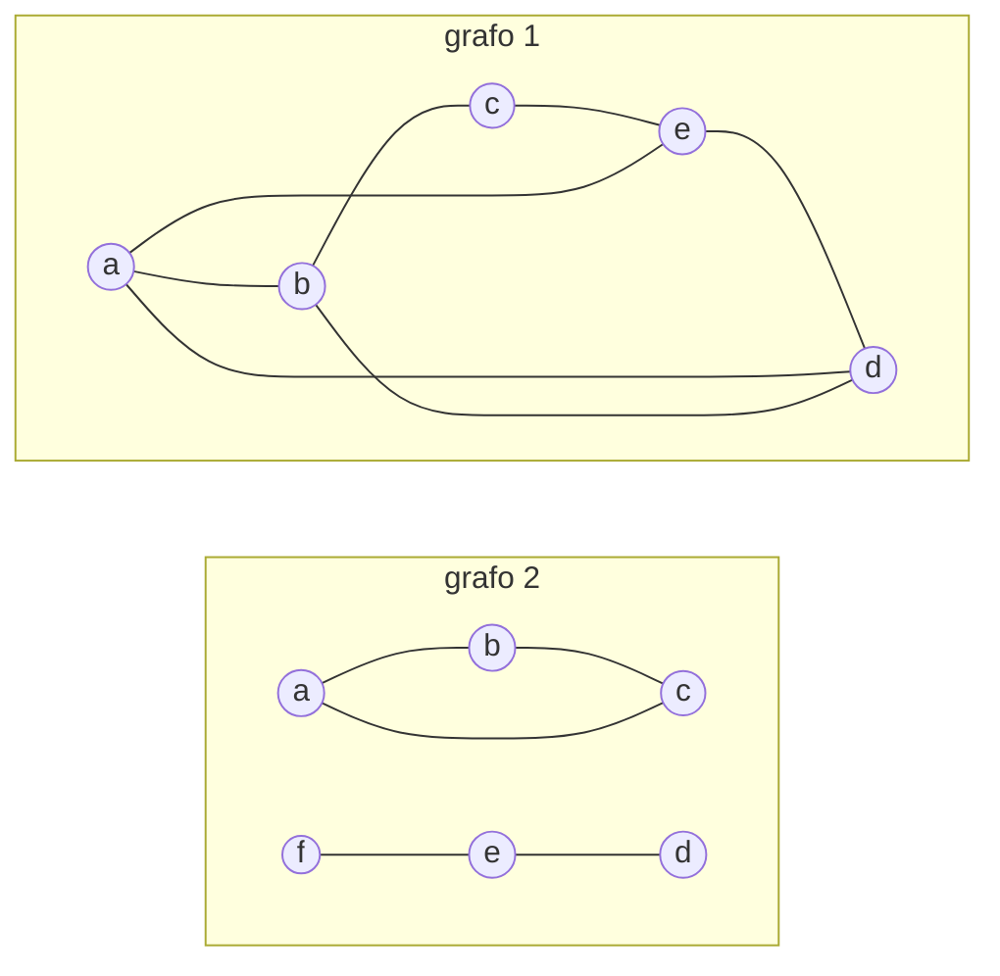
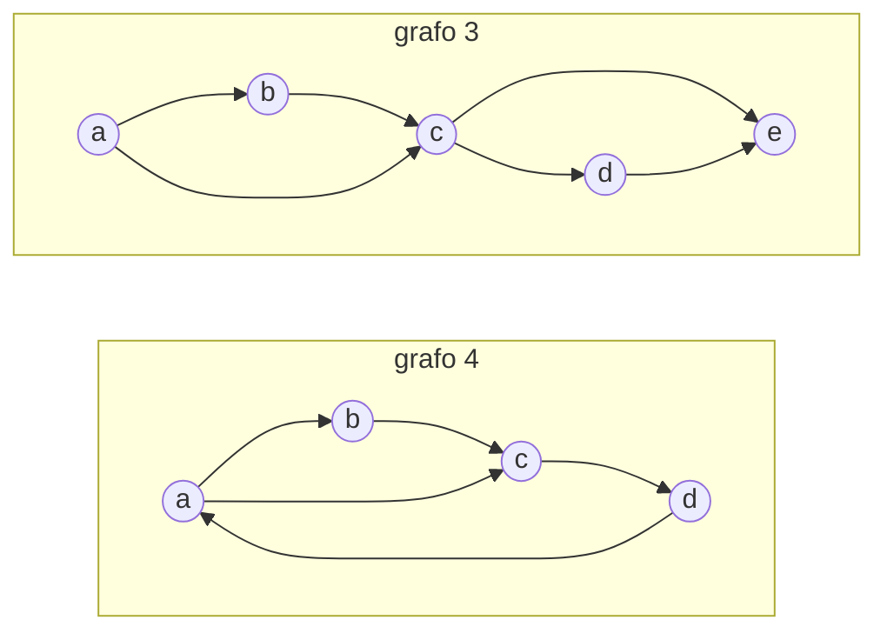
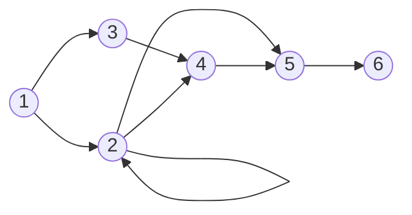

# Capítulo 12 — Ejercicios integradores

Cada capítulo anterior presentó una herramienta y la ejercitó por separado: la
recursión, las listas, la aritmética, el corte, la negación, el texto. Este
capítulo reúne ejercicios que requieren varias de ellas a la vez, sobre
problemas de un dominio: matrices, un tablero, grafos, mapas, bases de datos y
secuencias de números.

Antes de los ejercicios, tres secciones breves presentan lo que esos problemas
requieren además de lo visto: una manera de abordar un problema de varios
predicados, la doble negación con la que se expresa una condición «para todo»,
y la estrategia para armar la lista de todas las respuestas de una consulta.
El [capítulo 13](../capitulo-13-prolog-y-la-logica/index.md), que cierra la
parte I, lee después estos mismos programas como afirmaciones lógicas.

## Objetivos del capítulo

Al terminar el capítulo, el lector puede:

- elegir la representación de los datos de un problema, dividirlo en
  predicados y probar cada uno antes de combinarlos;
- expresar una condición «para todo» como una doble negación, y reconocer los
  casos en los que el supuesto de mundo cerrado altera su significado;
- armar la lista de todas las respuestas de una consulta en problemas que
  combinan varias relaciones;
- resolver problemas sobre matrices, grafos, mapas y bases de datos con la
  recursión, la aritmética, el corte y la negación de la parte I.

!!! info "Tiempo estimado"
    Leer el capítulo, ejecutar sus ejemplos y hacer las actividades: **0:20 h**.
    Ningún ejercicio está marcado con ★.
    Resolver los 16 ejercicios del final: **7:40 h**.

## 12.1 Cómo se aborda un ejercicio integrador

Un ejercicio integrador no se resuelve con un único predicado. Conviene
abordarlo en tres pasos, en este orden.

**Elegir la representación de los datos.** Antes de escribir una regla se
decide qué términos representan el problema: hechos o listas, qué término
compuesto agrupa los datos de cada elemento, qué argumento vincula dos
relaciones. La
representación decide qué predicados resultan simples. Un tablero con una sola
pieza queda determinado por la casilla de esa pieza; un grafo puede ser la
lista de sus aristas; una base de datos de libros vincula sus relaciones por
el ISBN, y una de estudiantes, por el legajo.

**Dividir el problema en predicados.** Cada concepto del enunciado se
convierte en un predicado propio, con su encabezado: «aprobó todas las
materias» requiere antes saber qué es «una materia sin aprobar». Los
predicados auxiliares de capítulos anteriores, como `selecciona/3` y
`permuta/2` del [capítulo 7](../capitulo-07-listas/index.md#ejercicios), se
copian en el archivo del ejercicio.

**Probar cada predicado antes de combinarlos.** Cada predicado recibe sus
pruebas de plunit, como en la
[sección 3.6](../capitulo-03-reglas-y-conjunciones/index.md#36-la-primera-prueba):
una con `all(…)`, que detecta respuestas de más, y una con `[fail]`, que
especifica lo que no debe cumplirse. Un error en un predicado auxiliar se
encuentra en su propia prueba, y no en la del predicado que lo usa.

La sección siguiente aplica los tres pasos a un ejemplo completo.

## 12.2 «Para todo»: la doble negación

Muchos enunciados exigen que una condición se cumpla para todos los elementos
de un conjunto: un estudiante aprobó **todas** las materias de su carrera, un
jugador ganó **todos** los partidos que jugó. La parte I no tiene una
construcción que exprese «para todo», y `\+` niega que exista algo. La lógica
vincula las dos formas con una equivalencia:

$$\forall x \, P \quad \equiv \quad \lnot \, \exists x \, \lnot P$$

«Para todo x, P» equivale a «no existe un x para el que no valga P». La
[sección 10.10](../capitulo-10-negacion-como-falla/index.md#1010-todas-las-materias-de-un-ciclo)
la aplicó a las materias de un ciclo, y la
[sección 13.4](../capitulo-13-prolog-y-la-logica/index.md#134-las-variables-y-los-cuantificadores)
la usa para leer las variables de un `\+`. Esta sección la presenta como una
estrategia general.

La base de `carreras.pl` registra los estudiantes con su legajo, las materias
que exige cada carrera y las materias que aprobó cada estudiante:

<!-- ejemplo: capitulo-12/carreras.pl predicado: estudiante/2 materia_carrera/2 materia_aprobada/3 consulta: exigencias_cumplidas(ingenieria_civil, Nombre). -->
```prolog
% estudiante(nombre(N), legajo(L)): el estudiante N tiene el legajo L.
estudiante(nombre("Romina Montalbán"), legajo(2490)).
estudiante(nombre("Daniel Hernández"), legajo(2310)).
estudiante(nombre("Lucía Ferreyra"), legajo(2575)).

% materia_carrera(carrera(C), materia(M)): la carrera C exige la materia M.
materia_carrera(carrera(ingenieria_civil), materia(analisis)).
materia_carrera(carrera(ingenieria_civil), materia(algebra)).
materia_carrera(carrera(ingenieria_civil), materia(materiales)).
materia_carrera(carrera(ingenieria_quimica), materia(analisis)).
materia_carrera(carrera(ingenieria_quimica), materia(quimica_general)).
materia_carrera(carrera(ingenieria_quimica), materia(termodinamica)).

% materia_aprobada(legajo(L), carrera(C), materia(M)): el estudiante de
% legajo L aprobó la materia M en la carrera C.
materia_aprobada(legajo(2490), carrera(ingenieria_quimica), materia(analisis)).
materia_aprobada(legajo(2490), carrera(ingenieria_quimica),
                 materia(quimica_general)).
materia_aprobada(legajo(2490), carrera(ingenieria_quimica),
                 materia(termodinamica)).
materia_aprobada(legajo(2310), carrera(ingenieria_civil), materia(analisis)).
materia_aprobada(legajo(2310), carrera(ingenieria_civil), materia(algebra)).
materia_aprobada(legajo(2575), carrera(ingenieria_civil), materia(analisis)).
materia_aprobada(legajo(2575), carrera(ingenieria_civil), materia(algebra)).
materia_aprobada(legajo(2575), carrera(ingenieria_civil), materia(materiales)).
```

Se busca `exigencias_cumplidas(Carrera, Nombre)`: el estudiante `Nombre`
aprobó todas las materias de `Carrera`. Con `L` el legajo del estudiante, la
condición y su forma con doble negación son:

$$\forall M \; \bigl( \mathit{materia\_carrera}(C, M) \rightarrow \mathit{materia\_aprobada}(L, C, M) \bigr)
  \quad \equiv \quad
  \lnot \, \exists M \; \bigl( \mathit{materia\_carrera}(C, M) \land \lnot \, \mathit{materia\_aprobada}(L, C, M) \bigr)$$

La segunda forma se escribe con un `\+` dentro de otro, sin recorrer ninguna
lista. La materia sin aprobar es un predicado propio, que contiene el `\+`
interior:

<!-- ejemplo: capitulo-12/carreras.pl predicado: exigencias_cumplidas/2 materia_no_aprobada/3 consulta: exigencias_cumplidas(ingenieria_civil, Nombre). -->
```prolog
%!  exigencias_cumplidas(+Carrera, ?Nombre) is nondet.
%
%   El estudiante Nombre aprobó todas las materias de Carrera: no tiene
%   ninguna materia de Carrera sin aprobar. Carrera debe llegar ligada.
exigencias_cumplidas(Carrera, Nombre) :-
    estudiante(nombre(Nombre), legajo(L)),
    \+ materia_no_aprobada(Carrera, L, _).

%!  materia_no_aprobada(+Carrera, +L, ?M) is nondet.
%
%   M es una materia de Carrera que el estudiante de legajo L no aprobó.
materia_no_aprobada(Carrera, L, M) :-
    materia_carrera(carrera(Carrera), materia(M)),
    \+ materia_aprobada(legajo(L), carrera(Carrera), materia(M)).
```

```prolog
?- exigencias_cumplidas(ingenieria_civil, Nombre).
Nombre = "Lucía Ferreyra".

?- exigencias_cumplidas(ingenieria_quimica, "Romina Montalbán").
true.

?- exigencias_cumplidas(ingenieria_civil, "Daniel Hernández").
false.

?- materia_no_aprobada(ingenieria_civil, 2310, M).
M = materiales.
```

`estudiante/2` genera al estudiante y su legajo; el primer `\+` exige que no
exista ninguna materia de la carrera sin aprobar, y `materia_no_aprobada/3`
describe esa materia con el segundo `\+`. En la fórmula de la regla, el primer
`\+` es el $\lnot \, \exists M$ y el segundo, el $\lnot$ interior:

$$\mathit{exigencias\_cumplidas}(C, N) \leftarrow
  \mathit{estudiante}(N, L) \land
  \lnot \, \exists M \; \bigl( \mathit{materia\_carrera}(C, M) \land
  \lnot \, \mathit{materia\_aprobada}(L, C, M) \bigr)$$

`M` aparece solamente dentro del `\+`, y por eso recorre todas las materias de
la carrera. La versión con «para todo» requiere armar la lista de las materias
de la carrera y recorrerla; la doble negación no requiere ninguna lista.

Las pruebas de `carreras.plt` siguen el tercer paso de la
[sección 12.1](#121-como-se-aborda-un-ejercicio-integrador): la última prueba
verifica `materia_no_aprobada/3` por separado, con la materia que le falta a
Daniel Hernández.

<!-- ejemplo: capitulo-12/carreras.plt fragmento: :- begin_tests(carreras). .. :- end_tests(carreras). -->
```prolog
:- begin_tests(carreras).

test(recibidos_de_civil, all(N == ["Lucía Ferreyra"])) :-
    exigencias_cumplidas(ingenieria_civil, N).

test(recibidos_de_quimica, all(N == ["Romina Montalbán"])) :-
    exigencias_cumplidas(ingenieria_quimica, N).

test(daniel_debe_materiales, [fail]) :-
    exigencias_cumplidas(ingenieria_civil, "Daniel Hernández").

test(materias_que_debe_daniel, all(M == [materiales])) :-
    materia_no_aprobada(ingenieria_civil, 2310, M).

:- end_tests(carreras).
```

`Carrera` debe llegar ligada. Con `Carrera` libre, la variable queda dentro del
`\+` y se lee también para toda carrera: la consulta preguntaría si el
estudiante aprobó las materias de todas las carreras. Además, una carrera sin
ninguna materia en la base cumple la condición para cualquier estudiante,
porque no tiene ninguna materia sin aprobar: es el «para todo» de un conjunto
vacío.

La doble negación hereda el supuesto de mundo cerrado del
[capítulo 10](../capitulo-10-negacion-como-falla/index.md): «no existe una
materia sin aprobar» significa que no se pudo probar que exista. Una materia
aprobada que la base no registra cuenta como no aprobada, y una materia que la
carrera exige pero que la base omite no se verifica. El resultado coincide con
el «para todo» de la lógica solo cuando la base contiene toda la información
relevante, que es la diferencia entre `\+` y $\lnot$ de la
[sección 13.12](../capitulo-13-prolog-y-la-logica/evaluacion.md#1312-la-negacion).

## 12.3 Recolectar soluciones

Varios ejercicios de este capítulo requieren la lista de todas las respuestas
de una consulta: las editoriales de una base de libros, los jugadores que
ganaron todos sus partidos, los vértices de un grafo. La parte I no tiene un
predicado que la arme en una llamada; la página
[Recolectar soluciones](../capitulo-10-negacion-como-falla/recolectar.md#estrategia-para-recolectar-soluciones)
del [capítulo 10](../capitulo-10-negacion-como-falla/index.md) presenta la
estrategia: un acumulador `YaIncluidas`, `\+` sobre la pertenencia a ese
acumulador, un corte y una cláusula de cierre. Las soluciones de
este capítulo la escriben con `member/2` y `append/3`, los predefinidos de la
[sección 7.7](../capitulo-07-listas/index.md#77-predicados-predefinidos), en
lugar de `pertenece/2` y `concatenar/3`.

## Ejercicios

Las soluciones están en [la página de soluciones](soluciones.md). La dificultad
va de 1 (se resuelve consultando el capítulo) a 3 (requiere elaboración propia).
Ningún ejercicio está marcado con ★: todos combinan temas de capítulos
anteriores, y ninguno introduce un tema que los capítulos siguientes den por
hecho.

Los ejercicios se agrupan por dominio. Los grafos y la base de libros que usan
varios de ellos se describen después del último ejercicio.

| Ejercicios | Dominio |
|---|---|
| 1 y 2 | listas y matrices |
| 3 | un tablero de ajedrez |
| 4 a 8 | [grafos](#grafos-de-los-ejercicios) |
| 9 | mapas |
| 10 a 15 | bases de datos: la [base de libros](#base-de-libros), un campeonato, una agencia de viajes, un torneo y una aerolínea |
| 16 | secuencias de números |

1. **(3)** Una matriz se representa como la lista de sus filas, cada una de
   ellas una lista. Las matrices de ejemplo son `a`, `b` y `at`, la
   transpuesta de `a`:

    ```prolog
    % matriz(Nombre, M): M es una de las matrices del enunciado, por filas.
    matriz(a, [[1, 2, 3], [1, 3, 5], [4, 4, 4]]).
    matriz(b, [[0, 0, 4], [7, 2, 10]]).
    matriz(at, [[1, 1, 4], [2, 3, 4], [3, 5, 4]]).
    ```

    a. Escribir `elemento(M, posicion(F, C), E)`: `E` es el elemento de la
       fila `F` y la columna `C` de `M`. En `a`, el de `posicion(2, 1)` es 1.

    b. Escribir `actualiza(M, posicion(F, C), E, M2)`: `M2` es `M` con `E` en
       esa posición. Con `a`, `posicion(2, 1)` y 9,
       `M2 = [[1, 2, 3], [9, 3, 5], [4, 4, 4]]`.

    c. Escribir `transpuesta(M, T)`: `T` es la transpuesta de `M`. Con `at` y
       `a` se cumple, y la de `b` es `[[0, 7], [0, 2], [4, 10]]`.

    d. Escribir `suma(M1, M2, S)`: `S` es la suma de `M1` y `M2`. La de `a`
       consigo misma es `[[2, 4, 6], [2, 6, 10], [8, 8, 8]]`.

    e. Escribir `suma_diagonales(M, SD)`: el elemento i de `SD` es la suma del
       elemento i de la diagonal principal de la matriz cuadrada `M` y del
       elemento i de su diagonal secundaria. Para `a`, `SD = [4, 6, 8]`.

2. **(2)** Una matriz es **rala** cuando la mayoría de sus elementos son
   ceros, y conviene guardar solo los distintos de cero. Escribir
   `convierte(M, Rala)`: `M` es una matriz representada como en el ejercicio
   1 y `Rala` es la lista de sus elementos distintos de cero, por filas,
   cada uno como `[Fila, Columna, Valor]`. Para la matriz
   `[[10, 0, 0, 10, 0], [0, 20, 0, 0, 0], [30, 0, 0, 0, 30],
   [40, 0, 0, 0, 0], [50, 0, 0, 0, 50]]`, `Rala = [[1, 1, 10], [1, 4, 10],
   [2, 2, 20], [3, 1, 30], [3, 5, 30], [4, 1, 40], [5, 1, 50], [5, 5, 50]]`.
3. **(2)** Un tablero de ajedrez tiene como única pieza una reina, que se
   mueve las casillas que se quiera en dirección horizontal, vertical o
   diagonal. Escribir `tablero_siguiente(Actual, Nuevo)`: `Nuevo` es un
   tablero que resulta de una movida de la reina en el tablero `Actual`.
   Representar el tablero con `reina(Fila, Columna)`, la casilla de la reina,
   con filas y columnas numeradas de 1 a 8, y explicar por qué esa
   representación alcanza. Determinar cuántos tableros siguientes tiene el
   tablero de la figura, `reina(6, 2)`:

    ```text
    8  . . . . . . . .
    7  . . . . . . . .
    6  . R . . . . . .
    5  . . . . . . . .
    4  . . . . . . . .
    3  . . . . . . . .
    2  . . . . . . . .
    1  . . . . . . . .
       1 2 3 4 5 6 7 8
    ```

4. **(2)** Con los grafos dirigidos 3 y 4 de los
   [grafos de los ejercicios](#grafos-de-los-ejercicios), escribir
   `walk(G, Camino, Vertices, Long)`: `Camino` es una lista de `Long` aristas
   de `G`, cada una a continuación de la anterior, que puede repetir aristas,
   y `Vertices` es la lista de los vértices que recorre. En el grafo 3 hay
   cuatro caminos de longitud 3; el primero es
   `[arista(a, b), arista(b, c), arista(c, d)]`, con
   `Vertices = [a, b, c, d]`. En el grafo 4, que tiene un ciclo,
   `[arista(a, b), arista(b, c), arista(c, d), arista(d, a), arista(a, b)]`
   es un camino de longitud 5. Explicar por qué `Long` debe llegar
   instanciado.
5. **(2)** Con los grafos no dirigidos 1 y 2 de los
   [grafos de los ejercicios](#grafos-de-los-ejercicios):

    a. Escribir `remover_aristas(G, V, G2)`: `G2` es `G` sin las aristas que
       incluyen al vértice `V`; con `V` libre, una respuesta por vértice. Sin
       `e`, al grafo 1 le quedan `[a(a, b), a(a, d), a(b, c), a(b, d)]`.

    b. Una cobertura de vértices es un subconjunto de los vértices que contiene
       al menos un extremo de cada arista. Escribir `cobertura_vertices(G, C)`
       con `remover_aristas/3`. En el grafo 2, `[e, c, b]` es una cobertura y
       `[a, e]` no lo es.

    c. Un clique es un subconjunto de los vértices en el que cada par de
       vértices distintos es adyacente. Escribir `clique(G, C)` con doble
       negación. `[d, a, b]` es un clique del grafo 1, `[b, c]` lo es del
       grafo 2 y `[f, e, d]` no.

6. **(3)** Sobre los grafos del ejercicio 5:

    a. Escribir `trail(G, Camino, Vertices)`: `Camino` es una lista no vacía de
       aristas de `G`, cada una a lo sumo una vez, y `Vertices` es la lista de
       los vértices por los que pasa. Cada arista se escribe en el sentido del
       recorrido: en el grafo 1, `[a(b, c), a(c, e), a(e, d), a(d, b)]` es un
       camino, con los vértices `[b, c, e, d, b]`.

    b. Un grafo es conexo si para todo par de vértices distintos existe un
       camino que los une. Escribir `conexo(G)` con `trail/3`. El grafo 1 es
       conexo y el grafo 2 no lo es.

7. **(3)** Con los grafos dirigidos 3 y 4, cuyos vértices son los que aparecen
   en alguna arista:

    a. Escribir `grado_salida(G, V, N)`: `N` es la cantidad de aristas que salen
       del vértice `V`. Con `V` libre, una respuesta por vértice: la lista de
       vértices se arma con la
       [estrategia para recolectar soluciones](../capitulo-10-negacion-como-falla/recolectar.md#estrategia-para-recolectar-soluciones).
       En el grafo 3, los vértices de grado 2 son `a` y `c`.

    b. Escribir `ordenados_x_grado(G, Vs)`: `Vs` son los vértices de `G` en
       orden ascendente de grado de salida, con `grado_salida/3` y un
       ordenamiento por inserción como el de `ordena/2` del
       [capítulo 8](../capitulo-08-aritmetica/index.md#ejercicios). Para el
       grafo 3 es `[e, b, d, a, c]`.

8. **(3)** Escribir `genera_grafo(G1, N, G2)`: `G2` tiene una arista de `X` a
   `Y` si en `G1` hay un camino de `N` aristas, que se pueden repetir, de `X`
   a `Y`. Los grafos son dirigidos, con la representación del ejercicio 7, y
   `G2` se arma con la
   [estrategia para recolectar soluciones](../capitulo-10-negacion-como-falla/recolectar.md#estrategia-para-recolectar-soluciones).
   Para el grafo 5 y `N = 2`, `G2` tiene nueve aristas; una va de 1 a 2,
   por el camino 1, 2, 2.
9. **(3)** Colorear un mapa es asignar a cada región un color de una lista dada
   de modo que dos regiones vecinas no tengan el mismo color. El mapa se
   representa como una lista de términos `region(Nombre, Color, Vecinas)`,
   donde `Vecinas` es la lista de los **colores** de las regiones vecinas: el
   mismo `Color` es una variable compartida. Para el mapa

    ```text
    +-----------------------+
    |           a           |
    +-------+-------+-------+
    |   b   |   c   |   d   |
    +-------+---+---+-------+
    |     e     |     f     |
    +-----------+-----------+
    ```

    la región `a` es `region(a, A, [B, C, D])`. Escribir `color_map(Mapa, Colores)`
    con generar y probar (plantilla 15, de la
    [sección 9.6](../capitulo-09-backtracking-y-corte/index.md#96-generar-y-probar)):
    `selecciona/3`, del
    [capítulo 7](../capitulo-07-listas/index.md#ejercicios), elige el color de
    cada región entre los disponibles. Determinar si alcanzan tres colores. El
    [capítulo 24](../capitulo-24-programacion-con-restricciones/index.md#248-coloreo-de-un-mapa)
    resuelve el mismo problema con restricciones.

10. **(2)** Sobre la [base de libros](#base-de-libros), escribir:

    a. `edicion_impresa(T, Id, A)`: el libro de título `T` tiene una edición
       impresa en el idioma `Id` en el año `A`. `edicion_impresa(T, "español", A)`
       da `T = "The Unified Software Development Process"` y `A = 2000`.

    b. `cantidad_autores(T, C)`: `C` es la cantidad de autores del libro de
       título `T`; con `T` libre, una respuesta por libro.

    c. `lista_editoriales(L)`: `L` es la lista de todas las editoriales, armada
       con la estrategia de la
       [sección 12.3](#123-recolectar-soluciones).

11. **(2)** Con la [base de libros](#base-de-libros), escribir
    `precio_maximo(T)`: el libro de título `T` tiene la edición impresa de
    mayor precio. «Ninguna edición impresa tiene un precio mayor» es la forma
    de la [sección 12.2](#122-para-todo-la-doble-negacion).
    `precio_maximo(T).` responde `T = "The Art of Prolog"`.
12. **(3)** La base siguiente registra los partidos de un campeonato de
    selecciones: `seleccionado(Jugador, Seleccion)`, con el apellido y el número
    del jugador; `partido(NroPartido, Eq1, Eq2, GolesEq1, GolesEq2)`, y
    `presencia(NroPartido, Jugador)`, que el jugador jugó ese partido.

    ```prolog
    seleccionado(jugador("Messi", 10), argentina).
    seleccionado(jugador("Karacic", 5), australia).
    seleccionado(jugador("Estrada", 11), ecuador).
    seleccionado(jugador("Mendy", 6), senegal).
    partido(35, ecuador, senegal, 1, 2).
    partido(21, tunez, australia, 0, 1).
    partido(61, argentina, croacia, 3, 0).
    partido(50, argentina, australia, 2, 1).
    partido(18, qatar, senegal, 1, 3).
    partido(8, argentina, arabia, 1, 2).
    partido(1, qatar, ecuador, 0, 2).
    partido(39, polonia, argentina, 0, 2).
    presencia(21, jugador("Karacic", 5)).
    presencia(35, jugador("Mendy", 6)).
    presencia(8, jugador("Messi", 10)).
    presencia(61, jugador("Messi", 10)).
    presencia(1, jugador("Estrada", 11)).
    presencia(39, jugador("Messi", 10)).
    presencia(18, jugador("Mendy", 6)).
    presencia(50, jugador("Messi", 10)).
    ```

    Las dos listas se arman con la
    [estrategia para recolectar soluciones](../capitulo-10-negacion-como-falla/recolectar.md#estrategia-para-recolectar-soluciones).

    a. Escribir `jugadores_victoriosos(Js)`: `Js` es la lista de los apellidos
       de los jugadores que ganaron todos los partidos que jugaron. La
       condición se escribe con doble negación. La respuesta es
       `["Karacic", "Estrada", "Mendy"]`.

    b. Escribir `partidos_jugados(Ps)`: `Ps` es la lista de los partidos, cada
       uno `[NroPartido, Eq1, Eq2]`, en orden ascendente de `NroPartido`, sin
       ordenar la lista después de armarla: en cada paso se agrega el partido
       para el que no existe otro de menor número todavía sin recolectar.

13. **(3)** Una agencia de viajes arma tours con las ciudades de `ciudad/2`, y
    su política establece que después de salir de un país no se puede volver a
    ingresar a él. Con las ciudades Venecia, Atenas y Roma, un tour comienza en
    Italia, visita Roma y Venecia en cualquier orden y continúa a Grecia, o
    comienza en Atenas y visita después las dos ciudades italianas.

    ```prolog
    % ciudad(C, P): la ciudad C pertenece al país P.
    ciudad(dresde, alemania).
    ciudad(basilea, suiza).
    ciudad(roma, italia).
    ciudad(hamburgo, alemania).
    ciudad(atenas, grecia).
    ciudad(venecia, italia).
    ciudad(colonia, alemania).
    ciudad(viena, austria).
    ciudad(florencia, italia).
    ciudad(munich, alemania).
    ciudad(berna, suiza).
    ```

    Escribir `tour(Lista, Tour)`: `Tour` tiene las ciudades de `Lista` en un
    orden que cumple la política. Usar `permuta/2` de los
    [ejercicios del capítulo 7](../capitulo-07-listas/index.md#ejercicios), y
    escribir la política como la negación de que exista un reingreso.
    `tour([roma, atenas, venecia], T).` tiene cuatro respuestas.

14. **(3)** La tabla de posiciones de un torneo es una lista de filas
    `[Equipo, Puntaje, Ganados, Empatados, Perdidos]`, ordenada por puntaje de
    mayor a menor. Cada resultado es `[Equipo1, Equipo2, R]`: con `R = 1` ganó
    `Equipo1`, con `R = 2` ganó `Equipo2`, y con `R = 3` empataron. El partido
    ganado suma 3 puntos, y el empatado, 1. Escribir
    `actualizar(Tabla, Resultados, TablaAct)`: `TablaAct` es `Tabla` con los
    resultados incorporados, y ordenada. Con la tabla
    `[[equipo_b, 0, 0, 0, 0], [equipo_a, 0, 0, 0, 0], [equipo_c, 0, 0, 0, 0]]` y
    los resultados `[[equipo_c, equipo_b, 3], [equipo_a, equipo_c, 2]]`, la tabla
    actualizada es
    `[[equipo_c, 4, 1, 1, 0], [equipo_b, 1, 0, 1, 0], [equipo_a, 0, 0, 0, 1]]`.
15. **(3)** Una aerolínea registra sus vuelos con cuatro predicados:
    `vuelo(T, Desde, Hasta, Precio)`; `vuelo_tramo(T, N, Desde, Hasta, Km)`, el
    tramo `N` del vuelo `T`; `vuelo_diario(T, D, Avion, Asientos)`, el vuelo `T`
    realizado el día `D`, y `segmento_vuelo_diario(T, N, D, Disponibles)`, los
    asientos disponibles en el tramo `N` del vuelo `T` del día `D`. Las fechas
    son términos `fecha(Anio, Mes, Dia)`.

    ```prolog
    vuelo('IB750', 'Bruselas', 'BsAs', 151000).
    vuelo('IB752', 'Bruselas', 'BsAs', 148000).
    vuelo('AR1132', 'Madrid', 'BsAs', 120000).
    vuelo_tramo('IB750', 1, 'Bruselas', 'Madrid', 1272).
    vuelo_tramo('IB750', 2, 'Madrid', 'SanPablo', 9725).
    vuelo_tramo('IB750', 3, 'SanPablo', 'BsAs', 1675).
    vuelo_tramo('IB752', 1, 'Bruselas', 'Madrid', 1272).
    vuelo_tramo('IB752', 2, 'Madrid', 'BsAs', 10040).
    vuelo_tramo('AR1132', 1, 'Madrid', 'BsAs', 10040).
    vuelo_diario('IB750', fecha(2023, 1, 10), 99765, 350).
    vuelo_diario('IB752', fecha(2023, 2, 12), 88120, 300).
    vuelo_diario('AR1132', fecha(2023, 1, 15), 77001, 280).
    vuelo_diario('AR1132', fecha(2023, 2, 20), 77001, 280).
    vuelo_diario('AR1132', fecha(2023, 3, 3), 77001, 280).
    segmento_vuelo_diario('IB750', 1, fecha(2023, 1, 10), 312).
    segmento_vuelo_diario('IB750', 2, fecha(2023, 1, 10), 350).
    segmento_vuelo_diario('IB750', 3, fecha(2023, 1, 10), 312).
    segmento_vuelo_diario('IB752', 1, fecha(2023, 2, 12), 0).
    segmento_vuelo_diario('IB752', 2, fecha(2023, 2, 12), 0).
    segmento_vuelo_diario('AR1132', 1, fecha(2023, 1, 15), 0).
    segmento_vuelo_diario('AR1132', 1, fecha(2023, 2, 20), 0).
    segmento_vuelo_diario('AR1132', 1, fecha(2023, 3, 3), 41).
    ```

    Escribir:

    a. `vuelo_completo(T, D)`: el vuelo `T` del día `D` no tiene asientos
       disponibles en al menos uno de sus tramos, con una sola respuesta por
       vuelo y día.

    b. `asientos_disponibles(T, D, N)`: `N` es el mínimo de los asientos
       disponibles en los tramos del vuelo `T` del día `D`.

    c. `tramo_mas_popular(Desde, Hasta)`: todos los vuelos entre el 1/1/2023 y
       el 28/2/2023 que unen `Desde` con `Hasta` estuvieron completos.

    d. `cantidad_km(T, N)`: `N` es la cantidad total de kilómetros del vuelo
       `T`, con todos sus tramos.

    Explicar por qué las fechas son términos `fecha(Anio, Mes, Dia)`, con el
    año primero, y no `fecha(Dia, Mes, Anio)` ni átomos como `'10/1/2023'`.

16. **(3)** La subsecuencia creciente más larga de una secuencia es la de
    valores en orden estrictamente creciente de mayor longitud: en
    `[20, 19, 1, 5, 2, 4, 6]` es `[1, 2, 4, 6]`. Escribir `sub_crec_mayor(L, S)`:
    `S` es una subsecuencia estrictamente creciente de `L`, y ninguna otra es
    más larga. Usar `es_subsecuencia/2` de la
    [solución 9 del capítulo 7](../capitulo-07-listas/soluciones.md#9) y la forma
    de la [sección 10.7](../capitulo-10-negacion-como-falla/index.md#107-obtener-una-respuesta-por-negacion).
    `sub_crec_mayor([2, 4, 8, 3, 4], S).` debe dar `[2, 4, 8]` y `[2, 3, 4]`.

### Grafos de los ejercicios

Los ejercicios 4 a 8 usan cinco grafos. Un grafo **no dirigido** se representa
con `grafo(Vs, As)`: `Vs` es la lista de vértices y `As` la de aristas, cada
una `a(X, Y)`, que une `X` con `Y` en los dos sentidos. Un grafo **dirigido**
se representa con la lista de sus aristas, cada una `arista(X, Y)`, que va de
`X` a `Y`. Los cinco grafos, como hechos:

```prolog
% grafo_ejemplo(N, G): G es el grafo N de los enunciados.
grafo_ejemplo(1, grafo([a, b, c, d, e],
                       [a(a, b), a(a, d), a(a, e), a(b, c), a(b, d),
                        a(c, e), a(e, d)])).
grafo_ejemplo(2, grafo([a, b, c, d, e, f],
                       [a(a, b), a(a, c), a(b, c), a(d, e), a(f, e)])).
grafo_ejemplo(3, [arista(a, b), arista(a, c), arista(b, c), arista(c, d),
                  arista(c, e), arista(d, e)]).
grafo_ejemplo(4, [arista(a, b), arista(a, c), arista(b, c), arista(c, d),
                  arista(d, a)]).
grafo_ejemplo(5, [arista(1, 2), arista(1, 3), arista(2, 2), arista(2, 4),
                  arista(2, 5), arista(3, 4), arista(4, 5), arista(5, 6)]).
```

Los grafos 1 y 2 son no dirigidos:



Los grafos 3 y 4 son dirigidos, y el 4 tiene un ciclo:



El grafo 5 es dirigido, y tiene una arista de 2 a sí mismo:



### Base de libros

Los libros, sus ediciones y las ediciones impresas, para los ejercicios
10 y 11. Los títulos, las editoriales y los idiomas son cadenas; el ISBN es un
término `978-…` que solo se compara por unificación. El archivo es
`libros.pl`:

<!-- ejemplo: capitulo-12/libros.pl predicado: libro/3 edicion/4 impreso/4 consulta: lista_editoriales(L). -->
```prolog
% libro(T, E, A): el libro de título T es de la editorial E y sus autores son
% los de la lista A.
libro(titulo("The Art of Prolog"), editorial("The MIT Press"), autor([sterling, shapiro])).
libro(titulo("The Unified Software Development Process"), editorial("Addison-Wesley"), autor([jacobson, booch, rumbaugh])).
libro(titulo("Logic for Problem Solving"), editorial("Prentice Hall"), autor([kowalski])).

% edicion(T, N, I, Id): la edición número N del libro de título T tiene el
% ISBN I y está en el idioma Id.
edicion(titulo("Logic for Problem Solving"), numero(1), isbn(978-0444003683), idioma("inglés")).
edicion(titulo("The Art of Prolog"), numero(2), isbn(978-0262193382), idioma("inglés")).
edicion(titulo("Logic for Problem Solving"), numero(2), isbn(978-3837036299), idioma("inglés")).
edicion(titulo("The Unified Software Development Process"), numero(1), isbn(978-8478290369), idioma("español")).
edicion(titulo("The Art of Prolog"), numero(1), isbn(978-2225819483), idioma("francés")).
edicion(titulo("The Unified Software Development Process"), numero(1), isbn(978-0201571691), idioma("inglés")).

% impreso(I, P, Pr, A): la edición de ISBN I está impresa, con P páginas,
% precio Pr y año A.
impreso(isbn(978-0262193382), pag(560), precio(65), anio(1994)).
impreso(isbn(978-0201571691), pag(472), precio(56), anio(2000)).
impreso(isbn(978-3837036299), pag(346), precio(64), anio(2014)).
impreso(isbn(978-2225819483), pag(505), precio(30), anio(1997)).
impreso(isbn(978-8478290369), pag(472), precio(25), anio(2000)).
```

## Resumen

| | |
|---|---|
| representación de los datos | los términos que representan el problema; deciden qué predicados resultan simples |
| dividir y probar | un predicado por concepto del enunciado, cada uno con sus pruebas antes de combinarlos |
| «para todo» | $\forall x \, P \equiv \lnot \, \exists x \, \lnot P$: un `\+` que contiene otro `\+` |
| variable solo dentro del `\+` | recorre todos los valores: es la variable del «para todo» |
| «para todo» de un conjunto vacío | se cumple sin ningún caso: conviene exigir antes que el conjunto tenga algún elemento |
| mundo cerrado | la doble negación coincide con el «para todo» de la lógica solo si la base contiene toda la información relevante |
| recolectar soluciones | acumulador `YaIncluidas`, `\+ member/2`, corte, `append/3` y una cláusula de cierre |

## Temas que se retoman

| Tema | Se retoma en |
|---|---|
| La lectura lógica de los programas, y los cuantificadores de sus variables | [capítulo 13](../capitulo-13-prolog-y-la-logica/index.md) |
| `findall/3`, que recolecta todas las respuestas en una llamada | [capítulo 18](../capitulo-18-todas-las-soluciones/index.md) |
| `forall/2`, que expresa «para todo» sin escribir la doble negación | [capítulo 18](../capitulo-18-todas-las-soluciones/index.md) |
| `maplist/2..5`, que recorre listas y matrices sin escribir la recursión | [capítulo 19](../capitulo-19-orden-superior/index.md) |
| Ordenar listas con predicados predefinidos | [capítulo 23](../capitulo-23-estructuras-de-datos-de-la-biblioteca/index.md) |
| El coloreo de un mapa con restricciones | [capítulo 24](../capitulo-24-programacion-con-restricciones/index.md) |
| Búsquedas de caminos en grafos de mayor escala | [capítulo 41](../capitulo-41-busqueda-y-planificacion/index.md) |
