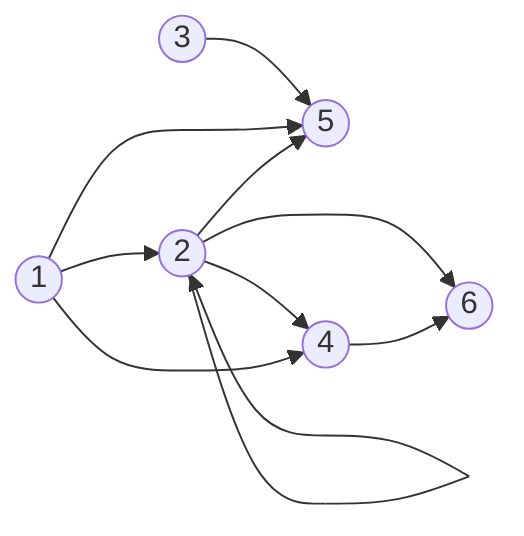

# Soluciones del capítulo 12 — Ejercicios integradores

El código de esta página está en `ejemplos/capitulo-12/soluciones.pl` y en
los archivos de los ejercicios que tienen una base de datos propia, y pasa
sus pruebas.

## 1

<!-- ejemplo: capitulo-12/soluciones.pl predicado: matriz/2 elemento/3 actualiza/4 reemplaza_en/4 transpuesta/2 primera_columna/3 suma/3 suma_fila/3 suma_diagonales/2 sumando_diagonales/4 consulta: matriz(a, A), elemento(A, posicion(2, 1), E). -->
```prolog
% matriz(Nombre, M): M es una de las matrices del enunciado, por filas.
matriz(a, [[1, 2, 3], [1, 3, 5], [4, 4, 4]]).
matriz(b, [[0, 0, 4], [7, 2, 10]]).
matriz(at, [[1, 1, 4], [2, 3, 4], [3, 5, 4]]).

%!  elemento(?M, ?Posicion, ?E) is nondet.
%
%   E es el elemento de la matriz M en Posicion, de la forma posicion(F, C).
elemento(M, posicion(F, C), E) :-
    nth1(F, M, Fila),
    nth1(C, Fila, E).

%!  actualiza(+M, +Posicion, +E, -M2) is semidet.
%
%   M2 es la matriz M con E en Posicion, de la forma posicion(F, C).
actualiza(M, posicion(F, C), E, M2) :-
    nth1(F, M, Fila),
    reemplaza_en(C, Fila, E, Fila2),
    reemplaza_en(F, M, Fila2, M2).

%!  reemplaza_en(+N, +L, +X, -L2) is semidet.
%
%   L2 es la lista L con X en la posición N, contando desde 1.
reemplaza_en(1, [_|Resto], X, [X|Resto]).
reemplaza_en(N, [Y|Resto], X, [Y|Resto2]) :-
    N > 1,
    Anterior is N - 1,
    reemplaza_en(Anterior, Resto, X, Resto2).

%!  transpuesta(+M, ?T) is semidet.
%
%   T es la matriz transpuesta de M: la fila i de T es la columna i de M.
transpuesta([[]|_], []).
transpuesta([[X|Xs]|Filas], [Columna|Columnas]) :-
    primera_columna([[X|Xs]|Filas], Columna, Restos),
    transpuesta(Restos, Columnas).

%!  primera_columna(+M, -Columna, -Restos) is det.
%
%   Columna es la primera columna de M, y Restos son las filas de M sin su
%   primer elemento.
primera_columna([], [], []).
primera_columna([[X|Xs]|Filas], [X|Columna], [Xs|Restos]) :-
    primera_columna(Filas, Columna, Restos).

%!  suma(+M1, +M2, -S) is semidet.
%
%   S es la suma de las matrices M1 y M2, de las mismas dimensiones.
suma([], [], []).
suma([F1|Filas1], [F2|Filas2], [F|Filas]) :-
    suma_fila(F1, F2, F),
    suma(Filas1, Filas2, Filas).

%!  suma_fila(+F1, +F2, -F) is semidet.
%
%   Cada elemento de F es la suma de los elementos de F1 y F2 en la misma
%   posición.
suma_fila([], [], []).
suma_fila([X|Xs], [Y|Ys], [Z|Zs]) :-
    Z is X + Y,
    suma_fila(Xs, Ys, Zs).

%!  suma_diagonales(+M, -SD) is det.
%
%   El elemento i de SD es la suma del elemento i de la diagonal principal de
%   la matriz cuadrada M y del elemento i de la diagonal secundaria.
suma_diagonales(M, SD) :-
    length(M, N),
    sumando_diagonales(M, 1, N, SD).

%!  sumando_diagonales(+Filas, +I, +N, -SD) is det.
%
%   Filas son las filas de la I a la N de una matriz de N columnas, y SD las
%   sumas de sus elementos de las dos diagonales.
sumando_diagonales([], _, _, []).
sumando_diagonales([Fila|Filas], I, N, [S|Ss]) :-
    nth1(I, Fila, Principal),
    J is N + 1 - I,
    nth1(J, Fila, Secundaria),
    S is Principal + Secundaria,
    Siguiente is I + 1,
    sumando_diagonales(Filas, Siguiente, N, Ss).
```

`elemento/3` toma la fila con `nth1/3` y, dentro de ella, la columna.
`actualiza/4` reemplaza el elemento en la fila, y después la fila en la matriz,
con el mismo `reemplaza_en/4`. `transpuesta/2` separa la primera columna de la
matriz, que es la primera fila de la transpuesta, y continúa con las filas
restantes, que tienen un elemento menos; termina cuando las filas quedan
vacías. `suma/3` suma fila por fila, y `suma_fila/3`, elemento por elemento. En
`suma_diagonales/2`, la fila `I` de una matriz de `N` columnas tiene el
elemento de la diagonal principal en la columna `I` y el de la secundaria en la
columna `N + 1 - I`.

```prolog
?- matriz(a, A), elemento(A, posicion(2, 1), E).
A = [[1, 2, 3], [1, 3, 5], [4, 4, 4]],
E = 1.

?- matriz(a, A), actualiza(A, posicion(2, 1), 9, M).
A = [[1, 2, 3], [1, 3, 5], [4, 4, 4]],
M = [[1, 2, 3], [9, 3, 5], [4, 4, 4]] ;
false.

?- matriz(at, AT), matriz(a, A), transpuesta(AT, A).
AT = [[1, 1, 4], [2, 3, 4], [3, 5, 4]],
A = [[1, 2, 3], [1, 3, 5], [4, 4, 4]].

?- matriz(b, B), transpuesta(B, BT).
B = [[0, 0, 4], [7, 2, 10]],
BT = [[0, 7], [0, 2], [4, 10]].

?- matriz(a, A), suma(A, A, S).
A = [[1, 2, 3], [1, 3, 5], [4, 4, 4]],
S = [[2, 4, 6], [2, 6, 10], [8, 8, 8]].

?- matriz(a, A), suma_diagonales(A, SD).
A = [[1, 2, 3], [1, 3, 5], [4, 4, 4]],
SD = [4, 6, 8].
```

## 2

<!-- ejemplo: capitulo-12/soluciones.pl predicado: convierte/2 convierte_filas/3 convierte_fila/4 consulta: convierte([[10, 0, 0], [0, 0, 20], [0, 30, 0]], Rala). -->
```prolog
%!  convierte(+M, -Rala) is det.
%
%   Rala es la lista de los elementos de M distintos de cero, cada uno como
%   [Fila, Columna, Valor], recorriendo M por filas.
convierte(M, Rala) :-
    convierte_filas(M, 1, Rala).

%!  convierte_filas(+Filas, +F, -Rala) is det.
%
%   Rala es la representación compacta de Filas, cuya primera fila es la F.
convierte_filas([], _, []).
convierte_filas([Fila|Filas], F, Rala) :-
    convierte_fila(Fila, F, 1, RalaFila),
    Siguiente is F + 1,
    convierte_filas(Filas, Siguiente, RalaResto),
    append(RalaFila, RalaResto, Rala).

%!  convierte_fila(+Fila, +F, +C, -Rala) is det.
%
%   Rala son los elementos distintos de cero de Fila, que es la fila F a
%   partir de la columna C.
convierte_fila([], _, _, []).
convierte_fila([0|Xs], F, C, Rala) :-
    Siguiente is C + 1,
    convierte_fila(Xs, F, Siguiente, Rala).
convierte_fila([X|Xs], F, C, [[F, C, X]|Rala]) :-
    X =\= 0,
    Siguiente is C + 1,
    convierte_fila(Xs, F, Siguiente, Rala).
```

El número de fila y el de columna avanzan de uno en uno durante el recorrido,
como `Desde` en `contando_atras/4` del
[ejercicio 10 del capítulo 8](../capitulo-08-aritmetica/soluciones.md#10).
Las dos últimas
cláusulas de `convierte_fila/4` son mutuamente excluyentes: la segunda
descarta un cero por unificación, y la tercera exige `X =\= 0`. Las pruebas
verifican además la matriz de 5 × 5 del enunciado.

```prolog
?- convierte([[10, 0, 0], [0, 0, 20], [0, 30, 0]], Rala).
Rala = [[1, 1, 10], [2, 3, 20], [3, 2, 30]] ;
false.
```

## 3

<!-- ejemplo: capitulo-12/soluciones.pl predicado: tablero_siguiente/2 movida_reina/4 consulta: tablero_siguiente(reina(6, 2), T). -->
```prolog
%!  tablero_siguiente(+Actual, ?Nuevo) is nondet.
%
%   Nuevo es un tablero que resulta de mover la reina del tablero Actual. Un
%   tablero es reina(Fila, Columna), la casilla de la única pieza, con filas
%   y columnas de 1 a 8.
tablero_siguiente(reina(F, C), reina(F2, C2)) :-
    between(1, 8, F2),
    between(1, 8, C2),
    movida_reina(F, C, F2, C2).

%!  movida_reina(+F, +C, +F2, +C2) is semidet.
%
%   La reina pasa de la casilla (F, C) a la casilla (F2, C2) en una movida:
%   por la fila, por la columna o por una de las dos diagonales.
movida_reina(F, C, F2, C2) :-
    F2 =:= F,
    C2 =\= C.
movida_reina(F, C, F2, C2) :-
    C2 =:= C,
    F2 =\= F.
movida_reina(F, C, F2, C2) :-
    F2 =\= F,
    F2 - F =:= C2 - C.
movida_reina(F, C, F2, C2) :-
    F2 =\= F,
    F2 - F =:= C - C2.
```

Como la reina es la única pieza, el tablero queda determinado por su casilla:
`reina(Fila, Columna)` contiene toda la información, y el predicado conserva la
forma de dos tableros que pide el enunciado. Una lista de ocho filas de ocho
casillas representaría lo mismo con 63 casillas vacías, y cada movida
requeriría reconstruirla.

`tablero_siguiente/2` genera las 64 casillas con `between/3`, de la
[sección 1.12](../capitulo-01-la-primera-hora/index.md#112-enumeracion-de-numeros),
y `movida_reina/4` verifica cada una con comparaciones aritméticas: es la
estrategia de generar y probar de la
[sección 8.4](../capitulo-08-aritmetica/index.md#84-cuando-se-admite-la-consulta-inversa).
Las cuatro
cláusulas corresponden a la fila, la columna y las dos diagonales; en una
diagonal, la diferencia de filas es igual a la de columnas o a su opuesta. Las
condiciones son mutuamente excluyentes, y ninguna casilla aparece dos veces.

```prolog
?- tablero_siguiente(reina(6, 2), T).
T = reina(1, 2) ;
T = reina(1, 7) ;
T = reina(2, 2) ;
...

?- tablero_siguiente(reina(6, 2), reina(8, 4)).
true ;
false.
```

Desde `reina(6, 2)` hay 23 tableros siguientes: 7 en la fila, 7 en la columna
y 9 en las dos diagonales.

## 4

El código de los ejercicios 4 a 8 está en `ejemplos/capitulo-12/grafos.pl`,
con los [grafos de los enunciados](index.md#grafos-de-los-ejercicios) como
hechos de `grafo_ejemplo/2`.

<!-- ejemplo: capitulo-12/grafos.pl predicado: walk/4 consulta: grafo_ejemplo(3, G), walk(G, C, Vs, 3). -->
```prolog
%!  walk(+G, ?Camino, ?Vertices, +Long) is nondet.
%
%   Camino es una lista de Long aristas consecutivas del grafo G, que puede
%   repetir aristas, y Vertices es la lista de los vértices que recorre.
walk(G, [arista(X, Y)], [X, Y], 1) :-
    member(arista(X, Y), G).
walk(G, [arista(X, Y)|Camino], [X, Y|Vertices], Long) :-
    Long > 1,
    member(arista(X, Y), G),
    Anterior is Long - 1,
    walk(G, Camino, [Y|Vertices], Anterior).
```

Un camino de longitud 1 es una arista del grafo. Uno más largo es una arista
de `X` a `Y` seguida de un camino de longitud `Long - 1` que comienza en `Y`:
la cabeza escribe la lista de vértices como `[X, Y|Vertices]` y la llamada
recursiva recibe `[Y|Vertices]`, de modo que su `member/2` solo elige aristas
que salen de `Y`.

`Long` debe llegar instanciado porque la guarda `Long > 1` lo compara, y con
`Long` libre produce un error de argumentos sin instanciar. Calcular `Long`
después de la llamada recursiva, con `Long is Anterior + 1`, tampoco resuelve
el problema: en el grafo 4, que tiene un ciclo, hay caminos de cualquier
longitud, y la búsqueda de más respuestas no terminaría nunca.

```prolog
?- walk([arista(a, b), arista(a, c), arista(b, c), arista(c, d), arista(c, e), arista(d, e)], C, Vs, 3).
C = [arista(a, b), arista(b, c), arista(c, d)],
Vs = [a, b, c, d] ;
C = [arista(a, b), arista(b, c), arista(c, e)],
Vs = [a, b, c, e] ;
C = [arista(a, c), arista(c, d), arista(d, e)],
Vs = [a, c, d, e] ;
C = [arista(b, c), arista(c, d), arista(d, e)],
Vs = [b, c, d, e] ;
false.
```

## 5

**a.**

<!-- ejemplo: capitulo-12/grafos.pl predicado: remover_aristas/3 sin_aristas_de/3 incluye/2 consulta: grafo_ejemplo(1, G1), remover_aristas(G1, e, G). -->
```prolog
%!  remover_aristas(+G, ?V, -G2) is nondet.
%
%   V es un vértice de G, y G2 es G sin las aristas que incluyen a V.
remover_aristas(grafo(Vs, As), V, grafo(Vs, Restantes)) :-
    member(V, Vs),
    sin_aristas_de(V, As, Restantes).

%!  sin_aristas_de(+V, +As, -Restantes) is det.
%
%   Restantes son las aristas de As que no incluyen al vértice V.
sin_aristas_de(_, [], []).
sin_aristas_de(V, [A|As], Restantes) :-
    incluye(A, V),
    sin_aristas_de(V, As, Restantes).
sin_aristas_de(V, [A|As], [A|Restantes]) :-
    \+ incluye(A, V),
    sin_aristas_de(V, As, Restantes).

%!  incluye(?A, ?V) is nondet.
%
%   La arista A incluye al vértice V, en cualquiera de sus dos extremos.
incluye(a(V, _), V).
incluye(a(_, V), V).
```

```prolog
?- grafo_ejemplo(1, G1), remover_aristas(G1, e, G).
G1 = grafo([a, b, c, d, e], [a(a, b), a(a, d), a(a, e), a(b, c), a(b, d), a(c, e), a(e, d)]),
G = grafo([a, b, c, d, e], [a(a, b), a(a, d), a(b, c), a(b, d)]) ;
false.
```

`member(V, Vs)` exige que `V` sea un vértice del grafo y, con `V` libre, lo
genera: `remover_aristas(G1, V, G)` da cinco respuestas, una por vértice.
`sin_aristas_de/3` recorre las aristas con dos casos mutuamente excluyentes: la
arista incluye al vértice y se descarta, o no lo incluye y se conserva.
`incluye/2` expresa con dos hechos que el vértice puede estar en cualquiera de
los dos extremos de `a(X, Y)`. La lista de vértices no cambia.

**b.**

<!-- ejemplo: capitulo-12/grafos.pl predicado: cobertura_vertices/2 remover_todas/3 consulta: grafo_ejemplo(2, G2), cobertura_vertices(G2, [e, c, b]). -->
```prolog
%!  cobertura_vertices(+G, +C) is semidet.
%
%   C es una cobertura de vértices de G: al quitar de G las aristas de cada
%   vértice de C no queda ninguna arista.
cobertura_vertices(G, C) :-
    remover_todas(C, G, grafo(_, [])).

%!  remover_todas(+Vs, +G, -G2) is semidet.
%
%   G2 es G sin las aristas que incluyen a alguno de los vértices de Vs.
remover_todas([], G, G).
remover_todas([V|Vs], G, G2) :-
    remover_aristas(G, V, G1),
    remover_todas(Vs, G1, G2).
```

```prolog
?- grafo_ejemplo(2, G2), cobertura_vertices(G2, [e, c, b]).
G2 = grafo([a, b, c, d, e, f], [a(a, b), a(a, c), a(b, c), a(d, e), a(f, e)]) ;
false.

?- grafo_ejemplo(2, G2), cobertura_vertices(G2, [a, e]).
false.
```

Si cada arista tiene un extremo en `C`, quitar las aristas de todos los vértices
de `C` deja el grafo sin aristas, y al revés. `remover_todas/3` aplica
`remover_aristas/3` a cada vértice de `C`, y la cabeza de la regla exige que el
resultado tenga la lista de aristas vacía. Con `[a, e]` queda la arista
`a(b, c)`. `C` debe llegar ligada: con `C` libre, `remover_todas/3` probaría
listas de longitud creciente sin fin.

**c.**

<!-- ejemplo: capitulo-12/grafos.pl predicado: clique/2 adyacente/3 consulta: grafo_ejemplo(2, G2), clique(G2, [f, e, d]). -->
```prolog
%!  clique(+G, +C) is semidet.
%
%   C es un clique de G: todos sus elementos son vértices de G y cada par de
%   vértices distintos de C es adyacente.
clique(grafo(Vs, As), C) :-
    \+ ( member(X, C),
         \+ member(X, Vs) ),
    \+ ( member(X, C),
         member(Y, C),
         X \== Y,
         \+ adyacente(X, Y, As) ).

%!  adyacente(?X, ?Y, +As) is nondet.
%
%   Alguna arista de As une X con Y, en cualquiera de los dos sentidos.
adyacente(X, Y, As) :-
    member(a(X, Y), As).
adyacente(X, Y, As) :-
    member(a(Y, X), As).
```

```prolog
?- grafo_ejemplo(1, G1), clique(G1, [d, a, b]).
G1 = grafo([a, b, c, d, e], [a(a, b), a(a, d), a(a, e), a(b, c), a(b, d), a(c, e), a(e, d)]).

?- grafo_ejemplo(2, G2), clique(G2, [b, c]).
G2 = grafo([a, b, c, d, e, f], [a(a, b), a(a, c), a(b, c), a(d, e), a(f, e)]).

?- grafo_ejemplo(2, G2), clique(G2, [f, e, d]).
false.
```

Las dos condiciones tienen la forma de la
[sección 12.2](index.md#122-para-todo-la-doble-negacion): no existe un elemento de
`C` que no sea vértice del grafo, y no existe un par de elementos distintos de
`C` que no sean adyacentes. En `[f, e, d]` el par `f`, `d` no tiene arista.
`adyacente/3` considera los dos sentidos de cada arista, porque el grafo no es
dirigido.

## 6

**a.** Se usa `adyacente/3` del [ejercicio 5](#5).

<!-- ejemplo: capitulo-12/grafos.pl predicado: trail/3 seguir/5 consulta: grafo_ejemplo(2, G2), trail(G2, C, Vs), Vs = [a|_]. -->
```prolog
%!  trail(+G, ?Camino, ?Vertices) is nondet.
%
%   Camino es una lista no vacía de aristas de G, cada una a lo sumo una vez
%   y escrita en el sentido del recorrido; Vertices son los vértices por los
%   que pasa, en orden.
trail(grafo(_, As), [a(X, Y)|Camino], [X|Vertices]) :-
    adyacente(X, Y, As),
    seguir(As, [a(X, Y)], Y, Camino, Vertices).

%!  seguir(+As, +Usadas, +Y, ?Camino, ?Vertices) is nondet.
%
%   Camino continúa desde el vértice Y con aristas de As que no están en
%   Usadas; Vertices son los vértices desde Y.
seguir(_, _, Y, [], [Y]).
seguir(As, Usadas, Y, [a(Y, Z)|Camino], [Y|Vertices]) :-
    adyacente(Y, Z, As),
    \+ adyacente(Y, Z, Usadas),
    seguir(As, [a(Y, Z)|Usadas], Z, Camino, Vertices).
```

```prolog
?- grafo_ejemplo(2, G2), trail(G2, C, Vs), Vs = [a|_].
G2 = grafo([a, b, c, d, e, f], [a(a, b), a(a, c), a(b, c), a(d, e), a(f, e)]),
C = [a(a, b)],
Vs = [a, b] ;
G2 = grafo([a, b, c, d, e, f], [a(a, b), a(a, c), a(b, c), a(d, e), a(f, e)]),
C = [a(a, b), a(b, c)],
Vs = [a, b, c] ;
G2 = grafo([a, b, c, d, e, f], [a(a, b), a(a, c), a(b, c), a(d, e), a(f, e)]),
C = [a(a, b), a(b, c), a(c, a)],
Vs = [a, b, c, a] ;
G2 = grafo([a, b, c, d, e, f], [a(a, b), a(a, c), a(b, c), a(d, e), a(f, e)]),
C = [a(a, c)],
Vs = [a, c] ;
G2 = grafo([a, b, c, d, e, f], [a(a, b), a(a, c), a(b, c), a(d, e), a(f, e)]),
C = [a(a, c), a(c, b)],
Vs = [a, c, b] ;
G2 = grafo([a, b, c, d, e, f], [a(a, b), a(a, c), a(b, c), a(d, e), a(f, e)]),
C = [a(a, c), a(c, b), a(b, a)],
Vs = [a, c, b, a] ;
false.
```

`trail/3` toma una primera arista en cualquiera de sus dos sentidos y sigue con
`seguir/5`, que lleva la lista de las aristas usadas. Su primera cláusula
termina el camino en el vértice actual; la segunda lo extiende con una arista
que no esté entre las usadas, en ninguno de los dos sentidos: el `\+` se aplica
cuando `Y` y `Z` ya tienen valor. Cada arista se agrega al camino escrita en el
sentido del recorrido, `a(Y, Z)`. Como el grafo es finito y ninguna arista se
repite, la búsqueda termina.

**b.**

<!-- ejemplo: capitulo-12/grafos.pl predicado: conexo/1 consulta: grafo_ejemplo(2, G2), conexo(G2). -->
```prolog
%!  conexo(+G) is semidet.
%
%   Para todo par de vértices distintos de G hay un camino que los une: no
%   existe un par de vértices distintos sin camino entre ellos.
conexo(grafo(Vs, As)) :-
    \+ ( member(X, Vs),
         member(Y, Vs),
         X \== Y,
         \+ ( trail(grafo(Vs, As), _, Recorrido),
              Recorrido = [X|_],
              last(Recorrido, Y) ) ).
```

```prolog
?- grafo_ejemplo(1, G1), conexo(G1).
G1 = grafo([a, b, c, d, e], [a(a, b), a(a, d), a(a, e), a(b, c), a(b, d), a(c, e), a(e, d)]).

?- grafo_ejemplo(2, G2), conexo(G2).
false.
```

«Para todo par de vértices distintos existe un camino» se escribe «no existe un
par de vértices distintos sin camino». El `\+` interior pregunta si existe un
camino que comienza en `X` y termina en `Y`; dentro de un `\+` no importa
cuántos caminos haya, porque basta con uno. En el grafo 2 no hay ningún camino
de `a` a `d`. Bratko escribe con la misma doble negación su `connected/1`, en
el programa que busca árboles de expansión de un grafo
(*Prolog Programming for Artificial Intelligence*, figura 9.23).

## 7

**a.**

<!-- ejemplo: capitulo-12/grafos.pl predicado: vertice/2 vertices/2 armar_vertices/3 grado_salida/3 salientes/3 consulta: grafo_ejemplo(3, G3), grado_salida(G3, V, 2). -->
```prolog
%!  vertice(+G, ?V) is nondet.
%
%   V es el origen o el destino de alguna arista del grafo dirigido G.
vertice(G, V) :-
    member(arista(V, _), G).
vertice(G, V) :-
    member(arista(_, V), G).

%!  vertices(+G, -Vs) is det.
%
%   Vs es la lista de los vértices de G, cada uno una vez. Vs debe llegar
%   libre: el corte de armar_vertices/3 es rojo.
vertices(G, Vs) :-
    armar_vertices(G, Vs, []).

%!  armar_vertices(+G, -Vs, +YaIncluidas) is det.
%
%   Vs es la lista de los vértices de G que no están en YaIncluidas.
armar_vertices(G, [V|Vs], YaIncluidas) :-
    vertice(G, V),
    \+ member(V, YaIncluidas),
    !,
    append(YaIncluidas, [V], YaIncluidasConV),
    armar_vertices(G, Vs, YaIncluidasConV).
armar_vertices(_, [], _).

%!  grado_salida(+G, ?V, ?N) is nondet.
%
%   N es la cantidad de aristas de G que salen del vértice V.
grado_salida(G, V, N) :-
    vertices(G, Vs),
    member(V, Vs),
    salientes(G, V, N).

%!  salientes(+As, +V, -N) is det.
%
%   N es la cantidad de aristas de la lista As que salen de V.
salientes([], _, 0).
salientes([arista(V, _)|As], V, N) :-
    salientes(As, V, N0),
    N is N0 + 1.
salientes([arista(X, _)|As], V, N) :-
    X \== V,
    salientes(As, V, N).
```

```prolog
?- grafo_ejemplo(3, G3), grado_salida(G3, V, 2).
G3 = [arista(a, b), arista(a, c), arista(b, c), arista(c, d), arista(c, e), arista(d, e)],
V = a ;
G3 = [arista(a, b), arista(a, c), arista(b, c), arista(c, d), arista(c, e), arista(d, e)],
V = c ;
false.

?- grafo_ejemplo(4, G4), grado_salida(G4, V, N).
G4 = [arista(a, b), arista(a, c), arista(b, c), arista(c, d), arista(d, a)],
V = a,
N = 2 ;
G4 = [arista(a, b), arista(a, c), arista(b, c), arista(c, d), arista(d, a)],
V = b,
N = 1 ;
G4 = [arista(a, b), arista(a, c), arista(b, c), arista(c, d), arista(d, a)],
V = c,
N = 1 ;
G4 = [arista(a, b), arista(a, c), arista(b, c), arista(c, d), arista(d, a)],
V = d,
N = 1 ;
false.
```

`vertice/2` da cada vértice tantas veces como aristas lo tocan; `vertices/2`
arma con la
[estrategia para recolectar soluciones](../capitulo-10-negacion-como-falla/recolectar.md#estrategia-para-recolectar-soluciones)
la lista en la que aparece una sola vez, primero los orígenes y después los
destinos que faltan. `grado_salida/3` toma cada vértice de esa lista, de modo
que también `e`, que no tiene aristas salientes, tiene grado 0. `salientes/3`
cuenta las aristas que salen del vértice con una recursión sobre la lista,
como `longitud/2` del [capítulo 8](../capitulo-08-aritmetica/index.md).

**b.**

<!-- ejemplo: capitulo-12/grafos.pl predicado: ordenados_x_grado/2 ordena_por_grado/3 inserta_por_grado/4 consulta: grafo_ejemplo(3, G3), ordenados_x_grado(G3, Vs). -->
```prolog
%!  ordenados_x_grado(+G, -Vs) is det.
%
%   Vs son los vértices de G en orden ascendente de grado de salida; los de
%   igual grado quedan en el orden de vertices/2.
ordenados_x_grado(G, Ordenados) :-
    vertices(G, Vs),
    ordena_por_grado(G, Vs, Ordenados).

%!  ordena_por_grado(+G, +Vs, -Ordenados) is det.
%
%   Ordenados tiene los vértices de Vs en orden ascendente de grado de
%   salida en G. Ordenamiento por inserción, como ordena/2.
ordena_por_grado(_, [], []).
ordena_por_grado(G, [V|Vs], Ordenados) :-
    ordena_por_grado(G, Vs, Parcial),
    inserta_por_grado(G, V, Parcial, Ordenados).

%!  inserta_por_grado(+G, +V, +Vs, -Zs) is det.
%
%   Zs es la lista Vs, ordenada por grado, con V insertado en su lugar.
inserta_por_grado(_, V, [], [V]).
inserta_por_grado(G, V, [W|Ws], [W|Zs]) :-
    grado_salida(G, V, N),
    grado_salida(G, W, M),
    N > M,
    inserta_por_grado(G, V, Ws, Zs).
inserta_por_grado(G, V, [W|Ws], [V, W|Ws]) :-
    grado_salida(G, V, N),
    grado_salida(G, W, M),
    N =< M.
```

```prolog
?- grafo_ejemplo(3, G3), ordenados_x_grado(G3, Vs).
G3 = [arista(a, b), arista(a, c), arista(b, c), arista(c, d), arista(c, e), arista(d, e)],
Vs = [e, b, d, a, c] ;
false.

?- grafo_ejemplo(4, G4), ordenados_x_grado(G4, Vs).
G4 = [arista(a, b), arista(a, c), arista(b, c), arista(c, d), arista(d, a)],
Vs = [b, c, d, a] ;
false.
```

`ordena_por_grado/3` e `inserta_por_grado/4` son `ordena/2` y su `insert/3`,
del [capítulo 8](../capitulo-08-aritmetica/soluciones.md), con la comparación
de los grados en lugar de la de los elementos. Los vértices de igual grado
conservan el orden de `vertices/2`, porque un vértice se inserta antes de los
que tienen su mismo grado. En el grafo 4, `b`, `c` y `d` tienen grado 1, y
cualquier orden entre ellos cumple el enunciado; `[d, b, c, a]`, por ejemplo,
es otro de esos órdenes.

## 8

<!-- ejemplo: capitulo-12/grafos.pl predicado: recorrido/4 genera_grafo/3 armar_grafo/4 consulta: grafo_ejemplo(5, G5), genera_grafo(G5, 2, G). -->
```prolog
%!  recorrido(+G, +N, ?X, ?Y) is nondet.
%
%   En el grafo dirigido G hay un camino de N aristas, N mayor que cero,
%   que va de X a Y. Las aristas se pueden repetir.
recorrido(G, 1, X, Y) :-
    member(arista(X, Y), G).
recorrido(G, N, X, Y) :-
    N > 1,
    member(arista(X, Z), G),
    N1 is N - 1,
    recorrido(G, N1, Z, Y).

%!  genera_grafo(+G1, +N, -G2) is det.
%
%   G2 tiene una arista de X a Y por cada par de vértices unidos en G1 por un
%   camino de N aristas. G2 debe llegar libre.
genera_grafo(G1, N, G2) :-
    armar_grafo(G1, N, G2, []).

%!  armar_grafo(+G1, +N, -G2, +YaIncluidas) is det.
%
%   G2 son las aristas de caminos de longitud N en G1 que no están en
%   YaIncluidas.
armar_grafo(G1, N, [arista(X, Y)|G2], YaIncluidas) :-
    recorrido(G1, N, X, Y),
    \+ member(arista(X, Y), YaIncluidas),
    !,
    append(YaIncluidas, [arista(X, Y)], YaIncluidasConArista),
    armar_grafo(G1, N, G2, YaIncluidasConArista).
armar_grafo(_, _, [], _).
```

```prolog
?- grafo_ejemplo(5, G5), genera_grafo(G5, 2, G).
G5 = [arista(1, 2), arista(1, 3), arista(2, 2), arista(2, 4), arista(2, 5), arista(3, 4), arista(4, 5), arista(5, 6)],
G = [arista(1, 2), arista(1, 4), arista(1, 5), arista(2, 2), arista(2, 4), arista(2, 5), arista(2, 6), arista(3, 5), arista(..., ...)].
```

La representación es la del ejercicio 7, una lista de términos
`arista(X, Y)`. `recorrido/4` es el generador: da un par de vértices por cada
camino de `N` aristas, de modo que el par 1, 4 aparece dos veces, por 1, 2, 4 y
por 1, 3, 4. La estrategia para recolectar soluciones deja cada arista una sola
vez. La novena arista, que el intérprete abrevia, es `arista(4, 6)`, como
verifica la prueba de `grafos.plt`. El grafo resultante:



## 9

El mapa y los colores son los de Sterling y Shapiro, *The Art of Prolog*,
programa 14.4: el mapa del enunciado es su figura 14.2. `selecciona/3` es el
del [ejercicio 21 del capítulo 7](../capitulo-07-listas/soluciones.md#21), copiado
en `soluciones.pl`, y `members/2`, del mismo libro, verifica que cada elemento
de una lista esté en otra.

<!-- ejemplo: capitulo-12/soluciones.pl predicado: color_map/2 color_region/2 selecciona/3 members/2 mapa_ejemplo/1 consulta: mapa_ejemplo(M), color_map(M, [rojo, verde, azul]). -->
```prolog
%!  color_map(?Mapa, +Colores) is nondet.
%
%   Cada región de Mapa tiene un color de Colores distinto del de sus
%   vecinas. Mapa es una lista de region(Nombre, Color, ColoresVecinas).
color_map([Region|Regiones], Colores) :-
    color_region(Region, Colores),
    color_map(Regiones, Colores).
color_map([], _).

%!  color_region(?Region, +Colores) is nondet.
%
%   La región y sus vecinas tienen colores de Colores, y el de la región es
%   distinto del de cada vecina: selecciona/3 elige el color de la región y
%   members/2 elige o verifica los de las vecinas entre los restantes.
color_region(region(_, Color, Vecinas), Colores) :-
    selecciona(Color, Colores, Restantes),
    members(Vecinas, Restantes).

%!  selecciona(?X, ?Xs, +Ys) is nondet.
%
%   Ys es Xs sin una de las apariciones de X: una respuesta por cada
%   aparición. Con Ys dada y Xs libre, inserta X en cada posición de Ys.
selecciona(X, [X|Xs], Xs).
selecciona(X, [Y|Ys], [Y|Zs]) :-
    selecciona(X, Ys, Zs).

%!  members(?Xs, +Ys) is nondet.
%
%   Cada elemento de Xs es un elemento de Ys.
members([X|Xs], Ys) :-
    member(X, Ys),
    members(Xs, Ys).
members([], _).

% mapa_ejemplo(M): M es el mapa del enunciado, con los colores libres.
mapa_ejemplo([region(a, A, [B, C, D]), region(b, B, [A, C, E]),
              region(c, C, [A, B, D, E, F]), region(d, D, [A, C, F]),
              region(e, E, [B, C, F]), region(f, F, [C, D, E])]).
```

```prolog
?- color_map([region(a, A, [B, C, D]), region(b, B, [A, C, E]), region(c, C, [A, B, D, E, F]), region(d, D, [A, C, F]), region(e, E, [B, C, F]), region(f, F, [C, D, E])], [rojo, verde, azul, blanco]).
A = E, E = rojo,
B = D, D = verde,
C = azul,
F = blanco ;
...

?- mapa_ejemplo(M), color_map(M, [rojo, verde, azul]).
false.
```

Es generar y probar sin un generador separado. Para cada región,
`selecciona/3` elige su color entre los disponibles y deja en `Restantes` los
otros. `members/2` exige que el color de cada vecina esté entre los restantes,
es decir, que sea distinto del de la región. Si una vecina ya tiene color,
`members/2` lo verifica; si todavía no lo tiene, `member/2` le asigna uno de
los restantes, que la región de esa vecina verificará después. Como el color
de una región es la misma variable en todos los términos donde aparece, la
asignación vale para todo el mapa.

Tres colores no alcanzan. La región `c` limita con las otras cinco, de modo
que ninguna de ellas puede tener su color, y `a`, `b`, `e`, `f`, `d` forman un
ciclo de cinco regiones vecinas, que no se puede colorear alternando dos
colores. El programa llega a la misma conclusión probando todas las
combinaciones.

## 10

El código de los ejercicios 10 y 11 está en `ejemplos/capitulo-12/libros.pl`,
con la [base de libros](index.md#base-de-libros).

<!-- ejemplo: capitulo-12/libros.pl predicado: edicion_impresa/3 cantidad_autores/2 lista_editoriales/1 armar_lista_editoriales/2 consulta: lista_editoriales(L). -->
```prolog
%!  edicion_impresa(?T, ?Id, ?A) is nondet.
%
%   El libro de título T tiene una edición impresa en el idioma Id en el año
%   A.
edicion_impresa(T, Id, A) :-
    edicion(titulo(T), numero(_), isbn(I), idioma(Id)),
    impreso(isbn(I), pag(_), precio(_), anio(A)).

%!  cantidad_autores(?T, ?C) is nondet.
%
%   C es la cantidad de autores del libro de título T.
cantidad_autores(T, C) :-
    libro(titulo(T), editorial(_), autor(As)),
    length(As, C).

%!  lista_editoriales(-L) is det.
%
%   L es la lista de todas las editoriales, sin repetidas, en el orden de los
%   hechos. L debe llegar libre.
lista_editoriales(L) :-
    armar_lista_editoriales(L, []).

%!  armar_lista_editoriales(-L, +YaIncluidas) is det.
%
%   L es la lista de las editoriales que no están en YaIncluidas.
armar_lista_editoriales([E|L], YaIncluidas) :-
    libro(titulo(_), editorial(E), autor(_)),
    \+ member(E, YaIncluidas),
    !,
    append(YaIncluidas, [E], YaIncluidasConE),
    armar_lista_editoriales(L, YaIncluidasConE).
armar_lista_editoriales([], _).
```

```prolog
?- edicion_impresa(T, "español", A).
T = "The Unified Software Development Process",
A = 2000 ;
false.

?- cantidad_autores(T, C).
T = "The Art of Prolog",
C = 2 ;
T = "The Unified Software Development Process",
C = 3 ;
T = "Logic for Problem Solving",
C = 1.

?- lista_editoriales(L).
L = ["The MIT Press", "Addison-Wesley", "Prentice Hall"].
```

`edicion_impresa/3` une dos relaciones por el ISBN: `edicion/4` da el ISBN
de cada edición en el idioma pedido, e `impreso/4` exige que esa edición esté
impresa y da el año. La primera edición de *Logic for Problem Solving* no
tiene un hecho `impreso/4`, y no aparece en ninguna respuesta.
`cantidad_autores/2` obtiene la lista de autores del libro y la mide con
`length/2`.

`lista_editoriales/1` aplica la estrategia de la
[sección 12.3](index.md#123-recolectar-soluciones) con `libro/3` como
generador. Cada libro tiene una sola editorial, de modo que en esta base no
hay repeticiones que descartar; la prueba `\+ member(E, YaIncluidas)` es la que las
descartaría si dos libros fueran de la misma editorial.

## 11

<!-- ejemplo: capitulo-12/libros.pl predicado: precio_maximo/1 consulta: precio_maximo(T). -->
```prolog
%!  precio_maximo(?T) is nondet.
%
%   El libro de título T tiene la edición impresa de mayor precio: ninguna
%   edición impresa tiene un precio mayor.
precio_maximo(T) :-
    edicion(titulo(T), _, isbn(I), _),
    impreso(isbn(I), _, precio(P), _),
    \+ ( impreso(_, _, precio(Otro), _),
         Otro > P ).
```

```prolog
?- precio_maximo(T).
T = "The Art of Prolog" ;
false.
```

`edicion/4` e `impreso/4` generan un título con el precio de una de sus
ediciones impresas, y el `\+` exige que ninguna edición impresa cueste más.
«Todas las ediciones cuestan a lo sumo `P`» se escribe como «no existe una
edición que cueste más que `P`»: el $\lnot$ interior de la doble negación es la
comparación opuesta, `Otro > P` en lugar de `Otro =< P`. Es la forma de
`mayor_edad/1` de la
[sección 10.7](../capitulo-10-negacion-como-falla/index.md#107-obtener-una-respuesta-por-negacion).
La primera edición de "Logic for Problem Solving" no tiene un hecho
`impreso/4`, y la regla no la considera.

## 12

El código está en `ejemplos/capitulo-12/campeonato.pl`, con la base del
enunciado.

**a.** `gano/2` describe el partido ganado por una selección, como primer o como
segundo equipo; `victorioso/1` aplica la doble negación, y
`jugadores_victoriosos/1` arma la lista con la
[estrategia para recolectar soluciones](../capitulo-10-negacion-como-falla/recolectar.md#estrategia-para-recolectar-soluciones),
con `victorioso/1` como generador.

<!-- ejemplo: capitulo-12/campeonato.pl predicado: gano/2 victorioso/1 jugadores_victoriosos/1 armar_victoriosos/2 consulta: jugadores_victoriosos(Js). -->
```prolog
%!  gano(?Seleccion, ?NroPartido) is nondet.
%
%   Seleccion ganó el partido NroPartido, como primer o como segundo equipo.
gano(S, N) :-
    partido(N, S, _, G1, G2),
    G1 > G2.
gano(S, N) :-
    partido(N, _, S, G1, G2),
    G2 > G1.

%!  victorioso(?Apellido) is nondet.
%
%   El jugador de apellido Apellido ganó todos los partidos que jugó: no
%   jugó ningún partido que su selección no haya ganado.
victorioso(Apellido) :-
    seleccionado(jugador(Apellido, Numero), Seleccion),
    \+ ( presencia(N, jugador(Apellido, Numero)),
         \+ gano(Seleccion, N) ).

%!  jugadores_victoriosos(-Js) is det.
%
%   Js es la lista de los apellidos de los jugadores que ganaron todos los
%   partidos que jugaron. Js debe llegar libre: el corte de
%   armar_victoriosos/2 es rojo.
jugadores_victoriosos(Js) :-
    armar_victoriosos(Js, []).

%!  armar_victoriosos(-Js, +YaIncluidas) is det.
%
%   Js es la lista de los jugadores victoriosos que no están en YaIncluidas.
armar_victoriosos([J|Js], YaIncluidas) :-
    victorioso(J),
    \+ member(J, YaIncluidas),
    !,
    append(YaIncluidas, [J], YaIncluidasConJ),
    armar_victoriosos(Js, YaIncluidasConJ).
armar_victoriosos([], _).
```

```prolog
?- jugadores_victoriosos(Js).
Js = ["Karacic", "Estrada", "Mendy"].

?- victorioso("Messi").
false.
```

«Ganó todos los partidos que jugó» es «no jugó ningún partido que su selección
no haya ganado». Messi jugó el partido 8, que Argentina perdió, y el `\+`
exterior falla. Los demás aparecen en el orden de los hechos de
`seleccionado/2`, porque la estrategia vuelve a recorrer el generador desde el
comienzo en cada paso y toma el primer apellido que todavía no está en
`YaIncluidas`. Un jugador que no jugó ningún partido cumpliría la condición,
porque no tiene ningún partido sin ganar.

**b.** La estrategia es la misma, con una condición más en el generador: el
partido elegido debe ser el de menor número entre los que todavía no se
recolectaron. Esa condición es un `\+` sobre una conjunción, y la lista queda
ordenada sin un paso de ordenamiento.

<!-- ejemplo: capitulo-12/campeonato.pl predicado: partidos_jugados/1 armar_partidos/2 consulta: partidos_jugados(Ps). -->
```prolog
%!  partidos_jugados(-Ps) is det.
%
%   Ps es la lista de los partidos, cada uno [NroPartido, Eq1, Eq2], en orden
%   ascendente de NroPartido. Ps debe llegar libre.
partidos_jugados(Ps) :-
    armar_partidos(Ps, []).

%!  armar_partidos(-Ps, +YaIncluidas) is det.
%
%   Ps es la lista ordenada de los partidos que no están en YaIncluidas. El
%   partido elegido es el de menor número entre los que todavía no se
%   recolectaron.
armar_partidos([[N, E1, E2]|Ps], YaIncluidas) :-
    partido(N, E1, E2, _, _),
    \+ member([N, E1, E2], YaIncluidas),
    \+ ( partido(M, _, _, _, _),
         M < N,
         \+ member([M, _, _], YaIncluidas) ),
    !,
    append(YaIncluidas, [[N, E1, E2]], YaIncluidasConPartido),
    armar_partidos(Ps, YaIncluidasConPartido).
armar_partidos([], _).
```

```prolog
?- partidos_jugados(Ps).
Ps = [[1, qatar, ecuador], [8, argentina, arabia], [18, qatar, senegal], [21, tunez, australia], [35, ecuador, senegal], [39, polonia, argentina], [50, argentina|...], [61|...]].
```

SWI-Prolog abrevia las listas largas con `|...`; la prueba de
`campeonato.plt` compara la lista completa, con los ocho partidos. En
`member([M, _, _], YaIncluidas)`, `M` llega ligada por `partido/5`, y las variables
anónimas unifican con los equipos del partido ya recolectado.

## 13

El código está en `ejemplos/capitulo-12/agencia.pl`, con los hechos de
`ciudad/2` y una copia de `selecciona/3` y `permuta/2` del
[capítulo 7](../capitulo-07-listas/soluciones.md).

<!-- ejemplo: capitulo-12/agencia.pl predicado: tour/2 reingresa/1 consulta: tour([roma, atenas, venecia], T). -->
```prolog
%!  tour(+Lista, ?Tour) is nondet.
%
%   Tour tiene las ciudades de Lista en un orden que no vuelve a ingresar a
%   ningún país: no hay en Tour dos ciudades de un mismo país con una ciudad
%   de otro país entre ellas.
tour(Lista, Tour) :-
    permuta(Lista, Tour),
    \+ reingresa(Tour).

%!  reingresa(+Tour) is semidet.
%
%   En Tour hay una ciudad X, después una ciudad Y de otro país y después una
%   ciudad Z del país de X.
reingresa(Tour) :-
    append(_, [X|Despues], Tour),
    append(Medio, [Z|_], Despues),
    member(Y, Medio),
    ciudad(X, Pais),
    ciudad(Z, Pais),
    ciudad(Y, Otro),
    Otro \== Pais.
```

```prolog
?- tour([roma, atenas, venecia], T).
T = [roma, venecia, atenas] ;
T = [atenas, roma, venecia] ;
T = [atenas, venecia, roma] ;
T = [venecia, roma, atenas] ;
false.
```

`permuta/2` genera cada orden posible de las ciudades, y `\+ reingresa(Tour)`
descarta los que vuelven a un país. `reingresa/1` describe el caso prohibido:
una ciudad `X`, más adelante una ciudad `Z` del mismo país, y entre las dos una
ciudad `Y` de otro país. Los dos `append/3` eligen la posición de `X` y la de
`Z`, y `member/2` toma cada ciudad intermedia. La política afirma que **para
todo** trío de ciudades en ese orden, si `X` y `Z` son del mismo país, `Y`
también lo es; su negación es que no exista un trío que la viole.

Con cuatro ciudades, la consulta
`tour([dresde, viena, colonia, hamburgo], T).` da doce respuestas: las tres
ciudades alemanas van juntas, en cualquiera de sus seis órdenes, antes o después
de viena.

## 14

El código está en `ejemplos/capitulo-12/soluciones.pl`.

<!-- ejemplo: capitulo-12/soluciones.pl predicado: actualizar/3 incorporar/3 desenlace/3 sumar/4 fila_actualizada/3 ordena_tabla/2 inserta_fila/3 consulta: actualizar([[equipo_b, 0, 0, 0, 0], [equipo_a, 0, 0, 0, 0], [equipo_c, 0, 0, 0, 0]], [[equipo_c, equipo_b, 3], [equipo_a, equipo_c, 2]], T). -->
```prolog
%!  actualizar(+Tabla, +Resultados, -TablaAct) is det.
%
%   TablaAct es Tabla con los Resultados incorporados, ordenada por puntaje
%   de mayor a menor. Cada fila es [Equipo, Puntaje, Ganados, Empatados,
%   Perdidos]; cada resultado, [Equipo1, Equipo2, R].
actualizar(Tabla, Resultados, TablaAct) :-
    incorporar(Tabla, Resultados, Tabla2),
    ordena_tabla(Tabla2, TablaAct).

%!  incorporar(+Tabla, +Resultados, -Tabla2) is det.
%
%   Tabla2 es Tabla con los Resultados incorporados, uno por uno.
incorporar(Tabla, [], Tabla).
incorporar(Tabla, [[E1, E2, R]|Resultados], Tabla2) :-
    desenlace(R, D1, D2),
    sumar(Tabla, E1, D1, T1),
    sumar(T1, E2, D2, T2),
    incorporar(T2, Resultados, Tabla2).

% desenlace(R, D1, D2): con el resultado R, el primer equipo tiene el
% desenlace D1 y el segundo, D2.
desenlace(1, gana, pierde).
desenlace(2, pierde, gana).
desenlace(3, empata, empata).

%!  sumar(+Tabla, +E, +D, -Tabla2) is semidet.
%
%   Tabla2 es Tabla con el desenlace D sumado a la fila del equipo E.
sumar([[E|Datos]|Filas], E, D, [Fila|Filas]) :-
    fila_actualizada(D, [E|Datos], Fila).
sumar([[Otro|Datos]|Filas], E, D, [[Otro|Datos]|Filas2]) :-
    Otro \== E,
    sumar(Filas, E, D, Filas2).

%!  fila_actualizada(+D, +Fila, -Fila2) is det.
%
%   Fila2 es Fila con el desenlace D: 3 puntos por partido ganado, 1 por
%   partido empatado y ninguno por partido perdido.
fila_actualizada(gana, [E, P, G, Em, Pe], [E, P1, G1, Em, Pe]) :-
    P1 is P + 3,
    G1 is G + 1.
fila_actualizada(empata, [E, P, G, Em, Pe], [E, P1, G, Em1, Pe]) :-
    P1 is P + 1,
    Em1 is Em + 1.
fila_actualizada(pierde, [E, P, G, Em, Pe], [E, P, G, Em, Pe1]) :-
    Pe1 is Pe + 1.

%!  ordena_tabla(+Tabla, -Ordenada) is det.
%
%   Ordenada tiene las filas de Tabla de mayor a menor puntaje; las de igual
%   puntaje conservan su orden. Ordenamiento por inserción, como ordena/2.
ordena_tabla([], []).
ordena_tabla([Fila|Filas], Ordenada) :-
    ordena_tabla(Filas, Parcial),
    inserta_fila(Fila, Parcial, Ordenada).

%!  inserta_fila(+Fila, +Filas, -Filas2) is det.
%
%   Filas2 es Filas, ordenada por puntaje, con Fila insertada en su lugar.
inserta_fila(Fila, [], [Fila]).
inserta_fila([E, P|Datos], [[E2, P2|Datos2]|Filas], [[E2, P2|Datos2]|Zs]) :-
    P < P2,
    inserta_fila([E, P|Datos], Filas, Zs).
inserta_fila([E, P|Datos], [[E2, P2|Datos2]|Filas],
             [[E, P|Datos], [E2, P2|Datos2]|Filas]) :-
    P >= P2.
```

```prolog
?- actualizar([[equipo_b, 0, 0, 0, 0], [equipo_a, 0, 0, 0, 0], [equipo_c, 0, 0, 0, 0]], [[equipo_c, equipo_b, 3], [equipo_a, equipo_c, 2]], T).
T = [[equipo_c, 4, 1, 1, 0], [equipo_b, 1, 0, 1, 0], [equipo_a, 0, 0, 0, 1]] ;
false.
```

El problema se divide en dos pasos: `incorporar/3` suma los resultados a la
tabla, uno por uno, y `ordena_tabla/2` la ordena al final. `desenlace/3`
traduce el número del resultado al desenlace de cada equipo; `sumar/4` busca
la fila del equipo y `fila_actualizada/3` le suma los puntos y el partido. La
tabla se ordena una sola vez, después de todos los resultados, con el
ordenamiento por inserción de `ordena/2` del
[capítulo 8](../capitulo-08-aritmetica/soluciones.md), de mayor a menor puntaje.
Un resultado con un equipo que no está en la tabla hace fallar a `sumar/4`, y
con él a `actualizar/3`.

## 15

El código está en `ejemplos/capitulo-12/aerolinea.pl`, con la base del
enunciado: tres vuelos con sus tramos y los días en que se realizaron.

Las fechas son términos `fecha(Anio, Mes, Dia)` porque el período del punto c
se decide comparando fechas, y en ese orden de los argumentos la comparación es
directa. `@<` y `@=<`, que la
[sección 11.6](../capitulo-11-texto/index.md#116-mayusculas-espacios-y-comparacion)
usa para ordenar átomos, comparan cualquier par de términos según el orden
estándar, que el [capítulo 23](../capitulo-23-estructuras-de-datos-de-la-biblioteca/index.md)
presenta completo. Dos términos `fecha/3` tienen el mismo nombre y la misma
cantidad de argumentos, y se comparan argumento por argumento de izquierda a
derecha, cada número por su valor: primero el año, después el mes y por último
el día, que es el orden cronológico. Con el día primero, el 20/1 iría después
del 3/2, porque 20 es mayor que 3; un átomo como `'10/1/2023'` se compara
carácter por carácter, y va antes que `'9/1/2023'`:

```prolog
?- fecha(2023, 1, 20) @< fecha(2023, 2, 3).
true.

?- fecha(20, 1, 2023) @< fecha(3, 2, 2023).
false.

?- '10/1/2023' @< '9/1/2023'.
true.
```

**a.**

<!-- ejemplo: capitulo-12/aerolinea.pl predicado: vuelo_completo/2 consulta: vuelo_completo(T, D). -->
```prolog
%!  vuelo_completo(?T, ?D) is nondet.
%
%   El vuelo T del día D no tiene asientos disponibles en al menos uno de sus
%   tramos. El doble \+ prueba que existe ese tramo sin ligar su número: una
%   respuesta por vuelo y día, aunque haya varios tramos completos.
vuelo_completo(T, D) :-
    vuelo_diario(T, D, _, _),
    \+ \+ segmento_vuelo_diario(T, _, D, 0).
```

```prolog
?- vuelo_completo(T, D).
T = 'IB752',
D = fecha(2023, 2, 12) ;
T = 'AR1132',
D = fecha(2023, 1, 15) ;
T = 'AR1132',
D = fecha(2023, 2, 20) ;
false.
```

`\+ \+` prueba que existe un tramo completo sin conservar su número
([sección 10.7](../capitulo-10-negacion-como-falla/index.md#107-obtener-una-respuesta-por-negacion)),
y por eso el vuelo IB752 del 12/2, que tiene sus dos tramos completos, aparece
una sola vez.

**b.**

<!-- ejemplo: capitulo-12/aerolinea.pl predicado: asientos_disponibles/3 consulta: asientos_disponibles('IB750', fecha(2023, 1, 10), N). -->
```prolog
%!  asientos_disponibles(?T, ?D, ?N) is nondet.
%
%   N es el mínimo de los asientos disponibles en los tramos del vuelo T del
%   día D: ningún tramo tiene menos, y ningún tramo anterior tiene los
%   mismos.
asientos_disponibles(T, D, N) :-
    segmento_vuelo_diario(T, Tramo, D, N),
    \+ ( segmento_vuelo_diario(T, _, D, Otro),
         Otro < N ),
    \+ ( segmento_vuelo_diario(T, Anterior, D, N),
         Anterior < Tramo ).
```

```prolog
?- asientos_disponibles('IB750', fecha(2023, 1, 10), N).
N = 312 ;
false.
```

El mínimo es el valor para el que no existe uno menor. Los tramos 1 y 3 del
vuelo IB750 del 10/1 tienen 312 asientos disponibles; sin el segundo `\+`, que
descarta un tramo si uno anterior tiene la misma cantidad, la consulta daría
dos veces la misma respuesta.

**c.**

<!-- ejemplo: capitulo-12/aerolinea.pl predicado: en_periodo/1 ruta/2 tramo_mas_popular/2 consulta: tramo_mas_popular(Desde, Hasta). -->
```prolog
%!  en_periodo(+D) is semidet.
%
%   La fecha D está entre el 1/1/2023 y el 28/2/2023, inclusive.
en_periodo(D) :-
    fecha(2023, 1, 1) @=< D,
    D @=< fecha(2023, 2, 28).

%!  ruta(?Desde, ?Hasta) is nondet.
%
%   Algún vuelo une Desde con Hasta y se realizó en el período. Cada ruta se
%   obtiene una vez, con el vuelo de menor identificador.
ruta(Desde, Hasta) :-
    vuelo(T, Desde, Hasta, _),
    \+ ( vuelo(Otro, Desde, Hasta, _),
         Otro @< T ),
    \+ \+ ( vuelo(T2, Desde, Hasta, _),
            vuelo_diario(T2, D, _, _),
            en_periodo(D) ).

%!  tramo_mas_popular(?Desde, ?Hasta) is nondet.
%
%   Todos los vuelos del período que unen Desde con Hasta estuvieron
%   completos: no hubo ninguno con asientos disponibles en todos sus tramos.
tramo_mas_popular(Desde, Hasta) :-
    ruta(Desde, Hasta),
    \+ ( vuelo(T, Desde, Hasta, _),
         vuelo_diario(T, D, _, _),
         en_periodo(D),
         \+ vuelo_completo(T, D) ).
```

```prolog
?- tramo_mas_popular(Desde, Hasta).
Desde = 'Madrid',
Hasta = 'BsAs'.
```

`tramo_mas_popular/2` es una doble negación: no existe un vuelo del período, con
ese origen y ese destino, que no haya estado completo. `ruta/2` genera cada par
origen-destino una sola vez, con el vuelo de menor identificador según `@<`
([capítulo 11](../capitulo-11-texto/index.md)), y exige que algún vuelo de esa
ruta se haya realizado en el período: sin esa condición, una ruta sin vuelos en
el período cumpliría el «para todo» sin ningún caso. Los dos vuelos de
Madrid del período estuvieron completos; el del 3/3 tenía lugar, pero está
fuera del período. De Bruselas, el vuelo IB750 del 10/1 tenía lugar.
`en_periodo/1` compara la fecha con los dos extremos del período con `@=<`,
de modo que el 1/1 y el 28/2 quedan incluidos.

**d.**

<!-- ejemplo: capitulo-12/aerolinea.pl predicado: cantidad_km/2 km_desde/3 consulta: cantidad_km('IB750', N). -->
```prolog
%!  cantidad_km(?T, ?N) is nondet.
%
%   N es la suma de los kilómetros de todos los tramos del vuelo T.
cantidad_km(T, N) :-
    vuelo(T, _, _, _),
    km_desde(T, 1, N).

%!  km_desde(+T, +Tramo, -N) is det.
%
%   N es la suma de los kilómetros de los tramos del vuelo T a partir del
%   tramo de número Tramo. Los tramos se numeran desde 1 sin saltos.
km_desde(T, Tramo, 0) :-
    \+ vuelo_tramo(T, Tramo, _, _, _).
km_desde(T, Tramo, N) :-
    vuelo_tramo(T, Tramo, _, _, Km),
    Siguiente is Tramo + 1,
    km_desde(T, Siguiente, Resto),
    N is Km + Resto.
```

```prolog
?- cantidad_km(T, N).
T = 'IB750',
N = 12672 ;
T = 'IB752',
N = 11312 ;
T = 'AR1132',
N = 10040 ;
false.
```

`km_desde/3` suma los tramos a partir del número 1, con una recursión sobre el
número de tramo como las del [capítulo 8](../capitulo-08-aritmetica/index.md):
termina cuando no existe el tramo siguiente. Requiere que los tramos estén
numerados desde 1 sin saltos.

## 16

`es_subsecuencia/2` es el de la
[solución 9 del capítulo 7](../capitulo-07-listas/soluciones.md#9), copiado en
`soluciones.pl`. `creciente/1` verifica el orden estricto comparando cada
elemento con el siguiente:

<!-- ejemplo: capitulo-12/soluciones.pl predicado: es_subsecuencia/2 creciente/1 sub_crec_mayor/2 consulta: sub_crec_mayor([2, 4, 8, 3, 4], S). -->
```prolog
%!  es_subsecuencia(?S, +L) is nondet.
%
%   Los elementos de S aparecen en L en el mismo orden, no necesariamente
%   contiguos. Con S libre, enumera cada subsecuencia de L una sola vez.
es_subsecuencia([], []).
es_subsecuencia([X|Resto], [X|Otros]) :-
    es_subsecuencia(Resto, Otros).
es_subsecuencia(S, [_|Otros]) :-
    es_subsecuencia(S, Otros).

%!  creciente(+L) is semidet.
%
%   Los números de L están en orden estrictamente creciente.
creciente([]).
creciente([_]).
creciente([X, Y|Resto]) :-
    X < Y,
    creciente([Y|Resto]).

%!  sub_crec_mayor(+L, ?S) is nondet.
%
%   S es una subsecuencia estrictamente creciente de L, y ninguna otra
%   subsecuencia creciente de L es más larga.
sub_crec_mayor(L, S) :-
    es_subsecuencia(S, L),
    creciente(S),
    length(S, N),
    \+ ( es_subsecuencia(Otra, L),
         creciente(Otra),
         length(Otra, M),
         M > N ).
```

```prolog
?- sub_crec_mayor([20, 19, 1, 5, 2, 4, 6], S).
S = [1, 2, 4, 6] ;
false.

?- sub_crec_mayor([2, 4, 8, 3, 4], S).
S = [2, 4, 8] ;
S = [2, 3, 4] ;
false.
```

Es la forma de la
[sección 10.7](../capitulo-10-negacion-como-falla/index.md#107-obtener-una-respuesta-por-negacion):
los tres
primeros objetivos generan una subsecuencia creciente y su longitud `N`, y el
`\+` descarta que exista otra subsecuencia creciente de longitud mayor. `Otra` y
`M` aparecen solamente dentro del `\+`, y recorren todas las subsecuencias de
`L`. Como la condición es que no exista una **más larga**, las dos
subsecuencias de longitud 3 del segundo ejemplo son respuestas; salen en el
orden en que `es_subsecuencia/2` las genera, que toma cada elemento antes de
saltearlo.

`L` debe llegar ligada, porque `es_subsecuencia/2` la recorre. Si una misma
subsecuencia de valores aparece en dos posiciones distintas de `L`, como `[1, 2]`
en `[1, 2, 1, 2]`, se obtiene una respuesta por cada posición. El método prueba
todas las subsecuencias de `L` para cada candidato: sirve para listas cortas.
