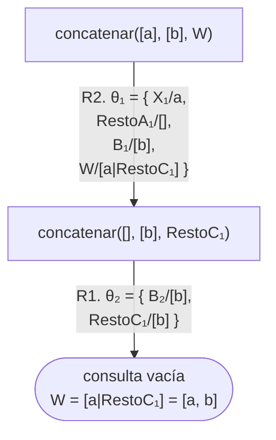
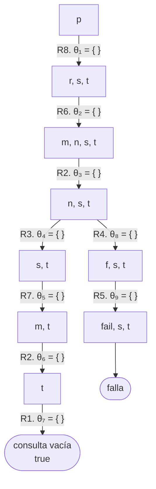
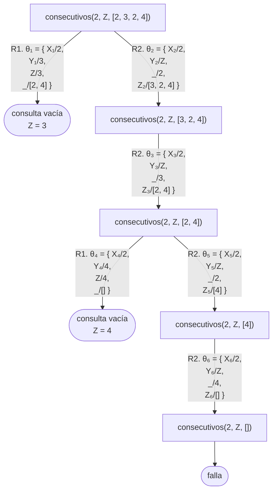
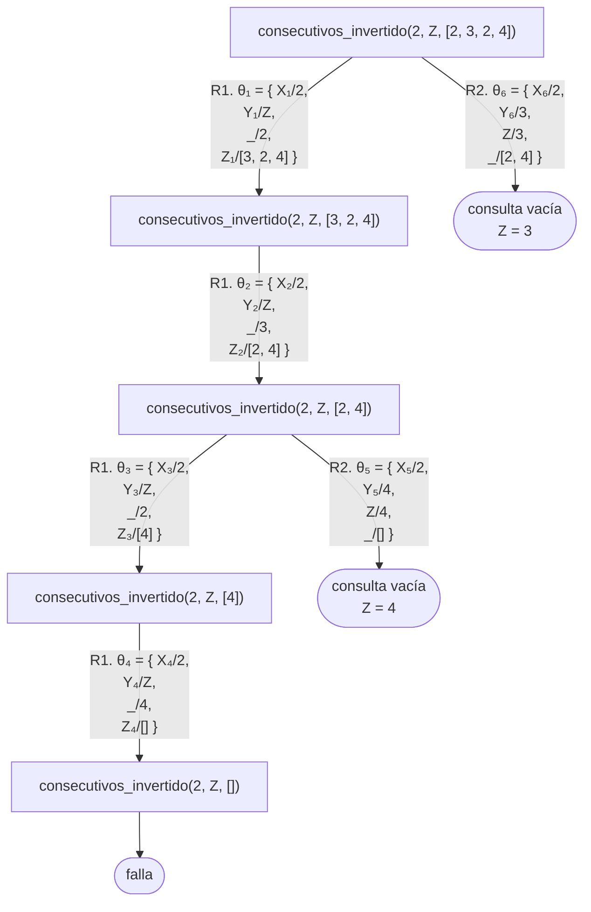

# La evaluación de un programa y los límites de la lógica

Esta página continúa la página
[Sustituciones y unificadores](sustituciones.md#139-unificadores-y-el-unificador-mas-general)
del [capítulo 13](index.md), con las secciones [13.10](#1310-los-cuatro-pasos)
a [13.13](#1313-lo-que-excede-la-logica) y el
[cierre de la parte I](#cierre-de-la-parte-i): los cuatro pasos en que se
descompone cada arco del árbol de derivación, el intérprete que deja sin fijar
las dos elecciones de cada paso, las dos estrategias para recorrer el árbol
que resulta —la de Prolog, en profundidad, y la de anchura—, la negación como
falla y lo que el lenguaje agrega a la lógica. Los programas están en
`evaluacion.pl`, en `ejemplos/capitulo-13/`, con sus pruebas.

## 13.10 Los cuatro pasos

Cada arco del árbol de derivación de la
[sección 5.2](../capitulo-05-como-responde-prolog/index.md#52-el-arbol-de-derivacion)
es un paso de resolución. La [sección 13.7](inferencia.md#137-como-prueba-prolog)
lo definió por su resultado; esta lo descompone en lo que Prolog hace para
construirlo. Dada la consulta pendiente —una conjunción de objetivos— y el
programa, un paso consiste en:

1. **Elegir** un objetivo de la consulta pendiente y una cláusula del programa
   cuya cabeza tenga el mismo nombre y la misma aridad que el objetivo, tomada
   con variables nuevas. Si no hay ninguna, el paso falla: el nodo es una hoja
   de falla.
2. **Unificar** el objetivo con la cabeza de la cláusula, calculando su
   unificador más general
   ([sección 13.9](sustituciones.md#139-unificadores-y-el-unificador-mas-general)).
   Si no existe, la cláusula no sirve para ese objetivo: en el árbol, no se
   abre un arco.
3. **Reemplazar** el objetivo por el cuerpo de la cláusula; por nada, si la
   cláusula es un hecho.
4. **Aplicar** el unificador a toda la consulta que queda.

Si la consulta queda vacía, la rama es de éxito, y la respuesta es la
composición de los unificadores de sus arcos, restringida a las variables de
la consulta original ([sección 13.8](sustituciones.md#138-sustituciones)). El
predicado para seguirlos es `concatenar/3` de la
[sección 7.4](../capitulo-07-listas/index.md#74-contar-durante-el-recorrido),
copiado en `evaluacion.pl` con sus dos cláusulas numeradas R1 y R2:

<!-- ejemplo: capitulo-13/evaluacion.pl predicado: concatenar/3 consulta: concatenar([a], [b], W). -->
```prolog
%!  concatenar(+A, ?B, -C) is det.
%!  concatenar(?A, ?B, +C) is nondet.
%
%   C es la lista A seguida de la lista B. Es el predicado de la sección 7.4,
%   copiado con su encabezado.
concatenar([], B, B).
concatenar([X|RestoA], B, [X|RestoC]) :-
    concatenar(RestoA, B, RestoC).
```

La consulta `?- concatenar([a], [b], W).` tiene un solo objetivo, de modo que
el primer paso no tiene nada que elegir en ese sentido. R1, con variables
nuevas, es `concatenar([], B₁, B₁)`, y su primer argumento `[]` no unifica
con `[a]`: la cláusula no sirve. R2 sí:

| Paso | Elegir | Unificar | Reemplazar y aplicar |
|---|---|---|---|
| 1 | `concatenar([a], [b], W)` con R2, `concatenar([X₁\|RestoA₁], B₁, [X₁\|RestoC₁]) :- concatenar(RestoA₁, B₁, RestoC₁).` | θ₁ = { X₁/a, RestoA₁/[], B₁/[b], W/[a\|RestoC₁] } | `concatenar([], [b], RestoC₁)` |
| 2 | el único objetivo con R1, `concatenar([], B₂, B₂).` | θ₂ = { B₂/[b], RestoC₁/[b] } | la consulta vacía |

En el paso 2, R2 tampoco sirve: `[X₂|RestoA₂]` no unifica con `[]`. La
composición θ₁θ₂ liga `W` a `[a|RestoC₁]` y después `RestoC₁` a `[b]`, de modo
que `W` queda ligada a `[a|[b]]`, que es `[a, b]`. Es el árbol siguiente, con
un solo camino, y la respuesta de Prolog:



```prolog
?- concatenar([a], [b], W).
W = [a, b].
```

Las dos cláusulas que no sirvieron, R1 en el primer paso y R2 en el segundo,
no aparecen en el árbol: son los arcos que no se abren de la
[sección 6.4](../capitulo-06-recursion/index.md#64-la-suma). El paso 2 falla
con ellas, no la rama: la rama falla solo cuando ninguna cláusula sirve para
el objetivo elegido.

!!! question "Actividad"
    Seguir los cuatro pasos, en papel, sobre `?- concatenar([], [b], W).` y
    sobre `?- concatenar([a], W, [a, b]).` En la segunda, el paso 2 del
    primer arco liga `W` a una variable nueva de R2, y la respuesta aparece
    recién en la composición. Comprobar las dos respuestas con el programa.

**Un programa sin variables.** Con el programa siguiente los cuatro pasos se
reducen a dos, elegir y reemplazar, porque el unificador es siempre vacío:

<!-- ejemplo: capitulo-13/evaluacion.pl predicado: t/0 m/0 n/0 f/0 r/0 s/0 p/0 consulta: p. -->
```prolog
% t: un hecho.
t.

% m: un hecho.
m.

% n: un hecho, y además la conclusión de una regla cuya condición no se cumple.
n.
n :-
    f.

% f: no se cumple nunca. La cláusula existe para que la consulta falle en vez
% de informar un predicado desconocido.
f :-
    fail.

%!  r is det.
%
%   r se cumple si se cumplen m y n.
r :-
    m,
    n.

%!  s is det.
%
%   s se cumple si se cumple m.
s :-
    m.

%!  p is det.
%
%   p se cumple si se cumplen r, s y t. Tiene una sola demostración; la
%   segunda cláusula de n/0 deja una alternativa pendiente que falla.
p :-
    r,
    s,
    t.
```

Con las cláusulas numeradas en el orden del archivo, de `t.` como R1 a la regla
de `p` como R8, la evaluación de `?- p.` que elige siempre el primer objetivo y
la primera cláusula es esta sucesión de consultas pendientes:

| Paso | Consulta pendiente | Se elige | Queda |
|---|---|---|---|
| 1 | `p` | `p` con R8 | `r, s, t` |
| 2 | `r, s, t` | `r` con R6 | `m, n, s, t` |
| 3 | `m, n, s, t` | `m` con R2 | `n, s, t` |
| 4 | `n, s, t` | `n` con R3, la primera de sus dos cláusulas | `s, t` |
| 5 | `s, t` | `s` con R7 | `m, t` |
| 6 | `m, t` | `m` con R2 | `t` |
| 7 | `t` | `t` con R1 | la consulta vacía |

En el paso 4 había otra cláusula para `n`: R4, `n :- f.`, que reemplaza `n` por
`f` y deja `f, s, t`. Con R5 queda `fail, s, t`, y `fail` es el objetivo
predefinido de la
[sección 10.8](../capitulo-10-negacion-como-falla/index.md#108-prescindir-de)
que falla siempre: la rama termina en una hoja de falla. El árbol tiene las
dos ramas; los subíndices de las sustituciones, todas vacías, siguen el orden
en que Prolog las recorre:



```prolog
?- p.
true ;
false.
```

La primera respuesta es la hoja de éxito de la izquierda. El `;` pide otra, y
Prolog retrocede hasta el último nodo con una alternativa sin explorar, el de
`n, s, t`, baja por R4 y llega a la hoja de falla: `false.` La rama de la
derecha existe aunque no produzca nada, y el recorrido la visita.

Un paso nunca resuelve dos cláusulas del programa entre sí, como señaló la
[sección 13.7](inferencia.md#137-como-prueba-prolog): combina la consulta pendiente
con una cláusula del programa, y lo que produce es la consulta pendiente
siguiente. Por eso una evaluación es un camino en un árbol, y las distintas
maneras de elegir son sus ramas. La sección siguiente describe el
procedimiento que las genera todas.

## 13.11 El intérprete no determinista y las estrategias de evaluación

Los cuatro pasos contienen dos decisiones: qué objetivo de la consulta
pendiente se ataca, y con qué cláusula. Cada una es un **punto de elección**.
El procedimiento que resulta de dejarlas abiertas es este:

1. Si la consulta pendiente está vacía, terminar con éxito: la respuesta es
   la composición de los unificadores aplicados, restringida a las variables
   de la consulta original.
2. Elegir un objetivo de la consulta pendiente.
3. Elegir una cláusula del programa cuya cabeza unifique con ese objetivo,
   tomada con variables nuevas. Si no hay ninguna, terminar con falla.
4. Reemplazar el objetivo por el cuerpo de la cláusula, aplicar el unificador
   a toda la consulta, y volver al paso 1.

«Elegir» es la palabra decisiva: el procedimiento no dice cómo. Un
procedimiento que deja elecciones abiertas se llama **no determinista**, y
describe a la vez todas las computaciones posibles, una por cada manera de
elegir. No se lo puede escribir en Prolog con lo que la parte I presentó: hace
falta leer las cláusulas del programa como datos, y es lo que hace el
intérprete de la
[sección 34.2](../capitulo-34-introspeccion-y-metainterpretes/index.md#342-el-interprete-vainilla).

El conjunto de todas sus computaciones es el **árbol de derivación** del
[capítulo 5](../capitulo-05-como-responde-prolog/index.md): cada nodo es una
consulta pendiente, cada hijo es el resultado de elegir una cláusula para el
objetivo elegido, y cada hoja es la consulta vacía o una falla. El predicado
para verlo es `consecutivos/3`, que se cumple cuando `X` e `Y` aparecen
seguidos, en ese orden, en la lista `L`:

<!-- ejemplo: capitulo-13/evaluacion.pl predicado: consecutivos/3 consulta: consecutivos(2, Z, [2, 3, 2, 4]). -->
```prolog
%!  consecutivos(?X, ?Y, ?L) is nondet.
%
%   X e Y aparecen consecutivos, en ese orden, en la lista L.
consecutivos(X, Y, [X, Y|_]).
consecutivos(X, Y, [_|Z]) :-
    consecutivos(X, Y, Z).
```

La consulta `?- consecutivos(2, Z, [2, 3, 2, 4]).` pregunta qué sigue a un 2.
Con el hecho numerado R1 y la regla R2, y las variables de cada uso de una
cláusula con el subíndice de ese uso, el árbol es:



En el nodo `consecutivos(2, Z, [3, 2, 4])` no hay arco de R1, porque
`[2, Y₃|_]` no unifica con `[3, 2, 4]`; lo mismo ocurre en
`consecutivos(2, Z, [4])`, y en `consecutivos(2, Z, [])` no sirve ninguna de
las dos. Dos hojas de éxito, con `Z = 3` y `Z = 4`, y una de falla. El árbol
existe con independencia de cómo se lo recorra: es el conjunto de todas las
computaciones del intérprete no determinista.

**Las estrategias.** Un intérprete real tiene que decidir las dos elecciones,
y la manera de decidirlas se llama **estrategia de evaluación**. Prolog elige
siempre el objetivo de más a la izquierda y las cláusulas en el orden del
archivo, y cuando una rama termina retrocede al último punto de elección con
alternativas pendientes, deshaciendo las ligaduras hechas desde entonces: es
el backtracking del [capítulo 5](../capitulo-05-como-responde-prolog/index.md),
y la estrategia se llama **recorrido en profundidad**, porque baja por cada
rama hasta el final antes de pasar a la siguiente. Sobre el árbol de arriba
produce las respuestas en el orden de las hojas, de izquierda a derecha:

```prolog
?- consecutivos(2, Z, [2, 3, 2, 4]).
Z = 3 ;
Z = 4 ;
false.
```

El orden de las cláusulas es parte de la estrategia. Con las dos cláusulas
intercambiadas el árbol es el mismo, reflejado: en cada nodo la rama de la
regla queda a la izquierda y la del hecho a la derecha.

<!-- ejemplo: capitulo-13/evaluacion.pl predicado: consecutivos_invertido/3 consulta: consecutivos_invertido(2, Z, [2, 3, 2, 4]). -->
```prolog
%!  consecutivos_invertido(?X, ?Y, ?L) is nondet.
%
%   Las dos cláusulas de consecutivos/3 en el orden inverso. El árbol es el
%   mismo, reflejado: el recorrido en profundidad encuentra las mismas
%   respuestas en el orden contrario.
consecutivos_invertido(X, Y, [_|Z]) :-
    consecutivos_invertido(X, Y, Z).
consecutivos_invertido(X, Y, [X, Y|_]).
```



```prolog
?- consecutivos_invertido(2, Z, [2, 3, 2, 4]).
Z = 4 ;
Z = 3.
```

El recorrido en profundidad llega primero a la hoja de falla, después a
`Z = 4` y por último a `Z = 3`: las mismas respuestas, en el orden contrario,
y la última con un punto en vez de `;`, porque ya no queda ningún punto de
elección con alternativas. Es la
[sección 5.4](../capitulo-05-como-responde-prolog/index.md#54-el-orden-de-las-clausulas-determina-el-orden-de-las-respuestas),
explicada por el árbol que el intérprete no determinista define.

**El recorrido en anchura.** La otra estrategia visita el árbol por niveles:
todos los nodos a distancia $n$ de la raíz antes que cualquiera a distancia
$n + 1$. Sobre el árbol de `consecutivos/3` produce las mismas dos
respuestas, `Z = 3` en el nivel 1 y `Z = 4` en el nivel 3. La diferencia
aparece con las ramas infinitas de la
[sección 5.6](../capitulo-05-como-responde-prolog/index.md#56-ramas-infinitas):
en el árbol de `antepasado/2` con la recursión a la izquierda, el recorrido en
profundidad baja por la primera rama y no termina nunca, mientras que el
recorrido en anchura llega, en el nivel 2, a las ramas de R2 que están a la
derecha, y produce cada una de las respuestas que el programa afirma. El
ejercicio 21 lo hace sobre `ascendiente/2`. Un recorrido en anchura encuentra
toda hoja de éxito que exista, porque cada hoja está a una distancia finita de
la raíz y el recorrido llega a esa distancia tarde o temprano. Lo que no puede
es responder `false.` sobre un árbol infinito sin hojas de éxito: los niveles
no se acaban nunca.

El precio es doble. El recorrido en anchura guarda todos los nodos de un nivel
mientras explora el siguiente, y los niveles crecen rápido; el recorrido en
profundidad guarda solo la rama actual y sus puntos de elección. Y las
respuestas salen en el orden de los niveles, no en el del programa. No se lo
puede escribir con lo que la parte I presentó: el
[ejercicio 6 del capítulo 34](../capitulo-34-introspeccion-y-metainterpretes/index.md#ejercicios)
escribe un intérprete que lo hace, y la
[sección 41.2](../capitulo-41-busqueda-y-planificacion/index.md#412-una-sola-busqueda-varias-estrategias)
lo aplica a problemas de búsqueda, junto con una tercera estrategia que
combina las ventajas de las dos.

!!! question "Actividad"
    Ejecutar `?- consecutivos(1, 2, L).` y pedir cuatro respuestas. El árbol
    es infinito, como el de la [sección 5.6](../capitulo-05-como-responde-prolog/index.md#56-ramas-infinitas), pero cada hoja de éxito está a
    profundidad finita y el recorrido en profundidad las encuentra una por
    una. Explicar por qué este árbol infinito no impide responder y el de
    `antepasado/2` sí.

**Lógica y control.** Las cláusulas de un programa son su lógica: lo que
afirma, y lo que la [sección 13.6](inferencia.md#136-interpretaciones-modelos-y-consecuencia-logica)
define como sus consecuencias. La estrategia es su control: en qué orden se
buscan esas consecuencias. Un algoritmo escrito en Prolog es las dos cosas
juntas, «lógica más control», y los capítulos
[5](../capitulo-05-como-responde-prolog/index.md) y
[9](../capitulo-09-backtracking-y-corte/index.md) enseñaron el control que
Prolog tiene: el orden de los objetivos y de las cláusulas, y el corte, que
poda ramas del árbol sin agregar ni quitar nada a lo que las cláusulas
afirman. Tres observaciones cierran la sección:

- la elección del objetivo cambia la forma y el tamaño del árbol, pero no el
  conjunto de respuestas que contiene; el
  [capítulo 39](../capitulo-39-semantica-de-los-programas-logicos/resolucion.md#392-resolucion-sld)
  enuncia ese resultado;
- la elección de la cláusula, es decir el orden de las cláusulas, cambia el
  orden de las respuestas y, cuando hay ramas infinitas, cuáles se alcanzan;
- una hoja de éxito es una respuesta correcta cualquiera sea la estrategia que
  la encuentre, por la corrección de la resolución de la
  [sección 13.7](inferencia.md#137-como-prueba-prolog); lo que distingue a las
  estrategias es si encuentran todas las que existen.

## 13.12 La negación

Un programa de hechos y reglas no puede afirmar que algo es falso: ninguna
cláusula de Horn tiene la forma $\lnot A$, y la
[sección 13.6](inferencia.md#136-interpretaciones-modelos-y-consecuencia-logica) mostró
que ninguna negación es consecuencia de un programa así. Lo que Prolog ofrece
en su lugar es la **negación como falla** del
[capítulo 10](../capitulo-10-negacion-como-falla/index.md): `\+ p` tiene
éxito cuando `p` no se puede probar. Su definición es un corte seguido de
`fail`, la forma que la
[sección 10.8](../capitulo-10-negacion-como-falla/index.md#108-prescindir-de)
escribió a mano:

<!-- ejemplo: capitulo-13/logica.pl predicado: sin_hijos/1 consulta: sin_hijos(luis). -->
```prolog
%!  sin_hijos(+P) is semidet.
%
%   No se puede probar que P tenga hijos. Es la negación escrita con el corte
%   y fail, la definición de \+ que describe la sección 10.2. P debe llegar
%   ligada: con P libre, tiene_hijos(P) encuentra a alguien con hijos, el corte
%   descarta la segunda cláusula y fail hace fallar al predicado para todos.
sin_hijos(P) :-
    tiene_hijos(P),
    !,
    fail.
sin_hijos(_).
```

```prolog
?- sin_hijos(luis).
true.

?- sin_hijos(pedro).
false.

?- sin_hijos(P).
false.
```

El corte es rojo
([sección 9.5](../capitulo-09-backtracking-y-corte/index.md#95-corte-verde-y-corte-rojo)):
sin él, la segunda cláusula se cumpliría siempre. La tercera consulta es el
problema de la
[sección 10.4](../capitulo-10-negacion-como-falla/index.md#104-donde-ubicar)
visto desde la [sección 13.4](index.md#134-las-variables-y-los-cuantificadores): con
`P` libre, `tiene_hijos(P)` se cumple para algún valor, y la falla vale para
todos los valores a la vez, porque la variable está cuantificada
universalmente. La negación como falla no enumera a quienes no tienen hijos.

Leída desde los modelos, `\+ p` tiene éxito cuando $p$ no es consecuencia del
programa, lo que no equivale a que $\lnot p$ lo sea: la diferencia de la
[sección 10.3](../capitulo-10-negacion-como-falla/index.md#103-por-que-no-es-la-negacion-de-la-logica).
Las dos coinciden bajo el supuesto de mundo cerrado de la
[sección 10.1](../capitulo-10-negacion-como-falla/index.md#101-el-supuesto-de-mundo-cerrado):
que el programa contiene toda la información relevante, de modo que lo que no
se deduce de él es falso. El cuantificador universal que la
[sección 12.2](../capitulo-12-ejercicios-integradores/index.md#122-para-todo-la-doble-negacion)
escribe con dos `\+` anidados hereda la misma condición. La
[sección 39.3](../capitulo-39-semantica-de-los-programas-logicos/resolucion.md#393-negacion-como-falla-la-complecion-de-clark-y-sldnf)
da la cuenta precisa de qué afirma un programa con `\+`.

## 13.13 Lo que excede la lógica

Las dos lecturas coinciden en la mayoría de los casos. Esta sección enumera las
excepciones, que se deben tener presentes cuando un programa produce un
resultado inesperado.

**El orden.** Las fórmulas no tienen orden: $a \land b$ y $b \land a$ son equivalentes.
En Prolog tienen el mismo significado pero distinto comportamiento, y en algunos
casos la diferencia determina si el programa termina o no ([capítulo 5](../capitulo-05-como-responde-prolog/index.md)).

**El recorrido no alcanza todo lo que el método demuestra.** La resolución
encuentra toda consecuencia del programa; el recorrido en profundidad de la
[sección 13.11](evaluacion.md#1311-el-interprete-no-determinista-y-las-estrategias-de-evaluacion)
no llega a las ramas ubicadas a la derecha de una rama infinita. Es la razón
de fondo por la cual existe el corte.

**El corte.** `!` sí tiene traducción a la lógica, y es la más simple posible:
se lee como un objetivo que siempre se cumple, de modo que una cláusula con
corte afirma lo mismo que afirmaría sin él. Lo que el corte altera no es la
lectura sino el acuerdo entre la lectura y las respuestas: con un corte rojo, el
programa deja de responder de acuerdo con lo que sus propias cláusulas afirman
([capítulo 9](../capitulo-09-backtracking-y-corte/index.md)). De ahí la recomendación de escribir primero cláusulas verdaderas y
agregar los cortes después.

**`\+` no es $\lnot$.** La negación lógica establece que una afirmación es
falsa; `\+` establece que no se la pudo probar, y coinciden solo bajo el
supuesto de mundo cerrado ([sección 13.12](#1312-la-negacion)).

**Las respuestas repetidas.** La lógica establece que una afirmación es
verdadera; Prolog produce una respuesta por cada demostración, como se observó
con `tiene_hijos/1`.

**`is/2`.** "X es el resultado de 2+3" se asemeja a una igualdad, pero opera en
un único sentido ([capítulo 8](../capitulo-08-aritmetica/index.md)). Corresponde a la relación aritmética únicamente
cuando su lado derecho no contiene variables sin valor; fuera de ese caso, el
programa abandona la lógica por completo.

**Los errores.** Todo el curso sostiene que una consulta responde `true.` o
`false.`, y hay un tercer desenlace: `is/2` y las comparaciones aritméticas no
responden ninguna de las dos cuando sus argumentos no tienen valor, sino que
emiten un error. Un error no tiene ninguna contraparte en la lógica: no es una
afirmación verdadera ni falsa, es la ejecución que se interrumpe.

**La unificación no es exactamente la de la lógica.** Lógicamente no existe
ningún valor que haga idénticos a `X` y a `padre(X)`: el segundo término siempre
tiene un nivel más de anidamiento, y el unificador de la
[sección 13.9](sustituciones.md#139-unificadores-y-el-unificador-mas-general) no existe.
Prolog, sin embargo, acepta la unificación:

```prolog
?- X = padre(X).
X = padre(X).
```

Construye un término que se contiene a sí mismo. La comprobación que evitaría
este caso existe, y tiene un costo que las implementaciones prefieren no pagar
en cada unificación. Es la diferencia menos visible de esta lista, porque no
produce un error ni una respuesta extraña: produce un término que no
corresponde a ninguna afirmación del programa.

Ninguna de estas diferencias es un defecto: son consecuencia de que el lenguaje,
además de expresar afirmaciones, **se ejecuta**. Conviene conocerlas, porque
cuando un programa produce un resultado inesperado, la causa es con frecuencia
una de ellas.

## Cierre de la parte I

Con este capítulo termina la primera parte del curso. Los contenidos cubiertos
son:

- la escritura de hechos, reglas y consultas, y sus dos lecturas;
- el modelo de búsqueda de Prolog, y su representación como árbol de derivación;
- unificación, recursión, listas y aritmética;
- el corte y la negación, con sus restricciones;
- el texto: sus representaciones, sus conversiones y `format/2`;
- los ejercicios integradores del
  [capítulo 12](../capitulo-12-ejercicios-integradores/index.md), que combinan
  esas herramientas, y la doble negación con la que se expresa «para todo»;
- quince plantillas que cubren la mayor parte de los programas de este nivel;
- la base lógica de todo lo anterior: términos y fórmulas, modelos y
  consecuencia lógica, resolución y refutación, sustituciones y unificadores, y
  las estrategias de evaluación.

La parte II, «Prolog para programadores», va del
[capítulo 14](../capitulo-14-el-entorno-de-trabajo/index.md) al
[32](../capitulo-32-ejecutables-y-distribucion/index.md) y enseña a escribir
con el lenguaje programas que otros usan: el entorno de trabajo y las pruebas,
el estilo y el rendimiento, todas las soluciones de una consulta, el orden
superior, la base de datos dinámica, las gramáticas, las restricciones, los
módulos, las excepciones y los archivos, y la entrega de programas por línea
de comandos, desde Python y por HTTP; con todas las soluciones y el orden
superior, gran parte de lo que en la parte I se debía escribir de manera
explícita se reduce a una línea. La parte III, «Lo avanzado», va del
[capítulo 33](../capitulo-33-inspeccion-de-terminos/index.md) al
[43](../capitulo-43-prolog-y-sql/index.md) y trata los programas como datos,
las interfaces de usuario y la concurrencia, la semántica, la tabulación, la
búsqueda, los juegos y la relación con SQL; la parte IV, «Proyectos», va del
[capítulo 44](../capitulo-44-proyecto-resolver-ecuaciones/index.md) al
[88](../capitulo-88-proyecto-preguntas-en-castellano/index.md) y construye con
todo lo anterior proyectos completos.

## Ejercicios

Las soluciones están en [la página de soluciones](soluciones.md). La dificultad
va de 1 (se resuelve consultando el capítulo) a 3 (requiere elaboración propia).
Los marcados con ★ son los que no conviene saltear: cubren lo que el capítulo
tiene de propio, y los capítulos siguientes los dan por hechos.

20. **(2)** Evaluar `?- concatenar(X, Y, [a, b]).` con los cuatro pasos de la
    [sección 13.10](#1310-los-cuatro-pasos): para cada paso, la
    cláusula elegida, el unificador más general y la consulta que queda.
    Componer las sustituciones de cada rama de éxito hasta obtener las tres
    respuestas, dibujar el árbol, y compararlo con lo que pide el
    [ejercicio 14 del capítulo 7](../capitulo-07-listas/index.md#ejercicios)
    para la misma consulta.
21. ★ **(3)** El programa siguiente tiene una lectura declarativa correcta y no
    produce ninguna respuesta:

    ```prolog
    %!  ascendiente(?A, ?D) is nondet.
    %
    %   A es ascendiente de D.
    ascendiente(A, D) :-
        ascendiente(A, X),
        progenitor(X, D).
    ascendiente(A, D) :-
        progenitor(A, D).
    ```

    a. Escribir su lectura declarativa y explicar por qué es verdadera.

    b. Dibujar el árbol de `?- ascendiente(juan, Quien).` hasta profundidad 3,
       con las ramas de la segunda cláusula.

    c. Decir qué respuestas obtiene el recorrido en profundidad, y cuáles, y en
       qué orden, obtendría el recorrido en anchura de la
       [sección 13.11](#1311-el-interprete-no-determinista-y-las-estrategias-de-evaluacion).

    d. Intercambiar las dos cláusulas: qué cambia para el recorrido en
       profundidad, y si termina después de dar las respuestas.

    e. Verdadero o falso: «las respuestas corresponden a nodos intermedios del
       árbol, y las fallas a sus hojas».

22. **(2)** Con los hechos `p(a, b)`, `p(a, e)`, `p(b, c)`, `p(b, d)` y
    `p(e, f)` y las reglas

    ```prolog
    q(X, Y) :- p(X, Z), p(Z, Y).
    r(X, Y) :- p(Z, X), p(Z, Y).
    s(X, Y) :- p(Z, Y), r(Z, X).
    ```

    a. Mostrar que `?- q(e, b).` falla con cualquier estrategia: ninguna rama
       de su árbol llega a la consulta vacía.

    b. Mostrar una respuesta de `?- r(X, X), s(X, Y).` que el intérprete no
       determinista puede obtener eligiendo primero el **segundo** objetivo,
       con cada elección anotada.

    c. Decir qué respuesta da Prolog primero, y por qué. Comprobarlo con el
       programa.

23. **(3)** El siguiente programa y la siguiente fórmula no tienen el mismo
    significado. Identificar la diferencia:

    ```prolog
    %!  sin_mascota(?P) is nondet.
    %
    %   P es una persona sin mascota.
    sin_mascota(P) :-
        persona(P),
        \+ tiene(P, _).
    ```

    $$\forall P \; \bigl( \mathit{persona}(P) \land \lnot \, \exists M \; \mathit{tiene}(P, M)
  \rightarrow \mathit{sin\_mascota}(P) \bigr)$$

24. **(2)** De las diferencias que enumera la
    [sección 13.13](#1313-lo-que-excede-la-logica), indicar cuál explica cada
    uno de estos comportamientos:

    a. `?- categoria(sofia, adulto).` responde `true.`

    b. `?- tiene_hijos(P).` informa dos veces a `juan`.

    c. `?- X is 3 + Y.` no responde `true.` ni `false.`

    d. Un programa correcto no produce una respuesta que sus cláusulas afirman.

    e. Sobre la versión de `ascendiente/2` del ejercicio 21,
       `?- \+ ascendiente(eva, luis).` no responde nunca, aunque eva no es
       ascendiente de nadie.

25. **(3)** Elegir un predicado de cualquier capítulo anterior, escribir su
    lectura declarativa, e indicar si el programa cumple exactamente lo que la
    fórmula afirma.

## Resumen

| | |
|---|---|
| **lectura procedimental** | qué hace Prolog para responder una consulta |
| **lectura declarativa** | qué afirma el programa |
| **término**, **fórmula atómica** | un objeto; una afirmación: un nombre de predicado aplicado a tantos términos como su aridad |
| **cláusula**, **programa** | una fórmula de la forma de Horn; un conjunto de hechos y reglas, del que la consulta no forma parte |
| `,` | $\land$ |
| varias cláusulas | $\lor$ |
| `:-` | $\rightarrow$, con los operandos en orden inverso |
| variable en la cabeza | $\forall$, con alcance sobre toda la cláusula |
| variable solo en el cuerpo | $\exists$, con alcance sobre el antecedente |
| **cláusula de Horn** | una implicación con una única conclusión |
| hecho, regla, consulta | los tres casos de la misma forma |
| **interpretación** | un dominio y un significado para cada constante, functor y nombre de predicado |
| **modelo** | una interpretación que satisface todas las cláusulas del programa |
| **consecuencia lógica**, $P \models f$ | $f$ es verdadera en todos los modelos de $P$; es lo que pregunta una consulta |
| **regla de inferencia**, **modus ponens** | produce fórmulas nuevas mirando solo la forma; de $A$ y $A \rightarrow B$ se infiere $B$ |
| **deducción**, $P \vdash f$ | una sucesión de pasos de inferencia que termina en $f$ |
| **corrección**, **completitud** | todo lo deducido es consecuencia; toda consecuencia se puede deducir |
| **resolución** | reemplazar un objetivo por el cuerpo de una cláusula cuya cabeza unifica con él |
| **refutación** | probar una afirmación suponiendo su negación y derivando una contradicción |
| **resolvente** | la disyunción que queda al resolver dos cláusulas; la cláusula vacía, $\square$, es la contradicción |
| **árbol de refutación** | el árbol de derivación leído como resoluciones: cada nodo es un resolvente, cada arco un paso, y la consulta vacía de la hoja de éxito es la cláusula vacía $\square$ |
| **sustitución**, $P\theta$ | un conjunto de pares `Variable/término`; su aplicación reemplaza cada variable ligada por su término |
| **instancia** | $Q$ es instancia de $P$ si $P\theta = Q$ para alguna θ |
| **composición** θσ, **sustitución vacía** ε | aplicar σ a los términos de θ y agregar los pares de σ que θ no liga; θε = εθ = θ |
| **unificador**, **unificador más general** | θ con $E_1\theta = E_2\theta$; el que tiene a todos los demás como instancias, y el que Prolog calcula |
| **los cuatro pasos** | elegir objetivo y cláusula, unificar, reemplazar, aplicar la sustitución a toda la consulta |
| **intérprete no determinista** | el procedimiento que elige objetivo y cláusula sin fijar cómo: describe todas las ramas a la vez |
| **recorrido en profundidad**, **recorrido en anchura** | el de Prolog; el que alcanza toda hoja de éxito aun con ramas infinitas |
| **negación como falla** | `\+ p` tiene éxito cuando `p` no se puede probar; coincide con $\lnot$ solo bajo el supuesto de mundo cerrado |

## Temas que se retoman

| Tema | Se retoma en |
|---|---|
| Reunir todas las respuestas de una consulta | [capítulo 18](../capitulo-18-todas-las-soluciones/index.md) |
| Predicados que reciben predicados como argumento | [capítulo 19](../capitulo-19-orden-superior/index.md) |
| Programas que se modifican durante la ejecución | [capítulo 21](../capitulo-21-base-de-datos-dinamica/index.md) |
| Gramáticas, que son cláusulas con otra notación | [capítulo 22](../capitulo-22-gramaticas-dcg/index.md) |
| Restricciones, donde la lectura declarativa vuelve a ser exacta | [capítulo 24](../capitulo-24-programacion-con-restricciones/index.md) |
| Metaintérpretes: un intérprete de Prolog escrito en Prolog | [capítulo 34](../capitulo-34-introspeccion-y-metainterpretes/index.md) |
| Un metaintérprete que recorre el árbol en anchura | [capítulo 34](../capitulo-34-introspeccion-y-metainterpretes/index.md#ejercicios), ejercicio 6 |
| Modelos de Herbrand, resolución SLD y SLDNF enunciados con precisión, estratificación | [capítulo 39](../capitulo-39-semantica-de-los-programas-logicos/index.md) |
| Unificación con verificación de ocurrencia | [capítulo 39](../capitulo-39-semantica-de-los-programas-logicos/resolucion.md), página «Resolución SLD y SLDNF» |
| Recorrido en anchura, profundidad limitada y profundización iterativa sobre espacios de estados | [capítulo 41](../capitulo-41-busqueda-y-planificacion/index.md) |
| Resolución sobre fórmulas que no son cláusulas de Horn | [capítulo 63](../capitulo-63-proyecto-demostrador-teoremas/index.md) |
| Tablas de verdad calculadas con un programa | [capítulo 63](../capitulo-63-proyecto-demostrador-teoremas/index.md) |

## Referencias

- Álvaro Tasistro y Jorge Vidart, *Programación lógica y funcional*, 1988 —
  parte I, «Programación en lógica», caps. 2 «Introducción a la
  programación en lógica», 3 «Interpretación lógica» y 4 «Interpretación
  algorítmica». Esta página adapta de allí, con la notación de SWI-Prolog y
  los nombres de este curso, los cuatro pasos de la evaluación, el
  intérprete no determinista, las estrategias de evaluación y el
  tratamiento de la negación.
- Robert Kowalski, «Algorithm = Logic + Control», 1979 — citado a través de la
  obra de Tasistro y Vidart: la ecuación que resume la [sección 13.11](#1311-el-interprete-no-determinista-y-las-estrategias-de-evaluacion).
- Christopher J. Hogger, *Introduction to Logic Programming*, 1984 — el
  ejemplo de los elementos consecutivos de la [sección 13.11](#1311-el-interprete-no-determinista-y-las-estrategias-de-evaluacion) proviene de allí, a
  través de la obra de Tasistro y Vidart.

Los programas del capítulo son propios, escritos para el curso; la obra citada
aporta las definiciones, los teoremas que el capítulo enuncia sin demostrar y
los ejemplos de unificación y de evaluación, reescritos con la notación de
SWI-Prolog.
