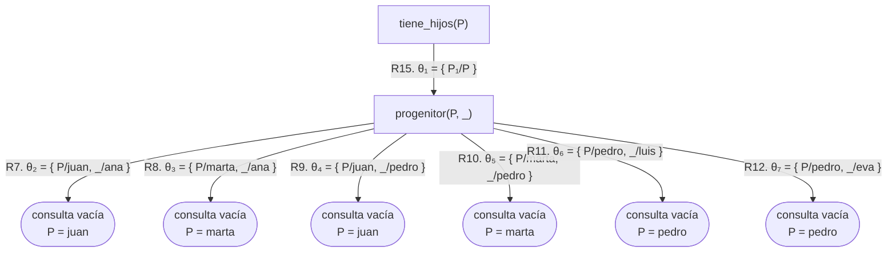

# Capítulo 13 — Prolog y la lógica

Este capítulo cierra la parte I, y vincula todo su contenido con la asignatura
de lógica.

En los capítulos anteriores se describió a Prolog como un mecanismo de búsqueda
de respuestas: prueba objetivos, recorre cláusulas, retrocede. Esa descripción
es correcta, y corresponde a lo que ocurre durante la ejecución del programa.
Existe una segunda lectura, presente desde el [capítulo 1](../capitulo-01-la-primera-hora/index.md) aunque no se la haya
nombrado: **un programa Prolog es un conjunto de afirmaciones lógicas**, y una
consulta es una pregunta sobre lo que se deduce de ellas.

Las dos lecturas coexisten, y en la mayoría de los casos coinciden. Este
capítulo describe la correspondencia entre ambas, y también los casos en los que
difieren.

Los capítulos anteriores usaron la lógica sin nombrarla: la unificación del
[capítulo 4](../capitulo-04-terminos-y-unificacion/index.md), el árbol de
derivación del [capítulo 5](../capitulo-05-como-responde-prolog/index.md), la
negación como falla del
[capítulo 10](../capitulo-10-negacion-como-falla/index.md). Este capítulo
enuncia, al nivel de un primer curso, la base sobre la que descansó toda la
parte I: qué es un término y qué es una fórmula, qué afirma un programa y cuándo
una consulta es consecuencia de él, con qué regla de inferencia prueba Prolog,
qué son las sustituciones y los unificadores que etiquetan los árboles desde el
[capítulo 5](../capitulo-05-como-responde-prolog/index.md), y cómo se evalúa
un programa paso a paso. Sigue, en lo esencial, la parte I de la obra que se
cita en [Referencias](#referencias). Las secciones
[13.6](inferencia.md#136-interpretaciones-modelos-y-consecuencia-logica) a
[13.11](evaluacion.md#1311-el-interprete-no-determinista-y-las-estrategias-de-evaluacion)
y [13.12](evaluacion.md#1312-la-negacion) a
[13.13](evaluacion.md#1313-lo-que-excede-la-logica) siguen en tres páginas,
una después de otra, hasta el cierre de la parte I; los ejercicios están en
esta página.

## Objetivos del capítulo

Al terminar el capítulo, el lector puede:

- distinguir un término de una fórmula atómica y de una cláusula, y decir qué
  contiene un programa y qué no;
- leer una regla como una fórmula lógica, escribir una fórmula como regla, y
  determinar qué cuantificador corresponde a cada variable de una cláusula;
- explicar qué es una cláusula de Horn y por qué Prolog se restringe a ellas;
- explicar qué afirma un programa —interpretación, modelo y consecuencia
  lógica— y decidir, en un programa pequeño, si una fórmula es consecuencia de
  él;
- describir el método de prueba de Prolog, resolución y refutación, y enunciar
  en una oración qué significa que sea correcto y que sea completo;
- aplicar y componer sustituciones, decidir si un término es instancia de otro,
  y hallar el unificador más general de dos términos o explicar por qué no
  existe;
- seguir la evaluación de una consulta con los cuatro pasos de un paso de
  inferencia, y reconocerla en el árbol de derivación;
- describir el intérprete no determinista y comparar el recorrido en
  profundidad con el de anchura: qué termina y en qué orden responde;
- identificar las construcciones de Prolog que **no** admiten una lectura
  lógica.

!!! info "Tiempo estimado"
    Leer el capítulo, ejecutar sus ejemplos y hacer las actividades: **2:47 h**.
    Resolver los 7 ejercicios marcados con ★: **2:25 h**.
    Resolver los 25 ejercicios del final: **7:40 h**.

## 13.1 Las dos lecturas

La siguiente es una regla del ejemplo de este capítulo:

<!-- ejemplo: capitulo-13/logica.pl predicado: madre/2 consulta: madre(Quien, ana). -->
```prolog
%!  madre(?M, ?H) is nondet.
%
%   Para toda M y todo H, si M es mujer y M es progenitora de H, entonces M es
%   madre de H.
madre(M, H) :-
    mujer(M),
    progenitor(M, H).
```

La **lectura procedimental** es la que se usó hasta aquí: para probar que M es
madre de H, se prueba que M es mujer, y después se prueba que M es progenitora
de H.

La **lectura declarativa** no hace referencia a ningún procedimiento de prueba:

> Para toda M y todo H: si M es mujer y M es progenitora de H, entonces M es
> madre de H.

En notación simbólica, como en la asignatura de lógica:

$$\forall M \, \forall H \; \bigl( \mathit{mujer}(M) \land \mathit{progenitor}(M, H)
  \rightarrow \mathit{madre}(M, H) \bigr)$$

La fórmula no establece el orden en que se deben probar las condiciones, ni hace
referencia al backtracking. Establece qué es verdadero. Sin embargo, es
exactamente la misma regla.

En la lectura declarativa, un predicado define una **relación**. Un conjunto de
hechos la define por enumeración: `progenitor/2` es la relación formada por los
seis pares que sus hechos nombran. Una regla define una relación nueva a partir
de otras: `madre/2` es la parte de `progenitor/2` cuyo primer componente está en
`mujer/1`. Una consulta sin variables, `?- madre(marta, ana).`, pregunta si un
par pertenece a la relación; una consulta con variables pide los pares que
pertenecen a ella, y cada respuesta es uno de esos pares:

```prolog
?- madre(Quien, ana).
Quien = marta ;
false.
```

Es la lectura que el
[capítulo 2](../capitulo-02-hechos-consultas-y-variables/index.md) dio a las
consultas, enunciada sobre relaciones.

## 13.2 Términos, fórmulas y programas

Las afirmaciones de un programa se escriben con un vocabulario fijo, que el
[capítulo 4](../capitulo-04-terminos-y-unificacion/index.md) presentó pieza por
pieza:

- las **constantes**: los átomos y los números
  ([secciones 4.2](../capitulo-04-terminos-y-unificacion/index.md#42-atomos) y
  [4.3](../capitulo-04-terminos-y-unificacion/index.md#43-numeros)), que
  nombran objetos: `juan`, `ana`, `3`;
- las **variables**
  ([sección 4.4](../capitulo-04-terminos-y-unificacion/index.md#44-variables)):
  `M`, `H`, `Quien`, `_`;
- los **functores**, cada uno con su aridad: los nombres de los términos
  compuestos de la
  [sección 4.5](../capitulo-04-terminos-y-unificacion/index.md#45-terminos-compuestos),
  `fecha/3`, `mascota/2`. La palabra no apareció hasta aquí: nombra lo que esa
  sección llamó «el nombre» del término compuesto, y la nota siguiente dice
  en qué sentido se la usa;
- los **nombres de predicado**, cada uno con su aridad: `progenitor/2`,
  `madre/2`, `tiene_hijos/1`.

!!! note "La palabra «functor»"
    «Functor» tiene más de un significado en la bibliografía, y el curso la usa
    en el sentido de los libros de Prolog: **el functor de un término compuesto
    es su nombre junto con su aridad**, de modo que `fecha/3` y `fecha/2` son
    functores distintos. Así lo definen Sterling y Shapiro (*The Art of
    Prolog*, §1.1: un término compuesto consta de un functor, el
    functor principal del término, y una sucesión de argumentos, y un functor
    se caracteriza por su nombre, que es un átomo, y por su aridad), Clocksin
    y Mellish (*Programming in Prolog*, §2.1.3: el functor nombra la
    clase general de la estructura, y el predicado de un hecho es el functor
    de esa estructura), Bratko (*Prolog Programming for Artificial
    Intelligence*, §2.1: en el árbol de un objeto estructurado, la raíz
    es el functor), Blackburn, Bos y Striegnitz
    ([*Learn Prolog Now!*, §1.1](https://lpn.swi-prolog.org/lpnpage.php?pagetype=html&pageid=lpn-htmlse1):
    un término complejo se construye con un functor seguido de una sucesión
    de argumentos) y el manual de SWI-Prolog, cuyo
    [glosario](https://www.swi-prolog.org/pldoc/man?section=glossary) define
    el functor como la combinación de un nombre y una aridad, y cuyo
    predicado [`functor/3`](https://www.swi-prolog.org/pldoc/doc_for?object=functor/3)
    obtiene ambos de un término. En la lógica, el mismo papel lo cumple el
    **símbolo de función**, que Tasistro y Vidart llaman «símbolo funcional»
    (§3.1 de la obra citada en las referencias); y en otras ramas de la
    matemática «functor» nombra una noción distinta, que no interviene en
    este curso.

Con las tres primeras clases se construyen los términos. Un **término** es una
constante, una variable, o un functor aplicado a tantos términos como indica su
aridad. La definición se aplica a sí misma, como la recursión del
[capítulo 6](../capitulo-06-recursion/index.md): `fecha(2021, 5, 3)` es un
término porque `fecha/3` está aplicado a tres términos, y
`ficha(mascota(gato, felix), fecha(2021, 5, 3), ana)` lo es porque sus tres
argumentos lo son. Las listas también: `[a, b]` es el functor `'[|]'/2`
aplicado dos veces
([sección 7.1](../capitulo-07-listas/index.md#71-una-lista-es-un-termino)).

Con la cuarta clase se construyen las afirmaciones. Una **fórmula atómica** es
un nombre de predicado aplicado a tantos términos como indica su aridad:
$\mathit{progenitor}(\mathit{juan}, \mathit{ana})$, $\mathit{madre}(M, H)$,
$\mathit{tiene\_hijos}(P)$. Un término nombra un objeto; una fórmula atómica
afirma algo de uno o más objetos, y es lo que puede ser verdadero o falso. Es
la distinción de «[Un término no es un hecho](../capitulo-04-terminos-y-unificacion/index.md#un-termino-no-es-un-hecho)»
de la [sección 4.5](../capitulo-04-terminos-y-unificacion/index.md#45-terminos-compuestos): `fecha(2021, 5, 3)` no afirma nada, y
`progenitor(juan, ana)` sí. Un predicado se aplica a términos, nunca a
fórmulas: `tiene(ana, progenitor(juan, ana))` no es una fórmula, porque
`progenitor(juan, ana)` no nombra un objeto.

Para la unificación de Prolog, en cambio, el texto de una fórmula atómica es
también un término, con el nombre de predicado como functor. La distinción
está en el uso que se le da, no en el texto:

```prolog
?- X = padre(juan, ana).
X = padre(juan, ana).

?- padre(juan, ana) = ana.
false.
```

La primera consulta liga `X` al término `padre(juan, ana)`, sin preguntar si
juan es padre de ana. La parte III aprovecha esa doble condición para escribir
programas que examinan programas
([capítulo 34](../capitulo-34-introspeccion-y-metainterpretes/index.md)).

Las **fórmulas** se construyen a partir de las atómicas con los conectivos de la
[sección 13.3](#133-los-conectivos) y los cuantificadores de la
[sección 13.4](#134-las-variables-y-los-cuantificadores): la fórmula de `madre/2`
tiene tres fórmulas atómicas, dos conectivos y dos cuantificadores. Con las
constantes `a` y `b`, los functores `f/1` y `g/2` y los predicados `p/2` y
`q/1`, los casos son estos:

| Cadena | Qué es | Por qué |
|---|---|---|
| `a` | término | una constante |
| `g(a, X)` | término | `g/2` aplicado a dos términos |
| `f(a, b)` | ninguna de las tres cosas | `f/1` tiene un solo argumento |
| `q(f(X))` | fórmula atómica | `q/1` aplicado a un término |
| `p(q(a), b)` | ninguna | `q(a)` es una fórmula, y un predicado se aplica a términos |
| $q(a) \land p(a, b)$ | fórmula | dos fórmulas atómicas unidas por un conectivo |

Una **cláusula** es una fórmula con la forma particular que define la
[sección 13.5](#135-clausulas-de-horn); los hechos y las reglas son cláusulas.
Un **programa** es un conjunto de cláusulas: sus hechos y sus reglas. La
consulta **no** forma parte del programa: es lo que se le pregunta, cambia de
una ejecución a la siguiente mientras el programa es el mismo, y la
[sección 13.7](inferencia.md#137-como-prueba-prolog) la agrega al programa de una manera
particular, negada. El conjunto de todos los términos sin variables que se
pueden construir con las constantes y los functores de un programa, y el de las
fórmulas atómicas sin variables, tienen nombre propio y un papel central en la
semántica; el
[capítulo 39](../capitulo-39-semantica-de-los-programas-logicos/index.md#391-modelos-y-consecuencia-logica)
los define.

## 13.3 Los conectivos

La traducción entre ambas notaciones es sistemática. Cuatro correspondencias
cubren la mayor parte de los casos:

| En lógica | En Prolog |
|---|---|
| $\land$ (conjunción) | la coma entre objetivos |
| $\lor$ (disyunción) | varias cláusulas del mismo predicado |
| $\rightarrow$ (implicación) | `:-`, **con los operandos en orden inverso** |
| $\lnot$ (negación) | `\+`, con restricciones ([sección 13.12](evaluacion.md#1312-la-negacion)) |

Dos observaciones sobre la tabla.

**`:-` invierte el orden de la implicación.** En lógica se escribe primero el
antecedente y después el consecuente: $\text{condición} \rightarrow \text{conclusión}$. En Prolog se
escribe primero la conclusión: `conclusion :- condicion`. Por eso `:-` se suele
representar como una flecha hacia la izquierda. Es la misma implicación, con los
operandos en orden inverso. En las fórmulas de este capítulo la implicación se
escribe siempre con las condiciones a la izquierda,
$\text{condiciones} \rightarrow \text{conclusión}$; donde un texto de lógica
escribe $A \leftarrow B_1, \dots, B_m$, la flecha está invertida como lo está
`:-`.

**La disyunción no tiene un símbolo propio.** En la parte I no se usa ningún
operador para la disyunción: se escriben dos cláusulas, y ese conjunto de
cláusulas *es* la disyunción.

<!-- ejemplo: capitulo-13/logica.pl predicado: ascendiente/2 consulta: ascendiente(Quien, luis). -->
```prolog
%!  ascendiente(?A, ?D) is nondet.
%
%   A es progenitor de D, o es progenitor de alguien que a su vez es
%   ascendiente de D. La disyunción se expresa con las dos cláusulas.
ascendiente(A, D) :-
    progenitor(A, D).
ascendiente(A, D) :-
    progenitor(A, Medio),
    ascendiente(Medio, D).
```

Su lectura lógica es:

> Para todo A y todo D: A es ascendiente de D si A es progenitor de D, **o** si
> existe alguien de quien A es progenitor y que a su vez es ascendiente de D.

## 13.4 Las variables y los cuantificadores

En una cláusula no se escribe ningún cuantificador; sin embargo, cada variable
tiene uno asociado. La regla es breve:

**Una variable que aparece en la cabeza está cuantificada universalmente**, y el
alcance del $\forall$ es la cláusula completa. Es el caso de `M` y `H` en `madre/2`: la
regla vale para todos sus valores.

**Una variable que aparece solo en el cuerpo está cuantificada
existencialmente**, y el alcance del $\exists$ es el antecedente:

<!-- ejemplo: capitulo-13/logica.pl predicado: tiene_hijos/1 consulta: tiene_hijos(Quien). -->
```prolog
%!  tiene_hijos(?P) is nondet.
%
%   Para todo P, si existe algún H del que P es progenitor, entonces P tiene
%   hijos. H no aparece en la cabeza: es la variable cuantificada
%   existencialmente.
tiene_hijos(P) :-
    progenitor(P, _).
```

$$\forall P \; \bigl( \exists H \; \mathit{progenitor}(P, H)
  \rightarrow \mathit{tiene\_hijos}(P) \bigr)$$

"Para todo P: si existe algún H del que P es progenitor, entonces P tiene
hijos." La variable anónima `_` corresponde a la variable cuantificada
existencialmente, y por eso no es necesario darle nombre.

El alcance de los cuantificadores termina donde termina la cláusula. Cada
cláusula es una afirmación cerrada por sus propios cuantificadores, y por eso
dos cláusulas pueden usar un mismo nombre de variable sin que exista relación
alguna entre ellas: la `P` de `padre/2` y la `P` de `tiene_hijos/1` son
variables distintas, como lo son la `A` de las dos cláusulas de
`ascendiente/2`. Por la misma razón, las variables de una cláusula se pueden
renombrar sin cambiar lo que afirma: $\forall M \, \forall H$ dice lo mismo con
cualquier otro par de nombres. Es la justificación de la nota «cada uso de una
cláusula emplea variables nuevas» de la
[sección 5.2](../capitulo-05-como-responde-prolog/index.md#52-el-arbol-de-derivacion):
la copia con variables nuevas es la misma afirmación, y evita que la `P` de una
regla se confunda con la `P` de la consulta.

La regla tiene una excepción, y es la del [capítulo 10](../capitulo-10-negacion-como-falla/index.md): **una variable que
aparece solo dentro de un `\+` está cuantificada universalmente**, no
existencialmente. Negar "existe algún H" equivale a afirmar "para todo H, no":

$$\lnot \, \exists H \; \mathit{tiene}(P, H)
  \quad \equiv \quad
  \forall H \; \lnot \, \mathit{tiene}(P, H)$$

Es la razón de fondo del problema de ubicación de `\+` de la [sección 10.4](../capitulo-10-negacion-como-falla/index.md#104-donde-ubicar): al
escribir `\+ tiene(P, _)` no se pregunta si *algún* valor falla, sino si fallan
*todos*.

!!! question "Actividad"
    En `logica.pl`, `tiene_hijos/1` tiene una variable que aparece solo en el
    cuerpo. Ejecutar `tiene_hijos(P).` y solicitar todas las respuestas.
    Contar cuántas se obtienen para cada persona y explicar por qué hay
    repeticiones. Son la marca del $\exists$: Prolog no informa "existe un hijo", sino
    que informa una respuesta por cada hijo que encuentra.

El programa muestra un comportamiento que la fórmula no refleja:

```prolog
?- tiene_hijos(P).
P = juan ;
P = marta ;
P = juan ;
P = marta ;
P = pedro ;
P = pedro.
```

Se obtienen seis respuestas para tres personas. La fórmula establece que juan
tiene hijos, una sola vez; el programa lo establece una vez **por cada
demostración**, y juan tiene dos hijos registrados. Es la primera diferencia
entre las dos lecturas: la lógica establece qué es verdadero; Prolog produce una
respuesta por cada demostración.

El árbol de derivación del [capítulo 5](../capitulo-05-como-responde-prolog/index.md)
muestra las seis demostraciones. Con las cláusulas de `logica.pl` numeradas en
el orden del archivo —los hechos de `mujer/1` y `varon/1` ocupan R1 a R6, y las
reglas `madre/2` y `padre/2` son R13 y R14—, las que intervienen son:

| | |
|---|---|
| R7 | `progenitor(juan, ana).` |
| R8 | `progenitor(marta, ana).` |
| R9 | `progenitor(juan, pedro).` |
| R10 | `progenitor(marta, pedro).` |
| R11 | `progenitor(pedro, luis).` |
| R12 | `progenitor(pedro, eva).` |
| R15 | `tiene_hijos(P) :- progenitor(P, _).` |

La variable `P` de R15 se escribe `P₁` en el árbol, porque la consulta ya usa
ese nombre y cada uso de una cláusula emplea variables nuevas
([sección 6.2](../capitulo-06-recursion/index.md#62-caso-base-y-caso-recursivo)):



Seis hojas de éxito, seis respuestas: cada hoja es una demostración distinta, y
cada demostración aporta un testigo del $\exists$, el hijo al que queda ligada
la variable anónima. Las dos hojas `P = juan` difieren solo en ese testigo, y
la fórmula no distingue entre ellas.

## 13.5 Cláusulas de Horn

En lógica se pueden escribir fórmulas de cualquier forma: con varias
disyunciones en el consecuente, con negaciones en cualquier posición, con
cuantificadores anidados. Prolog no admite todas esas formas. Admite una forma
particular, y conocerla explica varias de sus características.

Una **cláusula de Horn** es una implicación con **una única conclusión**:

$$\text{condición}_1 \land \text{condición}_2 \land \dots \land \text{condición}_n
  \rightarrow \text{conclusión}$$

El consecuente contiene una sola fórmula atómica, nunca dos.

Esa es exactamente la forma de una regla de Prolog, y los casos límite también
corresponden a construcciones del lenguaje:

- si no hay ninguna condición, queda solo la conclusión: es un **hecho**;
- si no hay conclusión, queda solo un conjunto de condiciones a satisfacer: es
  una **consulta**.

Hechos, reglas y consultas —las tres construcciones que se usan desde el
[capítulo 2](../capitulo-02-hechos-consultas-y-variables/index.md)— son los tres casos de una misma forma.

**La forma general.** En lógica, una **cláusula** es una disyunción de fórmulas
atómicas, algunas de ellas negadas, con todas sus variables cuantificadas
universalmente:

$$\forall X_1 \dots \forall X_j \; \bigl( A_1 \lor \dots \lor A_n
  \lor \lnot B_1 \lor \dots \lor \lnot B_m \bigr)$$

Como $\lnot B \lor A$ equivale a $B \rightarrow A$, la misma cláusula se lee
como una implicación cuyas condiciones son las fórmulas negadas y cuyas
conclusiones son las demás:

$$B_1 \land \dots \land B_m \rightarrow A_1 \lor \dots \lor A_n$$

Una cláusula es **de Horn** cuando tiene **a lo sumo una** fórmula atómica sin
negar, es decir $n \le 1$. Los tres casos de arriba son las tres combinaciones
que quedan:

| $n$ | $m$ | Forma | En Prolog |
|---|---|---|---|
| 1 | 0 | $A$ | un hecho |
| 1 | 1 o más | $B_1 \land \dots \land B_m \rightarrow A$ | una regla |
| 0 | 1 o más | $\lnot B_1 \lor \dots \lor \lnot B_m$ | una consulta |

La consulta merece una observación. Con sus variables cuantificadas
universalmente, $\lnot B_1 \lor \dots \lor \lnot B_m$ equivale a
$\lnot \, \exists X_1 \dots X_j \, (B_1 \land \dots \land B_m)$: «no existen
valores que cumplan todas las condiciones». Es la **negación** de lo que la
consulta pregunta, y la [sección 13.7](inferencia.md#137-como-prueba-prolog) explica por
qué es esa negación, y no la pregunta, lo que se agrega al programa. Con
$n = 0$ y $m = 0$ queda la **cláusula vacía**, $\square$, sin ninguna fórmula
atómica; la misma sección la usa. El programa, en los términos de la
[sección 13.2](#132-terminos-formulas-y-programas), es el conjunto de las
cláusulas con conclusión, los hechos y las reglas; la consulta, sin conclusión,
se le agrega en cada ejecución.

Toda fórmula de la lógica de primer orden tiene una forma clausal, pero no
siempre de Horn: «toda persona es varón o mujer» tiene dos conclusiones, y
ninguna reescritura le quita una. La
[sección 39.1](../capitulo-39-semantica-de-los-programas-logicos/index.md#formulas-que-no-son-clausulas-de-horn)
muestra cómo se expresan algunas de esas fórmulas, y el
[capítulo 63](../capitulo-63-proyecto-demostrador-teoremas/index.md) construye
un demostrador que trabaja con cláusulas cualesquiera.

Esto permite releer el árbol de derivación del [capítulo 5](../capitulo-05-como-responde-prolog/index.md). Cada uno de sus nodos
es una **consulta**, es decir el tercer caso: una cláusula sin conclusión. Cada
uno de sus arcos está etiquetado con una cláusula de los otros dos casos, un
hecho o una regla. El árbol completo está construido con las tres
construcciones del lenguaje, y con ninguna otra.

### Por qué se usa esa forma

Porque con una única conclusión la demostración es **directa**: para establecer
la conclusión se deben satisfacer las condiciones, y no se requiere nada más.
Prolog no necesita razonar por casos ni formular hipótesis auxiliares.

Si se admitieran dos conclusiones —"llueve $\lor$ está nublado"—, el programa debería
operar con información indefinida: se sabe que una de las dos afirmaciones es
verdadera, pero no cuál. Ese razonamiento tiene un costo computacional mucho
mayor, y el lenguaje resultante ya no sería Prolog.

El costo de la restricción es que algunas afirmaciones no se pueden expresar.
"Toda persona es mayor o menor de edad" no se puede escribir como una cláusula
de Horn. Se puede escribir el predicado que lo determina —como se hizo en el
[capítulo 9](../capitulo-09-backtracking-y-corte/index.md)—, pero no es equivalente: es un programa que decide, y no una
afirmación que se pueda usar en cualquier sentido.

!!! question "Actividad"
    Intentar escribir "todo número es par o impar" como una sola cláusula, con
    la conclusión `par(N) ; impar(N)` a la izquierda de `:-`, y cargar el
    archivo. SWI-Prolog responde:

    ```
    ERROR: No permission to modify static procedure `(;)/2'
    ```

    La causa es la siguiente: Prolog lee esa cabeza
    como el término `;(par(N), impar(N))`, es decir como una llamada a `;/2`,
    que ya existe. Escribir en dos líneas por qué una cláusula de Horn admite
    la disyunción en el cuerpo y no en la cabeza.

El capítulo continúa en la página
[Qué afirma un programa y cómo se prueba](inferencia.md#136-interpretaciones-modelos-y-consecuencia-logica):
qué afirma un programa y con qué regla de inferencia lo prueba Prolog. Las
dos páginas siguientes la continúan hasta la
[sección 13.13](evaluacion.md#1313-lo-que-excede-la-logica) y el
[cierre de la parte I](evaluacion.md#cierre-de-la-parte-i), y el capítulo
vuelve a esta página para los [ejercicios](#ejercicios).

## Ejercicios

Las soluciones están en [la página de soluciones](soluciones.md). La dificultad
va de 1 (se resuelve consultando el capítulo) a 3 (requiere elaboración propia).
Los marcados con ★ son los que no conviene saltear: cubren lo que el capítulo
tiene de propio, y los capítulos siguientes los dan por hechos.

1. **(1)** Escribir en notación lógica, con $\forall$ y $\land$, la regla `padre/2` del
   ejemplo.
2. **(2)** Con las constantes `a` y `b`, las variables `X`, `Y` y `Z`, los
   functores `f/1` y `g/2` y los predicados `p/2`, `q/1` y `r/3`:

    a. Decir de cada una de estas cadenas si es un término, una fórmula
       atómica, una fórmula compuesta o ninguna de las tres cosas, y por qué:
       `p(a, f(a))`, `g(Z, Z)`, `f(f(a))`, $p(X) \land q(X)$, `q(p(X))`,
       `q(f(f(a)))`, `r(f, a, b)`, $p(X, f(g(Y, Y))) \rightarrow q(X)$.

    b. De estas fórmulas en forma clausal, decir cuáles son cláusulas de Horn
       y, para cada una que lo sea, escribirla como hecho, regla o consulta de
       Prolog: $\forall X \, \bigl( q(X) \lor \lnot r(f(X), a, a) \bigr)$;
       $\forall Z \; q(Z)$;
       $\forall X \, \forall Y \, \forall Z \, \bigl( q(X) \lor \lnot p(Z, Y) \lor q(Z) \bigr)$;
       $p(a, b) \land r(a, b, f(a)) \rightarrow q(b)$.

3. **(1)** Traducir a Prolog: "para todo X, si X es un gato entonces X es un
   animal".
4. ★ **(2)** ¿Qué cuantificador corresponde a cada variable de la siguiente regla?
   Escribir también su encabezado: qué argumento puede llegar libre y cuántas
   respuestas produce.

    ```prolog
    tiene_nieto(A) :-
        progenitor(A, P),
        progenitor(P, _).
    ```

5. **(1)** Escribir la lectura declarativa de cada una de estas cláusulas,
   indicando el cuantificador de cada variable:

    ```prolog
    % a
    abuelo(A, N) :- padre(A, P), padre(P, N).
    % b
    tiene_mascota(P) :- tiene(P, _).
    % c
    varon(juan).
    ```

6. **(2)** `ascendiente/2` del ejemplo produce tres respuestas para `luis`.
   Escribir la fórmula lógica que corresponde a las dos cláusulas en conjunto.
7. **(2)** Escribir como cláusulas de Horn: "una persona puede entrar si es
   socia, o si la invita un socio".
8. ★ **(2)** ¿Por qué "todo número es par o impar" no se puede escribir como una
   única cláusula de Horn? ¿Cómo se lo puede expresar en Prolog de todos modos?
9. **(2)** Traducir a cláusulas de Prolog, o explicar por qué no se puede:

    a. "Todo el que tiene un gato tiene una mascota."

    b. "Nadie es padre de sí mismo."

    c. "Toda persona es varón o mujer."

10. **(2)** La [sección 13.5](#135-clausulas-de-horn) afirma que un hecho es
    una cláusula de Horn sin condiciones y una consulta es una cláusula de Horn
    sin conclusión.

    a. Escribir la fórmula que corresponde a la consulta
       `?- padre(juan, Quien).` y explicar en qué sentido Prolog la **refuta**
       en lugar de demostrarla.

    b. Decir cuáles de estas afirmaciones son verdaderas, y corregir las
       falsas: un programa es un conjunto de hechos y reglas; la consulta forma
       parte del programa; `odia(X, Y), odia(Y, X) :- enemigo(X, Y).` puede
       ser una cláusula de un programa; un hecho es una cláusula sin
       condiciones; una consulta sin variables pregunta si el programa contiene
       esa afirmación como hecho.

11. **(2)** Explicar por qué ninguna de estas dos cláusulas es una cláusula de
    Horn. Para la segunda, conviene escribir en forma clausal lo que afirma su
    cuerpo.

    ```prolog
    odia(X, Y), odia(Y, X) :- enemigo(X, Y).
    p(X) :- (q(X) :- r(X)).
    ```

    Después, cargar cada una en un archivo, junto con los hechos
    `enemigo(juan, pedro).` y `r(ana).`, consultar `p(ana).`, y explicar qué
    informa SWI-Prolog en cada caso.

12. **(1)** Calcular el valor de verdad de
    $(p \rightarrow q) \leftrightarrow (\lnot q \rightarrow \lnot p)$ en las
    cuatro interpretaciones de la
    [sección 13.6](inferencia.md#136-interpretaciones-modelos-y-consecuencia-logica) para
    dos átomos —los átomos verdaderos son $\{p, q\}$, $\{p\}$, $\{q\}$ y
    ninguno—, en una tabla de cuatro filas. Decir si la fórmula es verdadera
    en todas ellas, y en qué filas uno de los dos lados del $\leftrightarrow$
    es falso.
13. ★ **(2)** Sobre `torta.pl`, el programa de cinco cláusulas de la
    [sección 13.6](inferencia.md#136-interpretaciones-modelos-y-consecuencia-logica):

    a. Decir cuáles de estas interpretaciones son modelos del programa, y por
       qué: la que hace verdaderos a `hay_harina`, `hay_leche` y `masa` y
       falsos a los demás; la que hace verdaderos a `hay_huevos`, `masa` y
       `torta`; la que hace verdaderos a los cinco átomos menos `torta`; la que
       hace verdaderos a los cinco átomos y además a `hay_azucar`.

    b. ¿Es $\mathit{torta}$ consecuencia lógica del programa? ¿Lo es
       $\mathit{hay\_azucar}$? ¿Lo es $\lnot \mathit{hay\_azucar}$?

    c. Verdadero o falso, con la razón: «si $P \models f$, entonces todo modelo
       de $P$ es modelo de $P \cup \{f\}$».

14. **(2)** La resolución no exige que una de las dos cláusulas sea una consulta.
    Resolver la regla `madre/2` de `logica.pl` con el hecho `mujer(marta).`,
    escribir el resolvente como una cláusula de Prolog, y explicar por qué es
    una consecuencia del programa aunque ninguna consulta la produzca durante la
    ejecución.
15. ★ **(2)** Reescribir en forma clausal el árbol del
    [ejercicio 1 del capítulo 5](../capitulo-05-como-responde-prolog/index.md#ejercicios),
    el de `?- abuelo(Quien, luis).` sobre `busqueda.pl`, como en
    [La refutación en forma clausal](inferencia.md#la-refutacion-en-forma-clausal): la
    consulta negada, cada paso de resolución con su sustitución y su
    resolvente, y los resolventes en los que termina cada una de las tres
    ramas.
16. **(3)** El programa siguiente no tiene variables, de modo que cada átomo es
    una afirmación completa:

    ```prolog
    templado.
    llueve.
    picnic :- templado, \+ llueve.
    remar :- picnic.
    ```

    A esas cláusulas se agrega la afirmación «no se rema cuando llueve», que en
    forma clausal es $\lnot \mathit{remar} \lor \lnot \mathit{llueve}$.

    a. Escribir en forma clausal las dos primeras cláusulas y la cuarta, y
       demostrar en papel, por refutación, que no se rema: agregar la negación
       de esa conclusión y derivar la cláusula vacía, indicando cada
       resolvente.

    b. Explicar por qué $\lnot \mathit{remar} \lor \lnot \mathit{llueve}$ no es un hecho ni una
       regla de Prolog, y a cuál de los tres casos de la
       [sección 13.5](#135-clausulas-de-horn) corresponde su forma.

    c. Sin ejecutarla, explicar por qué `?- \+ remar.` tiene éxito sobre las
       cuatro cláusulas del programa, y por qué la razón de ese éxito es otra
       que la de la demostración del punto a. Comprobarlo después. El
       [capítulo 10](../capitulo-10-negacion-como-falla/index.md) describe
       `\+`, y el [capítulo 39](../capitulo-39-semantica-de-los-programas-logicos/index.md)
       trata la forma clausal de fórmulas cualesquiera.

17. ★ **(2)** Composición de sustituciones
    ([sección 13.8](sustituciones.md#138-sustituciones)):

    a. Con θ = { X/f(W), Y/X } y σ = { Y/Z, X/a, W/g(a) }, calcular θσ y σθ, y
       decir cuáles de estos pares pertenecen a θσ: `Y/Z`, `X/f(g(a))`,
       `W/g(a)`, `Y/X`.

    b. Calcular { X/a, Y/c, U/c }{ Z/W, X/b },
       { W/a, Y/f(Z) }{ W/b, Y/a, Z/c } y
       { X/g(Y, a), Z/f(W), U/W }{ Y/f(b), W/U, T/g(a, f(b)) }. En la última,
       un par se vuelve trivial.

    c. Componer de a dos, en ese orden, { P/d, Q/f(X, Y), R/Z },
       { X/a, Y/T } y { Z/R, X/b, T/c }.

    d. ¿Existe, para toda θ, una γ con θγ = θ? ¿Y una con γθ = θ?

18. **(1)** Sobre las definiciones de la página
    [Sustituciones y unificadores](sustituciones.md):

    a. Verdadero o falso, con la razón: una sustitución es un par
       `Variable/término`; en una sustitución, el término de cada par solo
       puede ser una constante; un unificador no puede contener variables en
       sus términos; todo unificador es una sustitución; toda sustitución es un
       unificador de algún par de términos.

    b. Decir si `padre(juan, ana)` es instancia de `padre(X, Y)`, de
       `padre(juan, Y)`, de `padre(X, X)` y de `padre(Y, X)`, y dar la θ cuando
       existe.

    c. Verdadero o falso: «si Q es instancia de P, entonces Pθ = Q para
       cualquier θ».

19. ★ **(2)** Para cada par, dar un unificador más general o explicar por qué no
    existe, y comprobar con `=` qué imprime SWI-Prolog:

    a. `padre(Z, diego)` y `padre(jorge, diego)`.

    b. `tio(X, diego)` y `tio(W, diego)`. Mostrar además que
       { X/guillermo, W/guillermo } también es un unificador, y escribir la γ
       que lo obtiene a partir de { X/W }.

    c. `p(q(X, Y), X, h(4))` y `p(q(3, Z), W, h(Z))`.

    d. `r([X|Y])` y `r([[a, b], c, d])`.

    e. `r([X|Y])` y `r([])`.

    f. `[[X, 2], [Y]]` y `[A|[B|C]]`.

20. **(2)** Evaluar `?- concatenar(X, Y, [a, b]).` con los cuatro pasos de la
    [sección 13.10](evaluacion.md#1310-los-cuatro-pasos): para cada paso, la
    cláusula elegida, el unificador más general y la consulta que queda.
    Componer las sustituciones de cada rama de éxito hasta obtener las tres
    respuestas, dibujar el árbol, y compararlo con lo que pide el
    [ejercicio 14 del capítulo 7](../capitulo-07-listas/index.md#ejercicios)
    para la misma consulta.
21. ★ **(3)** El programa siguiente tiene una lectura declarativa correcta y no
    produce ninguna respuesta:

    ```prolog
    %!  ascendiente(?A, ?D) is nondet.
    %
    %   A es ascendiente de D.
    ascendiente(A, D) :-
        ascendiente(A, X),
        progenitor(X, D).
    ascendiente(A, D) :-
        progenitor(A, D).
    ```

    a. Escribir su lectura declarativa y explicar por qué es verdadera.

    b. Dibujar el árbol de `?- ascendiente(juan, Quien).` hasta profundidad 3,
       con las ramas de la segunda cláusula.

    c. Decir qué respuestas obtiene el recorrido en profundidad, y cuáles, y en
       qué orden, obtendría el recorrido en anchura de la
       [sección 13.11](evaluacion.md#1311-el-interprete-no-determinista-y-las-estrategias-de-evaluacion).

    d. Intercambiar las dos cláusulas: qué cambia para el recorrido en
       profundidad, y si termina después de dar las respuestas.

    e. Verdadero o falso: «las respuestas corresponden a nodos intermedios del
       árbol, y las fallas a sus hojas».

22. **(2)** Con los hechos `p(a, b)`, `p(a, e)`, `p(b, c)`, `p(b, d)` y
    `p(e, f)` y las reglas

    ```prolog
    q(X, Y) :- p(X, Z), p(Z, Y).
    r(X, Y) :- p(Z, X), p(Z, Y).
    s(X, Y) :- p(Z, Y), r(Z, X).
    ```

    a. Mostrar que `?- q(e, b).` falla con cualquier estrategia: ninguna rama
       de su árbol llega a la consulta vacía.

    b. Mostrar una respuesta de `?- r(X, X), s(X, Y).` que el intérprete no
       determinista puede obtener eligiendo primero el **segundo** objetivo,
       con cada elección anotada.

    c. Decir qué respuesta da Prolog primero, y por qué. Comprobarlo con el
       programa.

23. **(3)** El siguiente programa y la siguiente fórmula no tienen el mismo
    significado. Identificar la diferencia:

    ```prolog
    %!  sin_mascota(?P) is nondet.
    %
    %   P es una persona sin mascota.
    sin_mascota(P) :-
        persona(P),
        \+ tiene(P, _).
    ```

    $$\forall P \; \bigl( \mathit{persona}(P) \land \lnot \, \exists M \; \mathit{tiene}(P, M)
  \rightarrow \mathit{sin\_mascota}(P) \bigr)$$

24. **(2)** De las diferencias que enumera la
    [sección 13.13](evaluacion.md#1313-lo-que-excede-la-logica), indicar cuál explica cada
    uno de estos comportamientos:

    a. `?- categoria(sofia, adulto).` responde `true.`

    b. `?- tiene_hijos(P).` informa dos veces a `juan`.

    c. `?- X is 3 + Y.` no responde `true.` ni `false.`

    d. Un programa correcto no produce una respuesta que sus cláusulas afirman.

    e. Sobre la versión de `ascendiente/2` del ejercicio 21,
       `?- \+ ascendiente(eva, luis).` no responde nunca, aunque eva no es
       ascendiente de nadie.

25. **(3)** Elegir un predicado de cualquier capítulo anterior, escribir su
    lectura declarativa, e indicar si el programa cumple exactamente lo que la
    fórmula afirma.

## Resumen

| | |
|---|---|
| **lectura procedimental** | qué hace Prolog para responder una consulta |
| **lectura declarativa** | qué afirma el programa |
| **término**, **fórmula atómica** | un objeto; una afirmación: un nombre de predicado aplicado a tantos términos como su aridad |
| **cláusula**, **programa** | una fórmula de la forma de Horn; un conjunto de hechos y reglas, del que la consulta no forma parte |
| `,` | $\land$ |
| varias cláusulas | $\lor$ |
| `:-` | $\rightarrow$, con los operandos en orden inverso |
| variable en la cabeza | $\forall$, con alcance sobre toda la cláusula |
| variable solo en el cuerpo | $\exists$, con alcance sobre el antecedente |
| **cláusula de Horn** | una implicación con una única conclusión |
| hecho, regla, consulta | los tres casos de la misma forma |
| **interpretación** | un dominio y un significado para cada constante, functor y nombre de predicado |
| **modelo** | una interpretación que satisface todas las cláusulas del programa |
| **consecuencia lógica**, $P \models f$ | $f$ es verdadera en todos los modelos de $P$; es lo que pregunta una consulta |
| **regla de inferencia**, **modus ponens** | produce fórmulas nuevas mirando solo la forma; de $A$ y $A \rightarrow B$ se infiere $B$ |
| **deducción**, $P \vdash f$ | una sucesión de pasos de inferencia que termina en $f$ |
| **corrección**, **completitud** | todo lo deducido es consecuencia; toda consecuencia se puede deducir |
| **resolución** | reemplazar un objetivo por el cuerpo de una cláusula cuya cabeza unifica con él |
| **refutación** | probar una afirmación suponiendo su negación y derivando una contradicción |
| **resolvente** | la disyunción que queda al resolver dos cláusulas; la cláusula vacía, $\square$, es la contradicción |
| **árbol de refutación** | el árbol de derivación leído como resoluciones: cada nodo es un resolvente, cada arco un paso, y la consulta vacía de la hoja de éxito es la cláusula vacía $\square$ |
| **sustitución**, $P\theta$ | un conjunto de pares `Variable/término`; su aplicación reemplaza cada variable ligada por su término |
| **instancia** | $Q$ es instancia de $P$ si $P\theta = Q$ para alguna θ |
| **composición** θσ, **sustitución vacía** ε | aplicar σ a los términos de θ y agregar los pares de σ que θ no liga; θε = εθ = θ |
| **unificador**, **unificador más general** | θ con $E_1\theta = E_2\theta$; el que tiene a todos los demás como instancias, y el que Prolog calcula |
| **los cuatro pasos** | elegir objetivo y cláusula, unificar, reemplazar, aplicar la sustitución a toda la consulta |
| **intérprete no determinista** | el procedimiento que elige objetivo y cláusula sin fijar cómo: describe todas las ramas a la vez |
| **recorrido en profundidad**, **recorrido en anchura** | el de Prolog; el que alcanza toda hoja de éxito aun con ramas infinitas |
| **negación como falla** | `\+ p` tiene éxito cuando `p` no se puede probar; coincide con $\lnot$ solo bajo el supuesto de mundo cerrado |

## Temas que se retoman

| Tema | Se retoma en |
|---|---|
| Reunir todas las respuestas de una consulta | [capítulo 18](../capitulo-18-todas-las-soluciones/index.md) |
| Predicados que reciben predicados como argumento | [capítulo 19](../capitulo-19-orden-superior/index.md) |
| Programas que se modifican durante la ejecución | [capítulo 21](../capitulo-21-base-de-datos-dinamica/index.md) |
| Gramáticas, que son cláusulas con otra notación | [capítulo 22](../capitulo-22-gramaticas-dcg/index.md) |
| Restricciones, donde la lectura declarativa vuelve a ser exacta | [capítulo 24](../capitulo-24-programacion-con-restricciones/index.md) |
| Metaintérpretes: un intérprete de Prolog escrito en Prolog | [capítulo 34](../capitulo-34-introspeccion-y-metainterpretes/index.md) |
| Un metaintérprete que recorre el árbol en anchura | [capítulo 34](../capitulo-34-introspeccion-y-metainterpretes/index.md#ejercicios), ejercicio 6 |
| Modelos de Herbrand, resolución SLD y SLDNF enunciados con precisión, estratificación | [capítulo 39](../capitulo-39-semantica-de-los-programas-logicos/index.md) |
| Unificación con verificación de ocurrencia | [capítulo 39](../capitulo-39-semantica-de-los-programas-logicos/resolucion.md), página «Resolución SLD y SLDNF» |
| Recorrido en anchura, profundidad limitada y profundización iterativa sobre espacios de estados | [capítulo 41](../capitulo-41-busqueda-y-planificacion/index.md) |
| Resolución sobre fórmulas que no son cláusulas de Horn | [capítulo 63](../capitulo-63-proyecto-demostrador-teoremas/index.md) |
| Tablas de verdad calculadas con un programa | [capítulo 63](../capitulo-63-proyecto-demostrador-teoremas/index.md) |

## Referencias

- Álvaro Tasistro y Jorge Vidart, *Programación lógica y funcional*, 1988 —
  parte I, «Programación en lógica», caps. 2 «Introducción a la
  programación en lógica», 3 «Interpretación lógica» y 4 «Interpretación
  algorítmica». El capítulo adapta de allí, con la notación de SWI-Prolog y los
  nombres de este curso, la definición de término y de cláusula, las de
  interpretación, satisfacción y consecuencia lógica, las reglas de inferencia,
  la resolución y la prueba por refutación con los dos teoremas que el capítulo
  enuncia sin demostrar, las de sustitución, unificador y unificador más general
  con sus ejemplos, los cuatro pasos de la evaluación, el intérprete no
  determinista, las estrategias de evaluación y el tratamiento de la negación.
- Para el significado de «functor» en la [sección 13.2](#132-terminos-formulas-y-programas): Leon Sterling y Ehud
  Shapiro, *The Art of Prolog*, 2.ª edición, 1994, §1.1; William F.
  Clocksin y Christopher S. Mellish, *Programming in Prolog*, 5.ª edición,
  2003, §2.1.3; Ivan Bratko, *Prolog Programming for Artificial
  Intelligence*, 4.ª edición, 2012, §2.1; Patrick Blackburn, Johan Bos y
  Kristina Striegnitz, [*Learn Prolog Now!*](https://lpn.swi-prolog.org/),
  2006, §1.1; el
  [glosario del manual de SWI-Prolog](https://www.swi-prolog.org/pldoc/man?section=glossary).
- John Alan Robinson, «A Machine-Oriented Logic Based on the Resolution
  Principle», *Journal of the ACM* 12(1), 1965, pp. 23–41, DOI
  [10.1145/321250.321253](https://doi.org/10.1145/321250.321253): el origen de
  la regla general de la subsección «La resolución de Robinson» de la
  [sección 13.7](inferencia.md#la-resolucion-de-robinson); el resolvente con
  varios literales, que incluye la factorización, está en las definiciones 5.10
  y 5.11, página 33.
- Para la regla de resolución de esa subsección: Zbigniew Kluzniak y Stanislaw
  Szpakowicz, *Prolog for Programmers*, Academic Press, 1985, §2.4, el
  enunciado y sus casos particulares; Peter Flach, *Simply Logical*, Wiley,
  1994, cap. 2, «Proof theory», las derivaciones, la prueba por refutación
  y la incompletitud para las consecuencias; Michael Spivey, *An Introduction
  to Logic Programming through Prolog*, Prentice Hall, 1996, §6.2, la regla con
  variables y su corrección, y la factorización como ejercicio; Leon Sterling y
  Ehud Shapiro, *The Art of Prolog*, 2.ª edición, 1994, §4.3, el origen de la
  unificación en el artículo de Robinson.
- Robert Kowalski, «Algorithm = Logic + Control», 1979 — citado a través de la
  obra anterior: la ecuación que resume la [sección 13.11](evaluacion.md#1311-el-interprete-no-determinista-y-las-estrategias-de-evaluacion).
- Christopher J. Hogger, *Introduction to Logic Programming*, 1984 — el
  ejemplo de los elementos consecutivos de la [sección 13.11](evaluacion.md#1311-el-interprete-no-determinista-y-las-estrategias-de-evaluacion) proviene de allí, a
  través de la obra anterior.

Los programas del capítulo son propios, escritos para el curso; la obra citada
aporta las definiciones, los teoremas que el capítulo enuncia sin demostrar y
los ejemplos de unificación y de evaluación, reescritos con la notación de
SWI-Prolog.
