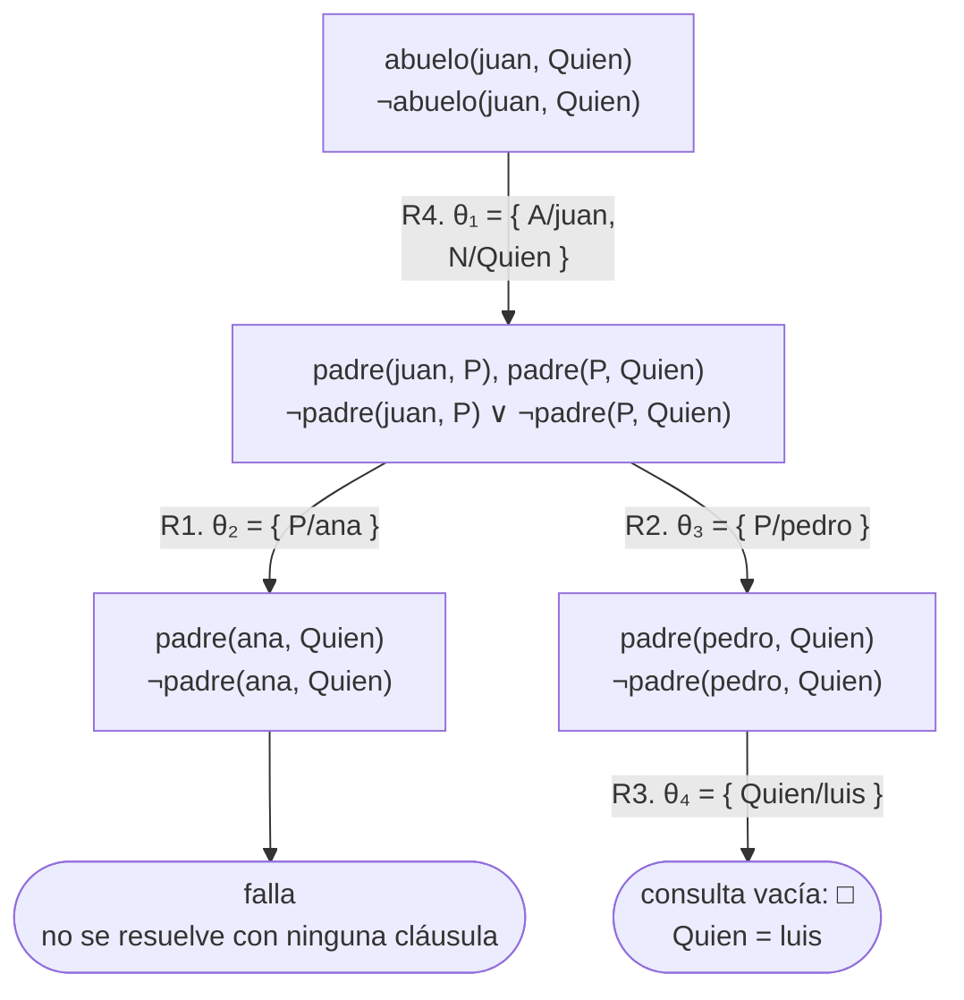
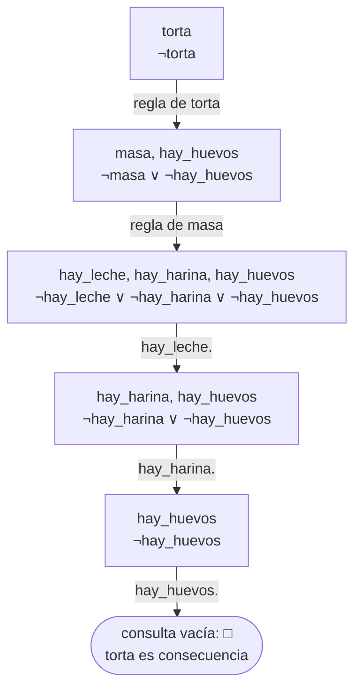
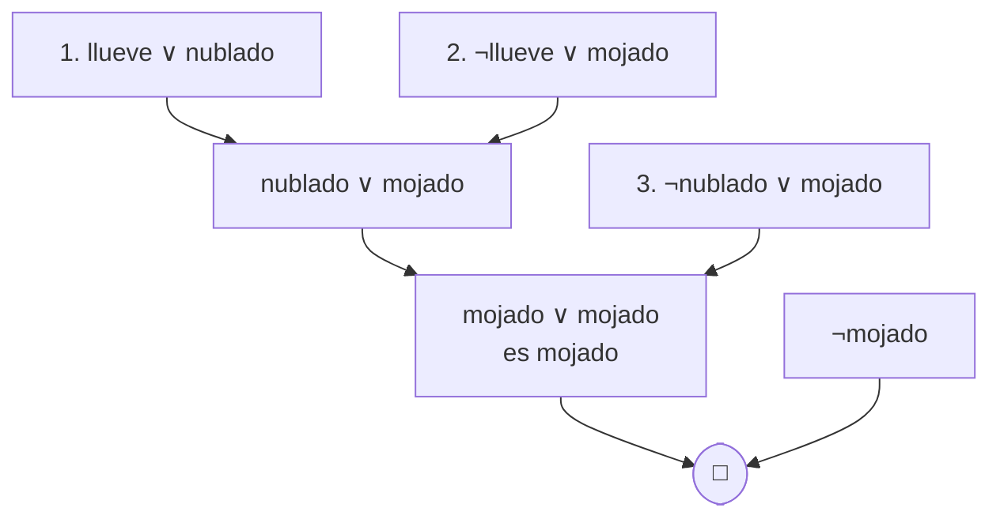
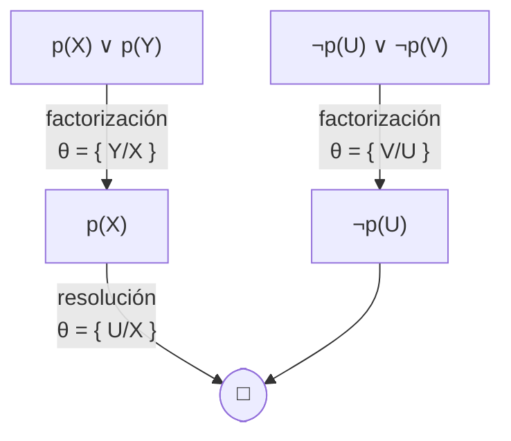

# Qué afirma un programa y cómo se prueba

Esta página continúa el [capítulo 13](index.md) después de la
[sección 13.5](index.md#135-clausulas-de-horn), con las secciones
[13.6](#136-interpretaciones-modelos-y-consecuencia-logica) y
[13.7](#137-como-prueba-prolog): qué
afirma un programa —sus interpretaciones, sus modelos y lo que es
consecuencia lógica de él— y cómo Prolog lo prueba: las reglas de
inferencia, la demostración por refutación y la regla de resolución,
seguidas paso a paso sobre `?- abuelo(juan, Quien).` y sobre `?- torta.`,
que no tiene variables.
El programa sin variables está en `torta.pl`, en `ejemplos/capitulo-13/`,
con sus pruebas.

## 13.6 Interpretaciones, modelos y consecuencia lógica

Los nombres de un programa no significan nada por sí mismos. Para Prolog,
`juan` y `ana` son dos átomos distintos, y `progenitor` es un nombre de
predicado de aridad 2: nada en el programa establece que juan sea una persona
ni que `progenitor` hable de familias. El significado está en la cabeza de
quien escribe el programa, que eligió los nombres para que el lector los
reconozca. La lógica hace explícita esa elección, y con ella define qué
afirma un programa.

Una **interpretación** fija un conjunto de objetos, el **dominio**, y asigna a
cada constante un objeto del dominio, a cada functor una manera de construir
un objeto a partir de otros, y a cada nombre de predicado una relación entre
objetos del dominio: para cada tupla de objetos, si la relación se cumple o
no. Con eso, cada fórmula atómica sin variables resulta verdadera o falsa, y
los conectivos y los cuantificadores extienden la verdad a las demás fórmulas:
$\forall$ se lee «para todo objeto del dominio». Una interpretación
**satisface** una fórmula cuando la fórmula resulta verdadera en ella, y
satisface un programa cuando satisface cada una de sus cláusulas. Una
interpretación que satisface un programa es un **modelo** del programa.

**La interpretación prevista.** Para `logica.pl`, el dominio son seis personas,
cada átomo nombra a una de ellas, `mujer` es el conjunto {marta, ana, eva},
`progenitor` es el conjunto de los seis pares de sus hechos, y `madre` es el
conjunto {(marta, ana), (marta, pedro)}. Es un modelo: cada hecho resulta
verdadero porque así se eligió la relación, y la regla de `madre/2` también,
porque los únicos pares que cumplen el antecedente son los dos que `madre`
contiene. Si en cambio `madre` fuera el conjunto vacío, la interpretación no
sería un modelo: la regla exige $\mathit{madre}(\mathit{marta}, \mathit{ana})$
y la interpretación la hace falsa. Y si `mujer` no incluyera a marta, el hecho
`mujer(marta).` sería falso, con el mismo resultado.

**Otra interpretación.** El dominio son los números 1 a 6; `juan` nombra al 1,
`marta` al 2, `ana` al 3, `pedro` al 4, `luis` al 5 y `eva` al 6; `mujer` es
{2, 3, 6}, `progenitor` es {(1, 3), (2, 3), (1, 4), (2, 4), (4, 5), (4, 6)} y
`madre` es {(2, 3), (2, 4)}. También es un modelo: las cláusulas no dicen que
sus objetos sean personas, y cualquier conjunto de objetos con relaciones de la
misma forma las satisface. Un programa tiene muchos modelos; entre ellos, el
que hace verdadero solo lo que las cláusulas obligan es el que el programador
tiene en mente, y el
[capítulo 39](../capitulo-39-semantica-de-los-programas-logicos/index.md#391-modelos-y-consecuencia-logica)
muestra que ese modelo existe y es único.

Una fórmula $f$ es **consecuencia lógica** de un programa $P$, lo que se
escribe $P \models f$, cuando **todo** modelo de $P$ satisface $f$. Una
consulta pregunta exactamente eso. $\mathit{madre}(\mathit{marta}, \mathit{ana})$
es consecuencia de `logica.pl`: en cualquier modelo, `mujer(marta)` y
`progenitor(marta, ana)` son verdaderos porque son hechos, y la regla obliga
entonces a que `madre(marta, ana)` lo sea. En cambio
$\mathit{madre}(\mathit{ana}, \mathit{luis})$ no lo es: la interpretación
prevista es un modelo, y la hace falsa; un solo modelo en contra es
suficiente. Como la consecuencia debe valer en todos los modelos, no depende de
qué significan los nombres para quien escribió el programa: `logica.pl`
responde lo mismo si `juan` nombra a una persona, a un número o a una ciudad.

**Un programa sin variables.** Las interpretaciones se cuentan con facilidad
cuando el programa no tiene variables ni argumentos:

<!-- ejemplo: capitulo-13/torta.pl predicado: hay_harina/0 hay_huevos/0 hay_leche/0 masa/0 torta/0 consulta: torta. -->
```prolog
% hay_harina: hay harina.
hay_harina.

% hay_huevos: hay huevos.
hay_huevos.

% hay_leche: hay leche.
hay_leche.

%!  masa is det.
%
%   Se puede preparar la masa: hay leche y hay harina.
masa :-
    hay_leche,
    hay_harina.

%!  torta is det.
%
%   Se puede hornear la torta: se puede preparar la masa y hay huevos.
torta :-
    masa,
    hay_huevos.
```

Cada átomo es una afirmación completa, y una interpretación queda determinada
por el conjunto de los átomos que toma como verdaderos: con cinco átomos hay 32
interpretaciones. Cuatro de ellas, y una que agrega un átomo ajeno al programa:

| Átomos verdaderos | ¿Modelo? | Por qué |
|---|---|---|
| ninguno | no | los tres hechos resultan falsos |
| `hay_harina`, `hay_huevos`, `hay_leche` | no | el antecedente de `masa` es verdadero y `masa` es falso: la regla no se cumple |
| los tres anteriores y `masa` | no | lo mismo con la regla de `torta` |
| los tres anteriores, `masa` y `torta` | sí | los hechos son verdaderos, y las dos reglas tienen antecedente y consecuente verdaderos |
| los cinco anteriores y `hay_azucar` | sí | agregar un átomo verdadero no hace falsa ninguna cláusula: `hay_azucar` no aparece en el programa |

$\mathit{torta}$ es consecuencia lógica del programa: todo modelo contiene los
tres hechos, por lo tanto contiene $\mathit{masa}$, y por lo tanto contiene
$\mathit{torta}$. $\mathit{hay\_azucar}$ no lo es, porque el modelo de la
cuarta fila no lo contiene. Y $\lnot \mathit{hay\_azucar}$ tampoco, porque el
modelo de la quinta fila lo contiene. El programa no afirma nada sobre el
azúcar, ni a favor ni en contra, y la lógica lo registra así:

```prolog
?- torta.
true.

?- masa.
true.
```

```text
?- hay_azucar.
ERROR: Unknown procedure: hay_azucar/0 (DWIM could not correct goal)
```

Lo que Prolog responde `false.` es «no es consecuencia del programa», y no «su
negación es consecuencia», que un programa de hechos y reglas nunca tiene: el
modelo que hace verdadero todo lo que se le pregunte es siempre un modelo. Es
el supuesto de mundo cerrado de la
[sección 10.1](../capitulo-10-negacion-como-falla/index.md#101-el-supuesto-de-mundo-cerrado)
visto desde los modelos, y la [sección 13.12](evaluacion.md#1312-la-negacion) lo retoma. El
mensaje de error para un nombre que el programa no contiene es el de la
[sección 10.4](../capitulo-10-negacion-como-falla/index.md#104-donde-ubicar).

Revisar todas las interpretaciones no es un método: con variables son
infinitas, y aun aquí son 32 para cinco átomos. La sección siguiente presenta
el método que Prolog usa, que trabaja sobre el texto de las cláusulas sin mirar
ninguna interpretación, y lo que garantiza que ese método y esta definición
coinciden. El
[capítulo 63](../capitulo-63-proyecto-demostrador-teoremas/index.md) escribe un
programa que calcula tablas de verdad como la de arriba.

## 13.7 Cómo prueba Prolog

La sección anterior define qué es verdadero. Esta describe cómo se lo
establece sin recorrer interpretaciones: con **reglas de inferencia**, que
producen fórmulas nuevas a partir de fórmulas dadas mirando solamente su
forma.

**Modus ponens.** La regla de inferencia más conocida establece que de $A$ y
de $A \rightarrow B$ se infiere $B$. Con variables, se aplica a una instancia
de la regla: como la de `madre/2` vale para toda $M$, vale en particular para
marta, y con el hecho `mujer(marta).` se infiere que marta es madre de todo
aquel de quien es progenitora:

$$\dfrac{\mathit{mujer}(\mathit{marta}) \qquad
  \forall M \, \forall H \; \bigl( \mathit{mujer}(M) \land \mathit{progenitor}(M, H)
  \rightarrow \mathit{madre}(M, H) \bigr)}
  {\forall H \; \bigl( \mathit{progenitor}(\mathit{marta}, H)
  \rightarrow \mathit{madre}(\mathit{marta}, H) \bigr)}$$

Un paso más, con `progenitor(marta, ana).`, infiere
$\mathit{madre}(\mathit{marta}, \mathit{ana})$. La conclusión de abajo es una
cláusula de Prolog, `madre(marta, H) :- progenitor(marta, H).`, y el
ejercicio 14 la examina.

**Deducción.** Una **demostración**, o deducción, de $f$ a partir de un
conjunto de cláusulas $P$ es una sucesión de fórmulas, cada una de ellas una
cláusula de $P$ o el resultado de aplicar una regla de inferencia a fórmulas
anteriores, que termina en $f$. Se escribe $P \vdash f$. Un conjunto de
fórmulas es **consistente** cuando no se deduce de él una fórmula y su
negación.

**Corrección y completitud.** Dos propiedades vinculan $\vdash$, que es
sintáctico, con $\models$, que habla de modelos. Una regla de inferencia es
**correcta** si todo lo que deduce es consecuencia lógica: $P \vdash f$
implica $P \models f$. Es **completa** si toda consecuencia lógica se puede
deducir con ella: $P \models f$ implica $P \vdash f$. Modus ponens es
correcto —si $A$ y $A \rightarrow B$ son verdaderos en una interpretación, $B$
lo es— pero no es completo por sí solo.

**La refutación.** El método de demostración de Prolog tiene una
característica que conviene explicitar: para probar que una afirmación es
verdadera, comienza por suponer que es **falsa**. La razón es un resultado de
la lógica: $f$ es consecuencia de $P$ exactamente cuando $P \cup \{\lnot f\}$
es inconsistente, es decir cuando no existe ningún modelo de $P$ que haga
verdadera a $\lnot f$. Ante la consulta `?- madre(marta, ana).`, Prolog agrega
a las cláusulas del programa la negación de la consulta —"marta no es madre de
ana"— e intenta derivar una contradicción. Si la encuentra, la suposición no
puede ser verdadera, y por lo tanto la consulta original sí lo es. El método se
denomina **demostración por refutación**, y es la razón por la que la consulta
es la cláusula negada de la [sección 13.5](index.md#135-clausulas-de-horn).

**La regla de resolución.** Para refutar basta una sola regla de inferencia,
y es la del [capítulo 5](../capitulo-05-como-responde-prolog/index.md): un
paso de **resolución** toma dos cláusulas que contienen una misma fórmula
atómica, negada en una y sin negar en la otra, unifica esas dos apariciones y
produce el **resolvente**: la disyunción de todo lo demás, con la sustitución
aplicada. En los términos del árbol de derivación, se toma un objetivo, se
encuentra una cláusula cuya cabeza unifique con él, y se lo reemplaza por el
cuerpo de esa cláusula; la unificación del
[capítulo 4](../capitulo-04-terminos-y-unificacion/index.md) es la que
determina cuándo se la puede aplicar. Dos casos particulares:

| Se resuelve | Resolvente |
|---|---|
| un objetivo $\lnot A$ con un hecho $A'$, donde $A$ y $A'$ unifican | lo que quedaba de la consulta, sin ese objetivo; si no quedaba nada, $\square$ |
| un objetivo $\lnot A$ con una regla $B_1 \land \dots \land B_m \rightarrow A'$ | la consulta con $\lnot B_1 \lor \dots \lor \lnot B_m$ en lugar de $\lnot A$ |

La cláusula vacía $\square$ es la contradicción: no contiene ninguna fórmula
atómica, y ninguna interpretación la hace verdadera. Resolución es correcta, y
para la refutación es completa: si $P \cup \{\lnot f\}$ es inconsistente, la
resolución deduce $\square$ a partir de ese conjunto. El capítulo enuncia los
dos resultados sin demostrarlos; el
[capítulo 39](../capitulo-39-semantica-de-los-programas-logicos/resolucion.md#392-resolucion-sld)
los enuncia con precisión para los programas Prolog.

Con `torta.pl` y la consulta `?- torta.` el mecanismo se ve solo, sin
sustituciones: la subsección
[Una refutación sin variables](#una-refutacion-sin-variables) sigue esa
refutación paso a paso, hasta la cláusula vacía. La regla de Robinson, de la
que esta es un caso, se enuncia en general en la subsección
[La resolución de Robinson](#la-resolucion-de-robinson).

En síntesis: **Prolog es resolución sobre cláusulas de Horn, con un recorrido
del árbol de izquierda a derecha y de arriba hacia abajo.** Esa definición resume
toda la parte I, y cada uno de sus términos se desarrolló en un capítulo
anterior.

Cuando el árbol alcanza un objetivo vacío —no queda nada por probar—, la
contradicción está derivada y se produce la respuesta. Las hojas de éxito del
[capítulo 5](../capitulo-05-como-responde-prolog/index.md) corresponden exactamente a esa situación.

### La refutación en forma clausal

En la asignatura de lógica la resolución se aplica a cláusulas escritas como
disyunciones. Como $b \land c \rightarrow a$ equivale a $\lnot b \lor \lnot c \lor a$, una
regla se escribe con su cabeza sin negar y cada objetivo del cuerpo negado; un
hecho queda como una única fórmula atómica sin negar, y la negación de una
consulta, como una disyunción de fórmulas atómicas negadas. Las variables
siguen cuantificadas universalmente: la negación de «existe un `Quien` del que
juan es abuelo» es «para todo `Quien`, juan no es su abuelo». El programa de la
[sección 5.2](../capitulo-05-como-responde-prolog/index.md#52-el-arbol-de-derivacion)
y la consulta `?- abuelo(juan, Quien).` quedan así:

| | |
|---|---|
| R1 | $\mathit{padre}(\mathit{juan}, \mathit{ana})$ |
| R2 | $\mathit{padre}(\mathit{juan}, \mathit{pedro})$ |
| R3 | $\mathit{padre}(\mathit{pedro}, \mathit{luis})$ |
| R4 | $\lnot \mathit{padre}(A, P) \lor \lnot \mathit{padre}(P, N) \lor \mathit{abuelo}(A, N)$ |
| consulta negada | $\lnot \mathit{abuelo}(\mathit{juan}, \mathit{Quien})$ |

La rama de éxito del árbol es una cadena de tres pasos de resolución:

| Paso | Se resuelve | Sustitución | Resolvente |
|---|---|---|---|
| 1 | la consulta negada con R4 | θ₁ = { A/juan, N/Quien } | $\lnot \mathit{padre}(\mathit{juan}, P) \lor \lnot \mathit{padre}(P, \mathit{Quien})$ |
| 2 | el resolvente 1 con R2 | θ₃ = { P/pedro } | $\lnot \mathit{padre}(\mathit{pedro}, \mathit{Quien})$ |
| 3 | el resolvente 2 con R3 | θ₄ = { Quien/luis } | $\square$, la cláusula vacía |

La suposición «juan no es abuelo de nadie» queda refutada, y la composición de
las sustituciones de la rama, restringida a `Quien`, es la respuesta; la
[sección 13.8](sustituciones.md#138-sustituciones) define esa composición. Los
subíndices son los del árbol: θ₂ = { P/ana } corresponde a resolver el
resolvente 1 con R1 en lugar de R2, que produce
$\lnot \mathit{padre}(\mathit{ana}, \mathit{Quien})$, y ese resolvente no se puede
resolver con ninguna cláusula. La tabla es el árbol de la
[sección 5.2](../capitulo-05-como-responde-prolog/index.md#52-el-arbol-de-derivacion)
leído como resoluciones: cada nodo es un resolvente, cada arco un paso, y la
consulta vacía de la hoja de éxito es la cláusula vacía.

El árbol siguiente es el de esa sección con cada nodo escrito en las dos
formas: arriba, la consulta pendiente; abajo, el mismo nodo como resolvente,
con cada objetivo negado y los objetivos unidos por $\lor$. Los arcos y sus
sustituciones son los mismos. La hoja de éxito es la consulta vacía, es decir
$\square$; la hoja de falla es un resolvente que no se resuelve con ninguna
cláusula.



El árbol de derivación **es** el árbol de refutación, nodo por nodo; lo que
cambia es la notación de las etiquetas. Leído de izquierda a derecha, en el
orden del recorrido de Prolog, el paso 1 de la tabla es el primer arco, la rama
de R1 termina en el resolvente de θ₂, que no se resuelve con ninguna cláusula, y
los pasos 2 y 3 son la rama de R2 hasta $\square$.

Cuatro observaciones cierran la sección:

- la consulta es una cláusula sin conclusión, y cada resolvente vuelve a
  serlo: sus fórmulas atómicas, negadas, son el trabajo pendiente;
- resolver con un hecho elimina un objetivo; resolver con una regla lo
  reemplaza por el cuerpo, y el resolvente puede ser más largo que la consulta
  de la que proviene;
- Prolog nunca resuelve dos cláusulas del programa entre sí: cada paso combina
  la consulta pendiente con una cláusula del programa, y por eso la deducción
  es un camino en un árbol (ejercicio 14);
- el objetivo de todo el recorrido es llegar a $\square$; las ramas que
  terminan en un resolvente que no se puede resolver son las hojas de falla.

### Una refutación sin variables

Sobre `torta.pl`, la refutación de `?- torta.` no necesita ninguna
sustitución. La consulta negada es $\lnot
\mathit{torta}$, y cada paso la resuelve con una cláusula del programa; la
regla `torta :- masa, hay_huevos.` es la cláusula
$\lnot \mathit{masa} \lor \lnot \mathit{hay\_huevos} \lor \mathit{torta}$:

| Paso | Se resuelve | Resolvente |
|---|---|---|
| 1 | $\lnot \mathit{torta}$ con la regla de `torta` | $\lnot \mathit{masa} \lor \lnot \mathit{hay\_huevos}$ |
| 2 | el resolvente 1 con la regla de `masa` | $\lnot \mathit{hay\_leche} \lor \lnot \mathit{hay\_harina} \lor \lnot \mathit{hay\_huevos}$ |
| 3 | el resolvente 2 con `hay_leche.` | $\lnot \mathit{hay\_harina} \lor \lnot \mathit{hay\_huevos}$ |
| 4 | el resolvente 3 con `hay_harina.` | $\lnot \mathit{hay\_huevos}$ |
| 5 | el resolvente 4 con `hay_huevos.` | $\square$ |

El árbol de derivación de `?- torta.` es una sola rama, y cada arco lleva la
cláusula con la que se resuelve:



La suposición «no hay torta» lleva a la contradicción, y por lo tanto
$\mathit{torta}$ es consecuencia del programa, como la
[sección 13.6](#136-interpretaciones-modelos-y-consecuencia-logica) había
establecido revisando los modelos. Cada resolvente es la consulta pendiente de
un nodo del árbol de derivación, y los cinco pasos son sus cinco arcos; la
página [La evaluación de un programa y los límites de la lógica](evaluacion.md#1310-los-cuatro-pasos)
muestra cómo se construye cada uno de ellos, y evalúa de la misma manera
otro programa sin variables.

### La resolución de Robinson

La regla de esta sección es el caso de Horn de una regla más general, que John
Alan Robinson publicó en 1965 y de la que parte la demostración automática de
teoremas. Vale para **cláusulas** cualesquiera: una cláusula es una
disyunción de **literales**, fórmulas atómicas o negadas, con sus variables
cuantificadas universalmente. En una cláusula de Horn a lo sumo un literal es
positivo; aquí puede haber cualquier cantidad.

**La regla.** Se toman dos cláusulas $C_1 = A \lor R_1$ y
$C_2 = \lnot B \lor R_2$, donde $A$ y $B$ son fórmulas atómicas y $R_1$ y $R_2$
son la disyunción de los demás literales de cada una. Las dos cláusulas no
comparten variables; si las compartieran, se renombran las de una. Si $A$ y
$B$ unifican, con unificador más general $\theta$, el **resolvente** es

$$(R_1 \lor R_2)\,\theta$$

Se elige el unificador más general porque así el resolvente resulta lo más
general posible: cualquier otro que se obtenga con otro unificador es un caso
particular de él. Un literal que queda repetido se escribe una sola vez.

Es el paso de la regla anterior sin la restricción de que la consulta tenga
solo literales negados: cuando $C_1$ es un hecho o una regla y $C_2$ la
consulta, es exactamente el reemplazo de un objetivo por el cuerpo de una
cláusula. Y vale en los dos sentidos: lo que importa es que uno de los literales
que unifican esté negado y el otro no.

**Por qué es correcta.** Sin variables, el argumento es por casos. En un
modelo cualquiera de $C_1$ y $C_2$, $A$ es falso o es verdadero. Si $A$ es
falso, $C_1$ obliga a que $R_1$ sea verdadero; si $A$ es verdadero, $\lnot A$
es falso y $C_2$ obliga a que $R_2$ lo sea. En los dos casos el modelo
satisface $R_1 \lor R_2$. Con variables, el mismo razonamiento vale para cada
instancia sin variables de las dos cláusulas, y $\theta$ las hace coincidir.
Los dos casos particulares de la tabla anterior son $\lnot A \lor R_2$ con $A$,
de donde se deriva $R_2$, y $\lnot A$ con $A$, de donde se deriva $\square$.

**Un ejemplo con una disyunción.** Lo que una cláusula de Horn no puede decir,
como «llueve o está nublado» de la [sección 13.5](index.md#135-clausulas-de-horn),
la regla general lo maneja sin cambios. Con estas tres cláusulas se prueba
$\mathit{mojado}$, y la consulta negada es $\lnot \mathit{mojado}$:

1. $\mathit{llueve} \lor \mathit{nublado}$
2. $\lnot \mathit{llueve} \lor \mathit{mojado}$
3. $\lnot \mathit{nublado} \lor \mathit{mojado}$

| Paso | Se resuelve | Resolvente |
|---|---|---|
| 1 | la cláusula 1 con la 2 | $\mathit{nublado} \lor \mathit{mojado}$ |
| 2 | el resolvente 1 con la cláusula 3 | $\mathit{mojado} \lor \mathit{mojado}$, que es $\mathit{mojado}$ |
| 3 | el resolvente 2 con $\lnot \mathit{mojado}$ | $\square$ |

El razonamiento es por casos: si llueve, hay mojado por la 2; si está nublado,
por la 3; y una de las dos cosas ocurre. Un programa de Prolog no puede
contener la cláusula 1, porque tiene dos literales positivos, y por eso no
puede hacer esta prueba.

Como la resolución combina aquí dos cláusulas del programa entre sí, la
refutación ya no es un camino sino un árbol que se junta hacia abajo: cada
resolvente tiene dos padres.



**La factorización.** Con variables, un paso de resolución no basta para toda
refutación. Las cláusulas $p(X) \lor p(Y)$ y $\lnot p(U) \lor \lnot p(V)$ son
contradictorias: la primera afirma $p$ para todo valor, y la segunda lo niega
para todo valor. Pero cada resolvente conserva dos literales, y la cláusula
vacía no aparece nunca. La salida es la **factorización**: si dos literales de
una misma cláusula unifican con $\theta$, la cláusula con $\theta$ aplicada, que
los reúne en uno, es consecuencia de ella. Aquí $p(X) \lor p(Y)$ se factoriza
en $p(X)$, con $\theta = \{ Y/X \}$; $\lnot p(U) \lor \lnot p(V)$ en $\lnot p(U)$, y
resolver las dos cláusulas resultantes da $\square$ en un paso:


En el artículo de Robinson la factorización está dentro de la definición del
resolvente: se eligen dos conjuntos no vacíos de literales, uno de cada
cláusula, que unifican todos con un mismo unificador más general (definiciones
5.10 y 5.11, página 33). Aquí se la presenta como una regla aparte, como hace
Spivey, que la enuncia entre los ejercicios de su libro.

**Qué conserva Prolog.** Robinson demostró que la resolución, con la
factorización, es correcta y completa para la refutación en la lógica de primer
orden: si $P \cup \{\lnot f\}$ es inconsistente, se deriva $\square$. No es
completa en otro sentido, el de producir toda consecuencia: $a \lor \lnot a$
es verdadera en toda interpretación, y la resolución no la deriva de un
programa donde $a$ ni aparece. Por eso se la usa para decidir si una fórmula
dada es consecuencia, no para generar consecuencias. Prolog emplea una parte
pequeña de la regla, la que el
[capítulo 39](../capitulo-39-semantica-de-los-programas-logicos/resolucion.md#392-resolucion-sld)
llama **resolución SLD**:

- una de las dos cláusulas es siempre la consulta pendiente, con todos sus
  literales negados, y la otra una cláusula del programa, con un solo literal
  positivo;
- el literal que se resuelve es siempre el primero de la consulta, y las
  cláusulas se prueban en el orden del archivo;
- con un solo literal positivo, el resolvente es otra consulta y la
  factorización no se necesita, y por eso la regla de la tabla anterior alcanza.

Lo que Prolog no hace es lo que la
[sección 39.1](../capitulo-39-semantica-de-los-programas-logicos/index.md#formulas-que-no-son-clausulas-de-horn)
muestra de las fórmulas que no son cláusulas de Horn, y el
[capítulo 63](../capitulo-63-proyecto-demostrador-teoremas/index.md) construye un
demostrador que resuelve cláusulas cualesquiera, con factorización.

El capítulo continúa en la página
[Sustituciones y unificadores](sustituciones.md#138-sustituciones), con las
sustituciones que etiquetan los arcos de esos árboles.

## Ejercicios

Las soluciones están en [la página de soluciones](soluciones.md). La dificultad
va de 1 (se resuelve consultando el capítulo) a 3 (requiere elaboración propia).
Los marcados con ★ son los que no conviene saltear: cubren lo que el capítulo
tiene de propio, y los capítulos siguientes los dan por hechos.

11. **(2)** La [sección 13.5](index.md#135-clausulas-de-horn) afirma que un hecho es
    una cláusula de Horn sin condiciones y una consulta es una cláusula de Horn
    sin conclusión.

    a. Escribir la fórmula que corresponde a la consulta
       `?- padre(juan, Quien).` y explicar en qué sentido Prolog la **refuta**
       en lugar de demostrarla.

    b. Decir cuáles de estas afirmaciones son verdaderas, y corregir las
       falsas: un programa es un conjunto de hechos y reglas; la consulta forma
       parte del programa; `odia(X, Y), odia(Y, X) :- enemigo(X, Y).` puede
       ser una cláusula de un programa; un hecho es una cláusula sin
       condiciones; una consulta sin variables pregunta si el programa contiene
       esa afirmación como hecho.

12. **(1)** Calcular el valor de verdad de
    $(p \rightarrow q) \leftrightarrow (\lnot q \rightarrow \lnot p)$ en las
    cuatro interpretaciones de la
    [sección 13.6](#136-interpretaciones-modelos-y-consecuencia-logica) para
    dos átomos —los átomos verdaderos son $\{p, q\}$, $\{p\}$, $\{q\}$ y
    ninguno—, en una tabla de cuatro filas. Decir si la fórmula es verdadera
    en todas ellas, y en qué filas uno de los dos lados del $\leftrightarrow$
    es falso.
13. ★ **(2)** Sobre `torta.pl`, el programa de cinco cláusulas de la
    [sección 13.6](#136-interpretaciones-modelos-y-consecuencia-logica):

    a. Decir cuáles de estas interpretaciones son modelos del programa, y por
       qué: la que hace verdaderos a `hay_harina`, `hay_leche` y `masa` y
       falsos a los demás; la que hace verdaderos a `hay_huevos`, `masa` y
       `torta`; la que hace verdaderos a los cinco átomos menos `torta`; la que
       hace verdaderos a los cinco átomos y además a `hay_azucar`.

    b. ¿Es $\mathit{torta}$ consecuencia lógica del programa? ¿Lo es
       $\mathit{hay\_azucar}$? ¿Lo es $\lnot \mathit{hay\_azucar}$?

    c. Verdadero o falso, con la razón: «si $P \models f$, entonces todo modelo
       de $P$ es modelo de $P \cup \{f\}$».

14. **(2)** La resolución no exige que una de las dos cláusulas sea una consulta.
    Resolver la regla `madre/2` de `logica.pl` con el hecho `mujer(marta).`,
    escribir el resolvente como una cláusula de Prolog, y explicar por qué es
    una consecuencia del programa aunque ninguna consulta la produzca durante la
    ejecución.
15. ★ **(2)** Reescribir en forma clausal el árbol del
    [ejercicio 1 del capítulo 5](../capitulo-05-como-responde-prolog/index.md#ejercicios),
    el de `?- abuelo(Quien, luis).` sobre `busqueda.pl`, como en
    [La refutación en forma clausal](#la-refutacion-en-forma-clausal): la
    consulta negada, cada paso de resolución con su sustitución y su
    resolvente, y los resolventes en los que termina cada una de las tres
    ramas.
16. **(3)** El programa siguiente no tiene variables, de modo que cada átomo es
    una afirmación completa:

    ```prolog
    templado.
    llueve.
    picnic :- templado, \+ llueve.
    remar :- picnic.
    ```

    A esas cláusulas se agrega la afirmación «no se rema cuando llueve», que en
    forma clausal es $\lnot \mathit{remar} \lor \lnot \mathit{llueve}$.

    a. Escribir en forma clausal las dos primeras cláusulas y la cuarta, y
       demostrar en papel, por refutación, que no se rema: agregar la negación
       de esa conclusión y derivar la cláusula vacía, indicando cada
       resolvente.

    b. Explicar por qué $\lnot \mathit{remar} \lor \lnot \mathit{llueve}$ no es un hecho ni una
       regla de Prolog, y a cuál de los tres casos de la
       [sección 13.5](index.md#135-clausulas-de-horn) corresponde su forma.

    c. Sin ejecutarla, explicar por qué `?- \+ remar.` tiene éxito sobre las
       cuatro cláusulas del programa, y por qué la razón de ese éxito es otra
       que la de la demostración del punto a. Comprobarlo después. El
       [capítulo 10](../capitulo-10-negacion-como-falla/index.md) describe
       `\+`, y el [capítulo 39](../capitulo-39-semantica-de-los-programas-logicos/index.md)
       trata la forma clausal de fórmulas cualesquiera.

## Referencias

- Álvaro Tasistro y Jorge Vidart, *Programación lógica y funcional*, 1988 —
  parte I, «Programación en lógica», caps. 2 «Introducción a la
  programación en lógica», 3 «Interpretación lógica» y 4 «Interpretación
  algorítmica». Esta página adapta de allí, con la notación de SWI-Prolog y
  los nombres de este curso, las definiciones de interpretación,
  satisfacción y consecuencia lógica, las reglas de inferencia, la
  resolución y la prueba por refutación con los dos teoremas que la página
  enuncia sin demostrar.
- John Alan Robinson, «A Machine-Oriented Logic Based on the Resolution
  Principle», *Journal of the ACM* 12(1), 1965, pp. 23–41, DOI
  [10.1145/321250.321253](https://doi.org/10.1145/321250.321253): el origen de
  la regla general de la subsección «La resolución de Robinson» de la
  [sección 13.7](#la-resolucion-de-robinson); el resolvente con
  varios literales, que incluye la factorización, está en las definiciones 5.10
  y 5.11, página 33.
- Para la regla de resolución de esa subsección: Zbigniew Kluzniak y Stanislaw
  Szpakowicz, *Prolog for Programmers*, Academic Press, 1985, §2.4, el
  enunciado y sus casos particulares; Peter Flach, *Simply Logical*, Wiley,
  1994, cap. 2, «Proof theory», las derivaciones, la prueba por refutación
  y la incompletitud para las consecuencias; Michael Spivey, *An Introduction
  to Logic Programming through Prolog*, Prentice Hall, 1996, §6.2, la regla con
  variables y su corrección, y la factorización como ejercicio; Leon Sterling y
  Ehud Shapiro, *The Art of Prolog*, 2.ª edición, 1994, §4.3, el origen de la
  unificación en el artículo de Robinson.
