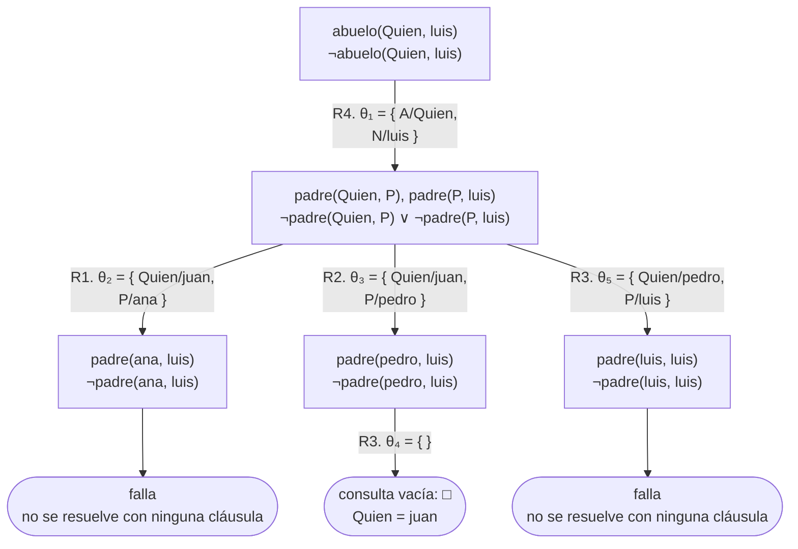
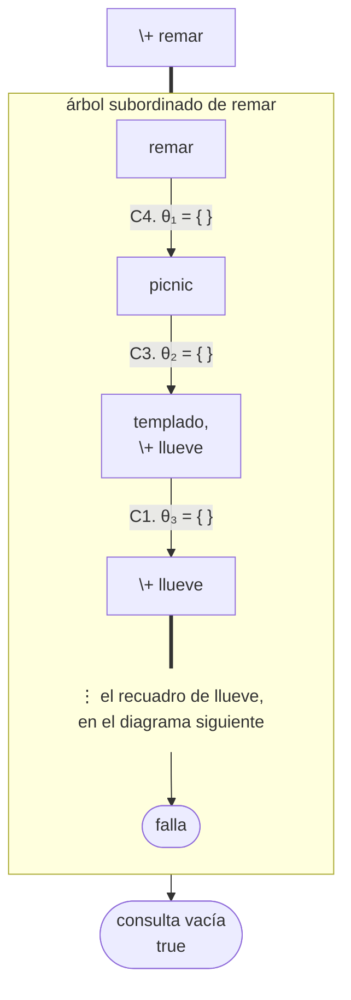
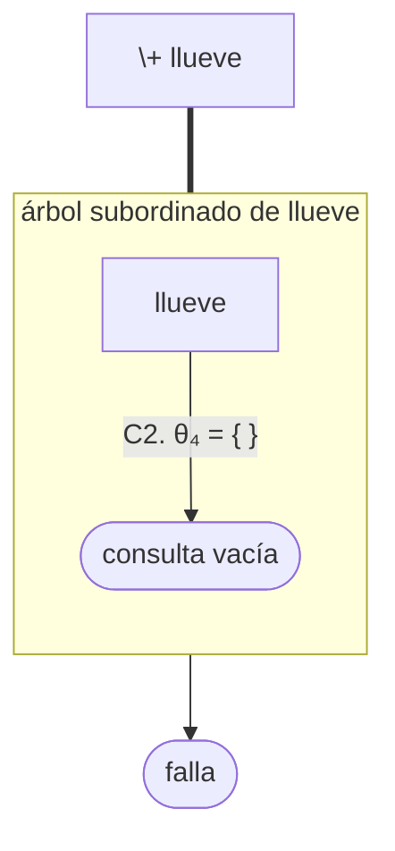
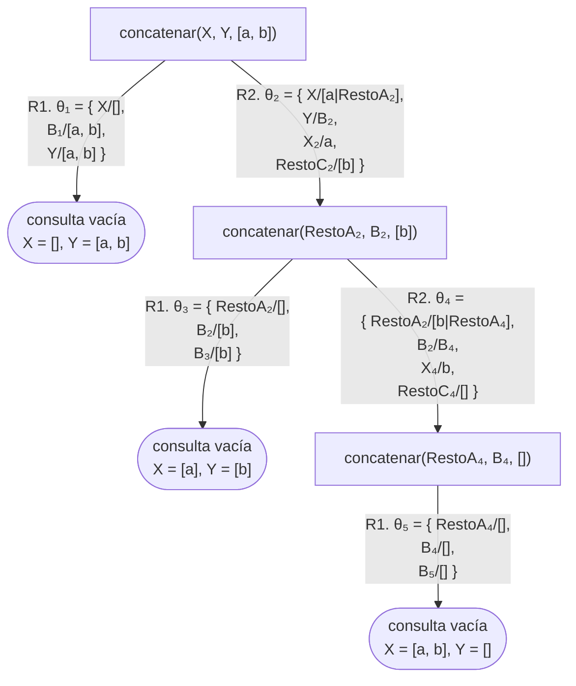
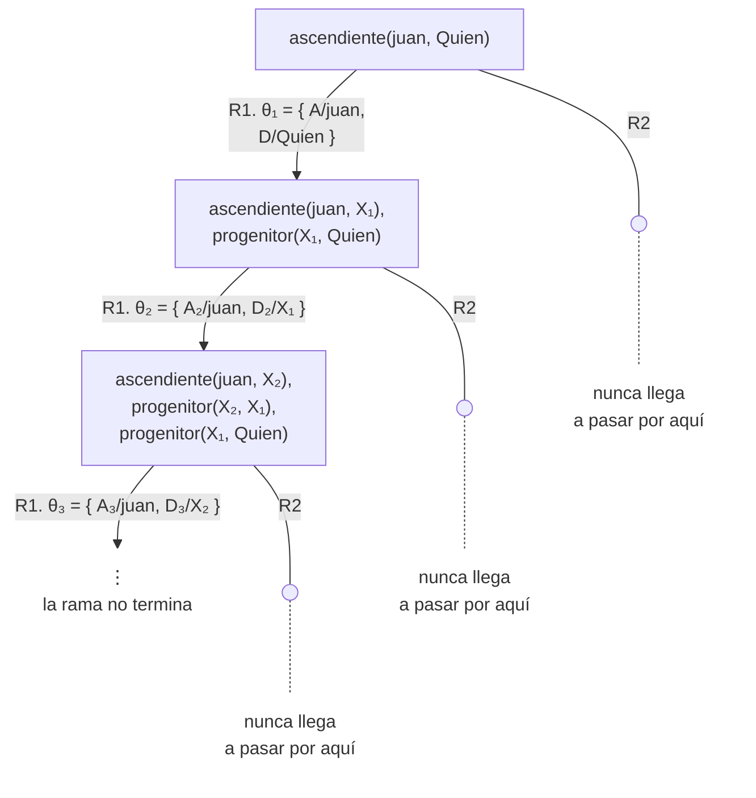
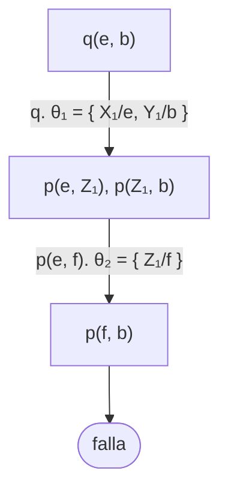

# Soluciones del capítulo 13 — Prolog y la lógica

El código de esta página está en `ejemplos/capitulo-13/soluciones.pl` y pasa sus
pruebas. Además de los predicados de los ejercicios, el archivo contiene los
hechos sobre los que razonan: la familia del ejercicio 4, el programa del
ejercicio 16, una copia de `concatenar/3` para el ejercicio 20 y los hechos
`p/2` del ejercicio 22.

## 1

$$\forall P \, \forall H \; \bigl( \mathit{varon}(P) \land \mathit{progenitor}(P, H)
  \rightarrow \mathit{padre}(P, H) \bigr)$$

Las dos variables aparecen en la cabeza, por lo que ambas están cuantificadas
universalmente, y el alcance del $\forall$ es la cláusula completa.

## 2

**a.** Con los functores y los predicados que fija el enunciado, cada uno con
su aridad:

| Cadena | Qué es | Por qué |
|---|---|---|
| `p(a, f(a))` | fórmula atómica | `p/2` aplicado a dos términos, `a` y `f(a)` |
| `g(Z, Z)` | término | `g/2` aplicado a dos términos; que sean la misma variable no cambia nada |
| `f(f(a))` | término | `f/1` aplicado a un término, que a su vez es `f/1` aplicado a una constante |
| $p(X) \land q(X)$ | ninguna | `p/2` con un solo argumento no es una fórmula, y la conjunción tampoco |
| `q(p(X))` | ninguna | `p(X)` no es un término, y un predicado se aplica a términos; `q(p(X, a))` tampoco lo sería, porque `p(X, a)` es una fórmula |
| `q(f(f(a)))` | fórmula atómica | `q/1` aplicado a un término |
| `r(f, a, b)` | ninguna | `f` es un functor de aridad 1, y sin argumento no es un término |
| $p(X, f(g(Y, Y))) \rightarrow q(X)$ | fórmula compuesta | dos fórmulas atómicas unidas por una implicación |

**b.** Una cláusula es de Horn cuando tiene a lo sumo una fórmula atómica sin
negar:

| Fórmula | ¿De Horn? | En Prolog |
|---|---|---|
| $\forall X \, \bigl( q(X) \lor \lnot r(f(X), a, a) \bigr)$ | sí: una sin negar, una negada | la regla `q(X) :- r(f(X), a, a).` |
| $\forall Z \; q(Z)$ | sí: una sin negar, ninguna negada | el hecho `q(Z).`, verdadero para todo `Z` |
| $\forall X \, \forall Y \, \forall Z \, \bigl( q(X) \lor \lnot p(Z, Y) \lor q(Z) \bigr)$ | no: $q(X)$ y $q(Z)$ son dos conclusiones | — |
| $p(a, b) \land r(a, b, f(a)) \rightarrow q(b)$ | sí: equivale a $\lnot p(a, b) \lor \lnot r(a, b, f(a)) \lor q(b)$ | la regla `q(b) :- p(a, b), r(a, b, f(a)).` |

La última no tiene variables, y una regla sin variables es tan válida como un
hecho sin variables.

## 3

<!-- ejemplo: capitulo-13/soluciones.pl predicado: animal/1 consulta: animal(Quien). -->
```prolog
%!  animal(?X) is nondet.
%
%   Para todo X, si X es gato entonces X es animal.
animal(X) :-
    gato(X).
animal(X) :-
    perro(X).
```

La primera cláusula es suficiente para el enunciado; la segunda se agregó para
que el predicado tenga más de un caso. Cada cláusula es una implicación distinta
con la misma conclusión, y en conjunto expresan la disyunción.

## 4

- `A` aparece en la cabeza: es **universal**.
- `P` aparece solo en el cuerpo: es **existencial**.
- `_` también es existencial, y por eso no es necesario darle nombre.

La lectura completa es:

$$\forall A \; \Bigl( \exists P \; \bigl( \mathit{progenitor}(A, P) \land
  \exists N \; \mathit{progenitor}(P, N) \bigr) \rightarrow \mathit{tiene\_nieto}(A) \Bigr)$$

En castellano: A tiene nieto si existe alguien de quien A es progenitor, y que a
su vez es progenitor de alguien.

El encabezado:

<!-- ejemplo: capitulo-13/soluciones.pl predicado: tiene_nieto/1 consulta: tiene_nieto(Quien). -->
```prolog
%!  tiene_nieto(?A) is nondet.
%
%   A tiene algún nieto: A es progenitor de alguien que es progenitor de
%   alguien.
tiene_nieto(A) :-
    progenitor(A, P),
    progenitor(P, _).
```

`A` es `?` porque la regla sirve en los dos sentidos: con `A` ligada comprueba,
y con `A` libre `progenitor(A, P)` la genera. Es `nondet` por el conteo lógico:
con `A` libre hay una respuesta por cada par progenitor–nieto, y juan aparece dos
veces, una por cada nieto. Es la cuantificación existencial de `P` y de `_`
vista desde la ejecución: cada testigo de la existencia es una respuesta.

## 5

**a.** `A`, `N` y `P`: las dos primeras aparecen en la cabeza y están
cuantificadas universalmente; `P` aparece solo en el cuerpo y está cuantificada
existencialmente.

$$\forall A \, \forall N \; \Bigl( \exists P \; \bigl( \mathit{padre}(A, P) \land
  \mathit{padre}(P, N) \bigr) \rightarrow \mathit{abuelo}(A, N) \Bigr)$$

"Para todo A y todo N: si existe algún P tal que A es padre de P y P es padre de
N, entonces A es abuelo de N."

**b.** `P` aparece en la cabeza; la variable anónima aparece solo en el cuerpo:

$$\forall P \; \bigl( \exists M \; \mathit{tiene}(P, M) \rightarrow \mathit{tiene\_mascota}(P) \bigr)$$

**c.** No tiene variables, de modo que no lleva ningún cuantificador. Es una
afirmación sobre un objeto determinado:

> varon(juan)

Es el caso límite de la [sección 13.5](index.md#135-clausulas-de-horn): una
cláusula de Horn sin condiciones.

## 6

$$\forall A \, \forall D \; \bigl( \mathit{progenitor}(A, D) \rightarrow \mathit{ascendiente}(A, D) \bigr)$$

$$\forall A \, \forall D \; \Bigl( \exists M \; \bigl( \mathit{progenitor}(A, M) \land
  \mathit{ascendiente}(M, D) \bigr) \rightarrow \mathit{ascendiente}(A, D) \Bigr)$$

La variable `Medio` del programa aparece solo en el cuerpo, por lo que es
existencial. La segunda fórmula usa `ascendiente` en su propia definición: en
lógica es una definición recursiva, y es tan válida como en Prolog.

## 7

<!-- ejemplo: capitulo-13/soluciones.pl predicado: puede_entrar/1 consulta: puede_entrar(Quien). -->
```prolog
%!  puede_entrar(?P) is nondet.
%
%   P es socio, o lo invita un socio. Las dos cláusulas expresan la
%   disyunción.
puede_entrar(P) :-
    socio(P).
puede_entrar(P) :-
    invita(S, P),
    socio(S).
```

$$\forall P \; \bigl( \mathit{socio}(P) \rightarrow \mathit{puede\_entrar}(P) \bigr)$$

$$\forall P \; \Bigl( \exists S \; \bigl( \mathit{invita}(S, P) \land \mathit{socio}(S) \bigr)
  \rightarrow \mathit{puede\_entrar}(P) \Bigr)$$

Son dos cláusulas y dos fórmulas. La disyunción del enunciado no aparece en
ninguna de las dos: está expresada por la existencia de dos cláusulas.

## 8

Porque en "todo número es par o impar" la disyunción está en la **conclusión**:

$$\forall N \; \bigl( \mathit{numero}(N) \rightarrow \mathit{par}(N) \lor \mathit{impar}(N) \bigr)$$

El consecuente tiene dos fórmulas atómicas, y una cláusula de Horn admite una
sola. La afirmación establece que se cumple alguna de las dos alternativas sin
indicar cuál, y ese tipo de información indefinida es precisamente lo que
Prolog no puede representar.

En Prolog se escribe algo distinto: un predicado que **decide** cuál de las dos
alternativas corresponde.

<!-- ejemplo: capitulo-13/soluciones.pl predicado: paridad/2 consulta: paridad(7, Que). -->
```prolog
%!  paridad(+N, -P) is det.
%
%   P indica si N es par o impar. No es una afirmación con una disyunción en
%   la conclusión: son dos reglas, cada una con su condición.
paridad(N, par) :-
    0 =:= N mod 2.
paridad(N, impar) :-
    1 =:= N mod 2.
```

No es la misma afirmación. `paridad/2` determina la paridad de un número dado,
pero no afirma que todo número sea par o impar; esa propiedad se deduce de que
las dos condiciones cubren todos los casos, y es un conocimiento de quien escribe
el programa, no del programa.

## 9

**a.** Se traduce de manera directa. La implicación se escribe como regla, con
la conclusión a la izquierda:

<!-- ejemplo: capitulo-13/soluciones.pl predicado: tiene_mascota/1 tiene_gato/1 consulta: tiene_mascota(Quien). -->
```prolog
%!  tiene_mascota(?P) is nondet.
%
%   Todo el que tiene un gato tiene una mascota. La implicación se escribe como
%   una regla: la conclusión a la izquierda, la condición a la derecha.
tiene_mascota(P) :-
    tiene_gato(P).

% tiene_gato(P): P tiene un gato.
tiene_gato(ana).
tiene_gato(eva).
```

**b.** "Nadie es padre de sí mismo" es una **negación**, y no es una cláusula de
Horn: afirma que algo no ocurre. Lo que se puede escribir es el predicado que lo
verifica, con `\+`:

<!-- ejemplo: capitulo-13/soluciones.pl predicado: padre/2 no_es_padre_de_si_mismo/1 consulta: no_es_padre_de_si_mismo(Quien). -->
```prolog
% padre(P, H): P es el padre de H.
padre(luis, eva).

%!  no_es_padre_de_si_mismo(?P) is nondet.
%
%   Nadie es padre de sí mismo. La negación del enunciado se escribe con \+, y
%   no como una cláusula de Horn.
no_es_padre_de_si_mismo(P) :-
    persona(P),
    \+ padre(P, P).
```

Conviene notar la diferencia: el enunciado original es una afirmación sobre el
mundo; lo que se escribe es un predicado que la comprueba caso por caso, bajo la
hipótesis del mundo cerrado del [capítulo 10](../capitulo-10-negacion-como-falla/index.md).

**c.** "Toda persona es varón o mujer" **no** se puede escribir, y es el ejemplo
de la [sección 13.5](index.md#135-clausulas-de-horn): tiene dos conclusiones. Se puede escribir un predicado que
decida el sexo de cada persona, pero eso no es lo mismo: la afirmación original
dice que toda persona es una de las dos cosas sin decir cuál, y una cláusula de
Horn no puede expresar esa indefinición.

## 10

**La primera** tiene una conjunción en la conclusión. Afirma que, si X es
enemigo de Y, entonces X odia a Y **y** Y odia a X: dos conclusiones, y una
cláusula de Horn tiene una sola. Como la conclusión es una conjunción y no una
disyunción, la afirmación se puede escribir como dos cláusulas de Horn, una por
cada conclusión:

```prolog
odia(X, Y) :-
    enemigo(X, Y).
odia(Y, X) :-
    enemigo(X, Y).
```

Al cargarla tal como está escrita, SWI-Prolog lee la cabeza como el término
`','(odia(X, Y), odia(Y, X))`, es decir, como una cláusula del predicado `,/2`,
que es predefinido. Es la misma situación de la actividad de la
[sección 13.5](index.md#135-clausulas-de-horn) con `;/2`:

```text
ERROR: No permission to modify static procedure `(',')/2'
```

**La segunda** tiene una implicación en el cuerpo. El cuerpo afirma
$r(X) \rightarrow q(X)$, que equivale a $\lnot r(X) \lor q(X)$, y la cláusula
completa afirma:

$$\bigl( \lnot r(X) \lor q(X) \bigr) \rightarrow p(X)
  \;\equiv\; \bigl( r(X) \land \lnot q(X) \bigr) \lor p(X)
  \;\equiv\; \bigl( r(X) \lor p(X) \bigr) \land \bigl( \lnot q(X) \lor p(X) \bigr)$$

La segunda cláusula de la conjunción es de Horn, `p(X) :- q(X).`, pero la
primera, $r(X) \lor p(X)$, tiene dos fórmulas atómicas sin negar: dos
conclusiones posibles, que es exactamente lo que una cláusula de Horn excluye.

SWI-Prolog carga la cláusula sin informar nada, porque sintácticamente es
correcta: su cuerpo es un único objetivo, el término `:-(q(X), r(X))`. El error
aparece al ejecutar `p(ana).`, cuando Prolog intenta probar ese objetivo como
una llamada al predicado `:-/2`, que no existe:

```text
ERROR: Unknown procedure: (:-)/2
ERROR:   Rules must be loaded from a file
```

La segunda línea del mensaje supone que se intentó escribir una regla en una
consulta; aquí la causa es otra, y la información está en la primera línea. En
ninguno de los dos casos Prolog interpreta la cláusula como la fórmula que
parece expresar.

## 11

**a.** La consulta `?- padre(juan, Quien).` es una cláusula de Horn sin
conclusión, es decir un conjunto de condiciones sin nada que concluir:

$$\exists \mathit{Quien} \; \mathit{padre}(\mathit{juan}, \mathit{Quien})$$

Prolog no intenta demostrar esa fórmula de manera directa. Hace lo contrario:
supone que es **falsa** —que no existe ningún `Quien` que la cumpla— y agrega
esa suposición al programa. Si de esa suma se deduce una contradicción, la
suposición era errónea, y por lo tanto la fórmula original es cierta.

Eso es refutar. La ventaja práctica es la que describe la
[sección 13.7](inferencia.md#137-como-prueba-prolog): el método necesita una sola
regla de inferencia, la resolución, y termina cuando llega a la cláusula vacía,
que es la contradicción. Los valores de `Quien` que aparecen en el camino son
la respuesta.

**b.** Las cinco afirmaciones:

| Afirmación | | Por qué |
|---|---|---|
| un programa es un conjunto de hechos y reglas | verdadera | es la definición de la [sección 13.2](index.md#132-terminos-formulas-y-programas) |
| la consulta forma parte del programa | falsa | se le agrega en cada ejecución, negada, y cambia de una ejecución a otra mientras el programa es el mismo |
| `odia(X, Y), odia(Y, X) :- enemigo(X, Y).` puede ser una cláusula de un programa | falsa | tiene dos conclusiones y no es de Horn; lo que afirma se escribe como dos cláusulas (ejercicio 10) |
| un hecho es una cláusula sin condiciones | verdadera | es el primer caso de la [sección 13.5](index.md#135-clausulas-de-horn) |
| una consulta sin variables pregunta si el programa contiene esa afirmación como hecho | falsa | pregunta si la afirmación es **consecuencia lógica** del programa: `?- madre(marta, ana).` responde `true.` y `madre(marta, ana)` no es un hecho del programa |

## 12

Una interpretación de dos átomos es el conjunto de los que toma como
verdaderos. Con V y F por verdadero y falso:

| Átomos verdaderos | $p$ | $q$ | $p \rightarrow q$ | $\lnot q \rightarrow \lnot p$ | $(p \rightarrow q) \leftrightarrow (\lnot q \rightarrow \lnot p)$ |
|---|---|---|---|---|---|
| $\{p, q\}$ | V | V | V | V | V |
| $\{p\}$ | V | F | F | F | V |
| $\{q\}$ | F | V | V | V | V |
| ninguno | F | F | V | V | V |

La fórmula es verdadera en las cuatro interpretaciones: es una tautología, la
que justifica demostrar «si $p$ entonces $q$» probando «si no $q$ entonces no
$p$». Los dos lados del $\leftrightarrow$ son falsos en la segunda fila, la
única en la que $p$ es verdadero y $q$ falso; como son falsos los dos a la vez,
la equivalencia sigue siendo verdadera. El
[capítulo 63](../capitulo-63-proyecto-demostrador-teoremas/index.md) calcula
tablas como esta con un programa.

## 13

**a.** Una interpretación es modelo cuando hace verdaderas las cinco cláusulas:
los tres hechos, y las dos reglas, que fallan solo cuando su antecedente es
verdadero y su consecuente falso.

| Átomos verdaderos | ¿Modelo? | Por qué |
|---|---|---|
| `hay_harina`, `hay_leche`, `masa` | no | el hecho `hay_huevos.` resulta falso |
| `hay_huevos`, `masa`, `torta` | no | los hechos `hay_harina.` y `hay_leche.` resultan falsos |
| los cinco menos `torta` | no | la regla de `torta` tiene antecedente verdadero, `masa` y `hay_huevos`, y consecuente falso |
| los cinco y `hay_azucar` | sí | los hechos son verdaderos y las dos reglas tienen antecedente y consecuente verdaderos; `hay_azucar` no aparece en ninguna cláusula |

**b.** $\mathit{torta}$ es consecuencia lógica: todo modelo contiene
`hay_harina`, `hay_huevos` y `hay_leche`, porque son hechos; con los dos
primeros la regla de `masa` obliga a contener `masa`, y con `masa` y
`hay_huevos` la regla de `torta` obliga a contener `torta`.
$\mathit{hay\_azucar}$ no lo es: la interpretación que hace verdaderos
exactamente los cinco átomos del programa es un modelo y no lo contiene.
$\lnot \mathit{hay\_azucar}$ tampoco: la cuarta fila de la tabla es un modelo
que lo contiene. Prolog responde `true.` a `?- torta.`, y a `?- hay_azucar.`
informa un predicado desconocido: el programa no afirma nada sobre el azúcar.

**c.** Verdadero. Un modelo de $P$ satisface, por definición de consecuencia
lógica, toda fórmula $f$ con $P \models f$; por lo tanto satisface cada
cláusula de $P \cup \{f\}$. Y como todo modelo de $P \cup \{f\}$ es modelo de
$P$ —satisface las cláusulas de $P$, que son parte del conjunto—, los dos
conjuntos tienen exactamente los mismos modelos: agregar al programa una
consecuencia suya no cambia nada de lo que afirma. Es lo que el ejercicio 14
comprueba con un resolvente.

## 14

En forma clausal, la regla y el hecho son:

$$\lnot \mathit{mujer}(M) \lor \lnot \mathit{progenitor}(M, H) \lor \mathit{madre}(M, H)
  \qquad\qquad \mathit{mujer}(\mathit{marta})$$

La fórmula atómica $\mathit{mujer}(M)$ aparece negada en la regla y sin negar
en el hecho, y las dos apariciones unifican con θ = { M/marta }. El resolvente
es

$$\lnot \mathit{progenitor}(\mathit{marta}, H) \lor \mathit{madre}(\mathit{marta}, H)$$

que, escrito como cláusula de Prolog, es:

```prolog
madre(marta, H) :-
    progenitor(marta, H).
```

Es la misma cláusula que el modus ponens de la
[sección 13.7](inferencia.md#137-como-prueba-prolog) obtuvo: resolver una regla
con un hecho es modus ponens sobre una instancia de la regla.

Es una consecuencia del programa porque la resolución solo produce cláusulas que
son verdaderas en toda situación en que lo son las dos cláusulas de partida: si
marta es mujer, y toda mujer progenitora de H es madre de H, entonces marta es
madre de todo H del que es progenitora. Por eso agregar la cláusula al programa
no cambia ninguna respuesta. Sobre `logica.pl`, las dos consultas siguientes
responden lo mismo:

<!-- ejemplo: capitulo-13/logica.pl predicado: madre/2 consulta: madre(marta, H). -->
```prolog
%!  madre(?M, ?H) is nondet.
%
%   Para toda M y todo H, si M es mujer y M es progenitora de H, entonces M es
%   madre de H.
madre(M, H) :-
    mujer(M),
    progenitor(M, H).
```

```prolog
?- madre(marta, H).
H = ana ;
H = pedro.

?- progenitor(marta, H).
H = ana ;
H = pedro.
```

Ninguna consulta la produce porque Prolog no resuelve nunca dos cláusulas del
programa entre sí. Cada uno de sus pasos combina la consulta pendiente, que es
una cláusula sin conclusión, con una cláusula del programa, y el resolvente es
otra vez una cláusula sin conclusión: la consulta siguiente. Los resolventes que
Prolog construye son siempre nodos del árbol, nunca reglas nuevas. La
resolución, como regla de inferencia, admite muchos más pasos que los que
Prolog da, y esa restricción es la que convierte el método en el recorrido de
un árbol.

## 15

Las cláusulas R1 a R4 son las de la
[sección 13.7](inferencia.md#la-refutacion-en-forma-clausal), y los subíndices de las
sustituciones, los del árbol de la
[solución del ejercicio 1 del capítulo 5](../capitulo-05-como-responde-prolog/soluciones.md#1).
La consulta negada es $\lnot \mathit{abuelo}(\mathit{Quien}, \mathit{luis})$.

| Paso | Se resuelve | Sustitución | Resolvente |
|---|---|---|---|
| 1 | la consulta negada con R4 | θ₁ = { A/Quien, N/luis } | $\lnot \mathit{padre}(\mathit{Quien}, P) \lor \lnot \mathit{padre}(P, \mathit{luis})$ |
| 2 | el resolvente 1 con R1 | θ₂ = { Quien/juan, P/ana } | $\lnot \mathit{padre}(\mathit{ana}, \mathit{luis})$ |
| 3 | el resolvente 1 con R2 | θ₃ = { Quien/juan, P/pedro } | $\lnot \mathit{padre}(\mathit{pedro}, \mathit{luis})$ |
| 4 | el resolvente 3 con R3 | θ₄ = { } | $\square$ |
| 5 | el resolvente 1 con R3 | θ₅ = { Quien/pedro, P/luis } | $\lnot \mathit{padre}(\mathit{luis}, \mathit{luis})$ |

Las tres ramas parten del resolvente 1, porque su primera fórmula atómica,
$\mathit{padre}(\mathit{Quien}, P)$, unifica con los tres hechos. La del paso 3
llega a la cláusula vacía en el paso 4, y la composición θ₁θ₃θ₄, restringida a
`Quien`, da la respuesta `Quien = juan`. Las de los pasos 2 y 5 terminan en un
resolvente que no se puede resolver con ninguna cláusula: ningún hecho afirma
$\mathit{padre}(\mathit{ana}, \mathit{luis})$ ni
$\mathit{padre}(\mathit{luis}, \mathit{luis})$, y R4 no contiene ninguna fórmula
$\mathit{padre}$ sin negar. Son las dos hojas de falla del árbol.

Dibujado con las etiquetas de la
[sección 13.7](inferencia.md#la-refutacion-en-forma-clausal) —cada nodo como
consulta y como resolvente, $\square$ en la hoja de éxito—, es el árbol de la
solución 1 del [capítulo 5](../capitulo-05-como-responde-prolog/soluciones.md#1)
con otra notación:



El orden de los pasos es el del recorrido de Prolog: la rama de R1 se prueba
primero y la de R3, al final. Para la resolución el orden no importa: la
refutación existe cualquiera sea el orden en que se elijan los pasos.

## 16

**a.** Las cláusulas que se piden, en forma clausal, y la negación de la
conclusión:

| | |
|---|---|
| C1 | $\mathit{templado}$ |
| C2 | $\mathit{llueve}$ |
| C4 | $\lnot \mathit{picnic} \lor \mathit{remar}$ |
| C5 | $\lnot \mathit{remar} \lor \lnot \mathit{llueve}$ |
| negación de la conclusión | $\mathit{remar}$ |

La conclusión que se quiere demostrar es $\lnot \mathit{remar}$, y su negación es
$\mathit{remar}$. La refutación tiene dos pasos:

| Paso | Se resuelve | Resolvente |
|---|---|---|
| 1 | $\mathit{remar}$ con C5 | $\lnot \mathit{llueve}$ |
| 2 | el resolvente 1 con C2 | $\square$ |

Como las cláusulas no tienen variables, no hay sustituciones. C1 y C4 no
intervienen: la conclusión se sigue de la lluvia y de la restricción, y de nada
más. La tercera cláusula del programa queda afuera por otro motivo: `\+ llueve`
no es $\lnot \mathit{llueve}$ ([sección 13.12](evaluacion.md#1312-la-negacion)),
y aun leída como si lo fuera,
$\mathit{templado} \land \lnot \mathit{llueve} \rightarrow \mathit{picnic}$ tiene como
forma clausal $\lnot \mathit{templado} \lor \mathit{llueve} \lor \mathit{picnic}$, con
dos fórmulas atómicas sin negar.

**b.** $\lnot \mathit{remar} \lor \lnot \mathit{llueve}$ no tiene ninguna fórmula
atómica sin negar, es decir, ninguna conclusión. Un hecho es una conclusión sin
condiciones y una regla es una conclusión con condiciones; esta cláusula tiene
solamente condiciones. Su forma es la del tercer caso de la
[sección 13.5](index.md#135-clausulas-de-horn), la consulta: es exactamente la
cláusula que Prolog agrega al programa ante la consulta `?- remar, llueve.` Un
programa Prolog no puede contener una afirmación de esa forma, y por eso la
restricción «no se rema cuando llueve» no se puede escribir en él.

**c.** `?- \+ remar.` tiene éxito porque `remar` no se puede probar. Para probar
`remar` se debe probar `picnic`; para `picnic`, `templado` y `\+ llueve`; y
`\+ llueve` falla, porque `llueve` es un hecho. Sin `picnic`, ninguna cláusula
permite probar `remar`, y `\+ remar` tiene éxito.

El árbol de derivación lo muestra con dos árboles subordinados de la
[sección 10.2](../capitulo-10-negacion-como-falla/index.md#102-no-se-puede-probar),
uno dentro del otro. Con las cuatro cláusulas del programa numeradas C1 a C4 en
el orden del archivo —C3 es la regla de `picnic`—, el primer diagrama es el
árbol de `\+ remar`. El recuadro de `llueve` va dentro del recuadro de `remar`,
en el lugar que marca «⋮»; por su altura se dibuja aparte, en el segundo
diagrama.





El recuadro interior llega a la consulta vacía con C2, y esa hoja de éxito hace
fallar a `\+ llueve`. Con él falla la única rama de `remar`: el recuadro
exterior no tiene ninguna hoja de éxito, y por eso `\+ remar` se cumple. Las
sustituciones son vacías porque el programa no tiene variables. Ejecutada sobre
las cuatro cláusulas, que `soluciones.pl` contiene, la consulta responde:

<!-- contexto: capitulo-13/soluciones.pl -->
```prolog
?- \+ remar.
true.
```

La razón es distinta de la del punto a. Allí, $\lnot \mathit{remar}$ se deduce de
la restricción C5 y del hecho de que llueve: es una consecuencia lógica. `\+`,
en cambio, informa que `remar` no se pudo probar con lo que el programa contiene
([capítulo 10](../capitulo-10-negacion-como-falla/index.md)), y el programa ni
siquiera contiene la restricción. Que los dos resultados coincidan depende de
cómo está escrito `picnic`: si su regla no mencionara la lluvia, `remar` se
probaría y `\+ remar` fallaría. Con la restricción agregada como fórmula, ese
conjunto de afirmaciones sería contradictorio, y Prolog no lo advertiría, porque
la restricción no forma parte del programa. El
[capítulo 39](../capitulo-39-semantica-de-los-programas-logicos/index.md)
retoma la forma clausal de fórmulas cualesquiera y la relación entre las
consecuencias lógicas de un programa y lo que Prolog responde.

## 17

La regla de la [sección 13.8](sustituciones.md#138-sustituciones): aplicar la
segunda sustitución a los términos de la primera, agregar los pares de la
segunda cuya variable la primera no liga, y eliminar los pares triviales.

**a.** Con θ = { X/f(W), Y/X } y σ = { Y/Z, X/a, W/g(a) }:

| | Paso 1: σ sobre los términos de θ | Paso 2: pares de σ que θ no liga | Resultado |
|---|---|---|---|
| θσ | `X/f(g(a))`, `Y/a` | `W/g(a)` (θ liga `X` e `Y`) | { X/f(g(a)), Y/a, W/g(a) } |
| σθ | `Y/Z`, `X/a`, `W/g(a)` sin cambios: sus términos no contienen `X` ni `Y` | ninguno (σ liga `X` e `Y`) | { Y/Z, X/a, W/g(a) }, es decir σ |

De los cuatro pares, pertenecen a θσ `X/f(g(a))` y `W/g(a)`. `Y/Z` no: θ liga
`Y`, y el par de σ no se agrega. `Y/X` tampoco: es el par original de θ, y
después de aplicar σ es `Y/a`.

**b.** Las tres composiciones:

| Composición | Paso 1 | Paso 2 | Resultado |
|---|---|---|---|
| { X/a, Y/c, U/c }{ Z/W, X/b } | `a`, `c`, `c` no cambian | se agrega `Z/W`; `X/b` no, porque `X` ya está ligada | { X/a, Y/c, U/c, Z/W } |
| { W/a, Y/f(Z) }{ W/b, Y/a, Z/c } | `W/a`, `Y/f(c)` | se agrega `Z/c` | { W/a, Y/f(c), Z/c } |
| { X/g(Y, a), Z/f(W), U/W }{ Y/f(b), W/U, T/g(a, f(b)) } | `X/g(f(b), a)`, `Z/f(U)`, `U/U` | se agregan `Y/f(b)`, `W/U`, `T/g(a, f(b))` | { X/g(f(b), a), Z/f(U), Y/f(b), W/U, T/g(a, f(b)) } |

En la tercera, `U/W` se vuelve `U/U` al aplicar `W/U`, y se elimina: la
composición no liga `U` a nada, y en cambio liga `W` a `U`.

**c.** Con θ₁ = { P/d, Q/f(X, Y), R/Z }, θ₂ = { X/a, Y/T } y
θ₃ = { Z/R, X/b, T/c }:

| | Resultado |
|---|---|
| θ₁θ₂ | { P/d, Q/f(a, T), R/Z, X/a, Y/T } |
| (θ₁θ₂)θ₃ | { P/d, Q/f(a, c), X/a, Y/c, Z/R, T/c } |

En el segundo paso, `R/Z` se vuelve `R/R` y se elimina; `X/b` no se agrega
porque `X` ya está ligada; `Z/R` y `T/c` sí. La asociatividad permite
comprobarlo por el otro lado: θ₂θ₃ = { X/a, Y/c, Z/R, T/c }, y θ₁(θ₂θ₃) da el
mismo conjunto.

**d.** Las dos existen para toda θ: la sustitución vacía ε cumple θε = θ y
εθ = θ. Para la primera igualdad no es la única: con θ = { X/a } y
γ = { X/b }, θγ aplica γ al término `a`, que no cambia, y no agrega `X/b`
porque θ ya liga `X`, de modo que θγ = θ. En el otro orden, γθ = { X/b }, que
no es θ: una sustitución que liga una variable que θ también liga puede
desaparecer a la derecha de θ, pero no a su izquierda.

## 18

**a.** Las cinco afirmaciones:

| Afirmación | | Por qué |
|---|---|---|
| una sustitución es un par `Variable/término` | falsa | es un **conjunto** de pares, que puede tener uno, varios o ninguno |
| el término de cada par solo puede ser una constante | falsa | puede ser cualquier término: `R/empleado(T, 1200)` liga una variable a un término compuesto con una variable adentro |
| un unificador no puede contener variables en sus términos | falsa | { X/W } es un unificador de `tio(X, diego)` y `tio(W, diego)` |
| todo unificador es una sustitución | verdadera | por definición: un unificador es una sustitución con una propiedad más, la de volver idénticos a dos términos |
| toda sustitución es un unificador de algún par de términos | verdadera | cualquier sustitución unifica un término consigo mismo: `p(X)θ = p(X)θ` para toda θ; la definición no exige que los dos términos sean distintos |

**b.** `padre(juan, ana)` es instancia de `padre(X, Y)` con
θ = { X/juan, Y/ana }; de `padre(juan, Y)` con θ = { Y/ana }; y de
`padre(Y, X)` con θ = { Y/juan, X/ana }, porque los nombres de las variables
no importan. No es instancia de `padre(X, X)`: una misma variable no puede
ser a la vez juan y ana, y no existe ninguna θ.

**c.** Falsa. La definición pide que exista **alguna** θ con Pθ = Q, no que
todas la cumplan: `padre(juan, ana)` es instancia de `padre(X, Y)`, y con
θ = { X/pedro, Y/ana } la aplicación da `padre(pedro, ana)`.

## 19

Los seis pares, con el unificador más general o la razón de que no exista, y
lo que `=` imprime sobre `unificadores.pl`:

**a.** { Z/jorge }: la única diferencia entre los dos términos es el primer
argumento, una variable en uno y una constante en el otro.

**b.** { X/W }, o { W/X }, que difieren solo en el nombre que conservan.
{ X/guillermo, W/guillermo } también es un unificador: aplicada a los dos
términos da `tio(guillermo, diego)` en ambos casos. Se obtiene de { X/W } con
γ = { W/guillermo }: la composición { X/W }{ W/guillermo } aplica γ al término
`W` del único par, que queda `X/guillermo`, y agrega el par `W/guillermo`. Por
eso { X/W } es más general, y el otro es una instancia suya.

**c.** Argumento por argumento: `q(X, Y)` con `q(3, Z)` da `X/3` e `Y/Z`; el
segundo argumento, `X` con `W`, da `W/3`, porque `X` ya está ligada; `h(4)`
con `h(Z)` da `Z/4`, y con ella `Y/4`. El unificador más general es
{ X/3, Y/4, Z/4, W/3 }, y aplicado a los dos términos produce
`p(q(3, 4), 3, h(4))`.

**d.** { X/[a, b], Y/[c, d] }: `[X|Y]` se descompone en cabeza y resto, y
`[[a, b], c, d]` tiene como cabeza la lista `[a, b]` y como resto `[c, d]`.

**e.** No existe: `[]` es una constante y `[X|Y]` es un término compuesto, y
ninguna sustitución convierte una cosa en la otra. Es la regla de la
[sección 4.7](../capitulo-04-terminos-y-unificacion/index.md#47-unificacion-las-cuatro-reglas)
para dos términos de distinta forma.

**f.** `[A|[B|C]]` es `[A, B|C]`, una lista con al menos dos elementos y un
resto `C`. El lado izquierdo tiene exactamente dos elementos, de modo que el
unificador más general es { A/[X, 2], B/[Y], C/[] }, y deja libres a `X` e
`Y`.

<!-- contexto: capitulo-13/unificadores.pl -->
```prolog
?- padre(Z, diego) = padre(jorge, diego).
Z = jorge.

?- tio(X, diego) = tio(W, diego).
X = W.

?- p(q(X, Y), X, h(4)) = p(q(3, Z), W, h(Z)).
X = W, W = 3,
Y = Z, Z = 4.

?- r([X|Y]) = r([[a, b], c, d]).
X = [a, b],
Y = [c, d].

?- r([X|Y]) = r([]).
false.

?- [[X, 2], [Y]] = [A|[B|C]].
A = [X, 2],
B = [Y],
C = [].
```

## 20

Con las cláusulas de `concatenar/3` numeradas R1, el hecho, y R2, la regla,
y las variables de cada uso con el subíndice del uso. La consulta
`concatenar(X, Y, [a, b])` tiene un solo objetivo, y las dos cláusulas sirven
para él:

| Paso | Elegir | Unificar | Reemplazar y aplicar |
|---|---|---|---|
| 1 | el objetivo con R1, `concatenar([], B₁, B₁).` | θ₁ = { X/[], B₁/[a, b], Y/[a, b] } | la consulta vacía: `X = []`, `Y = [a, b]` |
| 1' | el objetivo con R2 | θ₂ = { X/[a\|RestoA₂], Y/B₂, X₂/a, RestoC₂/[b] } | `concatenar(RestoA₂, B₂, [b])` |
| 2 | el objetivo que queda con R1 | θ₃ = { RestoA₂/[], B₂/[b], B₃/[b] } | la consulta vacía |
| 2' | el objetivo que queda con R2 | θ₄ = { RestoA₂/[b\|RestoA₄], B₂/B₄, X₄/b, RestoC₄/[] } | `concatenar(RestoA₄, B₄, [])` |
| 3 | el objetivo que queda con R1 | θ₅ = { RestoA₄/[], B₄/[], B₅/[] } | la consulta vacía |
| 3' | el objetivo que queda con R2 | no unifican: `[X₆\|RestoC₆]` con `[]` | no se abre arco |

Las tres respuestas son las composiciones de cada rama de éxito, restringidas
a `X` e `Y`:

| Rama | Composición | Respuesta |
|---|---|---|
| θ₁ | { X/[], Y/[a, b], B₁/[a, b] } | `X = []`, `Y = [a, b]` |
| θ₂θ₃ | { X/[a], Y/[b], X₂/a, RestoC₂/[b], RestoA₂/[], B₂/[b], B₃/[b] } | `X = [a]`, `Y = [b]` |
| θ₂θ₄θ₅ | { X/[a, b], Y/[], …, RestoA₂/[b], RestoA₄/[], B₂/[], B₄/[], B₅/[] } | `X = [a, b]`, `Y = []` |

En la segunda rama, `X` fue ligada a `[a|RestoA₂]` por θ₂ y `RestoA₂` a `[]`
por θ₃: la composición da `[a|[]]`, que es `[a]`. En la tercera, `RestoA₂`
queda ligada a `[b|RestoA₄]` y `RestoA₄` a `[]`, de modo que `X` es
`[a|[b|[]]]`, es decir `[a, b]`. Es el árbol siguiente:



En el último nodo R2 no abre arco, y por eso el árbol es finito. Prolog, que
registra las alternativas antes de unificar, deja la de R2 pendiente en ese
nodo, y por eso la tercera respuesta llega con `;`: al pedir otra, intenta R2,
la unificación falla y responde `false.`

<!-- contexto: capitulo-13/soluciones.pl -->
```prolog
?- concatenar(X, Y, [a, b]).
X = [],
Y = [a, b] ;
X = [a],
Y = [b] ;
X = [a, b],
Y = [] ;
false.
```

El [ejercicio 14 del capítulo 7](../capitulo-07-listas/index.md#ejercicios)
pide anticipar que esta consulta produce varias respuestas y termina. El árbol
explica las dos cosas: una respuesta por cada manera de partir la lista, que
son tres, y ninguna rama infinita, porque cada uso de R2 acorta la tercera
lista en un elemento y R2 no unifica con `[]`.

## 21

**a.** La lectura declarativa es correcta, y de hecho es la más natural de las
dos posibles:

$$\forall A \, \forall D \; \Bigl( \exists X \; \bigl( \mathit{ascendiente}(A, X) \land
  \mathit{progenitor}(X, D) \bigr) \rightarrow \mathit{ascendiente}(A, D) \Bigr)$$

$$\forall A \, \forall D \; \bigl( \mathit{progenitor}(A, D) \rightarrow \mathit{ascendiente}(A, D) \bigr)$$

"A es ascendiente de D si es ascendiente de alguien que es progenitor de D; y
también si es progenitor de D." Las dos afirmaciones son verdaderas, y juntas
describen exactamente la relación de ascendencia. Es el mismo programa de la
[sección 5.6](../capitulo-05-como-responde-prolog/index.md#56-ramas-infinitas),
leído ahora desde la lógica: ninguna de sus dos cláusulas es falsa, y aun así
no responde.

**b.** Con la cláusula recursiva numerada R1 y el caso base R2, como en la
[sección 5.6](../capitulo-05-como-responde-prolog/index.md#56-ramas-infinitas), el árbol de `?- ascendiente(juan, Quien).` hasta profundidad 3
es:



La primera cláusula lleva a `ascendiente(juan, X₁)`, que es el mismo objetivo
con otro nombre de variable, de modo que la rama de la izquierda es infinita.
Las respuestas están en las ramas punteadas de R2: la primera de ellas, con
los hechos de `progenitor/2` de `logica.pl`, da `Quien = ana` y
`Quien = pedro`; la segunda, con `X₁` ligada por `progenitor(juan, X₁)` a ana
y a pedro, da los hijos de pedro, `Quien = luis` y `Quien = eva`; las que
siguen no agregan nada, porque la familia no tiene más generaciones.

**c.** El recorrido en profundidad no obtiene ninguna respuesta: baja por la
rama de R1, que está a la izquierda, y no termina nunca; después de un tiempo
la consulta termina con el error de la [sección 5.6](../capitulo-05-como-responde-prolog/index.md#56-ramas-infinitas), `Stack limit exceeded`.
Para llegar a cualquiera de las ramas de R2 tendría que haber agotado antes la
rama de R1 que está a su izquierda, y esa rama no termina. Es lo que la
[sección 13.13](evaluacion.md#1313-lo-que-excede-la-logica) llama **el recorrido
no alcanza todo lo que el método demuestra**: las respuestas se siguen del
programa y están en el árbol; lo que falla es el orden en que se lo explora.

El recorrido en anchura de la
[sección 13.11](evaluacion.md#1311-el-interprete-no-determinista-y-las-estrategias-de-evaluacion)
visita el árbol por niveles. En el nivel 1 están los dos hijos de la raíz; en
el nivel 2, el hijo de R1 del nodo de la izquierda y las dos hojas de éxito de
la rama `progenitor(juan, Quien)`, que dan `Quien = ana` y `Quien = pedro`;
en el nivel 4 aparecen `Quien = luis` y `Quien = eva`, por la rama de R2 del
segundo nodo. Las cuatro respuestas salen en ese orden, por niveles; después
el recorrido sigue bajando por la rama infinita y no termina, pero ya las
produjo todas.

**d.** Con las cláusulas intercambiadas, el caso base queda a la izquierda y
el recorrido en profundidad lo visita primero: `?- ascendiente(juan, Quien).`
responde `Quien = ana` y `Quien = pedro` por R2, y después, por la cláusula
recursiva, `Quien = luis` y `Quien = eva`. Las cuatro respuestas correctas
salen, en ese orden; pero al pedir una más el recorrido entra en la rama
recursiva del nodo `ascendiente(juan, X₁), …`, que vuelve a tener el mismo
objetivo a la izquierda, y no termina nunca. Es el caso de la
[sección 5.4](../capitulo-05-como-responde-prolog/index.md#54-el-orden-de-las-clausulas-determina-el-orden-de-las-respuestas):
el orden de las cláusulas decide qué se obtiene antes de que la rama infinita
se alcance, no si se la alcanza. La versión que termina es la de `logica.pl`,
con el objetivo `progenitor/2` antes de la llamada recursiva.

**e.** Falsa. En un árbol de derivación las respuestas son **hojas**: las
hojas de éxito, con la consulta vacía. Las fallas también son hojas. Los nodos
intermedios son consultas pendientes, con trabajo por hacer, y no son
respuestas ni fallas; en el árbol de arriba, ningún nodo intermedio dice quién
es `Quien`.

## 22

Las cinco cláusulas de `p/2` y las tres reglas están en `soluciones.pl`:

<!-- ejemplo: capitulo-13/soluciones.pl predicado: q/2 r/2 s/2 consulta: r(X, X), s(X, Y). -->
```prolog
%!  q(?X, ?Y) is nondet.
%
%   Hay un camino de dos arcos de X a Y.
q(X, Y) :-
    p(X, Z),
    p(Z, Y).

%!  r(?X, ?Y) is nondet.
%
%   X e Y tienen un origen común: hay arcos de un mismo Z a X y a Y.
r(X, Y) :-
    p(Z, X),
    p(Z, Y).

%!  s(?X, ?Y) is nondet.
%
%   Hay un arco de Z a Y, y Z y X tienen un origen común.
s(X, Y) :-
    p(Z, Y),
    r(Z, X).
```

**a.** La única cláusula de `q/2` deja la consulta `p(e, Z), p(Z, b)`. Con
cualquier estrategia, los dos objetivos se prueban con los hechos de `p/2`,
y ninguna elección llega a la consulta vacía:

- si se elige `p(e, Z)` primero, el único hecho que unifica es `p(e, f)`, con
  `Z = f`, y queda `p(f, b)`, que no unifica con ningún hecho;
- si se elige `p(Z, b)` primero, el único hecho que unifica es `p(a, b)`, con
  `Z = a`, y queda `p(e, a)`, que tampoco.

Las dos ramas terminan en falla, y no hay otras: no existe un camino de dos
arcos de `e` a `b`, y `?- q(e, b).` responde `false.` con cualquier orden de
elección. Con el orden de Prolog, el árbol es la primera de las dos ramas:



**b.** Una computación del intérprete no determinista que elige primero el
segundo objetivo, con cada elección anotada. Las variables de cada uso de una
cláusula llevan el subíndice del uso:

| Paso | Consulta pendiente | Objetivo elegido | Cláusula elegida | Queda |
|---|---|---|---|---|
| 1 | `r(X, X), s(X, Y)` | el segundo, `s(X, Y)` | la regla de `s/2`, { X₁/X, Y₁/Y } | `r(X, X), p(Z₁, Y), r(Z₁, X)` |
| 2 | | `p(Z₁, Y)` | `p(b, c)`, { Z₁/b, Y/c } | `r(X, X), r(b, X)` |
| 3 | | el segundo, `r(b, X)` | la regla de `r/2`, { X₂/b, Y₂/X } | `r(X, X), p(Z₂, b), p(Z₂, X)` |
| 4 | | `p(Z₂, b)` | `p(a, b)`, { Z₂/a } | `r(X, X), p(a, X)` |
| 5 | | `p(a, X)` | `p(a, b)`, { X/b } | `r(b, b)` |
| 6 | | `r(b, b)` | la regla de `r/2`, { X₃/b, Y₃/b } | `p(Z₃, b), p(Z₃, b)` |
| 7 | | `p(Z₃, b)` | `p(a, b)`, { Z₃/a } | `p(a, b)` |
| 8 | | `p(a, b)` | `p(a, b)` | la consulta vacía |

La respuesta es `X = b`, `Y = c`. Si en el paso 2 se hubiera elegido
`p(a, b)`, con `Y = b`, el paso 3 habría dejado `p(Z₂, a), p(Z₂, X)`, y ningún
hecho tiene a `a` como segundo argumento: esa rama falla, y el intérprete no
determinista la describe igual que a la de éxito.

**c.** Prolog elige siempre el objetivo de más a la izquierda y las cláusulas
en el orden del archivo. Empieza por `r(X, X)`, que deja `p(Z, X), p(Z, X)`;
el primer hecho, `p(a, b)`, liga `Z = a` y `X = b`, y el segundo objetivo,
`p(a, b)`, se cumple con el mismo hecho. Queda `s(b, Y)`, que deja
`p(Z', Y), r(Z', b)`: `p(a, b)` liga `Y = b`, pero `r(a, b)` falla porque
ningún hecho tiene a `a` como segundo argumento; `p(a, e)` liga `Y = e` y
falla por lo mismo; `p(b, c)` liga `Y = c`, y `r(b, b)` se cumple con
`p(a, b)` dos veces. La primera respuesta es `X = b`, `Y = c`, la misma del
punto b, porque los hechos están en el mismo orden; las demás salen por
backtracking:

<!-- contexto: capitulo-13/soluciones.pl -->
```prolog
?- r(X, X), s(X, Y).
X = b,
Y = c ;
X = b,
Y = d ;
X = b,
Y = f ;
X = e,
Y = c ;
X = e,
Y = d ;
X = e,
Y = f ;
false.
```

`r(X, X)` se cumple para todo nodo con un arco de entrada, `b`, `e`, `c`, `d`
y `f`; `s(X, Y)` exige que `X` tenga un origen común con el origen de `Y`, y
solo `b` y `e`, los dos hijos de `a`, lo cumplen. Las seis respuestas son las
mismas con cualquier estrategia; lo que la estrategia decide es el orden, y
cuánto trabajo cuesta cada una.

## 23

La diferencia está en `\+`.

La fórmula establece $\lnot \, \exists M \; \mathit{tiene}(P, M)$: no existe ninguna mascota de P. Es una
afirmación sobre el dominio.

El programa establece `\+ tiene(P, _)`: **no se puede probar**, con las cláusulas
disponibles, que P tenga una mascota. Es una afirmación sobre el programa.

Ambas coinciden solo si el programa contiene toda la información sobre quién
tiene qué mascota. Con la base del ejemplo, `sin_mascota(luis)` responde `true`,
aunque luis podría tener mascotas que no están registradas en el programa.

<!-- ejemplo: capitulo-13/soluciones.pl predicado: sin_mascota/1 consulta: sin_mascota(Quien). -->
```prolog
%!  sin_mascota(?P) is nondet.
%
%   P es una persona para la que no se puede probar que tenga mascota.
sin_mascota(P) :-
    persona(P),
    \+ tiene(P, _).
```

Es el supuesto de mundo cerrado del [capítulo 10](../capitulo-10-negacion-como-falla/index.md), analizado desde la lógica: `\+`
no es $\lnot$, y por eso la fórmula del enunciado describe al programa solo bajo ese
supuesto. La [sección 13.12](evaluacion.md#1312-la-negacion) lo enuncia desde los
modelos: `\+ tiene(P, _)` tiene éxito cuando ninguna mascota de P es
consecuencia del programa, y la fórmula pide algo más fuerte, que no exista.

## 24

| | Diferencia de la [sección 13.13](evaluacion.md#1313-lo-que-excede-la-logica) |
|---|---|
| a. `categoria(sofia, adulto)` responde `true.` | **El corte.** La lectura lógica de las cláusulas sigue existiendo; lo que se rompe es el acuerdo entre esa lectura y las respuestas, porque la tercera cláusula afirma algo falso y el corte no llega a ejecutarse ([capítulo 9](../capitulo-09-backtracking-y-corte/index.md)). |
| b. `tiene_hijos(P)` informa dos veces a `juan` | **Las respuestas repetidas.** La lógica afirma que algo es cierto; Prolog informa una respuesta por cada demostración, y juan tiene dos hijos. |
| c. `X is 3 + Y.` no responde `true.` ni `false.` | **Los errores.** Es el tercer desenlace, y no tiene contraparte lógica: no es una afirmación verdadera ni falsa. |
| d. No se obtiene una respuesta que el programa afirma | **El recorrido no alcanza todo lo que el método demuestra.** El método de demostración la alcanza; el orden en que Prolog explora, no. |
| e. `\+ ascendiente(eva, luis)` no responde nunca | **La misma diferencia, del lado de la falla.** Para que `\+` tenga éxito, el árbol subordinado de `ascendiente(eva, luis)` debe agotarse sin hojas de éxito, y su rama de R1 es infinita: la falla que `\+` necesita es la **falla finita** de la [sección 10.3](../capitulo-10-negacion-como-falla/index.md#103-por-que-no-es-la-negacion-de-la-logica), y aquí no llega. Que eva no sea ascendiente de nadie es verdadero en la lógica y en el árbol, que no tiene hojas de éxito; el recorrido en profundidad no termina de comprobarlo. |

## 25

El ejercicio admite cualquier predicado; la elección condiciona el resultado. Dos
casos representativos:

`abuelo/2` del [capítulo 3](../capitulo-03-reglas-y-conjunciones/index.md) es el caso simple: su lectura declarativa es exacta.
El programa no tiene corte ni negación, y responde exactamente lo que la fórmula
afirma, con la única salvedad de las respuestas repetidas cuando existe más de
una demostración.

`categoria/2` del [capítulo 9](../capitulo-09-backtracking-y-corte/index.md) es el caso en que la lectura declarativa
**no es válida**. La fórmula de la tercera cláusula establece que toda persona
con edad registrada es adulta, y eso es lo que el programa responde a la consulta
`categoria(sofia, adulto)`. El corte no aparece en ninguna fórmula, y por eso la
lectura declarativa y la procedimental dejan de coincidir.
