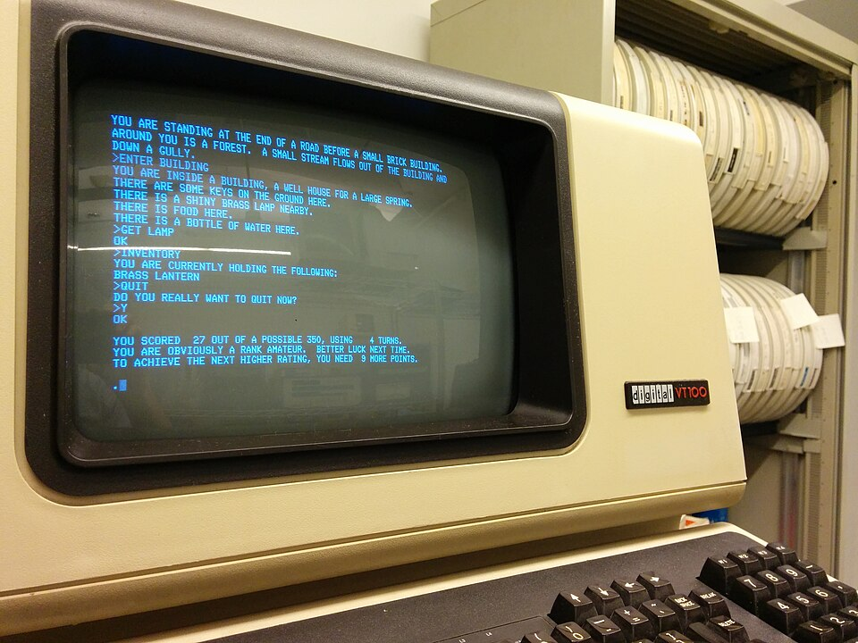
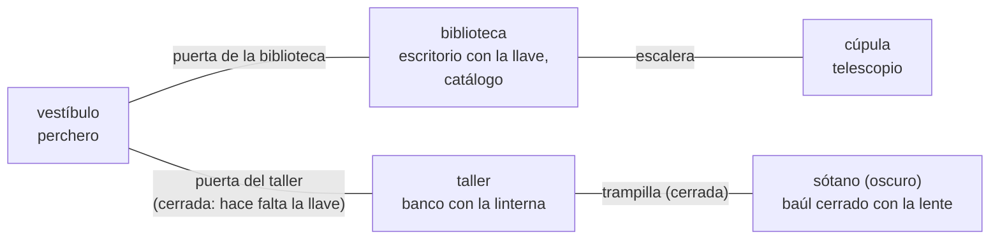

# Capítulo 45 — Proyecto: una aventura de texto

Una aventura de texto es un juego en el que el jugador recorre un mundo
escribiendo órdenes —«ir a la biblioteca», «tomar la llave», «abrir la
puerta»— y el programa responde con frases que describen lo que pasa. Es un
programa pequeño que reúne casi todo lo que el curso enseñó por separado: un
mundo descrito con hechos, un estado que cambia con cada orden, una gramática
que entiende las órdenes, otra que redacta las respuestas, un bucle que lee de
la terminal y una pantalla que se redibuja. El capítulo lo construye en seis
versiones, cada una en su archivo y con sus pruebas; cada versión carga la
anterior como módulo y corrige lo que esa no podía hacer.



*Colossal Cave Adventure*, la primera aventura de texto, escrita por Will
Crowther hacia 1976 y ampliada por Don Woods en 1977, en una terminal VT100
conectada a una PDP-11/34: el programa describe el lugar, el jugador escribe
una orden de una o dos palabras (`ENTER BUILDING`, `GET LAMP`, `INVENTORY`) y
el programa responde. Imagen: Autopilot,
[CC BY-SA 3.0](https://creativecommons.org/licenses/by-sa/3.0/), vía
[Wikimedia Commons](https://commons.wikimedia.org/wiki/File:Colossal_Cave_Adventure_on_VT100_terminal.jpg).

El mundo del capítulo es un observatorio de cinco salas. Cada flecha es un
paso que se recorre en los dos sentidos; dos de ellos empiezan cerrados, y el
sótano no tiene luz propia:



El proyecto parte principalmente de dos libros. El principal es *Adventure in Prolog*, de
Dennis Merritt, que enseña Prolog construyendo capítulo a capítulo un juego,
*Nani Search*; Amzi! lo publica en línea sin costo en
<https://www.amzi.com/AdventureInProlog/>. De él se toman la representación
del mundo con hechos de salas, objetos y puertas, y la conexión simétrica
entre salas (capítulos «Facts» y «Rules»); la contención recursiva de un
objeto dentro de otro («Recursion»); el estado del juego en la base dinámica
(«Managing Data»); las condiciones especiales que bloquean una orden, que el
libro llama *puzzles* («Cut»); el bucle de órdenes y la alternativa del estado
en argumentos («Control Structures»); y la interfaz en lenguaje natural, con
verbos que exigen un tipo de complemento, sinónimos, sustantivos de varias
palabras y una lectura que depende de la situación («Natural Language»). El
segundo es *Prolog Programming in Depth*, de Michael Covington, Donald Nute y
André Vellino, publicado por el autor en
<https://www.covingtoninnovations.com/books/PPID.pdf>: de sus apartados 2.13 y
5.5, «Constructing menus», se toma el menú generado a partir de una lista de
opciones, que vuelve a preguntar ante una respuesta que no es una de ellas. El
mundo, los textos y el código del capítulo son propios, en castellano.

El capítulo reutiliza la base de datos dinámica del [capítulo 21](../capitulo-21-base-de-datos-dinamica/index.md), las
gramáticas del [capítulo 22](../capitulo-22-gramaticas-dcg/index.md), las gramáticas que construyen listas del
[capítulo 35](../capitulo-35-estructuras-incompletas-y-listas-diferencia/index.md) y el módulo `pantalla` del [capítulo 37](../capitulo-37-interfaces-de-usuario/index.md), que carga sin
copiarlo. Cumple así los anuncios de esos dos últimos capítulos: las
respuestas construidas con gramáticas y la interfaz de pantalla completa. Todos
los ejemplos son módulos que cargan otros archivos, y la versión 6 dibuja en
la terminal: son `% solo-local`, y sus pruebas leen las órdenes de una cadena,
nunca del teclado.

## Objetivos del capítulo

Al terminar el capítulo, el lector puede:

- describir un mundo con hechos y derivar de ellos relaciones como la
  conexión entre salas y lo que está al alcance;
- mantener el estado de un programa detrás de una interfaz de pocos
  predicados, y expresar las reglas del juego como impedimentos y efectos;
- guardar y cargar ese estado como un archivo de hechos que se lee sin
  ejecutarse y se valida antes de usarse;
- escribir una gramática que entiende órdenes en castellano a partir de los
  nombres del mundo, y otra que redacta respuestas con artículos,
  concordancia de género y enumeraciones;
- escribir un bucle de juego y un menú que leen de un stream recibido como
  argumento, y probarlos con cadenas;
- montar una interfaz de pantalla completa sobre el modelo de pantalla del
  [capítulo 37](../capitulo-37-interfaces-de-usuario/index.md);
- agregar al juego, como capas que no modifican el estado, un puntaje por
  logros, personajes que se mueven solos y un laberinto con búsqueda del
  camino más corto, y leer menús de una sola tecla.

!!! info "Tiempo estimado"
    Leer el capítulo, ejecutar sus ejemplos y hacer las actividades: **3:10 h**.
    Resolver los 5 ejercicios marcados con ★: **1:35 h**.
    Resolver los 15 ejercicios del capítulo: **4:05 h**.

## 45.1 El programa terminado

El programa terminado se carga con `swipl ejemplos/capitulo-45/aventura.pl` y
se juega con `aventura.`: primero un menú, después la partida a pantalla
completa. `jugar.`, de la versión 5, juega la misma partida línea por línea.
Así se ve una partida corta en esa versión, con las órdenes tal como la
terminal las muestra al escribirlas. El juego se dirige al jugador en
segunda persona, con «tú» («Estás en el vestíbulo», «Tomas la llave de
bronce»); el texto del curso que lo rodea sigue siendo impersonal:

```text
1. Partida nueva
2. Continuar la partida guardada
3. Salir
Elige una opción, de 1 a 3: 1
Estás en el vestíbulo. Un vestíbulo con baldosas gastadas y olor a humedad. Ves un perchero. Desde aquí puedes ir a la biblioteca y al taller.
> ir a la biblioteca
Estás en la biblioteca. Estantes hasta el techo, casi todos vacíos. Ves un catálogo de estrellas y un escritorio. Desde aquí puedes ir a la cúpula y al vestíbulo.
> mirar en el escritorio
En el escritorio ves una llave de bronce.
> tomar la llave
Tomas la llave de bronce.
> volver al vestíbulo
Estás en el vestíbulo. Un vestíbulo con baldosas gastadas y olor a humedad. Ves un perchero. Desde aquí puedes ir a la biblioteca y al taller.
> abrir la puerta
Abres la puerta del taller.
> entrar en el taller
Estás en el taller. Herramientas oxidadas cuelgan de las paredes. Ves un banco de trabajo. Desde aquí puedes ir al sótano y al vestíbulo.
> tomar el banco
No puedes llevarte el banco de trabajo.
> guardar
Partida guardada en partida.partida.
> salir
Fin de la partida.
```

La versión 6 muestra lo mismo en tres recuadros que se redibujan después de
cada orden: el lugar, el inventario y las ocho últimas líneas de mensajes.
Esta es la pantalla después de tomar la linterna, abrir la trampilla y bajar
al sótano sin encenderla; la línea de abajo espera la orden siguiente:

```text
┌─ Lugar ──────────────────────────────────────────────────────┐
│ Está muy oscuro: no ves nada.                                │
└──────────────────────────────────────────────────────────────┘
┌─ Inventario ─────────────────────────────────────────────────┐
│ Llevas una linterna y una llave de bronce.                   │
└──────────────────────────────────────────────────────────────┘
┌─ Mensajes ───────────────────────────────────────────────────┐
│ paredes. Ves un banco de trabajo. Desde aquí puedes ir al    │
│ sótano y al vestíbulo.                                       │
│ > tomar la linterna                                          │
│ Tomas la linterna.                                           │
│ > abrir la trampilla                                         │
│ Abres la trampilla.                                          │
│ > bajar al sótano                                            │
│ Está muy oscuro: no ves nada.                                │
└──────────────────────────────────────────────────────────────┘
>
```

El mundo es un observatorio abandonado de cinco salas. La partida se gana
poniendo la lente, que está en un baúl cerrado del sótano oscuro, en el
telescopio de la cúpula; para llegar hace falta la llave de bronce del
escritorio, que abre el taller, y la linterna del taller, que alumbra el
sótano. Las secciones siguientes construyen el programa desde los hechos.

| Versión | Archivo | Agrega | Lo que no puede hacer todavía |
|---|---|---|---|
| 1 | `mundo.pl` | el mundo como hechos | nada cambia |
| 2 | `estado.pl` | el estado, las reglas del juego | la partida se pierde al terminar el proceso |
| 3 | `partidas.pl` | guardar y cargar | las órdenes son términos de Prolog |
| 4 | `lenguaje.pl` | órdenes y respuestas en castellano | cada orden es una consulta |
| 5 | `juego.pl` | el bucle y el menú de inicio | el texto se desplaza y se pierde de vista |
| 6 | `aventura.pl` | la pantalla completa | — |

## 45.2 Versión 1: el mundo como hechos

Todo lo que no cambia durante la partida es un hecho. Cada sala, puerta y
objeto tiene un nombre, que es un texto con tildes, y un género, que las
respuestas necesitan para elegir el artículo; el identificador es un átomo
sin tildes. Las salas llevan su descripción, y las puertas, las dos salas que
unen:

<!-- ejemplo: capitulo-45/mundo.pl fragmento: nombre(vestibulo, m, .. puerta(escalera, biblioteca, cupula). -->
```prolog
nombre(vestibulo, m, "vestíbulo").
nombre(biblioteca, f, "biblioteca").
nombre(taller, m, "taller").
nombre(sotano, m, "sótano").
nombre(cupula, f, "cúpula").
nombre(puerta_biblioteca, f, "puerta de la biblioteca").
nombre(puerta_taller, f, "puerta del taller").
nombre(trampilla, f, "trampilla").
nombre(escalera, f, "escalera").
nombre(perchero, m, "perchero").
nombre(escritorio, m, "escritorio").
nombre(llave, f, "llave de bronce").
nombre(catalogo, m, "catálogo de estrellas").
nombre(linterna, f, "linterna").
nombre(banco, m, "banco de trabajo").
nombre(baul, m, "baúl").
nombre(lente, f, "lente").
nombre(telescopio, m, "telescopio").

% sala(S, Descripcion): S es una sala, y Descripcion es lo que se ve en ella.
sala(vestibulo, "Un vestíbulo con baldosas gastadas y olor a humedad.").
sala(biblioteca, "Estantes hasta el techo, casi todos vacíos.").
sala(taller, "Herramientas oxidadas cuelgan de las paredes.").
sala(sotano, "Un sótano bajo, de paredes de piedra.").
sala(cupula, "La cúpula de metal está abierta hacia el cielo.").

% puerta(P, S1, S2): el paso P une las salas S1 y S2, en los dos sentidos.
puerta(puerta_biblioteca, vestibulo, biblioteca).
puerta(puerta_taller, vestibulo, taller).
puerta(trampilla, taller, sotano).
puerta(escalera, biblioteca, cupula).
```

Las propiedades de los objetos son hechos de un argumento: `fijo/1` (no se
puede llevar), `recipiente/1` (contiene otros objetos), `luz/1` (se enciende),
`oscura/1` (una sala sin luz propia) y `llave_de/2` (qué objeto abre qué
puerta). El estado inicial también está escrito con hechos, `inicio/1`, cuyo
argumento es un hecho del estado que la versión 2 guarda en la base: dónde
está el jugador, dónde está cada objeto y qué está cerrado. La meta, lo que
hay que conseguir para ganar, se escribe igual:

<!-- ejemplo: capitulo-45/mundo.pl fragmento: inicio(aqui(vestibulo)). .. meta(esta_en(lente, telescopio)). -->
```prolog
inicio(aqui(vestibulo)).
inicio(esta_en(perchero, vestibulo)).
inicio(esta_en(escritorio, biblioteca)).
inicio(esta_en(llave, escritorio)).
inicio(esta_en(catalogo, biblioteca)).
inicio(esta_en(banco, taller)).
inicio(esta_en(linterna, banco)).
inicio(esta_en(baul, sotano)).
inicio(esta_en(lente, baul)).
inicio(esta_en(telescopio, cupula)).
inicio(cerrada(puerta_taller)).
inicio(cerrada(trampilla)).
inicio(cerrada(baul)).

% meta(H): la partida se gana cuando vale el hecho H.
meta(esta_en(lente, telescopio)).
```

Un objeto está en una sala, dentro de un recipiente o en el inventario; el
lugar `jugador` es el inventario. Un solo predicado, `esta_en/2`, cubre los
tres casos, y la llave está en el escritorio, que está en la biblioteca.

Una puerta escrita una vez se recorre en los dos sentidos. `conecta/3` lo
dice con dos cláusulas, y `objeto/1` define los objetos como lo que tiene
nombre sin ser una sala ni un paso:

<!-- ejemplo: capitulo-45/mundo.pl predicado: conecta/3 objeto/1 -->
```prolog
%!  conecta(?P, ?S1, ?S2) is nondet.
%
%   El paso P lleva de la sala S1 a la sala S2, en cualquiera de los dos
%   sentidos en que está escrito.
conecta(P, S1, S2) :-
    puerta(P, S1, S2).
conecta(P, S1, S2) :-
    puerta(P, S2, S1).

%!  objeto(?O) is nondet.
%
%   O es un objeto: tiene nombre y no es una sala ni un paso.
objeto(O) :-
    nombre(O, _, _),
    \+ sala(O, _),
    \+ puerta(O, _, _).
```

```prolog
?- conecta(P, vestibulo, S).
P = puerta_biblioteca,
S = biblioteca ;
P = puerta_taller,
S = taller ;
false.

?- inicio(esta_en(O, biblioteca)).
O = escritorio ;
O = catalogo.
```

Los predicados de datos se declaran `multifile`: otro archivo puede agregar
salas, puertas u objetos con cláusulas como `mundo:sala(jardin, "…")`, sin
modificar `mundo.pl`. El ejercicio 5 lo usa. `mundo.plt` verifica además que
los datos sean coherentes: que cada puerta una dos salas, que todo lo que
aparece en el estado inicial tenga nombre y que haya un solo lugar inicial.

!!! example "Patrón 57 — Extensión por cláusulas multifile"
    **Problema.** Un programa está hecho de módulos que otros archivos
    cargan, y es necesario agregarle casos —una sala, un sinónimo, un
    logro, un personaje— sin modificar el archivo que define el
    predicado y sin copiarlo.

    **Versión ingenua.** Editar `mundo.pl` cada vez que el mundo crece,
    con lo que cada variante del juego es una copia del archivo. O
    escribir en otro archivo `mundo:sala(jardin, "…")` sin más: si
    `sala/2` no es `multifile`, SWI-Prolog avisa `Redefined static
    procedure mundo:sala/2`, y la consulta `mundo:sala(S, _)` responde
    solo `jardin`; las cinco salas del observatorio desaparecen.

    **Patrón.** El módulo declara `multifile`, en su propio archivo, los
    predicados que deja abiertos: `mundo.pl` los nueve predicados de
    datos, `lenguaje.pl` `forma/2`, `puntaje.pl` `logro/2` y
    `personajes.pl` `ruta/2` y `bloquea/3`. Otro archivo carga el módulo
    y escribe sus cláusulas con el nombre del módulo delante, como la
    solución del ejercicio 5, que agrega el jardín: las salas pasan a ser
    seis, y `conecta/3`, `objeto/1` y la gramática las usan sin cambio
    alguno. En el
    [capítulo 46](../capitulo-46-proyecto-compilador/index.md), los
    predicados abiertos son las etapas de un compilador —la gramática, el
    intérprete, el generador de código y el paso de la máquina—, y
    `leer.pl` agrega una sentencia con una cláusula en cada etapa. El
    [Patrón 79](../patrones.md#79-clausulas-para-un-modulo-cargado)
    resuelve el mismo problema cuando el programa cargado no declaró nada:
    un archivo puente declara `multifile` antes de cargarlo; aquí el
    módulo se escribe desde el principio para ser extendido. Y el
    [Patrón 46](../patrones.md#46-extender-el-interprete-no-el-programa)
    cambia lo que el intérprete calcula, con un argumento más en todas sus
    cláusulas, algo que agregar cláusulas no consigue.

    **Cuándo no usarlo.** Cuando la cláusula nueva tiene que ir antes que
    las originales: las de otro archivo quedan después, y una cláusula
    general o un corte del módulo deciden antes de alcanzarlas. Cuando dos
    extensiones pueden unificar la misma cabeza: las respuestas de una se
    mezclan con las de la otra. Y cuando lo que cambia es la conducta de
    una consulta y no el contenido del programa: un argumento, como en el
    [Patrón 60](../patrones.md#60-interprete-con-conducta-como-parametro),
    es más local que cláusulas que valen para todos los que usan el
    módulo.

**Lo que falta.** Los hechos describen el mundo al empezar, pero nada los
cambia: tomar la llave tiene que sacarla del escritorio y ponerla en el
inventario.

## 45.3 Versión 2: el estado detrás de una interfaz

Lo que cambia son cuatro relaciones: `aqui/1`, `esta_en/2`, `cerrada/1` y
`encendido/1`. El módulo `estado` las declara dinámicas y aplica el
[Patrón 19](../patrones.md#19-estado-detras-de-una-interfaz): solo unos pocos predicados con nombre las modifican. `iniciar/0` y
`restablecer/1` cargan un estado entero, y cinco predicados de cambio
—`mover_a/1`, `trasladar/2`, `abrir_cosa/1`, `encender_cosa/1` y
`apagar_cosa/1`— hacen cada uno una modificación. El estado entero se
representa con la misma lista de hechos que usa `inicio/1`:

<!-- ejemplo: capitulo-45/estado.pl predicado: iniciar/0 instantanea/1 restablecer/1 -->
```prolog
%!  iniciar is det.
%
%   Deja el estado de una partida nueva: los hechos de inicio/1.
iniciar :-
    findall(H, inicio(H), Hs),
    restablecer(Hs).

%!  instantanea(-Hechos:list) is det.
%
%   Hechos son los hechos del estado actual, ordenados.
instantanea(Hechos) :-
    findall(H, vale(H), Hs),
    sort(Hs, Hechos).

%!  restablecer(+Hechos:list) is det.
%
%   Reemplaza el estado por Hechos. Produce un error de dominio, sin
%   cambiar nada, si un hecho no es un hecho de estado válido o si Hechos
%   no tiene exactamente un aqui/1.
restablecer(Hechos) :-
    must_be(list, Hechos),
    maplist(validar_hecho, Hechos),
    (   aggregate_all(count, member(aqui(_), Hechos), 1)
    ->  true
    ;   domain_error(estado_con_un_lugar, Hechos)
    ),
    retractall(aqui(_)),
    retractall(esta_en(_, _)),
    retractall(cerrada(_)),
    retractall(encendido(_)),
    maplist(assertz, Hechos).
```

`restablecer/1` valida todos los hechos antes de borrar nada: un hecho que no
es de estado, o que nombra una cosa que el mundo no tiene, produce un error y
deja la partida como estaba. Las pruebas usan `restablecer/1` para preparar
cualquier situación sin recorrer el juego hasta ella.

**Lo que está al alcance.** Un objeto se puede tomar si está en la sala, en el
inventario o dentro de un recipiente abierto que a su vez está al alcance; una
puerta, si es una de las de la sala. Es la contención recursiva de Merritt,
con la condición del recipiente abierto:

<!-- ejemplo: capitulo-45/estado.pl predicado: al_alcance/1 accesible/1 a_oscuras/0 -->
```prolog
%!  al_alcance(?X) is nondet.
%
%   X es un paso de la sala actual, o un objeto que está en la sala, en el
%   inventario o dentro de un recipiente abierto que está al alcance.
al_alcance(X) :-
    aqui(S),
    conecta(X, S, _).
al_alcance(X) :-
    esta_en(X, L),
    accesible(L).

%!  accesible(+L) is semidet.
%
%   Lo que está en L está al alcance.
accesible(jugador).
accesible(S) :-
    aqui(S).
accesible(R) :-
    recipiente(R),
    \+ cerrada(R),
    al_alcance(R).

%!  a_oscuras is semidet.
%
%   La sala actual es oscura y ninguna luz encendida está al alcance.
a_oscuras :-
    aqui(S),
    oscura(S),
    \+ ( luz(L), encendido(L), al_alcance(L) ).
```

**Las reglas del juego.** Una orden es un término: `mirar`, `ir(Sala)`,
`tomar(Objeto)`, `poner(Objeto, Recipiente)`, `abrir(Cosa)`… `realizar/2` la
ejecuta en dos pasos. Primero busca un impedimento; si lo hay, la respuesta es
`no_puede(Motivo)` y el estado no cambia. Si no, aplica el efecto de la orden:

<!-- ejemplo: capitulo-45/estado.pl predicado: realizar/2 -->
```prolog
%!  realizar(+Orden, -Respuesta) is det.
%
%   Ejecuta Orden sobre el estado. Respuesta es no_puede(Motivo) si un
%   impedimento la bloquea, y el resultado de su efecto si no. Produce un
%   error de dominio si Orden no es una orden.
realizar(Orden, Respuesta) :-
    (   es_orden(Orden)
    ->  true
    ;   domain_error(orden, Orden)
    ),
    (   impedimento(Orden, Motivo)
    ->  Respuesta = no_puede(Motivo)
    ;   efecto(Orden, Respuesta)
    ).
```

Los impedimentos son una relación, `impedimento(Orden, Motivo)`, con una
cláusula por regla del juego. Algunas se aplican a una sola orden; otras, a
toda una familia, que un hecho auxiliar describe: `requiere_luz/1` dice qué
órdenes no se pueden hacer a oscuras, y `se_alcanza/2`, qué cosa tiene que
estar al alcance:

<!-- ejemplo: capitulo-45/estado.pl fragmento: impedimento(ir(S), ya_esta(S)) .. impedimento(tomar(O), ya_lo_tiene(O)) -->
```prolog
impedimento(ir(S), ya_esta(S)) :-
    aqui(S).
impedimento(ir(S), no_hay_paso(S)) :-
    aqui(A),
    \+ conecta(_, A, S).
impedimento(ir(S), cerrado(P)) :-
    aqui(A),
    conecta(P, A, S),
    cerrada(P).
impedimento(Orden, oscuro) :-
    requiere_luz(Orden),
    a_oscuras.
impedimento(Orden, no_lo_tiene(O)) :-
    se_lleva(Orden, O),
    \+ esta_en(O, jugador).
impedimento(Orden, no_esta(X)) :-
    se_alcanza(Orden, X),
    \+ al_alcance(X).
impedimento(tomar(O), ya_lo_tiene(O)) :-
```

`realizar/2` usa el primer impedimento, así que el orden de las cláusulas
decide qué aviso se da cuando hay varios: en el sótano a oscuras, «tomar la
lente» responde que está oscuro, no que la lente está dentro de un baúl
cerrado. Es el *puzzle* de Merritt generalizado: allí era un predicado con
cortes que imprimía el aviso; aquí es una relación sin efectos, que se
consulta, se prueba y se extiende con una cláusula. Los efectos, uno por
orden, llaman a los predicados de cambio y dan la respuesta como término:

```prolog
?- iniciar, realizar(mirar, R).
R = vista(vestibulo, [perchero], [biblioteca, taller]).

?- iniciar, realizar(ir(taller), R).
R = no_puede(cerrado(puerta_taller)).

?- iniciar, realizar(ir(biblioteca), _), realizar(tomar(llave), R1), realizar(ir(vestibulo), _), realizar(abrir(puerta_taller), R2), realizar(ir(taller), R3).
R1 = tomado(llave),
R2 = abierto(puerta_taller),
R3 = vista(taller, [banco], [sotano, vestibulo]).
```

Las respuestas son términos y no texto: el núcleo no sabe castellano, y las
pruebas comparan términos. `estado.plt` recorre la partida entera con
dieciséis órdenes y verifica `ganado/0` al final.

!!! example "Patrón 58 — Impedimento y efecto"
    **Problema.** Una orden cambia el estado de un programa, pero solo
    cuando las reglas lo permiten; si no, hay que decir por qué, sin haber
    cambiado nada.

    **Versión ingenua.** Cada orden comprueba sus condiciones dentro del
    mismo predicado que la ejecuta, con cortes que imprimen el aviso y
    cambios del estado intercalados. Las reglas no se pueden consultar sin
    ejecutar la orden, una condición que falla después del primer cambio
    deja el estado a medio modificar, y agregar una regla obliga a tocar
    cada orden a la que se aplica.

    **Patrón.** Las reglas son una relación sin efectos,
    `impedimento(Orden, Motivo)`, con una cláusula por regla; una cláusula
    puede abarcar una familia de órdenes a través de un hecho auxiliar,
    como `requiere_luz/1`. `realizar/2` la consulta primero y, si no hay
    impedimento, aplica un solo efecto, `efecto/2`. El orden de las
    cláusulas decide qué aviso se da cuando hay varios. Como la relación
    no cambia nada, también sirve para otras preguntas: `entender/2`, en la
    [sección 45.5](lenguaje.md#455-version-4-ordenes-y-respuestas-en-castellano), elige
    la lectura de una orden que ningún impedimento bloquea.

    **Cuándo no usarlo.** Cuando lo que impide la orden solo se conoce al
    intentarla, como abrir un archivo: ahí decide el sistema, y la
    respuesta es un error; lo que sí se comprueba antes es la validez de
    los datos ([Patrón 31](../patrones.md#31-validar-al-entrar)), como hace
    `cargar/1` en la
    [sección 45.4](#454-version-3-guardar-y-cargar-una-partida). Y cuando una
    orden tiene una sola condición y un solo aviso: un `->` en el propio
    predicado alcanza.

!!! question "Actividad"
    Predecir la respuesta de `realizar(tomar(lente), R)` en tres situaciones,
    preparadas con `restablecer/1`: el jugador en el sótano con la linterna
    apagada en el inventario; con la linterna encendida y el baúl cerrado; y
    con el baúl abierto. Comprobarlo, y explicar cada respuesta con las
    cláusulas de `impedimento/2`.

**Lo que falta.** El estado vive en la base de datos del proceso: al salir de
Prolog, la partida se pierde.

## 45.4 Versión 3: guardar y cargar una partida

La instantánea ya es una lista de hechos, y los hechos se escriben como
cláusulas con `portray_clause/2`. Una partida guardada es un archivo de texto
con un hecho por línea:

```text
aqui(biblioteca).
cerrada(baul).
cerrada(puerta_taller).
cerrada(trampilla).
esta_en(banco, taller).
esta_en(baul, sotano).
esta_en(catalogo, biblioteca).
esta_en(escritorio, biblioteca).
esta_en(lente, baul).
esta_en(linterna, banco).
esta_en(llave, jugador).
esta_en(perchero, vestibulo).
esta_en(telescopio, cupula).
```

Cargarla podría ser consultar el archivo, pero `consult/1` ejecuta lo que
encuentra: una directiva `:- halt.` en un archivo dañado o preparado a
propósito terminaría el programa, y las cláusulas quedarían en el módulo
`user`, no en `estado`. `cargar/1` lee los términos con `read_term/3`, que
solo los analiza, y los pasa a `restablecer/1`, que los valida
([Patrón 31](../patrones.md#31-validar-al-entrar)):

<!-- ejemplo: capitulo-45/partidas.pl predicado: guardar/1 cargar/1 leer_terminos/2 -->
```prolog
%!  guardar(+Archivo) is det.
%
%   Escribe en Archivo los hechos del estado actual, uno por línea.
guardar(Archivo) :-
    instantanea(Hechos),
    setup_call_cleanup(
        open(Archivo, write, Out, [encoding(utf8)]),
        forall(member(H, Hechos), portray_clause(Out, H)),
        close(Out)).

%!  cargar(+Archivo) is det.
%
%   Reemplaza el estado por los hechos de Archivo. Produce un error, y no
%   cambia el estado, si Archivo no existe, no es texto Prolog válido o
%   tiene términos que no son hechos de estado.
cargar(Archivo) :-
    setup_call_cleanup(
        open(Archivo, read, In, [encoding(utf8)]),
        leer_terminos(In, Hechos),
        close(In)),
    restablecer(Hechos).

%!  leer_terminos(+In, -Terminos:list) is det.
%
%   Terminos son los términos que quedan por leer en el stream In.
leer_terminos(In, Terminos) :-
    read_term(In, T, []),
    (   T == end_of_file
    ->  Terminos = []
    ;   Terminos = [T|Ts],
        leer_terminos(In, Ts)
    ).
```

`partidas.plt` escribe archivos temporales con `tmp_file/2` y los borra al
terminar. Una de sus pruebas carga un archivo que empieza con `:- halt.`:

```prolog
test(no_ejecuta_directivas, [ error(domain_error(hecho_de_estado,
                                                 (:- halt))),
                              cleanup(assertion(aqui(vestibulo))) ]) :-
    iniciar,
    con_archivo(A, ( escribir(A, ":- halt.\naqui(cupula).\n"), cargar(A) )).
```

La directiva llega a `restablecer/1` como el término `:-(halt)`, que no es un
hecho de estado; el error sale antes de que nada cambie, y el jugador sigue en
el vestíbulo.

!!! question "Actividad"
    Predecir qué pasa al cargar un archivo que contiene solamente
    `aqui(cupula).`: ¿produce un error? ¿Qué objetos quedan en el mundo, y
    qué responde `realizar(mirar, R)`? Comprobarlo, y proponer qué
    verificación agregaría `restablecer/1` para rechazar ese archivo.

**Lo que falta.** Las órdenes se escriben como términos de Prolog, con
paréntesis y con los identificadores del programa: `realizar(tomar(llave),
R)`, no «tomar la llave de bronce».

El capítulo continúa en la página
[Órdenes en castellano, el bucle del juego y la pantalla completa](lenguaje.md#455-version-4-ordenes-y-respuestas-en-castellano),
con la versión 4, que entiende las órdenes escritas en castellano y redacta
las respuestas.

## Ejercicios

Las soluciones están en [la página de soluciones](soluciones.md). La dificultad
va de 1 (se resuelve consultando el capítulo) a 3 (requiere elaboración propia).
Los marcados con ★ son los que no conviene saltear: cubren lo que el capítulo
tiene de propio. Los ejercicios extienden el programa: cada solución es un
archivo que carga los del capítulo, sin modificarlos.

1. **(1)** El encabezado de `al_alcance/1` declara un solo modo,
   `al_alcance(?X) is nondet`. Escribir la línea del modo con `X`
   instanciado, con su determinación, y justificarla con los datos del
   mundo y las cláusulas de `al_alcance/1` y `accesible/1`.
2. **(2)** Versionar el formato de las partidas: `guardar_con_formato/1`
   escribe primero el hecho `formato(aventura, 1)`, y
   `cargar_con_formato/1` rechaza, con un error de dominio y sin cambiar el
   estado, un archivo que no empieza con ese hecho.
3. ★ **(3)** Escribir el núcleo con el estado en argumentos, como la
   versión de «Control Structures» de Merritt: `paso(+Orden, +Estado0,
   -Estado, -Respuesta)` para `mirar`, `ir/1`, `tomar/1` y `dejar/1`, donde
   el estado es la lista de hechos de `instantanea/1`. Verificar, sobre una
   secuencia de órdenes, que da las mismas respuestas y el mismo estado final
   que `realizar/2`.

## Referencias

- Dennis Merritt, *Adventure in Prolog*, Springer-Verlag, 1990 — «Facts»,
  «Rules», «Managing Data», «Recursion», «Cut», «Control Structures»,
  «Natural Language» y el apéndice con el juego *Nani Search*.
  [Edición en línea](https://www.amzi.com/AdventureInProlog/), de Amzi!.
  Esta página toma de allí las ideas y la representación del juego: el
  mundo como hechos de salas, objetos y puertas con una conexión simétrica,
  la contención recursiva, el estado en la base dinámica, las condiciones
  que bloquean una orden (*puzzles*) y la variante del estado en argumentos
  del ejercicio 3.
- Michael A. Covington, Donald Nute y André Vellino, *Prolog Programming in
  Depth*, Prentice Hall, 1997 — apartados 2.13 y 5.5, «Constructing menus».
  [Edición en línea](https://www.covingtoninnovations.com/books/PPID.pdf).
  Es la segunda fuente del capítulo, que esta página presenta; sus menús
  están en las secciones
  [45.6](lenguaje.md#456-version-5-el-bucle-del-juego-y-el-menu-de-inicio)
  y [45.11](colossal-cave.md#4511-menus-de-una-tecla).
- William Crowther y Don Woods, *Colossal Cave Adventure*, 1976–1977, el
  juego que Merritt nombra en su prefacio como el modelo de todos los que lo
  siguieron. [Historia y versiones del juego](https://rickadams.org/adventure/),
  en el sitio de Rick Adams. Esta página toma de allí el género: un mundo de
  lugares y objetos que el programa describe, órdenes breves en lenguaje
  natural que el jugador escribe, y respuestas que relatan lo que ocurre.
