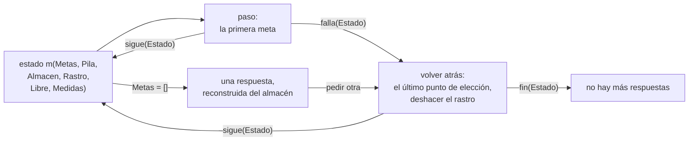

# Una pila de alternativas, el almacén, el corte y la indexación

Esta página continúa el [capítulo 62](index.md) después de la
[sección 62.2](index.md#622-la-resolvente-como-una-lista-de-metas), con las
secciones [62.3](#623-una-pila-de-alternativas) a
[62.7](#627-el-programa-compilado): la segunda versión de la máquina, que
convierte la búsqueda en un ciclo sobre una pila de alternativas, y las
versiones 3 a 6, que agregan las celdas, el almacén y el rastro, el corte, la
indexación por el primer argumento y la compilación del programa. Los
ejemplos son `alternativas.pl`, `almacen.pl`, `corte.pl`, `indice.pl` y
`compilado.pl`, en `ejemplos/capitulo-62/`, con sus pruebas; cargan el
módulo `programas`, y se ejecutan localmente.

## 62.3 Una pila de alternativas

La segunda versión, `alternativas.pl`, sigue el primer planteo de Spivey: la
búsqueda en profundidad es un ciclo sobre una lista de resolventes, en el
que cada paso reemplaza la primera por todas las que se derivan de ella en un
paso de resolución, y deja las demás detrás. Cada alternativa es
`alt(Metas, R)`: una resolvente y la instancia de la consulta que le
corresponde, con variables propias, porque `findall/3` copia cada una:

<!-- ejemplo: capitulo-62/alternativas.pl predicado: buscar/4 desde/6 expandir/5 -->
```prolog
%!  buscar(+Pila:list, +Clausulas:list, +Medidas, -Evento) is multi.
%
%   Evento es, en orden, respuesta(R) por cada respuesta R que se obtiene
%   de la Pila de alternativas, y por último fin(Medidas).
buscar([], _, Medidas, fin(Medidas)).
buscar([alt(Metas, R)|Pila], Clausulas, Medidas, Evento) :-
    desde(Metas, R, Pila, Clausulas, Medidas, Evento).

%!  desde(+Metas:list, +R, +Pila:list, +Clausulas:list, +Medidas,
%!        -Evento) is multi.
%
%   Continúa la búsqueda con la alternativa Metas, cuya consulta es R,
%   encima de la Pila.
desde([], R, Pila, Clausulas, Medidas, Evento) :-
    (   Evento = respuesta(R)
    ;   buscar(Pila, Clausulas, Medidas, Evento)
    ).
desde([Meta|Metas], R, Pila, Clausulas, Medidas0, Evento) :-
    clase(Meta, Clase),
    expandir(Clase, Metas, R, Clausulas, Nuevas),
    append(Nuevas, Pila, Pila1),
    contar(Clase, Nuevas, Pila1, Medidas0, Medidas),
    buscar(Pila1, Clausulas, Medidas, Evento).

%!  expandir(+Clase, +Metas:list, +R, +Clausulas:list, -Nuevas:list)
%!      is det.
%
%   Nuevas son las alternativas que resultan de probar una meta de la
%   Clase dada, seguida de Metas, con la consulta R: ninguna, una o una
%   por cada cláusula cuya cabeza unifica con la meta.
expandir(verdad, Metas, R, _, [alt(Metas, R)]).
expandir(conjuncion(A, B), Metas, R, _, [alt([A, B|Metas], R)]).
expandir(corte, Metas, R, _, [alt(Metas, R)]).
expandir(predefinida(Meta), Metas, R, _, Nuevas) :-
    (   ejecutar(Meta)
    ->  Nuevas = [alt(Metas, R)]
    ;   Nuevas = []
    ).
expandir(usuario(Meta), Metas, R, Clausulas, Nuevas) :-
    findall(alt([Cuerpo|Metas], R),
            ( member(Clausula, Clausulas),
              copy_term(Clausula, (Meta :- Cuerpo))
            ),
            Nuevas).
```

El ciclo no deja puntos de elección de Prolog, salvo el de la disyunción de
`desde/6`, que entrega las respuestas de a una y es lo que ve el nivel
superior. La máquina ya tiene las alternativas como datos; su problema es el
precio. Cada alternativa es una copia completa de la resolvente, y en
`suma_hasta(N, S)` la resolvente contiene la lista de `N` números que se
está sumando. `medir/3` cuenta las celdas que `findall/3` copió, medidas con
`term_size/2`:

```prolog
?- medir(listas, suma_hasta(100, S), M).
M = [pasos-810, respuestas-1, alternativas-2, copiado-37229].

?- medir(listas, suma_hasta(200, S), M).
M = [pasos-1610, respuestas-1, alternativas-2, copiado-134329].
```

Al duplicar la lista, los pasos se duplican y lo copiado se multiplica por
3,6: el costo de cada paso crece con el largo de lo que queda por sumar, y el
total es cuadrático. En tiempo, medido en la máquina donde se escribió el
capítulo, `suma_hasta(8000, S)` tarda 6,7 segundos en esta versión y 1,8 en
la versión 5.

!!! question "Actividad"
    Predecir el valor de `copiado` para `suma_hasta(400, S)` a partir de las
    dos cifras anteriores, y comprobarlo. ¿Qué parte de la resolvente se
    copia en cada paso, y por qué no se puede compartir entre dos
    alternativas mientras sus variables sean variables de Prolog?

## 62.4 Celdas, almacén y rastro

La tercera versión, `almacen.pl`, resuelve las dos cosas a la vez. Un punto de
elección no guarda las resolventes que se derivan de una meta, sino la meta
con las cláusulas que faltan probar: la resolución se hace cuando la
búsqueda vuelve a ese punto, y no antes. Y para que guardar la resolvente no
obligue a copiarla, las variables del programa objeto dejan de ser variables
de Prolog: la variable número `N` es el término `'$v'(N)`, una **celda**, y
un término del programa objeto es un término de Prolog sin variables, que se
puede compartir sin riesgo. El valor de las celdas ligadas está en el
**almacén**, un árbol AVL de `library(assoc)`.

Cada cláusula se traduce una sola vez, antes de ejecutar nada: sus
variables se numeran desde 0 y el cuerpo pasa a ser una lista de metas.
`compilar/2` guarda las cláusulas de cada predicado en una tabla, en el orden
del programa:

```prolog
?- compilar_clausula((concatenar([X|Xs], L, [X|Ys]) :- concatenar(Xs, L, Ys)), P).
P = concatenar/3-cl(4, concatenar(['$v'(0)|'$v'(1)], '$v'(2), ['$v'(0)|'$v'(3)]), [concatenar('$v'(1), '$v'(2), '$v'(3))]).
```

Usar la cláusula es sumar a cada celda la primera celda libre, con
`renombrar/3`: la cláusula traducida es un esqueleto que se comparte, y cada
uso recibe `K` celdas nuevas. La unificación trabaja sobre esos términos.
`desreferenciar/3` sigue las ligaduras de una celda hasta un valor que no es
una celda ligada; después, dos términos iguales unifican, una celda libre se
liga al otro término, y dos términos compuestos con el mismo nombre y la
misma aridad unifican argumento por argumento:

<!-- ejemplo: capitulo-62/almacen.pl predicado: unificar/5 ligar/5 -->
```prolog
%!  unificar(+X, +Y, +Marca:integer, +Estado0, -Estado) is semidet.
%
%   Unifica X e Y. Estado, un par Almacen-Rastro, agrega a Estado0 las
%   ligaduras necesarias; las de las celdas anteriores a Marca quedan
%   anotadas en el rastro. Falla si X e Y no unifican. No hace la prueba
%   de ocurrencia.
unificar(X0, Y0, Marca, Estado0, Estado) :-
    Estado0 = Almacen-_,
    desreferenciar(X0, Almacen, X),
    desreferenciar(Y0, Almacen, Y),
    (   X == Y
    ->  Estado = Estado0
    ;   X = '$v'(N)
    ->  ligar(N, Y, Marca, Estado0, Estado)
    ;   Y = '$v'(N)
    ->  ligar(N, X, Marca, Estado0, Estado)
    ;   compound(X),
        compound(Y),
        compound_name_arity(X, Nombre, Aridad),
        compound_name_arity(Y, Nombre, Aridad),
        compound_name_arguments(X, Nombre, Xs),
        compound_name_arguments(Y, Nombre, Ys),
        foldl(unificar_argumento(Marca), Xs, Ys, Estado0, Estado)
    ).

%!  ligar(+N:integer, +Valor, +Marca:integer, +Estado0, -Estado) is det.
%
%   Liga la celda N a Valor en el almacén, y la anota en el rastro si es
%   anterior a Marca.
ligar(N, Valor, Marca, Almacen0-Rastro0, Almacen-Rastro) :-
    put_assoc(N, Almacen0, Valor, Almacen),
    (   N < Marca
    ->  Rastro = [N|Rastro0]
    ;   Rastro = Rastro0
    ).
```

Como la de Prolog, esta unificación no hace la prueba de ocurrencia: ligar
una celda a un término que la contiene crea un término infinito, que
`reconstruir/3` no puede recorrer ([ejercicio 4](#ejercicios)). Spivey explica la
razón de la omisión: con la prueba, unificar un patrón corto con una lista
larga cuesta tanto como recorrer la lista.

El estado de la máquina es `m(Metas, Pila, Almacen, Rastro, Libre, Medidas)`.
Un punto de elección es `eleccion(Metas, Clausulas, N, Marca)`: la
resolvente de la llamada, las cláusulas que quedan, el largo del rastro y la
primera celda libre en el momento de crearlo. Al llamar a un predicado, la
máquina prueba sus cláusulas en orden y, antes de usar una que no es la
última, apila un punto de elección con las siguientes:

<!-- ejemplo: capitulo-62/almacen.pl predicado: llamar/5 usar/5 -->
```prolog
%!  llamar(+Clausulas:list, +Meta, +Metas:list, +Estado0, -Resultado)
%!      is det.
%
%   Prueba las Clausulas en orden con Meta, seguida de Metas. Antes de
%   usar una cláusula que no es la última, apila un punto de elección con
%   las que quedan. Resultado es sigue(Estado) con la primera cuya cabeza
%   unifica, o falla(Estado) si no hay ninguna.
llamar([Clausula|Clausulas], Meta, Metas, Estado0, Resultado) :-
    contar_intento(Estado0, Estado1),
    (   Clausulas == []
    ->  Estado2 = Estado1
    ;   apilar(eleccion([Meta|Metas], Clausulas), Estado1, Estado2)
    ),
    (   usar(Clausula, Meta, Metas, Estado2, Estado)
    ->  Resultado = sigue(Estado)
    ;   Clausulas == []
    ->  Resultado = falla(Estado1)
    ;   llamar(Clausulas, Meta, Metas, Estado1, Resultado)
    ).

%!  usar(+Clausula, +Meta, +Metas:list, +Estado0, -Estado) is semidet.
%
%   Usa la Clausula, cl(K, Cabeza, Cuerpo) con K variables, para resolver
%   Meta: renombra la cabeza con las celdas libres, la unifica con Meta y
%   pone el cuerpo, renombrado, delante de Metas. Falla si la cabeza no
%   unifica.
usar(cl(K, Cabeza, Cuerpo), Meta, Metas, m(_, Pila, A0, R0, L0, M),
     m(Metas1, Pila, A, R, L, M)) :-
    renombrar(L0, Cabeza, Cabeza1),
    marca(Pila, Marca),
    unificar(Meta, Cabeza1, Marca, A0-R0, A-R),
    maplist(renombrar(L0), Cuerpo, Cuerpo1),
    append(Cuerpo1, Metas, Metas1),
    L is L0 + K.
```

Volver atrás es tomar el último punto de elección, borrar del almacén las
ligaduras anotadas en el rastro desde que se creó, y seguir con las
cláusulas que guardaba. No hace falta anotar todas las ligaduras: una celda
creada después del último punto de elección (su número no es menor que la
`Marca`) deja de existir para la búsqueda al volver a ese punto, porque la
resolvente guardada no la menciona. Spivey llama **críticas** a las otras,
las únicas que `ligar/5` anota. `ejecutar/5` es el ciclo de la máquina, con
la versión como parámetro, un [intérprete con conducta como parámetro](../patrones.md#60-interprete-con-conducta-como-parametro):
el módulo que se le pasa define el paso y la vuelta atrás, y las versiones
4 y 5 cambian solo esos dos predicados. Ninguno de los dos falla: el paso
devuelve `sigue(Estado)` o `falla(Estado)`, y la vuelta atrás `sigue(Estado)`
o `fin(Estado)`. Si una falla de Prolog señalara la falla de la meta, el
estado del intento se perdería, y con él lo que midió. El ciclo es este:



!!! example "Patrón 63 — Estado como resultado, no como falla"
    **Problema.** Un paso de un intérprete o de una simulación puede
    fallar, y el estado que produce lleva algo que no debe perderse aunque
    falle: contadores, medidas, un registro de lo que ocurrió.

    **Versión ingenua.** Escribir el paso como un predicado `semidet` que
    falla cuando falla la meta. La falla de Prolog deshace todo lo que el
    paso calculó, y quien lo llama se queda con el estado de antes: las
    cabezas intentadas en una llamada que no encuentra ninguna cláusula
    desaparecen de las medidas, y la columna `intentos` cuenta de menos.

    **Patrón.** El paso es `det` y devuelve el estado dentro de un término
    que dice qué pasó: `sigue(Estado)` o `falla(Estado)`, y la vuelta atrás
    `sigue(Estado)` o `fin(Estado)`. Quien lo llama elige el camino por el
    functor, con la indexación por el primer argumento, y la falla de la
    meta queda como un dato, con el estado al día. Es el mismo principio
    que el [Patrón 44](../patrones.md#44-representacion-limpia) aplicado al
    resultado: un functor por cada clase.

    **Cuándo no usarlo.** Cuando el estado de un intento fallido no
    importa, la falla de Prolog es más directa y más barata: `usar/5`, que
    prueba una sola cabeza, sigue siendo `semidet`. Y cuando el paso tiene
    varias soluciones que Prolog debe enumerar, el resultado ya no es
    uno solo.

Las respuestas se reconstruyen desde el almacén, con una variable de Prolog
por cada celda libre, reunidas en un diccionario incompleto como el del
[capítulo 35](../capitulo-35-estructuras-incompletas-y-listas-diferencia/index.md):

```prolog
?- resolver(listas, concatenar(X, Y, [a])).
X = [],
Y = [a] ;
X = [a],
Y = [] ;
false.
```

La pila ya es visible, y se puede medir. `suma/3` tiene la cláusula
recursiva primero, así que cada llamada deja pendiente la de la lista vacía:

```prolog
?- medir(listas, suma_hasta(100, S), M).
M = [respuestas-1, pasos-506, intentos-407, metas-4, elecciones-101, rastro-102, celdas-914].
```

Hay 101 puntos de elección al mismo tiempo, y 102 entradas en el rastro,
porque cada punto de elección vuelve críticas las celdas que ya existían. La
versión 3 tampoco conoce el corte: `!` es para ella una llamada a un
predicado sin definir, como en Prolog.

```prolog
?- catch(resolver(maximo, maximo(4, 3, M)), error(E, _), true).
E = existence_error(procedure, !/0).
```

Con un almacén que es un árbol persistente, el rastro no es la única
solución: el punto de elección podría guardar el almacén entero, que no se
copia, porque las versiones viejas comparten sus nodos con la nueva. Una
máquina con una memoria que se modifica en su lugar, como la de Spivey o el
Toy de Kluźniak y Szpakowicz, necesita el rastro; el [ejercicio 8](#ejercicios)
escribe la otra variante y compara las dos.

!!! question "Actividad"
    En `almacen.pl`, `usar/5` renombra la cabeza entera antes de unificarla,
    y el cuerpo solo si la unificación tiene éxito. Predecir cuántas celdas
    usa `medir(listas, concatenar(X, Y, [a, b]), M)` y comprobarlo. ¿Qué
    celdas se crean para cláusulas cuya cabeza no unifica?

## 62.5 El corte

El corte quita las alternativas creadas desde que se llamó al predicado cuya
cláusula lo contiene: las de las metas anteriores del cuerpo y las
cláusulas que quedaban del predicado. En la cuarta versión, `corte.pl`, la
llamada anota la **altura** de la pila de puntos de elección, y cada `!` del
cuerpo elegido entra en la resolvente como `'$corte'(Altura)`. Ejecutarlo
deja en la pila solo los puntos de elección de más abajo:

<!-- ejemplo: capitulo-62/corte.pl predicado: paso/5 cortar/4 instanciar/4 -->
```prolog
%!  paso(+Meta, +Metas:list, +Tabla, +Estado0, -Resultado) is det.
%
%   Como paso/5 de almacen.pl, con el corte: '$corte'(Altura) corta hasta
%   Altura, ! corta hasta 0, y la llamada a un predicado anota la altura
%   de la pila para los cortes de su cuerpo.
paso(Meta, Metas, Tabla, Estado0, Resultado) :-
    (   Meta = '$corte'(Altura)
    ->  cortar(Altura, Metas, Estado0, Estado),
        Resultado = sigue(Estado)
    ;   Meta == !
    ->  cortar(0, Metas, Estado0, Estado),
        Resultado = sigue(Estado)
    ;   clase(Meta, usuario(_))
    ->  procedimiento(Tabla, Meta, Clausulas),
        Estado0 = m(_, Pila, _, _, _, _),
        length(Pila, Altura),
        llamar(Clausulas, Meta, Metas, Altura, Estado0, Resultado)
    ;   almacen:paso(Meta, Metas, Tabla, Estado0, Resultado)
    ).

%!  cortar(+Altura:integer, +Metas:list, +Estado0, -Estado) is det.
%
%   Estado sigue con Metas y deja en la pila solo los Altura puntos de
%   elección de más abajo. El rastro pierde las entradas que ya no hacen
%   falta.
cortar(Altura, Metas, m(_, Pila0, A, R0, L, M), m(Metas, Pila, A, R, L, M)) :-
    length(Pila0, N),
    K is max(0, N - Altura),
    length(Quitados, K),
    append(Quitados, Pila, Pila0),
    purgar(Pila, R0, R).

%!  instanciar(+Base:integer, +Altura:integer, +Meta0, -Meta) is det.
%
%   Meta es la meta Meta0 de un cuerpo, renombrada desde Base; un ! pasa a
%   ser '$corte'(Altura).
instanciar(Base, Altura, Meta0, Meta) :-
    (   Meta0 == !
    ->  Meta = '$corte'(Altura)
    ;   renombrar(Base, Meta0, Meta)
    ).
```

Al cortar, algunas entradas del rastro dejan de hacer falta: las de celdas
creadas después del punto de elección que quedó arriba. `purgar/3` las
quita, como `Commit` en picoProlog y como el corte de Toy. Sin esa purga, el
rastro de `suma_hasta(100, S)` con cortes crece hasta 200 entradas, aunque la
pila no pase de un punto de elección. Con el corte, el máximo es correcto:

```prolog
?- resolver(maximo, maximo(4, 3, M)).
M = 4.

?- resolver(corte, primero(X, [a, b, c])).
X = a.
```

El programa `corte` repite `suma/3` con un corte verde en la cláusula
recursiva. La pila no pasa de un punto de elección:

```prolog
?- medir(corte, suma_hasta(100, S), M).
M = [respuestas-1, pasos-705, intentos-206, metas-5, elecciones-1, rastro-1, celdas-912].
```

El precio lo paga el programa, que tiene que escribir el corte y queda
atado a un modo: Spivey muestra que un `append/3` con corte ya no sirve para
separar una lista en dos partes.

!!! question "Actividad"
    Predecir qué responde `resolver(listas, (concatenar(X, Y, [a, b]), !))`
    en la versión 4, y a qué altura corta ese `!`, que está en la consulta y
    no en una cláusula. Comprobarlo.

## 62.6 Indexación por el primer argumento

La indexación consigue lo mismo sin escribir el corte. Una cláusula cuya
cabeza no puede unificar con la meta no se prueba, y si después de la
elegida no queda ninguna que pueda unificar, no hay punto de elección. La
quinta versión, `indice.pl`, agrega a cada cláusula una **clave** calculada
con el primer argumento de la cabeza, como la tabla que SWI-Prolog construye
en la [sección 17.3](../capitulo-17-rendimiento/index.md#173-indexacion), y calcula la misma clave con el primer argumento de
la meta, desreferenciado. Dos claves son compatibles si alguna es `libre` o
si son iguales:

<!-- ejemplo: capitulo-62/indice.pl predicado: clave_de/2 compatibles/2 siguiente/4 saltar/3 -->
```prolog
%!  clave_de(+Termino, -Clave) is det.
%
%   Clave es la clave del Termino, como la describe clave/2.
clave_de(Termino, Clave) :-
    (   Termino = '$v'(_)
    ->  Clave = libre
    ;   atomic(Termino)
    ->  Clave = Termino
    ;   compound_name_arity(Termino, Nombre, Aridad),
        Clave = Nombre/Aridad
    ).

%!  compatibles(+Clave1, +Clave2) is semidet.
%
%   Las claves no descartan que los términos unifiquen.
compatibles(Clave1, Clave2) :-
    (   Clave1 == libre
    ->  true
    ;   Clave2 == libre
    ->  true
    ;   Clave1 == Clave2
    ).

%!  siguiente(+Pares0:list, +Clave, -Clausula, -Pares:list) is semidet.
%
%   Clausula es la primera de Pares0 con una clave compatible con Clave, y
%   Pares lo que sigue, desde la próxima compatible, o [] si no hay otra.
%   Falla si ninguna es compatible.
siguiente([Clave0-Clausula0|Pares0], Clave, Clausula, Pares) :-
    (   compatibles(Clave0, Clave)
    ->  Clausula = Clausula0,
        saltar(Pares0, Clave, Pares)
    ;   siguiente(Pares0, Clave, Clausula, Pares)
    ).

%!  saltar(+Pares0:list, +Clave, -Pares:list) is det.
%
%   Pares es Pares0 desde el primer par con una clave compatible con
%   Clave, o [] si no hay ninguno.
saltar([], _, []).
saltar([Clave0-Clausula|Pares0], Clave, Pares) :-
    (   compatibles(Clave0, Clave)
    ->  Pares = [Clave0-Clausula|Pares0]
    ;   saltar(Pares0, Clave, Pares)
    ).
```

`siguiente/4` filtra también las cláusulas que se guardan en el punto de
elección, como `Search` en picoProlog: si no queda ninguna compatible, la
lista es vacía y no se apila nada. La suma de una lista es entonces
determinista, como en SWI-Prolog, y la respuesta termina en punto:

```prolog
?- resolver(listas, suma([1, 2, 3], S)).
S = 6.
```

En la versión 3, la misma consulta termina en `S = 6 ;` y después `false.`.
Con la lista de cien números, la pila baja de 101 puntos de elección a uno,
el de `desde/3` al llegar a 0, y se intentan 206 cabezas en lugar de 407:

```prolog
?- medir(listas, suma_hasta(100, S), M).
M = [respuestas-1, pasos-506, intentos-206, metas-4, elecciones-1, rastro-2, celdas-914].

?- medir(listas, longitud_hasta(100, K), M).
M = [respuestas-1, pasos-505, intentos-205, metas-101, elecciones-1, rastro-2, celdas-811].
```

La columna `metas` muestra la **llamada de cola**. En `suma/3`, la llamada
recursiva es la última meta del cuerpo: cuando se ejecuta, la resolvente ya
no guarda nada de la cláusula que la llamó, y su largo no pasa de 4. En
`longitud/2`, la suma se hace al volver, y cada llamada deja pendiente su
`N is N0 + 1`: 101 metas, las llamadas que la [sección 17.2](../capitulo-17-rendimiento/index.md#172-la-pila-y-la-recursion) veía
crecer en la pila de SWI-Prolog. En una máquina con marcos de activación,
como picoProlog o Toy, liberar el marco de la cláusula que hace una llamada
de cola es una optimización explícita; aquí la da la representación de la
resolvente. Lo que ninguna versión recupera son las celdas: 914 en las dos
tablas, porque una celda creada durante una ejecución determinista no se
borra nunca. Recuperarlas es el trabajo de un recolector de basura, que
Spivey describe y el capítulo no escribe.

## 62.7 El programa compilado

Las versiones 3 a 5 examinan cada cláusula al usarla: renombran la cabeza
entera, la unifican con el algoritmo general, clasifican cada meta del
cuerpo con `clase/2` y buscan su procedimiento por nombre y aridad. Todo eso
depende solo de la cláusula, y se repite en cada llamada. La sexta versión,
`compilado.pl`, lo hace una vez, al traducir el programa: **compila** cada
cláusula a instrucciones de una máquina. Es lo que la
[sección 46.7](../capitulo-46-proyecto-compilador/especializacion.md#467-el-interprete-especializado) llamó especializar el intérprete, aplicado a Prolog.

La cabeza se compila a una lista de instrucciones de unificación, una por
argumento, con su posición. `primera(I, V)` es la primera aparición de la
variable `V`: su celda es nueva, así que se liga al argumento sin unificar
nada. `otra(I, V)` es una aparición repetida, que sí se unifica.
`constante(I, C)` compara o liga. `estructura(I, F/N, Hijas, Esqueleto)`
tiene dos modos: si el argumento de la meta es una celda libre, lo liga al
esqueleto renombrado, construido de una vez; si es un término compuesto,
verifica el nombre y la aridad y ejecuta con él las instrucciones `Hijas`.
El cuerpo se compila a llamadas ya clasificadas: `'$llamar'(Nombre/Aridad,
Meta)`, `'$predefinida'(Meta)` y `'$cortar'`:

```prolog
?- compilar_clausula_v6((p(f(X), X) :- q(X)), C).
C = f/1-cc(1, [estructura(1, f/1, [primera(1, 0)], f('$v'(0))), otra(2, 0)], ['$llamar'(q/1, q('$v'(0)))]).
```

`f/1` es la clave de la indexación, y `1` la cantidad de variables. La
máquina ejecuta las instrucciones con los argumentos de la meta, ya
desreferenciados:

<!-- ejemplo: capitulo-62/compilado.pl predicado: ejecutar/6 -->
```prolog
%!  ejecutar(+Termino, +Base:integer, +Marca:integer, +Instruccion,
%!           +Estado0, -Estado) is semidet.
%
%   Ejecuta una instrucción con el argumento que le corresponde del
%   Termino, ya desreferenciado. Estado0 y Estado son pares
%   Almacen-Rastro; la variable V de la cláusula es la celda Base + V.
ejecutar(Termino, Base, Marca, Instruccion, A0-R0, A-R) :-
    arg(1, Instruccion, I),
    arg(I, Termino, Argumento),
    desreferenciar(Argumento, A0, T),
    (   Instruccion = primera(_, V)
    ->  Celda is Base + V,
        put_assoc(Celda, A0, T, A),
        R = R0
    ;   Instruccion = constante(_, C)
    ->  (   T = '$v'(N)
        ->  ligar(N, C, Marca, A0-R0, A-R)
        ;   T == C,
            A = A0,
            R = R0
        )
    ;   Instruccion = otra(_, V)
    ->  Celda is Base + V,
        unificar('$v'(Celda), T, Marca, A0-R0, A-R)
    ;   Instruccion = estructura(_, Nombre/Aridad, Hijas, Esqueleto),
        (   T = '$v'(N)
        ->  renombrar(Base, Esqueleto, Nuevo),
            ligar(N, Nuevo, Marca, A0-R0, A-R)
        ;   compound(T),
            compound_name_arity(T, Nombre, Aridad),
            foldl(ejecutar(T, Base, Marca), Hijas, A0-R0, A-R)
        )
    ).
```

El resto de la máquina es el de la versión 5: las mismas claves, el mismo
corte, los mismos pasos, intentos, puntos de elección y celdas. Lo que
cambia es el trabajo de Prolog que cuesta cada paso, y
`tabla_de_inferencias/1` de `maquina.pl` lo mide:

```prolog
?- tabla_de_inferencias([listas-suma_hasta(200, _), listas-longitud_hasta(200, _), listas-invertir_hasta(60, _), familia-antepasado(_, _), listas-concatenar(_, _, [a, b, c, d, e, f])]).
consulta                          indice  compilado  cociente
suma_hasta(200,A)                 197805     179453      0.91
longitud_hasta(200,A)             179479     164116      0.91
invertir_hasta(60,A)              786416     709620      0.90
antepasado(A,B)                     5536       5121      0.93
concatenar(A,B,[a,b,c,d,e,f])       4949       5178      1.05
true.
```

La ganancia es de un 10 %, y en el tiempo de `suma_hasta(4000, S)`, de 1,06
a 0,86 segundos en la máquina donde se escribió el capítulo. Es poca porque
la mayor parte de cada paso no depende de la cláusula: las operaciones del
almacén, que es un árbol, y las medidas que la máquina anota. En la
concatenación que separa una lista, la compilación pierde: los dos primeros
argumentos son celdas libres, y el modo de construcción renombra los
esqueletos, que cuestan más que la cabeza entera. Un compilador de Prolog
como el de Warren (DEC-10 Prolog, 1977, y su máquina abstracta de 1983,
en las [Referencias](#referencias)) va mucho más lejos: las celdas son posiciones de una
memoria, las instrucciones son de la máquina que ejecuta el programa, y la
decisión entre construir y verificar se toma una vez por argumento, sin
examinar el término. Kluźniak y Szpakowicz dejan la compilación fuera de su
libro, y Spivey la menciona como el camino para ganar velocidad sin cambiar
las estructuras de datos del intérprete; esta versión muestra el primer
paso de ese camino.

El capítulo continúa en la página
[Los programas de otros capítulos, la negación y los errores](archivos.md#628-los-programas-de-otros-capitulos), con la
máquina terminada sobre archivos de otros capítulos y la séptima versión,
que agrega la negación y el manejo de errores.

## Ejercicios

Las soluciones están en [la página de soluciones](soluciones.md). La dificultad
va de 1 (se resuelve consultando el capítulo) a 3 (requiere elaboración propia).
Los marcados con ★ son los que no conviene saltear: cubren lo que el capítulo
tiene de propio, y los capítulos siguientes los dan por hechos.

1. ★ **(1)** Predecir qué responden las versiones 1, 3 y 5 (`resolver/3` de
   `maquina.pl`) a `suma([1, 2], S)` del programa `listas` y a
   `maximo(3, 4, M)` del programa `maximo`, con cuántas respuestas y si la
   última termina en punto. Comprobarlo y explicar cada diferencia.
2. **(1)** En la tabla de la [sección 62.1](index.md#621-la-maquina-terminada), las celdas de
   `suma_hasta(200, _)` son 1 814 en las versiones 3 y 5. Explicar de dónde
   sale esa cifra, y por qué la indexación, que evita intentar 401 cabezas,
   no la reduce.
3. **(2)** Escribir como lista de cláusulas un programa con `tipo(X, T)`,
   hechos cuyo argumento discriminante es el segundo, y otro con los
   argumentos invertidos. Medir con `medir_clausulas/4` de `almacen.pl`, en la
   versión 5, las consultas `tipo(X, entero)` y `tipo(entero, X)`, y
   explicar la diferencia en intentos y puntos de elección.
4. ★ **(2)** Escribir `unificar_con_prueba/5`, con los mismos argumentos que
   `unificar/5`, que falla si una celda se liga a un término que la contiene.
   Comprobar que unificar `'$v'(0)` con `f('$v'(0))` falla, y compararlo con
   `unify_with_occurs_check/2`.
5. **(2)** Escribir una versión `traza`, un módulo que define `paso/5` y
   `volver/3` y delega en los de `almacen.pl`, que escribe en cada paso la
   meta, reconstruida, y el número de puntos de elección. Ejecutar con ella
   `abuelo(juan, N)`.
6. ★ **(3)** La máquina no conoce la disyunción ni la negación. Escribir
   `transformar/2`, que reemplaza en las cláusulas cada `(A ; B)` por la
   llamada a un predicado auxiliar nuevo con dos cláusulas, y cada `\+ G`
   por uno con las cláusulas `G, !, fail` y `true`, ambos con las variables
   de la meta como argumentos. Probar con la versión 5 un programa con las
   dos construcciones. ¿En qué se aparta un corte dentro de una disyunción
   transformada del corte de Prolog?
7. **(2)** Medir los pasos de `invertir_hasta(N, R)` en la versión 5 para
   `N` 20, 40 y 80, y explicar su crecimiento. Escribir `invertir/3` con
   acumulador como lista de cláusulas y medir lo mismo.
8. **(3)** Escribir una versión `sin_rastro` en la que el punto de elección
   guarda el almacén en lugar del largo del rastro, y comparar sus
   respuestas y sus medidas con las de la versión 3. ¿Qué campo del estado
   deja de hacer falta?
9. ★ **(3)** La versión 6 compila las cabezas y clasifica las metas, pero
    `X is E` todavía reconstruye `E` como un término de Prolog en cada
    ejecución. Escribir una versión `aritmetica`, un módulo que compila con
    `compilar/2` de `compilado.pl` y traduce cada `'$predefinida'(X is E)`
    a `'$is'(X, Codigo)`, con `E` como instrucciones de una máquina de pila
    como la de la [sección 46.5](../capitulo-46-proyecto-compilador/index.md#465-la-maquina-de-pila), y que delega en la versión 6
    las demás metas. Medir las inferencias de `suma_hasta(200, S)` en las
    dos versiones y explicar el resultado.
10. **(2)** Con `medir_clausulas/4`, medir en la versión 5 las metas de
    `longitud/2` y de una `longitud/3` con acumulador, escrita como lista
    de cláusulas, para listas de 50 y 100 elementos. Relacionar la
    diferencia con la [sección 17.2](../capitulo-17-rendimiento/index.md#172-la-pila-y-la-recursion).

## Referencias

- Michael Spivey, *An Introduction to Logic Programming through Prolog*,
  Prentice Hall International, 1996 — «About picoProlog», «Implementing
  depth-first search», «Representing terms and substitutions», «Implementation
  notes» e «Interpreter optimizations».
  [Edición del autor](https://spivey.oriel.ox.ac.uk/wiki/files/logprog/logic.pdf).
  El capítulo toma la búsqueda en profundidad como una lista de resolventes
  (versión 2) y como una pila de marcos con las cláusulas que faltan (versión
  3), la resolución demorada hasta que hace falta, el punto de elección como
  registro al que vuelve la búsqueda y al que corta el corte, las ligaduras que
  se deshacen con un rastro y las variables críticas, las cláusulas guardadas
  con variables numeradas que se renombran al usarlas, la unificación sin prueba
  de ocurrencia y su justificación, la indexación por el primer argumento que
  filtra también las cláusulas guardadas, y la llamada de cola y la recolección
  de basura como las dos optimizaciones que completan la indexación. De
  picoProlog, escrito en otro lenguaje, el capítulo toma las ideas, no el
  código.
- Feliks Kluźniak y Stanisław Szpakowicz, con Janusz S. Bień, *Prolog for
  Programmers*, Academic Press, 1985 — «Principles of Prolog Implementation» y
  «Toy: An Exercise in Implementation».
  [Edición en línea en el sitio del coautor](https://www.site.uottawa.ca/~szpak/pub/P4P/Prolog_for_Programmers_neat.pdf).
  El capítulo toma la comparación entre compartir la estructura de los términos,
  con un prototipo y un marco de variables, y copiarla al ligar una variable; el
  registro de punto de falla separado del marco de activación; el rastro
  limitado a las variables de las zonas protegidas; y, del intérprete Toy, los
  prototipos sin variables que no se copian, el cuerpo de la cláusula como una
  lista de llamadas, y el corte que quita registros de vuelta atrás y purga el
  rastro.
- David H. D. Warren, *Applied Logic — Its Use and Implementation as a
  Programming Tool*, tesis doctoral, Universidad de Edimburgo, 1977.
  [Edinburgh Research Archive](https://era.ed.ac.uk/handle/1842/6648). Kluźniak
  y Szpakowicz citan de esta tesis la clasificación de las variables en locales
  y globales y los nombres *skeleton* y *molecule* para el prototipo de un
  término y su instancia; el capítulo toma la palabra **esqueleto** para la
  cláusula guardada que comparten todos sus usos, y la referencia del compilador
  DEC-10 Prolog de la [sección 62.7](#627-el-programa-compilado).
- David H. D. Warren, «An Abstract Prolog Instruction Set», Technical Note 309,
  SRI International, 1983.
  [Edición de SRI](https://www.sri.com/wp-content/uploads/2021/12/641.pdf). La
  máquina abstracta de Warren, con la que se compila Prolog a instrucciones que
  trabajan sobre una memoria de celdas; el capítulo la nombra como el final del
  camino que la versión 6 empieza.
- Hassan Aït-Kaci, *Warren's Abstract Machine: A Tutorial Reconstruction*, MIT
  Press, 1991. Spivey la recomienda para la compilación de Prolog; es la
  explicación paso a paso de la máquina anterior, y el capítulo remite a ella
  para lo que la [sección 62.7](#627-el-programa-compilado) no hace.
