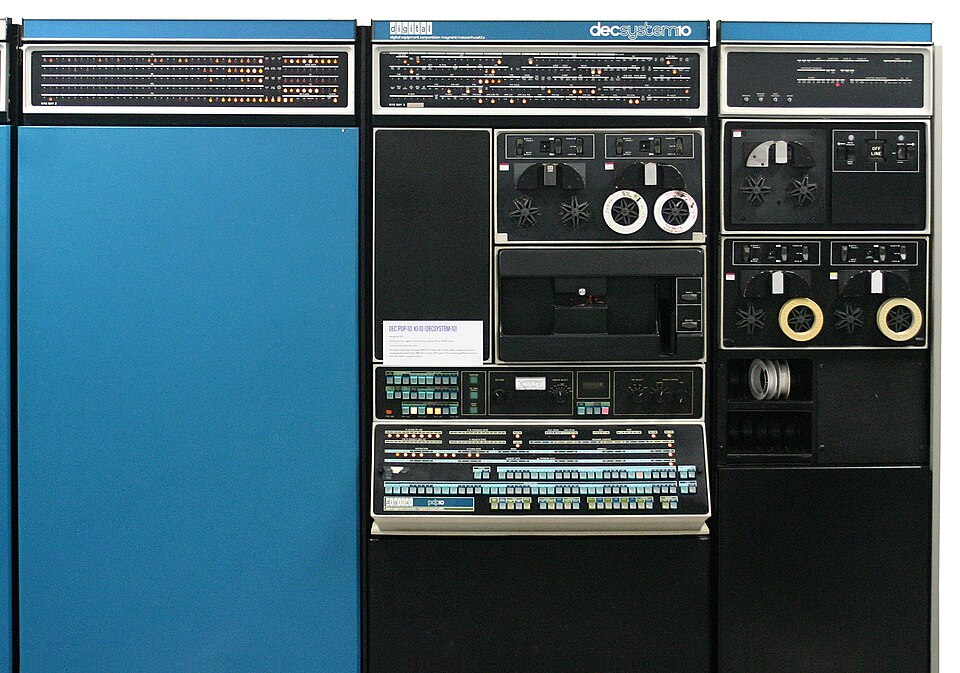

# Capítulo 62 — Proyecto: una máquina de Prolog

El intérprete vainilla de la [sección 34.2](../capitulo-34-introspeccion-y-metainterpretes/index.md#342-el-interprete-vainilla) prueba un programa en tres
cláusulas porque deja casi todo el trabajo a Prolog: la unificación, la
elección de la cláusula, la vuelta atrás y la memoria de lo que falta
probar. Es un [intérprete que absorbe](../patrones.md#45-interprete-que-absorbe). Este capítulo hace el camino
inverso y escribe una **máquina de Prolog**: un programa que ejecuta otro
programa Prolog con todo ese trabajo a la vista, como datos que se pueden
examinar y medir. La resolvente es una lista de metas; las alternativas, una
pila de **puntos de elección**; las variables del programa ejecutado,
celdas numeradas en un **almacén**; la unificación, un predicado escrito en
el capítulo; y la vuelta atrás, un **rastro** de las ligaduras que hay que
deshacer. Con esas piezas se agregan el corte y la indexación por el primer
argumento, y cada versión mide lo que cambia: pasos, cabezas intentadas,
largo de la resolvente, puntos de elección, entradas del rastro y celdas.



Una DECsystem-10 (PDP-10, unidad central KI10), de la década de 1970. En
una máquina de esta familia funcionó DEC-10 Prolog, el compilador con el que
David H. D. Warren mostró en 1977 que Prolog se puede ejecutar con
pilas, puntos de elección y un rastro, las mismas piezas que este capítulo
escribe en Prolog.
Imagen: Gah4, [CC BY-SA 4.0](https://creativecommons.org/licenses/by-sa/4.0/),
vía [Wikimedia Commons](https://commons.wikimedia.org/wiki/File:DEC_PDP-10_(from_ca._1970_named_decsystem-10)_mainframe_computer_system,_1970s_(edited,_white_background).jpg).

La máquina crece en siete versiones, una por sección. La primera hace de la
resolvente un dato y deja la elección de la cláusula a Prolog; la segunda
convierte la búsqueda en un ciclo sobre una pila de alternativas; la tercera
reemplaza las variables de Prolog por celdas y agrega los puntos de elección
y el rastro; la cuarta, el corte; la quinta, la indexación; la sexta
**compila** el programa a instrucciones, y la séptima agrega la negación y
el manejo de errores. La
[sección 62.8](archivos.md#628-los-programas-de-otros-capitulos) ejecuta en la máquina
archivos de otros capítulos, leídos con el lector del [capítulo 60](../capitulo-60-proyecto-analisis-programas/index.md). El capítulo usa la medición del [capítulo 17](../capitulo-17-rendimiento/index.md), los
árboles AVL de `library(assoc)` del [capítulo 23](../capitulo-23-estructuras-de-datos-de-la-biblioteca/index.md) para el almacén, la inspección de
términos del [capítulo 33](../capitulo-33-inspeccion-de-terminos/index.md) y un diccionario incompleto del [capítulo 35](../capitulo-35-estructuras-incompletas-y-listas-diferencia/index.md). Cumple
los anuncios de los capítulos [46](../capitulo-46-proyecto-compilador/index.md) (la compilación de Prolog a las
instrucciones de una máquina), [58](../capitulo-58-proyecto-interprete-funcional/index.md) (una máquina con una pila explícita, un paso más abajo
que un evaluador recursivo) y [60](../capitulo-60-proyecto-analisis-programas/index.md) (un intérprete con pila de metas y puntos
de elección que ejecuta los programas que ese capítulo lee). Todas las
versiones cargan otros archivos, así que se ejecutan en una instalación
local y no en SWISH.

El proyecto parte de dos libros. De *An Introduction to Logic Programming
through Prolog* de Michael Spivey vienen la búsqueda en profundidad escrita
primero como una lista de resolventes y después como una pila de marcos con
las cláusulas que faltan probar, el punto de elección como el lugar al que
vuelve la búsqueda y al que corta el corte, la representación de las
sustituciones por ligaduras que se deshacen con un rastro, las variables
**críticas** que el rastro anota, el renombrado de cláusulas guardadas con
sus variables numeradas, la unificación sin prueba de ocurrencia y la
indexación por el primer argumento. De *Prolog for Programmers* de Feliks
Kluźniak y Stanisław Szpakowicz vienen la distinción entre compartir la
estructura de los términos y copiarla, los registros de punto de falla
separados de los marcos de activación, y, del intérprete Toy, el corte que
quita puntos de elección y purga el rastro. La sección [Referencias](#referencias)
da el detalle; el código es propio.

## Objetivos del capítulo

Al terminar el capítulo, el lector puede:

- representar el estado de una demostración como datos: la resolvente, la
  pila de puntos de elección, el almacén de ligaduras y el rastro;
- explicar por qué copiar cada alternativa completa cuesta un tiempo
  cuadrático, y cómo un punto de elección perezoso lo evita;
- escribir la unificación sobre términos sin variables de Prolog, con las
  variables como celdas, y deshacer sus ligaduras con un rastro;
- implementar el corte como una altura de la pila de puntos de elección, y
  la indexación por el primer argumento como un filtro de cláusulas;
- compilar las cabezas y los cuerpos de las cláusulas a instrucciones, y
  medir lo que se gana al no examinarlas en cada uso;
- medir con la máquina los efectos que el [capítulo 17](../capitulo-17-rendimiento/index.md) observó desde afuera:
  alternativas pendientes, recursión de cola e indexación.

!!! info "Tiempo estimado"
    Leer el capítulo, ejecutar sus ejemplos y hacer las actividades: **2:05 h**.
    Resolver los 5 ejercicios marcados con ★: **1:50 h**.
    Resolver los 12 ejercicios del capítulo: **4:05 h**.

## 62.1 La máquina terminada

`maquina.pl` carga las seis versiones, cada una en su módulo, y el lector
del [capítulo 60](../capitulo-60-proyecto-analisis-programas/index.md):

<!-- ejemplo: capitulo-62/maquina.pl fragmento: :- use_module(programas). .. :- ensure_loaded('../capitulo-60/leer'). -->
```prolog
:- use_module(programas).
:- use_module(resolvente, []).
:- use_module(alternativas, []).
:- use_module(almacen, []).
:- use_module(corte, []).
:- use_module(indice, []).
:- use_module(compilado, []).
:- ensure_loaded('../capitulo-60/leer').
```

Los programas que la máquina ejecuta, los **programas objeto**, están en
`programas.pl`, como listas de cláusulas con un nombre: `familia` (padres,
abuelos y antepasados), `listas` (concatenar, invertir, sumar, contar),
`maximo` y `corte`, estos dos con cortes. `resolver/3` recibe la versión, el
nombre del programa y la consulta:

```prolog
?- resolver(indice, familia, abuelo(juan, N)).
N = luis ;
false.

?- resolver(indice, maximo, maximo(4, 3, M)).
M = 4.
```

`tabla_de_medidas/1` ejecuta cada consulta hasta agotar sus respuestas y
escribe lo que midió la versión indicada: los pasos (metas tomadas de la
resolvente), las cabezas de cláusula intentadas, y los máximos de la
resolvente, de la pila de puntos de elección y del rastro; `celdas` es la
cantidad de variables creadas:

```prolog
?- tabla_de_medidas([almacen-listas-suma_hasta(200, _), indice-listas-suma_hasta(200, _), corte-corte-suma_hasta(200, _), almacen-listas-longitud_hasta(200, _), indice-listas-longitud_hasta(200, _)]).
version  programa consulta                pasos intentos metas elecciones rastro celdas
almacen  listas   suma_hasta(200,A)        1006      807     4        201    202   1814
indice   listas   suma_hasta(200,A)        1006      406     4          1      2   1814
corte    corte    suma_hasta(200,A)        1405      406     5          1      1   1812
almacen  listas   longitud_hasta(200,A)    1005      806   201          2    203   1611
indice   listas   longitud_hasta(200,A)    1005      405   201          1      2   1611
true.
```

La suma con acumulador deja 201 puntos de elección en la versión 3; con
cortes (versión 4) o con indexación (versión 5), uno solo. La longitud sin
acumulador llega a 201 metas pendientes en todas las versiones, porque cada
llamada deja una suma por hacer; la suma con acumulador, a 4. Las celdas no
cambian: ninguna versión recupera la memoria de las variables que ya no se
usan. Las secciones que siguen explican cada columna.

## 62.2 La resolvente como una lista de metas

En el intérprete vainilla, lo que falta probar después de una meta está en
la pila de llamadas de Prolog: `resolver((A, B))` prueba `A` y al volver
prueba `B`. La primera versión, `resolvente.pl`, guarda eso en una lista, la
**resolvente**, que es el objeto de la resolución SLD de la
[sección 39.2](../capitulo-39-semantica-de-los-programas-logicos/resolucion.md#392-resolucion-sld). `programas.pl` define qué clase de meta es cada término,
con un functor por clase (una [representación limpia](../patrones.md#44-representacion-limpia)), y ejecuta los
predicados predefinidos, que la máquina no define con cláusulas:

<!-- ejemplo: capitulo-62/programas.pl predicado: clase/2 -->
```prolog
%!  clase(+Meta, -Clase) is det.
%
%   Clase describe la meta Meta con un functor por cada clase: verdad,
%   conjuncion(A, B), corte, predefinida(Meta) o usuario(Meta). Una meta
%   que es una variable produce un error de instanciación.
clase(Meta, Clase) :-
    (   var(Meta)
    ->  instantiation_error(Meta)
    ;   Meta == true
    ->  Clase = verdad
    ;   Meta = (A, B)
    ->  Clase = conjuncion(A, B)
    ;   Meta == !
    ->  Clase = corte
    ;   predefinida(Meta)
    ->  Clase = predefinida(Meta)
    ;   Clase = usuario(Meta)
    ).
```

Un paso toma la primera meta y la reemplaza según su clase. Para una meta
del programa, `member/2` elige una cláusula y `copy_term/2` la renombra, de
modo que cada uso tiene variables propias:

<!-- ejemplo: capitulo-62/resolvente.pl predicado: resolver_metas/2 paso/4 -->
```prolog
%!  resolver_metas(+Metas:list, +Clausulas:list) is nondet.
%
%   Las Metas, la resolvente, se prueban con las Clausulas.
resolver_metas([], _).
resolver_metas([Meta|Metas], Clausulas) :-
    clase(Meta, Clase),
    paso(Clase, Metas, Clausulas, Metas1),
    resolver_metas(Metas1, Clausulas).

%!  paso(+Clase, +Metas:list, +Clausulas:list, -Metas1:list) is nondet.
%
%   Metas1 es la resolvente que queda después de probar una meta de la
%   Clase dada, seguida de Metas: una alternativa por cada cláusula que
%   sirve.
paso(verdad, Metas, _, Metas).
paso(conjuncion(A, B), Metas, _, [A, B|Metas]).
paso(corte, Metas, _, Metas).
paso(predefinida(Meta), Metas, _, Metas) :-
    ejecutar(Meta).
paso(usuario(Meta), Metas, Clausulas, [Cuerpo|Metas]) :-
    member(Clausula, Clausulas),
    copy_term(Clausula, (Meta :- Cuerpo)).
```

`resolver_metas/2` es recursivo de cola: la pila de llamadas de Prolog no
crece con la profundidad de la demostración, porque la continuación ya es un
dato. Las respuestas son las de Prolog, en el mismo orden:

```prolog
?- resolver(familia, abuelo(juan, N)).
N = luis ;
false.
```

Las alternativas, en cambio, siguen siendo de Prolog: son los puntos de
elección de `member/2`, y la máquina no los ve. Por eso no puede cortarlos.
El programa `maximo` tiene un corte rojo, como el de la
[sección 9.5](../capitulo-09-backtracking-y-corte/index.md#95-corte-verde-y-corte-rojo), y la versión 1 lo ejecuta como `true`:

```prolog
?- resolver(maximo, maximo(4, 3, M)).
M = 4 ;
M = 3.
```

La segunda respuesta es incorrecta. Para que el corte sea posible, las
alternativas tienen que pasar a ser datos de la máquina.

El capítulo continúa en la página
[Una pila de alternativas, el almacén, el corte y la indexación](alternativas.md#623-una-pila-de-alternativas), con la segunda
versión, que convierte la búsqueda en un ciclo sobre una pila de
alternativas, y las versiones 3 a 6: las celdas, el almacén y el rastro, el
corte, la indexación y la compilación.

## Referencias

- Michael Spivey, *An Introduction to Logic Programming through Prolog*,
  Prentice Hall International, 1996 — «About picoProlog», «Implementing
  depth-first search», «Representing terms and substitutions», «Implementation
  notes» e «Interpreter optimizations».
  [Edición del autor](https://spivey.oriel.ox.ac.uk/wiki/files/logprog/logic.pdf).
  El capítulo toma la búsqueda en profundidad como una lista de resolventes
  (versión 2) y como una pila de marcos con las cláusulas que faltan (versión
  3), la resolución demorada hasta que hace falta, el punto de elección como
  registro al que vuelve la búsqueda y al que corta el corte, las ligaduras que
  se deshacen con un rastro y las variables críticas, las cláusulas guardadas
  con variables numeradas que se renombran al usarlas, la unificación sin prueba
  de ocurrencia y su justificación, la indexación por el primer argumento que
  filtra también las cláusulas guardadas, y la llamada de cola y la recolección
  de basura como las dos optimizaciones que completan la indexación, y la
  negación `not` como una llamada del ciclo del intérprete desde el paso, que la
  versión 7 escribe. De picoProlog, escrito en otro lenguaje, el capítulo toma
  las ideas, no el código.
- Feliks Kluźniak y Stanisław Szpakowicz, con Janusz S. Bień, *Prolog for
  Programmers*, Academic Press, 1985 — «Principles of Prolog Implementation» y
  «Toy: An Exercise in Implementation».
  [Edición en línea en el sitio del coautor](https://www.site.uottawa.ca/~szpak/pub/P4P/Prolog_for_Programmers_neat.pdf).
  El capítulo toma la comparación entre compartir la estructura de los términos,
  con un prototipo y un marco de variables, y copiarla al ligar una variable; el
  registro de punto de falla separado del marco de activación; el rastro
  limitado a las variables de las zonas protegidas; y, del intérprete Toy, los
  prototipos sin variables que no se copian, el cuerpo de la cláusula como una
  lista de llamadas, y el corte que quita registros de vuelta atrás y purga el
  rastro, y el manejo de errores que reemplaza la llamada errónea por una
  llamada a `error/1`, en la versión 7.
- David H. D. Warren, *Applied Logic — Its Use and Implementation as a
  Programming Tool*, tesis doctoral, Universidad de Edimburgo, 1977.
  [Edinburgh Research Archive](https://era.ed.ac.uk/handle/1842/6648). El
  capítulo toma de esta tesis la referencia del compilador DEC-10 Prolog que
  nombra el pie de la imagen del comienzo.
