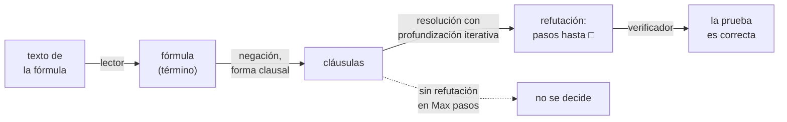
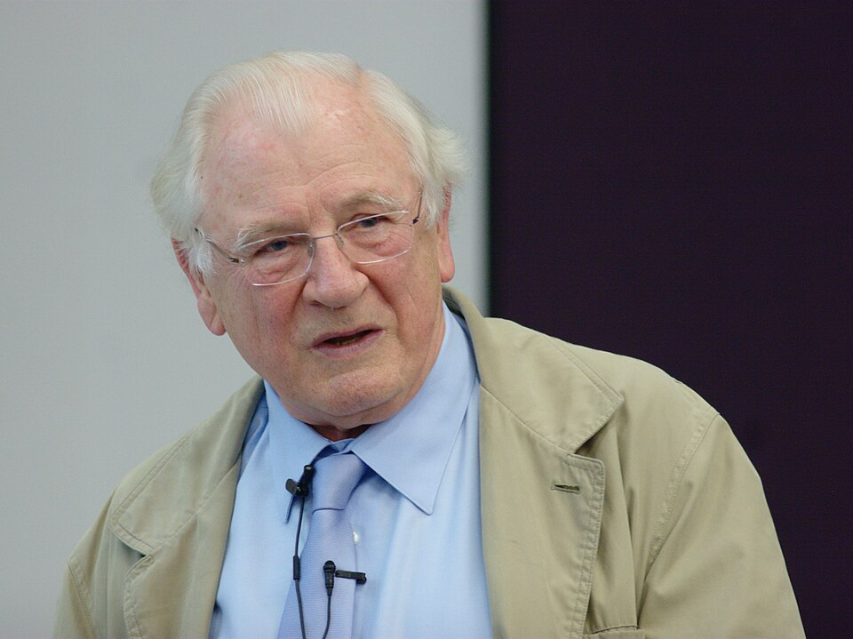

# Capítulo 63 — Proyecto: un demostrador de teoremas

Prolog prueba por resolución, pero solo sobre cláusulas de Horn y con un
recorrido en profundidad que puede no alcanzar una prueba que existe
([sección 13.11](../capitulo-13-prolog-y-la-logica/evaluacion.md#1311-el-interprete-no-determinista-y-las-estrategias-de-evaluacion)).
Un **demostrador de teoremas** escrito en Prolog no tiene esos límites:
acepta fórmulas cualesquiera de la lógica de predicados, con disyunciones en
la conclusión, negaciones y cuantificadores anidados, y organiza la búsqueda
de modo que, si la prueba existe, la encuentra. El programa de este capítulo
lee una fórmula escrita como texto, la lleva a forma clausal, busca por
resolución la refutación más corta de su negación y la devuelve como un dato
que un segundo programa, pequeño e independiente, verifica paso por paso.





John Alan Robinson, que en 1965 publicó el principio de resolución, la
regla de inferencia única sobre la que trabaja este demostrador (ver
[Referencias](#referencias)).
Imagen: David Monniaux,
[CC BY-SA 3.0](https://creativecommons.org/licenses/by-sa/3.0/), vía
[Wikimedia Commons](https://commons.wikimedia.org/wiki/File:John_Alan_Robinson_IMG_0493.jpg).

El proyecto crece en siete versiones. La primera es el lector de fórmulas;
la segunda, la forma clausal de la lógica proposicional; la tercera, el
demostrador por resolución con profundización iterativa; la cuarta, el
verificador de refutaciones. La quinta y la sexta extienden la forma
clausal y la resolución a la lógica de predicados, con skolemización,
factorización y la comprobación de ocurrencia. La séptima compara el
demostrador con dos procedimientos que deciden la lógica proposicional: la
separación de casos de Quine y `library(clpb)`. Dos secciones finales
construyen un modelo cuando no hay refutación y agregan la estrategia de
conjunto de soporte.

```prolog
?- demostrar_fo("¬∃x ∀y (afeita(x, y) ↔ ¬afeita(y, y))", 5, P), escribir_prueba(P).
  1.  ¬afeita(A, A) ∨ ¬afeita(sk1, A)  premisa
  2.  afeita(A, A) ∨ afeita(sk1, A)   premisa
  3.  ¬afeita(sk1, sk1)               factor de 1
  4.  afeita(sk1, sk1)                resolvente de 2 y 3
  5.  □                               resolvente de 3 y 4
P = prueba([[-afeita(_A, _A), -afeita(sk1, _A)], [+afeita(_B, _B), +afeita(sk1, _B)]], [f(1, [-afeita(sk1, sk1)]), r(2, 3, [+afeita(sk1, sk1)]), r(3, 4, [])]).
```

La consulta demuestra que no existe un barbero que afeita exactamente a
quienes no se afeitan a sí mismos. Las dos primeras líneas son la forma
clausal de la negación, con el barbero hipotético convertido en la
constante `sk1`; las tres siguientes, la refutación, y la última, la misma
refutación como término de Prolog, listo para el verificador.

El proyecto parte de seis libros. De *Prolog Experiments in Discrete
Mathematics, Logic, and Computability* de James L. Hein
([edición en línea](https://samples.jbpub.com/9780763772062/PrologLabBook09.pdf)),
de los apartados «Tautology Tester», «CNF Generator» y «Resolution Theorem
Prover for Propositions», toma el método de Quine, la forma normal
conjuntiva obtenida por reescritura y la prueba como una secuencia numerada
de cláusulas, cada una premisa o resolvente de dos anteriores. De *The Power
of Prolog* de Markus Triska, del capítulo
«[Theorem Proving with Prolog](https://www.metalevel.at/prolog/theoremproving)»,
toma la profundización iterativa con `length/2` sobre la cadena de
resolventes, la refutación como un término que otro programa puede
verificar y la comparación con las restricciones booleanas. De *Programming
in Prolog* de Clocksin y Mellish, del apéndice «Clausal Form Program
Listings», toma las etapas de la forma clausal con cuantificadores. De
*Simply Logical* de Peter Flach, del apartado
«[Forward chaining](https://book.simply-logical.space/src/text/2_part_ii/5.4.html)»,
toma la búsqueda de un modelo como la contracara de la refutación. De
*Artificial Intelligence through Prolog* de Neil Rowe
([capítulo 14](https://faculty.nps.edu/ncrowe/book/chap14.html)), toma la
resolución con variables, el renombrado antes de cada paso y los filtros de
redundancia. De *Prolog Programming for Artificial Intelligence* de Ivan
Bratko, del apartado «A simple theorem prover», toma el ejemplo que
recorre el capítulo. Las referencias de cada página dicen qué toma ella de
cada uno; las de esta están en [Referencias](#referencias). El código es
propio.

El capítulo cumple tres anuncios: el del
[capítulo 39](../capitulo-39-semantica-de-los-programas-logicos/index.md),
la resolución general sobre cláusulas que no son de Horn; el del
[capítulo 44](../capitulo-44-proyecto-resolver-ecuaciones/index.md), una
forma normal obtenida por reescritura; y el del
[capítulo 61](../capitulo-61-proyecto-interprete-dirigido-patrones/index.md),
cuyo demostrador proposicional se extiende aquí a la lógica de predicados,
con refutaciones que se verifican y la subsunción. Usa las gramáticas del
[capítulo 22](../capitulo-22-gramaticas-dcg/index.md), las representaciones
limpias del [capítulo 33](../capitulo-33-inspeccion-de-terminos/index.md),
la profundización iterativa del
[capítulo 34](../capitulo-34-introspeccion-y-metainterpretes/index.md) y
`library(clpb)`, presentada en la
[sección 24.12](../capitulo-24-programacion-con-restricciones/index.md#2412-libraryclpb).
Cada versión es un módulo que carga la anterior, y se ejecuta en una
instalación local; el verificador no depende de ningún otro archivo y
corre también en SWISH.

## Objetivos del capítulo

Al terminar el capítulo, el lector puede:

- leer fórmulas escritas como texto con un analizador léxico y una
  gramática con un no terminal por nivel de precedencia, y representar las
  variables del objeto como variables de Prolog;
- llevar una fórmula a forma normal negada y a forma clausal, y medir el
  crecimiento que produce la distribución;
- buscar la refutación más corta con profundización iterativa sobre la
  longitud de la prueba, y devolverla como un dato;
- escribir un verificador independiente del demostrador, que acepta una
  prueba solo si puede rehacer cada paso;
- completar la forma clausal de la lógica de predicados con la forma
  prenexa y la skolemización, y explicar por qué la resolución necesita
  factorización y comprobación de ocurrencia;
- comparar el demostrador con el método de Quine y con `library(clpb)`, y
  decir qué produce cada uno: un veredicto, un contraejemplo o una prueba.

!!! info "Tiempo estimado"
    Leer el capítulo, ejecutar sus ejemplos y hacer las actividades: **2:55 h**.
    Resolver los 5 ejercicios marcados con ★: **1:20 h**.
    Resolver los 12 ejercicios del capítulo: **4:15 h**.

## 63.1 El programa terminado

El programa terminado se carga con `swipl ejemplos/capitulo-63/comparacion.pl`,
que carga todas las versiones salvo el verificador. `demostrar_fo/3` recibe
el texto de una fórmula y la longitud máxima de la prueba; si encuentra una
refutación de la negación, la devuelve como `prueba(Clausulas, Pasos)`. Un
paso `r(I, J, R)` dice que la cláusula siguiente, `R`, es un resolvente de
las cláusulas número `I` y `J`; un paso `f(I, R)`, que es un factor de la
cláusula número `I`. El verificador, `verificar/1`, recibe ese término y
lo acepta o lo rechaza.

| Versión | Archivo | Agrega | Lo que no puede hacer todavía |
|---|---|---|---|
| 1 | `lector.pl` | el lector de fórmulas y su escritura | nada más que leer |
| 2 | `clausal.pl` | la forma normal negada y la forma clausal proposicional | tratar los cuantificadores |
| 3 | `resolucion.pl` | la resolución proposicional con profundización iterativa | cláusulas con variables |
| 4 | `verificador.pl` | la verificación de una refutación | — (no depende de las demás) |
| 5 | `primer_orden.pl` | la forma prenexa, la skolemización y la forma clausal de la lógica de predicados | probar |
| 6 | `resolucion_fo.pl` | la resolución con variables, la factorización y la estrategia lineal | decidir: si no hay prueba, la búsqueda no termina sin un máximo |
| 7 | `comparacion.pl` | el método de Quine, `library(clpb)` y el principio del palomar | — |

## 63.2 Versión 1: el lector de fórmulas

Una fórmula se escribe como texto, con los símbolos de la lógica o con sus
equivalentes en ASCII: ¬ o `~`, ∧ o `&`, ∨ o `|`, → o `->`, ↔ o `<->`, ∀ o
`todo`, ∃ o `existe`. `leer_formula/2` la devuelve como un término con una
**representación limpia**
([sección 33.6](../capitulo-33-inspeccion-de-terminos/index.md#336-representaciones-limpias)):
cada clase de fórmula tiene su functor —`at/1` para una fórmula atómica,
`no/1`, `y/2`, `o/2`, `si/2`, `sii/2`, `todo/2` y `existe/2`—, y ningún
predicado del proyecto necesita preguntar con `atom/1` qué clase de
fórmula recibió.

La lectura tiene dos etapas, como la del compilador del
[capítulo 46](../capitulo-46-proyecto-compilador/index.md). El analizador
léxico pasa los códigos del texto a una lista de símbolos: `no`, `y`, `o`,
`si`, `sii`, `todo`, `existe`, los paréntesis, la coma e `id(Nombre)`. El
primer carácter decide la clase del símbolo: si empieza un nombre, se lee
el nombre, y si no, `signo//2` elige la cláusula por ese carácter, que es
su primer argumento. La indexación encuentra la única cláusula que
corresponde, y el analizador no deja alternativas pendientes:

<!-- ejemplo: capitulo-63/lector.pl predicado: simbolo//1 signo//2 -->
```prolog
%!  simbolo(-S)// is semidet.
%
%   S es el símbolo que empieza en el texto: un conectivo, un
%   cuantificador, un paréntesis, una coma o id(Nombre). El primer
%   carácter decide la clase del símbolo, de modo que no queda ninguna
%   alternativa pendiente.
simbolo(S) -->
    [C],
    (   { code_type(C, csymf) }
    ->  resto_nombre(Cs),
        { atom_codes(Nombre, [C|Cs]),
          palabra(Nombre, S)
        }
    ;   signo(C, S)
    ).

%!  signo(+C, -S)// is semidet.
%
%   S es el símbolo que empieza con el carácter C, que no es el de un
%   nombre; el resto del símbolo sigue en el texto. La indexación por el
%   primer argumento elige la única cláusula que corresponde a C.
signo(0'¬, no)      --> [].
signo(0'~, no)      --> [].
signo(0'∧, y)       --> [].
signo(0'&, y)       --> [].
signo(0'∨, o)       --> [].
signo(0'|, o)       --> [].
signo(0'→, si)      --> [].
signo(0'-, si)      --> ">".
signo(0'↔, sii)     --> [].
signo(0'<, sii)     --> "->".
signo(0'∀, todo)    --> [].
signo(0'∃, existe)  --> [].
signo(0'(, '(')     --> [].
signo(0'), ')')     --> [].
signo(0',, ',')     --> [].
```

La gramática tiene un no terminal por nivel de precedencia, del que liga
menos al que liga más: ↔, →, ∨, ∧ y, en el nivel más alto, la negación y
los cuantificadores. La implicación se asocia a la derecha, porque su
segundo operando es otra implicación; la conjunción y la disyunción, a la
izquierda, porque un no terminal auxiliar acumula los operandos leídos:

<!-- ejemplo: capitulo-63/lector.pl predicado: implicacion//2 conjuncion_resto//3 -->
```prolog
%!  implicacion(+Entorno:list, -F)// is semidet.
%
%   F es una implicación, que se asocia a la derecha: p → q → r es
%   p → (q → r).
implicacion(E, F) -->
    disyuncion(E, A),
    (   [si]
    ->  implicacion(E, B),
        { F = si(A, B) }
    ;   { F = A }
    ).

%!  conjuncion_resto(+Entorno:list, +A, -F)// is semidet.
%
%   F es A seguida de los factores que quedan en el texto.
conjuncion_resto(E, A, F) -->
    [y],
    !,
    unaria(E, B),
    conjuncion_resto(E, y(A, B), F).
conjuncion_resto(_, F, F) -->
    [].
```

El primer argumento de cada no terminal es el **entorno**: la lista de
pares `Nombre-Variable` de los cuantificadores que rodean el punto de la
lectura. Cada cuantificador agrega un par con una variable de Prolog
nueva, y un nombre que aparece en el entorno se lee como esa variable; los
demás nombres son constantes o símbolos de función. Así, dos
cuantificadores nunca comparten una variable, aunque el texto use el mismo
nombre, y la fórmula que resulta está lista para que la unificación
trabaje sobre ella:

<!-- ejemplo: capitulo-63/lector.pl predicado: unaria//2 -->
```prolog
%!  unaria(+Entorno:list, -F)// is semidet.
%
%   F es una negación, una fórmula cuantificada, una fórmula entre
%   paréntesis o una fórmula atómica. Un cuantificador liga una variable
%   nueva y alcanza solo a la fórmula que lo sigue: ∀x p(x) → q(x) es
%   (∀x p(x)) → q(x).
unaria(E, no(F)) -->
    [no],
    !,
    unaria(E, F).
unaria(E, todo(X, F)) -->
    [todo, id(N)],
    !,
    unaria([N-X|E], F).
unaria(E, existe(X, F)) -->
    [existe, id(N)],
    !,
    unaria([N-X|E], F).
unaria(E, F) -->
    ['('],
    !,
    formula(E, F),
    [')'].
unaria(E, at(A)) -->
    [id(N)],
    argumentos(E, Ts),
    { compound_name_arguments_o_atomo(A, N, Ts) }.
```

```prolog
?- leer_formula("¬p ∧ q → r ∨ s", F).
F = si(y(no(at(p)), at(q)), o(at(r), at(s))).

?- leer_formula("∀x (hombre(x) → mortal(x))", F).
F = todo(_A, si(at(hombre(_A)), at(mortal(_A)))).

?- leer_formula("∀x p(x) → q(x)", F).
F = si(todo(_A, at(p(_A))), at(q(x))).
```

La tercera muestra el alcance de un cuantificador: solo la fórmula que lo
sigue, como la negación. La `x` de `q(x)` está fuera de ese alcance y se
lee como la constante `x`. Un texto que no es una fórmula produce un error
de sintaxis, y ↔ no se asocia:

```prolog
?- leer_formula("p ↔ q ↔ r", F).
ERROR: Syntax error: formula("p ↔ q ↔ r")
```

`formula_texto/2` hace el camino inverso: nombra `x`, `y`, `z`… las
variables ligadas, en el orden de sus cuantificadores, y escribe los
paréntesis que la precedencia exige. Leer lo escrito da una variante de la
fórmula original, y las pruebas de `lector.plt` lo verifican:

```prolog
?- leer_formula("existe b todo p (afeita(b, p) <-> ~afeita(p, p))", F), formula_texto(F, T).
F = existe(_A, todo(_B, sii(at(afeita(_A, _B)), no(at(afeita(_B, _B)))))),
T = "∃x ∀y (afeita(x, y) ↔ ¬afeita(y, y))".
```

!!! question "Actividad"
    Predecir el término que `leer_formula/2` devuelve para
    `"¬p ∨ q ∧ r → s"` y para `"∃x p(x) ∨ q(x) ↔ ¬r"`, y cuáles de sus
    subtérminos comparten una variable. Comprobarlo, y escribir cada
    término de vuelta con `formula_texto/2`.

## 63.3 Versión 2: la forma clausal proposicional

La resolución trabaja sobre **cláusulas**: disyunciones de literales. En
`clausal.pl` un literal es `+A` o `-A`, con `A` una fórmula atómica; una
cláusula es una lista ordenada de literales, sin repeticiones; la forma
clausal de una fórmula es la lista de sus cláusulas, que se leen unidas
por la conjunción. El camino tiene dos etapas, las de la
[sección 61.6](../capitulo-61-proyecto-interprete-dirigido-patrones/resolucion.md#616-version-4-un-demostrador-por-resolucion),
ahora con ↔ y con cuantificadores.

La **forma normal negada** elimina → y ↔ y lleva la negación hasta las
fórmulas atómicas. `fnn/2` traduce una fórmula, y `fnn_no/2`, su negación;
cada conectivo tiene una regla en cada uno, y la negación de un
cuantificador es su dual, como en el apéndice de Clocksin y Mellish:

<!-- ejemplo: capitulo-63/clausal.pl predicado: fnn_no/2 -->
```prolog
%!  fnn_no(+F, -G) is det.
%
%   G es la forma normal negada de ¬F.
fnn_no(at(A), no(at(A))).
fnn_no(no(F), G) :-
    fnn(F, G).
fnn_no(y(A, B), o(NA, NB)) :-
    fnn_no(A, NA),
    fnn_no(B, NB).
fnn_no(o(A, B), y(NA, NB)) :-
    fnn_no(A, NA),
    fnn_no(B, NB).
fnn_no(si(A, B), y(FA, NB)) :-
    fnn(A, FA),
    fnn_no(B, NB).
fnn_no(sii(A, B), o(y(FA, NB), y(NA, FB))) :-
    fnn(A, FA),
    fnn_no(A, NA),
    fnn(B, FB),
    fnn_no(B, NB).
fnn_no(todo(X, F), existe(X, G)) :-
    fnn_no(F, G).
fnn_no(existe(X, F), todo(X, G)) :-
    fnn_no(F, G).
```

```prolog
?- leer_formula("¬(p ↔ q)", F), fnn(F, G).
F = no(sii(at(p), at(q))),
G = o(y(at(p), no(at(q))), y(no(at(p)), at(q))).
```

La **forma normal conjuntiva** distribuye la disyunción sobre la
conjunción: cada cláusula de $A \lor B$ une una cláusula de $A$ con una de
$B$. `fnc/2` descarta las cláusulas que contienen un literal y su opuesto,
que son verdaderas siempre, y produce un error de tipo si todavía hay
cuantificadores:

<!-- ejemplo: capitulo-63/clausal.pl predicado: fnc/2 -->
```prolog
%!  fnc(+G, -Clausulas:list) is det.
%
%   Clausulas es la lista de cláusulas de G, una fórmula en forma normal
%   negada y sin cuantificadores. La disyunción se distribuye sobre la
%   conjunción: cada cláusula de A ∨ B une una cláusula de A con una de B.
%   Una fórmula con cuantificadores produce un error de tipo.
fnc(at(A), [[+A]]).
fnc(no(at(A)), [[-A]]).
fnc(y(A, B), Cs) :-
    fnc(A, CA),
    fnc(B, CB),
    append(CA, CB, Cs).
fnc(o(A, B), Cs) :-
    fnc(A, CA),
    fnc(B, CB),
    findall(C,
            ( member(X, CA),
              member(Y, CB),
              ord_union(X, Y, C),
              \+ tautologica(C)
            ),
            Cs).
fnc(todo(X, F), _) :-
    type_error(formula_sin_cuantificadores, todo(X, F)).
fnc(existe(X, F), _) :-
    type_error(formula_sin_cuantificadores, existe(X, F)).
```

```prolog
?- clausulas_texto("¬((p → q) ∧ p → q)", Cs).
Cs = [[+p], [+q, -p], [-q]].

?- clausulas_texto("(p ∧ q) ∨ (p ∧ ¬q)", Cs).
Cs = [[+p], [+p, +q], [+p, -q]].
```

La segunda forma clausal es correcta y redundante: las cláusulas
`[+p, +q]` y `[+p, -q]` contienen a `[+p]`, y cualquier asignación que
satisface `[+p]` las satisface. Una cláusula que contiene a otra está
**subsumida** por ella; la [sección 63.7](primer-orden.md#637-version-6-resolucion-con-variables)
vuelve sobre esa relación.

La distribución tiene un costo que conviene medir. La disyunción de n
conjunciones de dos átomos, $(a_1 \land b_1) \lor \dots \lor (a_n \land
b_n)$, tiene $2^n$ cláusulas, una por cada manera de elegir un átomo de
cada conjunción:

```prolog
?- clausulas_texto("a1 ∧ b1 ∨ a2 ∧ b2 ∨ a3 ∧ b3", Cs), length(Cs, N).
Cs = [[+a1, +a2, +a3], [+a1, +a2, +b3], [+a1, +a3, +b2], [+a1, +b2, +b3], [+a2, +a3, +b1], [+a2, +b1, + ...], [+a3, + ...|...], [+ ...|...]],
N = 8.
```

Con n = 12 son 4 096 cláusulas y 1 375 513 inferencias. El
[ejercicio 4](#ejercicios) construye una forma clausal que crece en forma
lineal, a cambio de agregar átomos nuevos.

## 63.4 Versión 3: resolución con profundización iterativa

Una fórmula es un teorema si su negación es insatisfacible, y la
negación es insatisfacible si de su forma clausal se deriva por resolución
la cláusula vacía, □. El paso de resolución toma un literal de una
cláusula y el opuesto de otra, y reúne los demás; `resolvente/3` no produce
resolventes tautológicos, que no pueden formar parte de una refutación más
corta:

<!-- ejemplo: capitulo-63/resolucion.pl predicado: resolvente/3 -->
```prolog
%!  resolvente(+C1:list, +C2:list, -R:list) is nondet.
%
%   R es un resolvente de las cláusulas C1 y C2, sin variables: C1 tiene
%   un literal y C2 su opuesto, y R reúne los demás literales de las dos.
%   Un resolvente tautológico no se produce.
resolvente(C1, C2, R) :-
    select(L1, C1, R1),
    opuesto(L1, L2),
    selectchk(L2, C2, R2),
    ord_union(R1, R2, R),
    \+ tautologica(R).
```

La búsqueda de la refutación no puede usar el recorrido en profundidad de
Prolog tal como es: una rama que agrega resolventes sin fin impediría
llegar a las demás, que es la razón por la que Prolog es incompleto
([sección 5.6](../capitulo-05-como-responde-prolog/index.md#56-ramas-infinitas)).
Como en el intérprete de la
[sección 34.5](../capitulo-34-introspeccion-y-metainterpretes/index.md#345-limites-de-profundidad-y-profundizacion-iterativa),
`length/2` genera listas de pasos de longitud 0, 1, 2…, y `derivar/2`
intenta completar cada una. La primera refutación que aparece es la más
corta, y el máximo evita que la búsqueda siga sin fin cuando no hay
ninguna:

<!-- ejemplo: capitulo-63/resolucion.pl predicado: refutar/3 derivar/2 -->
```prolog
%!  refutar(+Clausulas:list, +Max:integer, -Pasos:list) is semidet.
%
%   Pasos es la lista más corta de pasos de resolución, de a lo sumo Max,
%   que lleva de las Clausulas, sin variables, a la cláusula vacía.
refutar(Clausulas, Max, Pasos) :-
    between(0, Max, N),
    length(Pasos, N),
    derivar(Pasos, Clausulas),
    !.

%!  derivar(?Pasos:list, +Clausulas:list) is nondet.
%
%   Pasos, una lista de longitud conocida, lleva de Clausulas a una lista
%   que contiene la cláusula vacía. Cada paso agrega al final un
%   resolvente que no estaba.
derivar([], Clausulas) :-
    memberchk([], Clausulas).
derivar([r(I, J, R)|Pasos], Clausulas) :-
    nth1(J, Clausulas, C2),
    nth1(I, Clausulas, C1),
    I < J,
    resolvente(C1, C2, R),
    \+ memberchk(R, Clausulas),
    append(Clausulas, [R], Clausulas1),
    derivar(Pasos, Clausulas1).
```

`derivar/2` agrega cada resolvente al final de la lista, de modo que la
cláusula número k de la lista es la cláusula número k de la prueba, y
exige que el resolvente sea nuevo: sin esa condición, la misma cláusula se
podría agregar una y otra vez. `demostrar/3` niega la fórmula, la pasa a
cláusulas y busca la refutación; `escribir_prueba/1` la escribe con una
línea por cláusula, en la forma de Hein:

```prolog
?- demostrar("(a → b) ∧ (b → c) → (a → c)", 5, P).
P = prueba([[+a], [+b, -a], [+c, -b], [-c]], [r(1, 2, [+b]), r(3, 4, [-b]), r(5, 6, [])]).

?- demostrar("(p ∨ q) ∧ (p → r) ∧ (q → r) → r", 5, P), escribir_prueba(P).
  1.  p ∨ q                           premisa
  2.  r ∨ ¬p                          premisa
  3.  r ∨ ¬q                          premisa
  4.  ¬r                              premisa
  5.  q ∨ r                           resolvente de 1 y 2
  6.  r                               resolvente de 3 y 5
  7.  □                               resolvente de 4 y 6
P = prueba([[+p, +q], [+r, -p], [+r, -q], [-r]], [r(1, 2, [+q, +r]), r(3, 5, [+r]), r(4, 6, [])]).
```

La segunda es un razonamiento por casos: `p ∨ q` tiene dos literales
positivos y no es una cláusula de Horn. Prolog no puede cargarla como
programa ([sección 13.5](../capitulo-13-prolog-y-la-logica/index.md#135-clausulas-de-horn)),
y la resolución general la usa como cualquier otra.

Una fórmula que no es un teorema no tiene refutación. En la lógica
proposicional la búsqueda termina aun sin el máximo en cada longitud,
porque con finitos átomos hay finitas cláusulas: cuando no queda
ningún resolvente nuevo, ninguna longitud mayor tiene pasos posibles. El
`false.` significa entonces que no hay refutación de a lo sumo el máximo;
la segunda consulta muestra que un máximo menor que la prueba más corta
también da `false.`:

```prolog
?- demostrar("(p → q) → (q → p)", 10, P).
false.

?- demostrar("(a → b) ∧ (b → c) → (a → c)", 2, P).
false.
```

!!! question "Actividad"
    Predecir cuántos pasos tiene la refutación más corta de
    `"(p → q) ∧ (q → r) ∧ (r → s) → (p → s)"` y cuántas cláusulas
    tiene la negación. Comprobarlo con `demostrar/3` y
    `escribir_prueba/1`, y medir con `time/1` cuántas inferencias cuesta
    con el máximo en 4 y en 10.

## 63.5 Versión 4: el verificador

Un demostrador es un programa de búsqueda, con estrategias y filtros que
pueden tener errores. Si la prueba es un dato, no hace falta confiar en el
demostrador: alcanza con un programa que la **verifique**, más pequeño y
más fácil de leer que el que la buscó. `verificador.pl` no carga ningún
otro archivo del capítulo; recibe `prueba(Clausulas, Pasos)`, rehace cada
paso con las cláusulas anteriores y acepta la prueba si todos son
correctos y el último produce la cláusula vacía:

<!-- ejemplo: capitulo-63/verificador.pl predicado: verificar/1 paso_correcto/3 -->
```prolog
%!  verificar(+Prueba) is semidet.
%
%   Prueba, de la forma prueba(Clausulas, Pasos), es una refutación
%   correcta de las Clausulas: cada paso es correcto y el último produce
%   la cláusula vacía.
verificar(prueba(Clausulas, Pasos)) :-
    verificar_pasos(Pasos, Clausulas, Ultima),
    Ultima == [].

%!  paso_correcto(+Paso, +Clausulas:list, -C:list) is semidet.
%
%   Paso es correcto con las Clausulas anteriores, y agrega la cláusula C.
paso_correcto(r(I, J, C), Clausulas, C) :-
    integer(I),
    integer(J),
    nth1(I, Clausulas, C1),
    nth1(J, Clausulas, C2),
    once(( resolver(C1, C2, R),
           misma_clausula(R, C)
         )).
paso_correcto(f(I, C), Clausulas, C) :-
    integer(I),
    nth1(I, Clausulas, C1),
    once(( factorizar(C1, R),
           misma_clausula(R, C)
         )).
```

`resolver/3` hace el paso con copias de las dos cláusulas, de modo que no
comparten variables, y unifica los literales opuestos con
`unify_with_occurs_check/2`
([sección 35.2](../capitulo-35-estructuras-incompletas-y-listas-diferencia/index.md#352-de-append3-a-la-lista-diferencia)).
El resultado se compara con la cláusula que la prueba afirma salvo el
orden de los literales y el nombre de las variables:

<!-- ejemplo: capitulo-63/verificador.pl predicado: resolver/3 misma_clausula/2 -->
```prolog
%!  resolver(+C1:list, +C2:list, -R:list) is nondet.
%
%   R es un resolvente de copias de C1 y C2 sin variables comunes: un
%   literal de una unifica con el opuesto de un literal de la otra, y R
%   reúne los demás literales de las dos con el unificador aplicado.
resolver(C1, C2, R) :-
    copy_term(C1, D1),
    copy_term(C2, D2),
    select(L1, D1, R1),
    select(L2, D2, R2),
    opuestos(L1, L2),
    append(R1, R2, R0),
    sin_repetidos(R0, R).

%!  misma_clausula(+R:list, +C:list) is semidet.
%
%   R y C tienen los mismos literales, salvo el orden y el nombre de las
%   variables.
misma_clausula(R, C) :-
    same_length(R, C),
    permutation(R, P),
    P =@= C,
    !.
```

```prolog
?- verificar(prueba([[+p], [+q, -p], [-q]], [r(1, 2, [+q]), r(3, 4, [])])).
true.

?- verificar(prueba([[+p], [+q, -p], [-q]], [r(1, 3, [])])).
false.

?- verificar(prueba([[+p, +q], [-p], [-q]], [r(1, 2, [])])).
false.
```

La segunda prueba resuelve dos cláusulas sin literales opuestos; la
tercera afirma que el resolvente de `p ∨ q` y `¬p` es □, cuando es `q`.
El verificador ya trata variables y factores: la versión 6 lo usa sin
cambios. Las pruebas de `resolucion.plt` y de `resolucion_fo.plt` pasan
por él cada refutación que el demostrador encuentra, y ninguna prueba del
demostrador sale del capítulo sin esa verificación.

El capítulo continúa en la página
[La lógica de predicados](primer-orden.md#636-version-5-la-forma-clausal-de-la-logica-de-predicados),
con las versiones 5 y 6: la forma clausal y la resolución de la lógica de
predicados. La página siguiente,
[Tres maneras de decidir, un modelo y el conjunto de soporte](comparacion.md#638-tres-maneras-de-decidir),
compara el demostrador con dos procedimientos de decisión y termina el
capítulo con la construcción de un modelo y el conjunto de soporte. Antes,
los [ejercicios](#ejercicios) de esta página practican las secciones 63.1 a
63.5.

## Ejercicios

Las soluciones están en [la página de soluciones](soluciones.md). La dificultad
va de 1 (se resuelve consultando el capítulo) a 3 (requiere elaboración propia).
Los marcados con ★ son los que no conviene saltear: cubren lo que el capítulo
tiene de propio. Los ejercicios que piden código se resuelven en archivos
que cargan los del capítulo, sin modificarlos.

1. ★ **(1)** Predecir el término que devuelve `leer_formula/2` para cada
   texto, y comprobarlo: `"p → q ∨ r ∧ s"` · `"¬∀x p(x) ∧ q"` ·
   `"(p → q) → r → s"` · `"∀x ∃y ama(x, y) ∧ ∃y ama(y, x)"`. En el
   último, decir cuántas variables distintas tiene el término y a qué
   cuantificador pertenece cada una.
2. ★ **(2)** Predecir cuántas cláusulas tiene la forma clausal de cada
   fórmula, y comprobarlo con `clausulas_texto/2`:
   `"(p ∧ q) ∨ (r ∧ s)"` · `"¬((p ∨ q) → r)"` · `"p ↔ q"` ·
   `"(p ↔ q) ↔ r"`. Explicar por qué la última tiene las que tiene.
3. **(3)** La **forma clausal definicional** evita la distribución: cada
   subfórmula compuesta recibe un átomo nuevo, `d(N)`, y cláusulas que lo
   relacionan con ella. Escribir `clausulas_def(F, Cs)` para fórmulas sin
   cuantificadores, sobre su forma normal negada, de modo que Cs es
   satisfacible si y solo si F lo es. Comparar la cantidad de cláusulas
   con la de `clausulas/2` para la disyunción de n conjunciones de la
   [sección 63.3](#633-version-2-la-forma-clausal-proposicional), con n de
   1 a 8, y comprobar con `refutar/3` que la negación de
   `(p ∧ q) ∨ (p ∧ ¬q) → p` sigue teniendo refutación.
4. ★ **(2)** Escribir a mano, como un término `prueba/2`, una refutación
   del conjunto de cláusulas de Hein `[[-p, +q], [+p, +q], [+p, -q],
   [-p, -q]]`, y verificarla con `verificar/1`. Después cambiar un
   índice de un paso y explicar por qué el verificador la rechaza.
5. **(2)** Escribir `primer_error(Prueba, K)`: K es el número del primer
   paso de Prueba que no es correcto, o `ninguno` si todos lo son y la
   prueba termina en □. Usar los predicados de `verificador.pl` sin
   cambiarlos.
6. **(2)** La **resolución unitaria** exige que uno de los dos padres de
   cada paso tenga un solo literal. Escribir `refutar_unitaria(Cs, Max,
   Pasos)` con `resolvente/3` de `resolucion.pl`, comprobar que refuta
   las negaciones de las fórmulas de Bratko y del modus ponens, y que no
   refuta el conjunto de Hein del ejercicio 4. Explicar por qué.

## Referencias

- James L. Hein, *Prolog Experiments in Discrete Mathematics, Logic, and
  Computability*, Jones and Bartlett, 2009 — apartados «Tautology
  Tester», «CNF Generator» y «Resolution Theorem Prover for Propositions».
  [Edición en línea](https://samples.jbpub.com/9780763772062/PrologLabBook09.pdf).
  Esta página toma la forma normal conjuntiva obtenida por reglas de
  reescritura, las cláusulas como listas de literales y la prueba como una
  secuencia numerada de cláusulas con su justificación; el conjunto de
  cuatro cláusulas del ejercicio 4 es su ejemplo. El método de Quine para
  decidir tautologías está en la página
  [Tres maneras de decidir, un modelo y el conjunto de soporte](comparacion.md#638-tres-maneras-de-decidir).
- Markus Triska, *The Power of Prolog* — «Theorem Proving with Prolog».
  [Edición en línea](https://www.metalevel.at/prolog/theoremproving).
  Esta página toma la profundización iterativa con `length/2` sobre la
  cadena de resolventes, que hace completo al demostrador, y la refutación
  como un término que otro programa verifica. La comparación con
  `library(clpb)` está en la página
  [Tres maneras de decidir, un modelo y el conjunto de soporte](comparacion.md#638-tres-maneras-de-decidir).
- William F. Clocksin y Christopher S. Mellish, *Programming in Prolog*,
  5.ª edición, Springer, 2003 — apéndice «Clausal Form Program Listings».
  Esta página toma las etapas de la forma clausal: eliminar las
  implicaciones, llevar la negación hacia adentro con los cuantificadores
  duales y distribuir; y el descarte de las cláusulas tautológicas. Las
  etapas que exigen los cuantificadores, skolemizar y quitar los
  universales, están en la página
  [La lógica de predicados](primer-orden.md#636-version-5-la-forma-clausal-de-la-logica-de-predicados).
- Peter Flach, *Simply Logical: Intelligent Reasoning by Example*, John
  Wiley, 1994 — apartado 5.4, «Forward chaining».
  [Edición en línea](https://book.simply-logical.space/src/text/2_part_ii/5.4.html).
  La introducción de esta página toma de él la búsqueda de un modelo
  como la contracara de la refutación, que la
  [sección 63.9](comparacion.md#639-construir-un-modelo) desarrolla.
- Neil C. Rowe, *Artificial Intelligence through Prolog*, Prentice-Hall,
  1988 — capítulo «A more general logic programming», apartados
  «Resolution with variables», «Resolution search strategies» e
  «Implementing resolution without variables».
  [Edición en línea](https://faculty.nps.edu/ncrowe/book/chap14.html).
  Esta página toma la estrategia de preferencia unitaria del ejercicio 6.
  La resolución con variables y los filtros de redundancia están en la
  página
  [La lógica de predicados](primer-orden.md#637-version-6-resolucion-con-variables),
  y la estrategia de conjunto de soporte, en la
  [sección 63.10](comparacion.md#6310-el-conjunto-de-soporte).
- Ivan Bratko, *Prolog Programming for Artificial Intelligence*, 4.ª
  edición, Pearson, 2012 — apartado «A simple theorem prover».
  El capítulo toma el principio de resolución por refutación, la fórmula
  (a → b) ∧ (b → c) → (a → c) que recorre la versión 3, y la observación
  de que el mecanismo se extiende a la lógica de predicados.
- John Alan Robinson, «A Machine-Oriented Logic Based on the Resolution
  Principle», *Journal of the ACM* 12(1), 1965. El artículo que Clocksin y
  Mellish, Bratko y Rowe citan como origen de la resolución: la regla única
  de inferencia y la refutación de la forma clausal de la negación, que
  son la versión 3 del capítulo. La unificación más general con la
  comprobación de ocurrencia, de la versión 6, está en la página
  [La lógica de predicados](primer-orden.md#637-version-6-resolucion-con-variables).
- Richard E. Korf, «Depth-First Iterative-Deepening: An Optimal
  Admissible Tree Search», *Artificial Intelligence* 27, 1985. Flach lo
  cita como el origen de la profundización iterativa, y Triska la usa
  por la misma propiedad que Korf demuestra: encuentra la prueba más corta
  con la memoria de una búsqueda en profundidad.
- G. S. Tseitin, «On the Complexity of Derivation in Propositional
  Calculus», 1968, y David A. Plaisted y Steven Greenbaum, «A
  Structure-Preserving Clause Form Translation», *Journal of Symbolic
  Computation* 2(3), 1986. La forma clausal con átomos nuevos que crece en
  forma lineal, del ejercicio 3, con las definiciones en un solo sentido.
