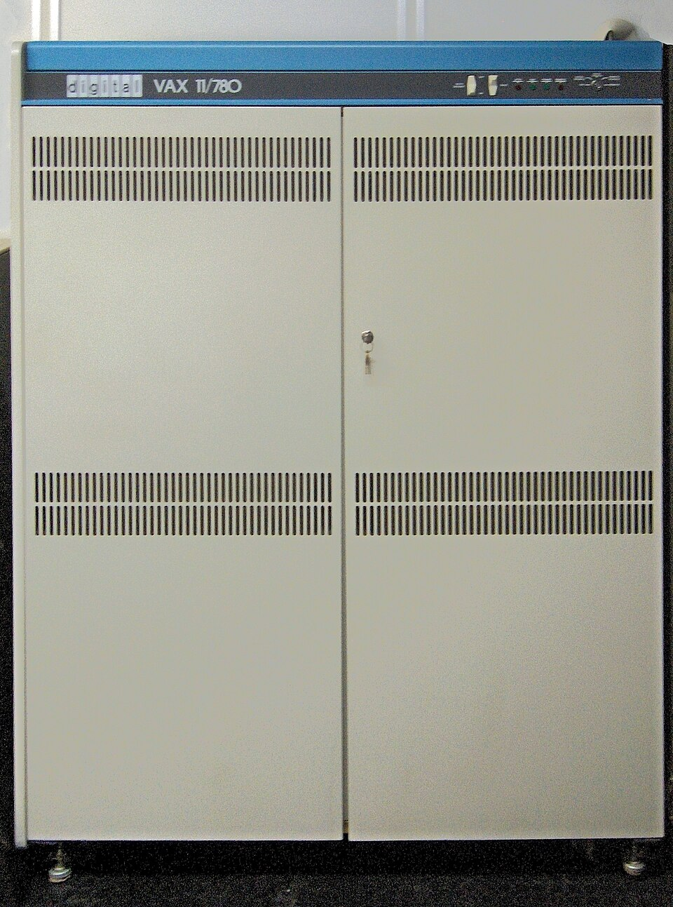
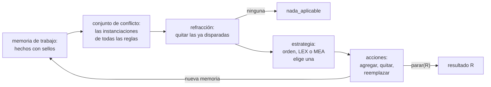

# Capítulo 64 — Proyecto: un sistema de producción

Un **sistema de producción** es un programa hecho de reglas de condición y
acción que trabajan sobre una **memoria de trabajo**, la colección de hechos
que describe la situación actual. Cada regla es una *producción*: cuando sus
condiciones se cumplen en la memoria, sus acciones agregan, quitan o
reemplazan hechos. El intérprete repite un ciclo —reunir las instanciaciones
aplicables, elegir una, ejecutarla— hasta que ninguna regla tiene nada nuevo
que hacer. Es el **encadenamiento hacia adelante**: se parte de los datos y
se avanza hacia las conclusiones, sin una pregunta que guíe la búsqueda.
Los sistemas de producción se usaron para configurar equipos a partir de un
pedido, una tarea con muchas soluciones posibles que no conviene enumerar
hacia atrás.



Una VAX-11/780. Para configurar los pedidos de estas máquinas, Digital
Equipment Corporation usó desde 1980 XCON (antes llamado R1), un sistema de
producción escrito en OPS5 que elegía y ubicaba los componentes a partir
del pedido del cliente (ver [Referencias](#referencias)).
Imagen: Emiliano Russo, Associazione Culturale VerdeBinario, dominio
público, vía
[Wikimedia Commons](https://commons.wikimedia.org/wiki/File:VAX_11-780_intero.jpg).



El [capítulo 61](../capitulo-61-proyecto-interprete-dirigido-patrones/index.md)
construyó la arquitectura: módulos `Nombre :: Condiciones ---> Acciones`, la
memoria como argumento y el conjunto de conflicto ordenado por una clave.
Este capítulo da el paso siguiente con el mismo lenguaje de reglas, en siete
versiones. La primera trata la memoria como un **conjunto** de hechos con
**sellos de tiempo** y aplica la **refracción**: la misma regla con los
mismos hechos se dispara una sola vez. La segunda agrega las estrategias de
resolución de conflictos **LEX** y **MEA**, que eligen por la recencia de
los hechos y por la especificidad de las reglas. La tercera agrega
**marcos**: clases con valores por omisión y herencia, cuyos objetos viven en
la memoria. La cuarta es un **configurador** de computadoras, y la quinta
mide lo que cuesta, en cada ciclo, volver a comparar todas las reglas con
toda la memoria. La sexta agrega a los marcos los valores calculados y los
demonios, y la séptima agrupa las reglas en conjuntos que eligen reglas de
control.

El proyecto parte de tres fuentes. De *Building Expert Systems in Prolog* de
Dennis Merritt vienen el sistema *Oops* —la memoria con sellos de tiempo, el
conjunto de conflicto, la refracción y las estrategias LEX y MEA de OPS5— y
*Foops*, su integración con marcos, con un configurador que ubica muebles en
una habitación. De *Prolog Programming in Depth* de Covington, Nute y
Vellino viene la separación entre hechos y metas en la memoria, con un robot
que apila cajas. De *Artificial Intelligence through Prolog* de Neil Rowe
vienen el foco de atención —preferir el hecho más reciente— y la
especificidad como criterio de orden entre reglas. Las referencias de cada
página dicen qué toma ella de cada fuente; las de esta están en
[Referencias](#referencias). El código es propio.

El capítulo reutiliza las reglas como datos del
[capítulo 20](../capitulo-20-operadores-y-reglas-como-datos/index.md), el
encadenamiento hacia adelante del
[capítulo 21](../capitulo-21-base-de-datos-dinamica/index.md#216-un-sistema-experto-con-encadenamiento-hacia-adelante),
el orden estándar y los conjuntos ordenados del
[capítulo 23](../capitulo-23-estructuras-de-datos-de-la-biblioteca/index.md),
y carga los archivos del
[capítulo 61](../capitulo-61-proyecto-interprete-dirigido-patrones/index.md):
sus operadores, su `bien_formado/1` y sus intérpretes, para ejecutar el
mismo programa con los dos. El
[capítulo 65](../capitulo-65-proyecto-algoritmo-rete/index.md) compila las
reglas de este capítulo en una red Rete. Los archivos se ejecutan en una
instalación local, porque cargan otros archivos; solo `memoria.pl` se puede
ejecutar en SWISH.

## Objetivos del capítulo

Al terminar el capítulo, el lector puede:

- representar la memoria de trabajo como un conjunto de hechos con sellos de
  tiempo, y explicar por qué el encadenamiento hacia adelante necesita
  además la refracción para terminar;
- reunir el conjunto de conflicto con reglas cuyas variables unen varias
  condiciones, y quitar las instanciaciones ya disparadas;
- escribir las estrategias LEX y MEA como claves de orden, y predecir cuál
  instanciación elige cada una;
- representar clases con marcos, con valores por omisión y herencia
  múltiple, y traducir condiciones sobre objetos a condiciones comunes;
- escribir un configurador como un sistema de producción controlado por
  fases, y comprobar que no depende del orden en que se escriben las reglas;
- medir el costo del reconocimiento en cada ciclo, y explicar qué parte de
  ese trabajo se repite.

!!! info "Tiempo estimado"
    Leer el capítulo, ejecutar sus ejemplos y hacer las actividades: **2:10 h**.
    Resolver los 5 ejercicios marcados con ★: **1:35 h**.
    Resolver los 13 ejercicios del capítulo: **4:10 h**.

## 64.1 El programa terminado

El programa terminado se carga con `swipl ejemplos/capitulo-64/costo.pl`, o
con `configurador.pl` si no interesan las mediciones. `configurar/4` recibe
un pedido y devuelve los componentes elegidos, el precio total y el consumo
en vatios:

```prolog
?- configurar([pedido(nucleos, 8), pedido(memoria, 32), pedido(video, si)], C, P, W).
C = [procesador-cpu_b, placa-placa_a, memoria-mem_b, disipador-dis_a, placa_de_video-gpu_a, fuente-fuente_b],
P = 1125,
W = 378.
```

La memoria empieza con el catálogo de la tienda, un objeto por componente,
y el pedido. Las reglas eligen un procesador de ocho núcleos, una placa con
su zócalo, una memoria del tipo que la placa admite, un disipador porque el
procesador no trae uno, la placa de video pedida y una fuente con un margen
del 30 % sobre el consumo total; de los candidatos de cada tipo queda el más
barato. Ninguna regla llama a otra, y ninguna dice cuál se aplica después:
lo deciden la memoria y la estrategia.

| Versión | Archivo | Agrega | Lo que no puede hacer todavía |
|---|---|---|---|
| 1 | `memoria.pl`, `produccion.pl` | la memoria como conjunto con sellos, la refracción | elegir por otra cosa que el orden del programa |
| 2 | `estrategias.pl` | LEX y MEA como claves de orden | describir objetos con valores heredados |
| 3 | `marcos.pl` | clases, herencia, objetos en la memoria | — (es la base de la versión 4) |
| 4 | `configurador.pl` | el configurador de computadoras | reconocer sin repetir el trabajo de cada ciclo |
| 5 | `costo.pl` | la medición del reconocimiento | — ([capítulo 65](../capitulo-65-proyecto-algoritmo-rete/index.md)) |

## 64.2 Versión 1: la memoria como conjunto y la refracción

**El problema.** El programa `familia` es el sistema experto hacia adelante
del [capítulo 21](../capitulo-21-base-de-datos-dinamica/index.md#216-un-sistema-experto-con-encadenamiento-hacia-adelante),
escrito en el lenguaje de reglas del
[capítulo 61](../capitulo-61-proyecto-interprete-dirigido-patrones/index.md#612-modulos-dirigidos-por-patrones).
Las reglas tienen variables que unen varias condiciones: `abuelo` pide un
padre `A` de `P` y un progenitor `P` de `N`. A diferencia del [capítulo 21](../capitulo-21-base-de-datos-dinamica/index.md),
ninguna regla pregunta si su conclusión ya está en la memoria:

<!-- ejemplo: capitulo-64/produccion.pl fragmento: programa(familia, .. ]). -->
```prolog
programa(familia,
    [ progenitor_p :: [padre(P, H)] ---> [agregar(progenitor(P, H))],
      progenitor_m :: [madre(M, H)] ---> [agregar(progenitor(M, H))],
      abuelo :: [padre(A, P), progenitor(P, N)] ---> [agregar(abuelo(A, N))],
      hermanos :: [progenitor(P, A), progenitor(P, B), {A \== B}]
           ---> [agregar(hermanos(A, B))],
      antepasado_1 :: [progenitor(A, D)] ---> [agregar(antepasado(A, D))],
      antepasado_2 :: [progenitor(A, H), antepasado(H, D)]
           ---> [agregar(antepasado(A, D))]
    ]).
```

Con el intérprete del [capítulo 61](../capitulo-61-proyecto-interprete-dirigido-patrones/index.md), la primera regla se aplica en cada ciclo
al mismo hecho y agrega otra copia de su conclusión. `contar_hechos/6`
ejecuta el programa con cada intérprete y cuenta los hechos de la memoria
final:

```prolog
?- familia(H), contar_hechos(capitulo_61, familia, H, R, N, D).
H = [padre(juan, ana), padre(juan, pedro), padre(pedro, luis), padre(pedro, eva), madre(marta, ana), madre(marta, pedro), madre(ana, sofia)],
R = limite(100),
N = 107,
D = 8.
```

Después de 100 ciclos la memoria tiene 107 hechos y solo 8 distintos: los 7
iniciales y `progenitor(juan, ana)`, repetido cien veces. Hacen falta dos
cambios. Si la memoria es un conjunto, agregar un hecho que ya está no la
cambia; pero la regla sigue aplicable y el ciclo la elige otra vez, sin fin.
La **refracción** completa el arreglo: una instanciación que ya se disparó
no vuelve a dispararse.

**La memoria.** `memoria.pl` guarda la memoria en un término
`mt(Reloj, Elementos)`: una lista de pares `Sello-Hecho`, del más reciente
al más antiguo, y el último sello asignado. Cada hecho nuevo recibe el valor
siguiente del reloj; un hecho que ya está conserva su sello:

<!-- ejemplo: capitulo-64/memoria.pl predicado: afirmar/3 retirar/3 elemento/3 -->
```prolog
%!  afirmar(+Hecho, +Memoria0, -Memoria) is det.
%
%   Memoria es Memoria0 con Hecho, que recibe el sello siguiente del reloj.
%   Si Hecho ya estaba, Memoria es Memoria0: ni el hecho ni el reloj
%   cambian.
afirmar(Hecho, mt(Reloj0, Elementos), Memoria) :-
    (   memberchk(_-Hecho, Elementos)
    ->  Memoria = mt(Reloj0, Elementos)
    ;   Reloj is Reloj0 + 1,
        Memoria = mt(Reloj, [Reloj-Hecho|Elementos])
    ).

%!  retirar(+Hecho, +Memoria0, -Memoria) is semidet.
%
%   Memoria es Memoria0 sin el hecho que unifica con Hecho. Falla si no hay
%   ninguno.
retirar(Hecho, mt(Reloj, Elementos0), mt(Reloj, Elementos)) :-
    selectchk(_-Hecho, Elementos0, Elementos).

%!  elemento(?Sello, ?Hecho, +Memoria) is nondet.
%
%   Hecho está en Memoria con el Sello. Enumera los hechos del más reciente
%   al más antiguo.
elemento(Sello, Hecho, mt(_, Elementos)) :-
    member(Sello-Hecho, Elementos).
```

```prolog
?- memoria_con([a, b], M0), afirmar(c, M0, M1), retirar(a, M1, M2), afirmar(a, M2, M).
M0 = mt(2, [2-b, 1-a]),
M1 = mt(3, [3-c, 2-b, 1-a]),
M2 = mt(3, [3-c, 2-b]),
M = mt(4, [4-a, 3-c, 2-b]).
```

Un hecho que se quita y vuelve a entrar es, para el intérprete, un hecho
nuevo: tiene otro sello. Los hechos no tienen variables, como en el
[capítulo 61](../capitulo-61-proyecto-interprete-dirigido-patrones/index.md).

**El reconocimiento.** Una **instanciación** es una regla con los hechos que
cumplen sus condiciones. `conjunto_conflicto/3` las reúne todas en términos
`instanciacion(Nombre, Sellos, Condiciones, Acciones)`: los sellos de los
hechos usados, en el orden de las condiciones, la cantidad de condiciones y
las acciones con las variables ya ligadas:

<!-- ejemplo: capitulo-64/produccion.pl predicado: conjunto_conflicto/3 cumple_condicion/4 -->
```prolog
%!  conjunto_conflicto(+Reglas:list, +Memoria, -Instanciaciones:list) is det.
%
%   Instanciaciones tiene un término
%   instanciacion(Nombre, Sellos, Condiciones, Acciones) por cada regla y
%   cada manera de cumplir sus condiciones en Memoria: Sellos son los de
%   los hechos que cumplen sus patrones, en el orden de las condiciones, y
%   Condiciones, la cantidad de condiciones de la regla. Están en el orden
%   del programa y, dentro de una regla, del hecho más reciente al más
%   antiguo.
conjunto_conflicto(Reglas, Memoria, Instanciaciones) :-
    findall(instanciacion(Nombre, Sellos, N, Acciones),
            ( member(Nombre :: Condiciones ---> Acciones, Reglas),
              length(Condiciones, N),
              cumple(Condiciones, Memoria, Sellos)
            ),
            Instanciaciones).

%!  cumple_condicion(+Condicion, +Memoria, -Sellos:list, ?Resto:list)
%!      is nondet.
%
%   Memoria cumple Condicion. Sellos es Resto precedida por el sello del
%   hecho que cumple un patrón; una prueba {Meta} y una negación no(F) no
%   agregan ninguno.
cumple_condicion({Meta}, _, Resto, Resto) :-
    call(Meta).
cumple_condicion(no(F), Memoria, Resto, Resto) :-
    \+ elemento(_, F, Memoria).
cumple_condicion(F, Memoria, [Sello|Resto], Resto) :-
    patron(F),
    elemento(Sello, F, Memoria).
```

`findall/3` recorre las reglas del programa y cada manera de cumplir sus
condiciones; como las variables de cada regla quedan libres al retroceder,
no hace falta renombrarlas con `copy_term/2`. Una condición es un patrón que
unifica con un hecho de la memoria, `no(F)` o una prueba `{Meta}`, las
mismas del [capítulo 61](../capitulo-61-proyecto-interprete-dirigido-patrones/index.md).

**La refracción.** Dos instanciaciones son la misma si tienen la misma regla
y los mismos sellos: los sellos identifican los hechos, y los hechos
determinan las variables, mientras las pruebas `{Meta}` solo comprueben o
calculen un único valor. El ciclo guarda el conjunto ordenado de los pares
`Regla-Sellos` ya disparados, con `ord_add_element/3` del
[capítulo 23](../capitulo-23-estructuras-de-datos-de-la-biblioteca/index.md#236-libraryordsets-y-librarynb_set),
y descarta las instanciaciones que están en él antes de elegir:

<!-- ejemplo: capitulo-64/produccion.pl predicado: reconocer_actuar/9 refractar/3 -->
```prolog
%!  reconocer_actuar(+Reglas:list, +Estrategia, +Traza, +N0:integer,
%!                   -N:integer, +Disparadas:list, +Memoria0, -Memoria,
%!                   -Resultado) is det.
%
%   Repite el ciclo desde Memoria0. N0 es la cantidad de ciclos hechos
%   antes, y N la cantidad al terminar. Traza es sin_traza, con_traza o
%   breve. Disparadas es el conjunto ordenado de las instanciaciones ya
%   disparadas, como pares Regla-Sellos.
reconocer_actuar(Reglas, Estrategia, Traza, N0, N, Disparadas, Memoria0,
                 Memoria, Resultado) :-
    conjunto_conflicto(Reglas, Memoria0, Todas),
    refractar(Todas, Disparadas, Nuevas),
    (   Nuevas == []
    ->  N = N0,
        Memoria = Memoria0,
        Resultado = nada_aplicable
    ;   preferida(Estrategia, Nuevas, Elegida),
        N1 is N0 + 1,
        informar(Traza, N1, Nuevas, Elegida, Memoria0),
        Elegida = instanciacion(Nombre, Sellos, _, Acciones),
        ord_add_element(Disparadas, Nombre-Sellos, Disparadas1),
        aplicar_acciones(Acciones, Memoria0, Memoria1, Fin),
        (   Fin = parar(R)
        ->  N = N1,
            Memoria = Memoria1,
            Resultado = R
        ;   reconocer_actuar(Reglas, Estrategia, Traza, N1, N, Disparadas1,
                             Memoria1, Memoria, Resultado)
        )
    ).

%!  refractar(+Instanciaciones:list, +Disparadas:list, -Nuevas:list) is det.
%
%   Nuevas son las Instanciaciones que no están en el conjunto ordenado
%   Disparadas, comparadas por su regla y sus sellos.
refractar(Instanciaciones, Disparadas, Nuevas) :-
    exclude(disparada(Disparadas), Instanciaciones, Nuevas).
```

La **estrategia** es una clave de orden, como en la
[sección 61.5](../capitulo-61-proyecto-interprete-dirigido-patrones/index.md#615-version-3-el-conjunto-de-conflicto),
pero ahora se prefiere la **mayor**: `preferida/3` ordena con
`sort(1, @>=, Pares, Ordenados)`, que conserva el orden de los empates. La
estrategia `orden` da a todas la misma clave, y gana la primera del
conjunto de conflicto: la primera regla del programa y, dentro de ella, la
que usa los hechos más recientes.

```prolog
?- rastrear(familia, orden, [padre(juan, ana), madre(ana, sofia)], M, R).
1: progenitor_p de 2, con [1-padre(juan,ana)]
2: progenitor_m de 2, con [2-madre(ana,sofia)]
3: abuelo de 3, con [1-padre(juan,ana),4-progenitor(ana,sofia)]
4: antepasado_1 de 2, con [4-progenitor(ana,sofia)]
5: antepasado_1 de 2, con [3-progenitor(juan,ana)]
6: antepasado_2 de 1, con [3-progenitor(juan,ana),6-antepasado(ana,sofia)]
M = [antepasado(juan, sofia), antepasado(juan, ana), antepasado(ana, sofia), abuelo(juan, sofia), progenitor(ana, sofia), progenitor(juan, ana), madre(ana, sofia), padre(juan, ana)],
R = nada_aplicable.
```

Cada línea dice el ciclo, la regla, cuántas instanciaciones **nuevas**
había y los hechos usados con sus sellos. En el ciclo 2 el conjunto de
conflicto tiene tres instanciaciones, pero `progenitor_p` con el hecho 1 ya
se disparó: quedan dos. Con la familia completa, el programa llega al mismo
punto fijo que el [capítulo 21](../capitulo-21-base-de-datos-dinamica/index.md):

```prolog
?- familia(H), contar_hechos(capitulo_64, familia, H, R, N, D).
H = [padre(juan, ana), padre(juan, pedro), padre(pedro, luis), padre(pedro, eva), madre(marta, ana), madre(marta, pedro), madre(ana, sofia)],
R = nada_aplicable,
N = D, D = 34.
```

Son 29 ciclos para 27 hechos nuevos: `hermanos` se dispara una vez por cada
progenitor común, y `ana` y `pedro` tienen dos; la segunda instanciación
agrega un hecho que ya está, y la memoria no cambia. La condición
`\+ hecho(Conclusion)` del
[Patrón 18](../capitulo-21-base-de-datos-dinamica/index.md#216-un-sistema-experto-con-encadenamiento-hacia-adelante)
ya no hace falta en cada regla: la memoria como conjunto y la refracción la
cumplen para todas.

!!! question "Actividad"
    Predecir cuántos hechos tiene la memoria final y cuántos ciclos hace
    `familia` desde `[padre(juan, ana), padre(juan, pedro)]`. Comprobarlo con
    `encadenar/5` y `cantidad_de_ciclos/4`, y explicar la diferencia entre
    las dos cantidades.

**Lo que falta.** Con `orden`, el resultado depende de cómo se escribieron
las reglas: el primer programa que ordene mal sus reglas elige mal, como el
`mcd_invertido` del [capítulo 61](../capitulo-61-proyecto-interprete-dirigido-patrones/index.md).

## 64.3 Versión 2: las estrategias LEX y MEA

OPS5, el lenguaje de sistemas de producción más difundido, definido por
Charles Forgy ([Referencias](#referencias)), ofrece dos
estrategias. **LEX**, después de la refracción, prefiere la instanciación
que usa los hechos más **recientes**, y entre dos igual de recientes, la de
la regla más **específica**, la que tiene más condiciones. **MEA** compara
antes el sello del **primer** patrón de cada regla, y después sigue como LEX.

La recencia se compara con listas. Los sellos de una instanciación,
ordenados de mayor a menor, forman una lista; dos listas se comparan
elemento por elemento, y la que tiene el primer sello mayor es más reciente.
Si una es prefijo de la otra, la más larga es mayor en el
[orden estándar](../capitulo-23-estructuras-de-datos-de-la-biblioteca/index.md#232-el-orden-estandar),
porque `[]` precede a toda lista no vacía: con los mismos hechos recientes,
gana la regla que usa más hechos. Así, una clave `lex(Sellos, N)` ordena por
recencia primero y por especificidad después, con una sola comparación:

<!-- ejemplo: capitulo-64/estrategias.pl predicado: clave_estrategia/3 -->
```prolog
%!  clave_estrategia(+Estrategia, +Instanciacion, -Clave) is det.
%
%   Con lex, Clave es lex(Sellos, N): los sellos de mayor a menor y la
%   cantidad de condiciones. Con mea, Clave es mea(Primero, Sellos, N), con
%   el sello del primer patrón, o 0 si la regla no tiene patrones.
clave_estrategia(lex, instanciacion(_, Sellos, N, _), lex(Recientes, N)) :-
    sort(0, @>=, Sellos, Recientes).
clave_estrategia(mea, instanciacion(_, Sellos, N, _),
                 mea(Primero, Recientes, N)) :-
    primer_sello(Sellos, Primero),
    sort(0, @>=, Sellos, Recientes).
```

`clave_estrategia/3` es `multifile`: `estrategias.pl` le agrega dos
cláusulas sin cambiar `produccion.pl`.

**Metas en la memoria.** El programa `cajas` es un robot que apila cajas,
como el de Covington. Las metas son hechos de la memoria: `apilar(Lista)`
pide una torre con las cajas de la lista, de abajo hacia arriba, y
`despejar(Caja)` pide que no haya nada encima de una caja. Todas las reglas
tienen la meta como primer patrón:

<!-- ejemplo: capitulo-64/estrategias.pl fragmento: programa(cajas, .. ]). -->
```prolog
programa(cajas,
    [ apilada :: [meta(apilar([X, Y|R])), sobre(Y, X)]
           ---> [reemplazar(meta(apilar([X, Y|R])), meta(apilar([Y|R])))],
      apilar :: [meta(apilar([X, Y|R])), no(sobre(_, X)), no(sobre(_, Y)),
                 sobre(Y, Z)]
           ---> [reemplazar(sobre(Y, Z), sobre(Y, X)),
                 reemplazar(meta(apilar([X, Y|R])), meta(apilar([Y|R])))],
      despejar_base :: [meta(apilar([X, Y|_])), sobre(Z, X), {Z \== Y}]
           ---> [agregar(meta(despejar(Z)))],
      despejar_segunda :: [meta(apilar([_, Y|_])), sobre(Z, Y)]
           ---> [agregar(meta(despejar(Z)))],
      despejar_encima :: [meta(despejar(X)), sobre(Y, X)]
           ---> [agregar(meta(despejar(Y)))],
      bajar :: [meta(despejar(X)), no(sobre(_, X)), sobre(X, Y),
                {Y \== piso}]
           ---> [reemplazar(sobre(X, Y), sobre(X, piso)),
                 quitar(meta(despejar(X)))],
      despejada :: [meta(despejar(X)), no(sobre(_, X))]
           ---> [quitar(meta(despejar(X)))],
      terminada :: [meta(apilar([_]))]
           ---> [quitar(meta(apilar([_])))]
    ]).
```

La memoria siguiente tiene dos metas: una torre con `c` sobre `b`, y otra
con `d` sobre `a`, pedida después; `c` está sobre `a`, de modo que la
segunda meta necesita despejar `a`. Con LEX:

```prolog
?- rastrear(cajas, lex, [sobre(a, piso), sobre(b, piso), sobre(c, a), sobre(d, piso), meta(apilar([b, c])), meta(apilar([a, d]))], M, R).
1: despejar_base de 2, con [6-meta(apilar([a,d])),3-sobre(c,a)]
2: bajar de 3, con [7-meta(despejar(c)),3-sobre(c,a)]
3: apilar de 2, con [5-meta(apilar([b,c])),8-sobre(c,piso)]
4: terminada de 2, con [10-meta(apilar([c]))]
5: apilar de 1, con [6-meta(apilar([a,d])),4-sobre(d,piso)]
6: terminada de 1, con [12-meta(apilar([d]))]
M = [sobre(d, a), sobre(c, b), sobre(b, piso), sobre(a, piso)],
R = nada_aplicable.
```

En el ciclo 3 la caja `c` acaba de llegar al piso, con el sello 8, el
mayor de la memoria. LEX elige la instanciación que lo usa, la de la meta
**antigua**, y deja la meta que motivó el despeje para después. MEA mira
primero la meta:

```prolog
?- rastrear(cajas, mea, [sobre(a, piso), sobre(b, piso), sobre(c, a), sobre(d, piso), meta(apilar([b, c])), meta(apilar([a, d]))], M, R).
1: despejar_base de 2, con [6-meta(apilar([a,d])),3-sobre(c,a)]
2: bajar de 3, con [7-meta(despejar(c)),3-sobre(c,a)]
3: apilar de 2, con [6-meta(apilar([a,d])),4-sobre(d,piso)]
4: terminada de 2, con [10-meta(apilar([d]))]
5: apilar de 1, con [5-meta(apilar([b,c])),8-sobre(c,piso)]
6: terminada de 1, con [12-meta(apilar([c]))]
M = [sobre(c, b), sobre(d, a), sobre(b, piso), sobre(a, piso)],
R = nada_aplicable.
```

Las claves de las dos instanciaciones del ciclo 3 lo explican. Con una
memoria que tiene los mismos hechos en el mismo orden, y por eso sellos del
1 al 6 en lugar de los del ciclo 3:

```prolog
?- claves(lex, cajas, [sobre(a, piso), sobre(b, piso), sobre(d, piso), meta(apilar([b, c])), meta(apilar([a, d])), sobre(c, piso)], L).
L = [apilar-lex([5, 3], 4), apilar-lex([6, 4], 4)].

?- claves(mea, cajas, [sobre(a, piso), sobre(b, piso), sobre(d, piso), meta(apilar([b, c])), meta(apilar([a, d])), sobre(c, piso)], L).
L = [apilar-mea(5, [5, 3], 4), apilar-mea(4, [6, 4], 4)].
```

`[6, 4]` es mayor que `[5, 3]`: LEX prefiere la segunda, la de la meta
`apilar([b, c])`, sello 4, con `sobre(c, piso)`, sello 6. MEA compara
primero el sello de la meta, 5 contra 4, y prefiere la primera. Con MEA las
metas se atienden como una pila: la más reciente, y las submetas que crea,
primero. Es el uso que Merritt señala para MEA: poner la meta en el primer
patrón de cada regla da al programador el control del orden.

Ninguna estrategia es mejor en todos los casos. Con `orden` el robot
resuelve las dos torres en cuatro ciclos, porque `apilar` está escrita antes
que `despejar_base` y lleva `c` directamente de `a` a `b`; con LEX y MEA,
la meta más reciente pide despejar `a` antes, y hacen seis ciclos.

!!! question "Actividad"
    Antes de ejecutarlo, escribir las claves LEX de las instanciaciones de
    `familia` en la memoria `[padre(juan, ana), madre(marta, ana),
    progenitor(juan, ana)]`, y predecir cuál elige LEX. Comprobarlo con
    `claves/4`.

**Lo que falta.** Los hechos son términos planos: cada propiedad de una cosa
es un hecho aparte, y lo que comparten todas las cosas de una clase se
repite en cada una.

## 64.4 Versión 3: marcos

Un **marco**, en el sentido que propuso Marvin Minsky
([Referencias](#referencias)), describe una clase con **ranuras**: los
atributos de sus objetos, con valores por omisión. Una clase hereda de otras, y un valor que
la clase no define se busca en sus padres. `marcos.pl` escribe cada clase
como un hecho `marco(Clase, Padres, Ranuras)`, con los componentes de una
computadora:

<!-- ejemplo: capitulo-64/marcos.pl fragmento: marco(componente, .. marco(fuente, [componente], []). -->
```prolog
marco(componente, [], [precio-0, consumo-0]).
marco(refrigerado, [], [necesita_disipador-si]).
marco(procesador, [componente, refrigerado], [consumo-65]).
marco(placa, [componente], [consumo-30]).
marco(memoria, [componente], [consumo-5]).
marco(placa_de_video, [componente], [consumo-200]).
marco(disipador, [componente], [consumo-3]).
marco(fuente, [componente], []).
```

`procesador` hereda de dos clases: de `componente`, el precio, y de
`refrigerado`, la necesidad de un disipador. `es_un/2` recorre la jerarquía
en profundidad, en el orden de los padres, y `valor_ranura/4` busca el valor
propio del objeto, y si no lo tiene, el de la primera clase que lo define:

<!-- ejemplo: capitulo-64/marcos.pl predicado: es_un/2 valor_ranura/4 -->
```prolog
%!  es_un(+Clase, ?Superclase) is nondet.
%
%   Superclase es la Clase misma o una clase de la que hereda, en
%   profundidad y en el orden de los padres.
es_un(Clase, Clase).
es_un(Clase, Superclase) :-
    marco(Clase, Padres, _),
    member(Padre, Padres),
    es_un(Padre, Superclase).

%!  valor_ranura(+Clase, +Ranuras:list, +Ranura, -Valor) is semidet.
%
%   Valor es el de la Ranura en un objeto de la Clase con los valores
%   propios Ranuras: el propio si lo tiene, o el primero que define una de
%   sus clases. Falla si ninguna lo define.
valor_ranura(_, Ranuras, Ranura, Valor) :-
    memberchk(Ranura-Propio, Ranuras),
    !,
    Valor = Propio.
valor_ranura(Clase, _, Ranura, Valor) :-
    once(( es_un(Clase, Superclase),
           marco(Superclase, _, PorOmision),
           memberchk(Ranura-Heredado, PorOmision)
         )),
    Valor = Heredado.
```

```prolog
?- es_un(procesador, C).
C = procesador ;
C = componente ;
C = refrigerado ;
false.

?- valor_ranura(procesador, [consumo-120], consumo, V).
V = 120.

?- valor_ranura(procesador, [], consumo, V).
V = 65.

?- valor_ranura(procesador, [], necesita_disipador, V).
V = si.

?- valor_ranura(placa, [], necesita_disipador, V).
false.
```

Las clases son fijas, parte del programa; los **objetos** están en la
memoria de trabajo, como hechos `objeto(Nombre, Clase, Ranuras)` con los
valores propios de cada uno. Así la memoria sigue siendo una colección de
hechos sin variables, y el intérprete no cambia.

**Condiciones sobre objetos.** Una regla puede pedir
`es(Objeto, Clase, Consultas)`: un objeto de la clase o de una subclase suya,
con los valores pedidos en sus ranuras, propios o heredados. `con_marcos/2`
traduce esa condición a un patrón `objeto/3` y una prueba, y traduce las
acciones `crear/3` y `poner/3` a `agregar/1` y `reemplazar/2`:

<!-- ejemplo: capitulo-64/marcos.pl predicado: condicion_con_marcos/4 -->
```prolog
%!  condicion_con_marcos(+Condicion, -Traduccion:list, +Objetos0:list,
%!                       -Objetos:list) is det.
%
%   Traduccion son las condiciones que reemplazan a Condicion. Objetos
%   tiene un término obj(Objeto, Clase, Ranuras) por cada objeto ya
%   buscado, con las variables de su clase y de sus ranuras.
condicion_con_marcos(Condicion, Traduccion, Objetos0, Objetos) :-
    (   Condicion = es(Objeto, Clase, Consultas)
    ->  (   buscado(Objeto, Objetos0, ClaseReal, Ranuras)
        ->  Traduccion = [Prueba],
            Objetos = Objetos0
        ;   Traduccion = [objeto(Objeto, ClaseReal, Ranuras), Prueba],
            Objetos = [obj(Objeto, ClaseReal, Ranuras)|Objetos0]
        ),
        Prueba = {es_de_clase(ClaseReal, Clase),
                  consultar(ClaseReal, Ranuras, Consultas)}
    ;   Traduccion = [Condicion],
        Objetos = Objetos0
    ).
```

Si el mismo objeto aparece en otra condición `es/3`, la segunda solo agrega
la prueba: el objeto ya está ligado a un hecho. El programa `disipadores`
marca los componentes que necesitan un disipador:

```prolog
?- programa(disipadores, [R]).
R = (marcar::[objeto(_A, _B, _C), {es_de_clase(_B, componente), consultar(_B, _C, [necesita_disipador-si])}]--->[agregar(requiere_disipador(_A))]).

?- encadenar(disipadores, lex, [objeto(cpu_a, procesador, [necesita_disipador-no]), objeto(cpu_b, procesador, []), objeto(gpu_a, placa_de_video, [])], M, R).
M = [requiere_disipador(cpu_b), objeto(gpu_a, placa_de_video, []), objeto(cpu_b, procesador, []), objeto(cpu_a, procesador, [necesita_disipador-no])],
R = nada_aplicable.
```

`cpu_a` trae su disipador y lo dice en una ranura propia; `cpu_b` hereda el
`si` de `refrigerado`; `gpu_a` no hereda de `refrigerado`, y la consulta
falla. La traducción deja las reglas en el lenguaje del [capítulo 61](../capitulo-61-proyecto-interprete-dirigido-patrones/index.md), con
patrones y pruebas: es lo que el
[capítulo 65](../capitulo-65-proyecto-algoritmo-rete/index.md) necesita para
compilarlas.

El capítulo continúa en la página
[Un configurador, el costo del reconocimiento, demonios y reglas de control](configurador.md#645-version-4-un-configurador), con las
versiones 4 a 7: el configurador de computadoras, la medición del costo del
reconocimiento, los valores calculados y los demonios de los marcos, y los
conjuntos de reglas. Antes, los [ejercicios](#ejercicios) de esta página
practican las secciones 64.1 a 64.4.

## Ejercicios

Las soluciones están en [la página de soluciones](soluciones.md). La dificultad
va de 1 (se resuelve consultando el capítulo) a 3 (requiere elaboración propia).
Los marcados con ★ son los que no conviene saltear: cubren lo que el capítulo
tiene de propio. Los ejercicios extienden los programas: cada solución es un
archivo que carga los del capítulo, sin modificarlos.

1. ★ **(1)** Predecir la traza de `rastrear(cajas, orden, [sobre(a, piso),
   sobre(b, a), meta(apilar([b, a]))], M, R)`: qué reglas se disparan, en qué
   orden, y cómo queda la memoria. Comprobarlo.
2. ★ **(2)** Escribir `encadenar_vigilado/7`, que ejecuta un programa con un
   límite de ciclos y con la refracción activada o no. Predecir qué ocurre
   con `familia` sin refracción, comprobarlo con un límite de 50 ciclos y
   explicar por qué la memoria como conjunto no basta para terminar.
3. **(1)** Escribir a mano las claves LEX y MEA de las instanciaciones con
   sellos `[4, 9]`, `[9, 2, 7]` y `[9, 7]`, de reglas con 2, 3 y 3
   condiciones, y decir cuál elige cada estrategia. Comprobarlo con
   `clave_estrategia/3` y `preferida/3`.
4. **(2)** Agregar, desde otro archivo, la estrategia `prioridad`: cada
   regla puede tener una prioridad en un hecho `prioridad(Regla, P)`, que
   se compara antes que la clave LEX; una regla sin prioridad tiene 0.
   Usarla para que `cajas` con `prioridad` resuelva las dos torres de la
   [sección 64.3](#643-version-2-las-estrategias-lex-y-mea) en cuatro ciclos.
5. ★ **(2)** Predecir qué hacen `orden`, `lex` y `mea` con el programa
   `cajas` desde una torre `c` sobre `b` sobre `a` y la meta
   `apilar([c, b, a])`, que la invierte. Comprobarlo con `rastrear/5`, y
   explicar el resultado a partir del tamaño del conjunto de conflicto en
   cada ciclo.
6. **(1)** Predecir `valor_ranura/4` para la ranura `precio` de una fuente
   sin valor propio, para `consumo` de una memoria con `consumo-8`, y para
   `necesita_disipador` de un disipador. Comprobarlo.
7. **(2)** Agregar la clase `apu`, un procesador con video integrado, que
   hereda de `procesador` y de `placa_de_video`. Predecir su consumo y si
   necesita disipador; cambiar el orden de los padres y volver a
   predecirlo.
8. **(3)** Escribir `con_origen/2`, que transforma las reglas de un programa
    para que cada `agregar(F)` agregue también `origen(F, Regla, Hechos)`,
    con los hechos que cumplieron los patrones de la regla. Usarlo para
    explicar cómo se obtuvo `antepasado(juan, sofia)` en `familia`.

## Referencias

- Dennis Merritt, *Building Expert Systems in Prolog*, Springer-Verlag,
  1989 — capítulos «Forward Chaining» (el sistema *Oops*, el conjunto de
  conflicto, los sellos de tiempo, LEX y MEA), «Frames» e «Integration»
  (*Foops* y el configurador de muebles).
  [Edición en línea](https://www.amzi.com/ExpertSystemsInProlog/), de
  Amzi!. Esta página toma de allí la memoria con sellos de tiempo, la
  refracción como instanciación ya disparada, LEX con listas de sellos
  ordenadas y comparadas elemento por elemento, MEA como filtro por el
  primer patrón, las metas de control en la memoria, la regla sin
  condiciones que se dispara al final por especificidad, los marcos con
  valores por omisión y herencia múltiple, y los objetos de marco en la
  memoria con reglas que los consultan.
- Michael A. Covington, Donald Nute y André Vellino, *Prolog Programming in
  Depth*, Prentice Hall, 1997 — apartados «A Simple Forward Chainer» y
  «Production Rules in Prolog».
  [Edición en línea](https://www.covingtoninnovations.com/books/PPID.pdf),
  del autor. Esta página toma de allí la separación entre hechos y metas
  en la memoria, el robot que apila cajas con metas intermedias, y la
  observación de que la resolución de conflictos importa solo cuando el
  conjunto tiene más de un miembro.
- Neil C. Rowe, *Artificial Intelligence through Prolog*, Prentice-Hall,
  1988 — capítulos «Control structures for rule-based systems» e
  «Implementation of rule-based systems».
  [Edición en línea](https://hdl.handle.net/10945/36984), del archivo de la
  Naval Postgraduate School. Esta página toma de allí el foco de atención
  —el hecho más reciente primero—, la especificidad como criterio de orden
  entre reglas, y las meta-reglas que eligen entre reglas, que aquí son las
  claves de orden.
- Charles L. Forgy, *OPS5 User's Manual*, informe técnico CMU-CS-81-135,
  Carnegie-Mellon University, 1981. Merritt toma de OPS5 las estrategias
  LEX y MEA y la refracción; esta página toma de ese lenguaje la
  definición de las dos estrategias, con los sellos de tiempo de los
  elementos de la memoria, y el uso del primer patrón como meta de control
  en MEA.
- John McDermott, «R1: A Rule-Based Configurer of Computer Systems»,
  *Artificial Intelligence* 19(1), 1982. Merritt cita XCON, el nombre
  posterior de R1, como el sistema de encadenamiento hacia adelante más
  conocido; es el sistema de la imagen que abre el capítulo, y el
  antecedente del configurador de la
  [sección 64.5](configurador.md#645-version-4-un-configurador).
- Marvin Minsky, «A Framework for Representing Knowledge», MIT AI
  Laboratory Memo 306, 1974.
  [Edición del MIT](https://dspace.mit.edu/handle/1721.1/6089).
  El origen de los marcos con ranuras, valores por omisión y herencia que
  Merritt implementa y que la versión 3 escribe como hechos `marco/3`.
