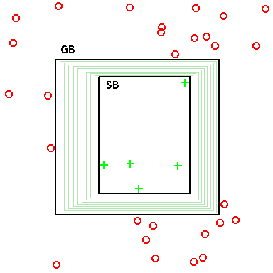

# Capítulo 69 — Proyecto: espacios de versiones y generalización por explicación

El [capítulo 68](../capitulo-68-proyecto-aprender-reglas-ejemplos/index.md) aprende reglas a partir de muchos ejemplos y
ningún conocimiento previo de la relación, y elige una de las hipótesis
posibles. Este capítulo presenta dos maneras distintas de aprender. La
primera no elige: guarda **todas** las hipótesis consistentes con los
ejemplos vistos, el **espacio de versiones**, representado por sus dos
bordes, el de los conceptos más específicos y el de los más generales. La
segunda aprende de **un solo** ejemplo, pero necesita una teoría del
dominio: prueba que el ejemplo pertenece al concepto, generaliza la prueba
y extrae una regla nueva. Es la **generalización basada en la
explicación**.



Un espacio de versiones en el plano: cada concepto es un rectángulo, las
cruces son los ejemplos positivos y los círculos los negativos. SB es el
concepto más específico que cubre los positivos y GB el más general que
no cubre ningún negativo; todo rectángulo comprendido entre los dos, como
los que se dibujan en verde, es consistente con los ejemplos. El capítulo
representa esos dos bordes en lugar del conjunto entero.
Imagen: Dfass, dominio público, vía [Wikimedia Commons](https://commons.wikimedia.org/wiki/File:Version_space.png).

El programa crece en siete versiones. Las cuatro primeras aprenden un
concepto sobre piezas descritas por cuatro atributos: la primera enumera
el espacio de conceptos entero, la segunda lo recorre en una sola
dirección, la tercera mantiene los dos bordes a la vez (el algoritmo de
**eliminación de candidatos**) y la cuarta usa el espacio antes de que
converja, para clasificar y para elegir qué ejemplo pedir. Las dos
últimas explican un ejemplo con una teoría, en un metaintérprete con
árbol de prueba, y generalizan esa explicación. La séptima agrega las
operaciones de generalización que las anteriores no usan y guarda las
reglas aprendidas para las consultas siguientes. El proyecto completo carga
las versiones 4 y 6:

<!-- ejemplo: capitulo-69/proyecto.pl archivo -->
```prolog
:- use_module(preguntas).
:- use_module(ebg, except([inferencias/2])).
```

```prolog
?- eliminar_de(esfera_roja, 5, EV), estado(EV, E).
EV = ev([pieza(esfera, rojo, _A, _B)], [pieza(esfera, rojo, _, _)]),
E = convergio(pieza(esfera, rojo, _A, _B)).
```

La consulta `mostrar_aprendida(taza, taza2, taza(taza2))` escribe:

```prolog
taza(A) :-
    material(A, carton),
    parte(A, B),
    asa(B),
    parte(A, C),
    concava(C),
    abierta_arriba(C),
    parte(A, D),
    base(D),
    plana(D).
```

La primera consulta procesa cinco ejemplos de piezas, dos positivos y
tres negativos, y el espacio de versiones se reduce a un solo concepto:
las esferas rojas, de cualquier tamaño y material. La segunda recibe la
descripción de una taza de cartón y una teoría que dice qué hace falta
para que un objeto sirva de taza, y devuelve una regla que reconoce, sin
pasar por la teoría, a todos los objetos que son tazas por la misma
razón.

El proyecto parte del capítulo «Machine Learning Algorithms in Prolog» de
*AI Algorithms, Data Structures, and Idioms in Prolog, Lisp, and Java* de
George F. Luger y William A. Stubblefield, que el autor publica en
[su sitio](https://www.cs.unm.edu/~luger/ai-final2/CH7_Machine%20Learning%20Algorithms%20in%20Prolog.pdf).
Su sección «Machine Learning: Version Space Search» da los conceptos como
términos con variables, el orden por cobertura, las búsquedas en una
dirección y la eliminación de candidatos; su sección «Explanation Based
Learning in Prolog» da la prueba simultánea del ejemplo y de su copia
general, el corte en los nodos operacionales y el dominio de la taza. Los
programas del capítulo son propios. Reutilizan la lgg y la θ-subsunción
del [capítulo 68](../capitulo-68-proyecto-aprender-reglas-ejemplos/index.md), el árbol de prueba del [capítulo 34](../capitulo-34-introspeccion-y-metainterpretes/index.md) y las
reglas de familia del [capítulo 3](../capitulo-03-reglas-y-conjunciones/index.md), cargando sus archivos; por eso se
ejecutan en una instalación local, no en SWISH.

## Objetivos del capítulo

Al terminar el capítulo, el lector puede:

- representar conceptos como términos con variables, ordenados por
  generalidad con la θ-subsunción;
- calcular el espacio de versiones de una lista de ejemplos, por
  enumeración y por eliminación de candidatos, y comprobar que los dos
  cálculos coinciden;
- clasificar instancias con un espacio de versiones que todavía no
  convergió, y elegir el ejemplo que más lo reduce;
- reconocer el colapso del espacio y sus dos causas: un concepto que el
  lenguaje no puede expresar y un ejemplo mal clasificado;
- explicar un ejemplo con una teoría del dominio y generalizar la
  explicación en una regla, con un criterio de operacionalidad;
- comparar lo que aprenden la inducción del [capítulo 68](../capitulo-68-proyecto-aprender-reglas-ejemplos/index.md), el espacio de
  versiones y la generalización por explicación, y medir el costo de cada
  uno;
- generalizar quitando condiciones, subiendo en una jerarquía de clases
  y agregando disyuntos, y reconocer el sesgo que fija cada lenguaje de
  conceptos.

!!! info "Tiempo estimado"
    Leer el capítulo, ejecutar sus ejemplos y hacer las actividades: **2:35 h**.
    Resolver los 5 ejercicios marcados con ★: **1:05 h**.
    Resolver los 14 ejercicios del capítulo: **3:55 h**.

## 69.1 Versión 1: el espacio de conceptos

Una pieza tiene cuatro atributos, cada uno con pocos valores posibles:

<!-- ejemplo: capitulo-69/espacio.pl predicado: atributo/2 -->
```prolog
% atributo(A, Vs): el atributo A de una pieza toma los valores Vs.
atributo(forma, [esfera, cubo, cilindro]).
atributo(color, [rojo, verde, azul]).
atributo(tamano, [chico, grande]).
atributo(material, [madera, metal]).
```

Una **instancia** es una pieza concreta, `pieza(esfera, rojo, chico,
madera)`. Un **concepto** describe un conjunto de instancias con el mismo
término, en el que cada argumento es un valor o una variable, que
significa «cualquier valor»: `pieza(esfera, rojo, _, _)` son las esferas
rojas. Hay además un concepto que no describe ninguna instancia, la
constante `vacio`. Con 3, 3, 2 y 2 valores hay 36 instancias y
4 · 4 · 3 · 3 + 1 = 145 conceptos:

<!-- ejemplo: capitulo-69/espacio.pl predicado: concepto/1 -->
```prolog
%!  concepto(-C) is multi.
%
%   C es un concepto del lenguaje: vacio, o una pieza con un valor o una
%   variable en cada atributo.
concepto(vacio).
concepto(C) :-
    findall(Vs, atributo(_, Vs), Vss),
    maplist(valor_o_libre, Vss, Args),
    C =.. [pieza|Args].
```

```prolog
?- aggregate_all(count, instancia(_), NI), aggregate_all(count, concepto(_), NC).
NI = 36,
NC = 145.
```

Un concepto **cubre** una instancia si alguna sustitución de sus
variables la da: es la θ-subsunción entre términos del
[capítulo 68](../capitulo-68-proyecto-aprender-reglas-ejemplos/index.md#682-version-1-la-lgg-de-dos-terminos), que `espacio.pl` carga del archivo de ese
capítulo. La misma relación ordena los conceptos: G es **al menos tan
general** como E si cubre todo lo que E cubre, y `vacio` está debajo de
todos:

<!-- ejemplo: capitulo-69/espacio.pl predicado: generaliza/2 -->
```prolog
%!  generaliza(@G, @E) is semidet.
%
%   El concepto G es al menos tan general como el concepto E: todo lo que
%   E cubre, G también lo cubre. vacio es el concepto menos general.
generaliza(G, E) :-
    (   E == vacio
    ->  true
    ;   mas_general(G, E)
    ).
```

```prolog
?- generaliza(pieza(_, rojo, _, _), pieza(esfera, rojo, _, _)).
true.

?- generaliza(pieza(esfera, rojo, _, _), pieza(_, rojo, _, _)).
false.
```

La variable es aquí un dato, como en la [sección 33.5](../capitulo-33-inspeccion-de-terminos/index.md#335-variables-como-datos): un concepto se
compara con `subsumes_term/2` y nunca se unifica, porque la unificación
ligaría sus variables y lo convertiría en otro concepto. Por la misma
razón, dos listas de conceptos se comparan con `=@=`, y `conjunto/2`
quita las variantes repetidas numerando las variables antes de ordenar.

Un ejemplo es `pos(I)` o `neg(I)`. Un concepto es **consistente** con una
lista de ejemplos si cubre todos los positivos y ningún negativo, y el
**espacio de versiones** es el conjunto de los conceptos consistentes. La
primera versión lo calcula de la manera más directa, probando los 145:

<!-- ejemplo: capitulo-69/espacio.pl predicado: version/2 -->
```prolog
%!  version(+Ejs:list, -V:list) is det.
%
%   V es el espacio de versiones de Ejs: los conceptos consistentes con
%   los ejemplos, en el orden en que concepto/1 los enumera.
version(Ejs, V) :-
    findall(C, ( concepto(C), consistente(C, Ejs) ), V).
```

`secuencia/2` guarda dos listas de ejemplos. La primera enseña las
esferas rojas; `tamanos/2` da el tamaño del espacio antes de ver ejemplos
y después de cada uno:

```prolog
?- tamanos(esfera_roja, Ns).
Ns = [145, 16, 15, 3, 2, 1].
```

El primer positivo deja 16 conceptos: los que se obtienen reemplazando
por variables cualquier subconjunto de sus cuatro valores. Cada ejemplo
posterior descarta algunos, y el último deja uno. El espacio de versiones
tiene un orden, y queda descrito por sus elementos **mínimos**, los que no
generalizan a ningún otro del espacio, y sus **máximos**, los que ningún
otro generaliza. `bordes_enumerados/4` los calcula después de K ejemplos:

```prolog
?- bordes_enumerados(esfera_roja, 3, S, G).
S = [pieza(esfera, rojo, _, _)],
G = [pieza(_, rojo, _, _), pieza(esfera, _, _, _)].
```

Después de tres ejemplos quedan tres conceptos, las esferas rojas, las
piezas rojas y las esferas, y los bordes los determinan: todo concepto
consistente está entre uno de S y uno de G. La versión 1 obtiene los
bordes a partir del espacio entero, y ese es su límite. Con n atributos de
k valores hay (k + 1)ⁿ conceptos; diez atributos de tres valores dan más
de un millón, y cada uno se prueba contra todos los ejemplos.

!!! question "Actividad"
    Predecir cuántas instancias cubre `pieza(esfera, _, chico, _)` y
    cuántos conceptos quedan en el espacio de versiones de la secuencia
    `esfera_roja` después del segundo ejemplo, si el primero hubiera sido
    `pos(pieza(esfera, rojo, chico, madera))` y el segundo
    `pos(pieza(esfera, verde, chico, metal))`. Comprobarlo con
    `aggregate_all/3`, `cubre/2` y `version/2`.

## 69.2 Versión 2: una sola dirección

Los bordes se pueden calcular sin enumerar. La búsqueda **de lo
específico a lo general** empieza con S = [`vacio`] y, con cada positivo
que no cubre, reemplaza cada concepto de S por su **generalización
mínima** que lo cubre. Esa operación ya está escrita: es la lgg del
[capítulo 68](../capitulo-68-proyecto-aprender-reglas-ejemplos/index.md#682-version-1-la-lgg-de-dos-terminos), que conserva lo común y pone una variable donde los
términos difieren:

<!-- ejemplo: capitulo-69/unidireccional.pl predicado: generalizacion/3 -->
```prolog
%!  generalizacion(+S, +I, -S1) is det.
%
%   S1 es la generalización mínima del concepto S que cubre la instancia
%   I: I misma si S es vacio, la lgg de S e I en otro caso.
generalizacion(S, I, S1) :-
    (   S == vacio
    ->  S1 = I
    ;   lgg(S, I, S1)
    ).
```

```prolog
?- lgg(pieza(esfera, rojo, chico, madera), pieza(esfera, rojo, grande, metal), C).
C = pieza(esfera, rojo, _, _).
```

La lgg da siempre un concepto del lenguaje porque ningún valor se repite
entre atributos: si `rojo` fuera a la vez un color y un material, la lgg
de dos piezas podría reutilizar la misma variable en dos atributos, y el
resultado exigiría que color y material coincidieran, algo que un
concepto del lenguaje no puede decir. Los negativos, en esta dirección,
solo sirven para descartar: se guardan, y un concepto de S que cubre
alguno se elimina.

La búsqueda **de lo general a lo específico** hace lo opuesto. Empieza con
el concepto que cubre todo y, con cada negativo que un concepto de G
cubre, lo reemplaza por sus **especializaciones mínimas** que no lo
cubren: fijar un atributo libre en un valor distinto del que tiene el
negativo. Para eso necesita conocer los valores de cada atributo, cosa que
la generalización no necesita:

<!-- ejemplo: capitulo-69/unidireccional.pl predicado: especializacion/3 -->
```prolog
%!  especializacion(+G, +I, -H) is nondet.
%
%   H es una especialización mínima del concepto G que no cubre la
%   instancia I: G con uno de sus atributos libres fijado en un valor
%   distinto del que tiene I. Una respuesta por cada atributo libre y
%   cada valor. H es una copia: no comparte variables con G.
especializacion(G, I, H) :-
    findall(Vs, atributo(_, Vs), Vss),
    nth1(K, Vss, Vs),
    arg(K, G, A),
    var(A),
    arg(K, I, V0),
    member(V, Vs),
    V \== V0,
    copy_term(G, H),
    arg(K, H, V).
```

Una especialización se conserva solo si cubre todos los positivos vistos,
y de las que quedan se conservan las máximas. Los positivos, en esta
dirección, solo sirven para descartar. `una_direccion/4` corre las dos
búsquedas sobre los primeros K ejemplos:

```prolog
?- una_direccion(esfera_roja, 2, S, G).
S = [pieza(esfera, rojo, chico, madera)],
G = [pieza(esfera, _, _, _), pieza(_, rojo, _, _), pieza(_, _, chico, _), pieza(_, _, _, madera)].

?- una_direccion(esfera_roja, 3, S, G).
S = [pieza(esfera, rojo, _, _)],
G = [pieza(esfera, _, _, _), pieza(_, rojo, _, _)].
```

Cada búsqueda obtiene uno de los bordes de la versión 1; las pruebas lo
verifican en cada prefijo de la secuencia. El límite es que cada una
conoce la mitad de la respuesta. Después de tres ejemplos, S afirma
«esferas rojas» y G admite «esferas» o «piezas rojas», y ninguna de las
dos búsquedas sabe si ya terminó: para eso habría que comparar S con G.
Además, cada una guarda la lista de los ejemplos que no usa para moverse.

## 69.3 Versión 3: eliminación de candidatos

La eliminación de candidatos, de Tom Mitchell («Generalization as
search», 1982), mantiene los dos bordes
juntos en un término `ev(S, G)`, y cada borde reemplaza a la lista de
ejemplos que la versión 2 guardaba para el otro. Un positivo quita de G
lo que no lo cubre y generaliza S, conservando solo lo que queda debajo
de algún concepto de G; un negativo quita de S lo que lo cubre y
especializa G, conservando solo lo que queda encima de algún concepto de
S:

<!-- ejemplo: capitulo-69/candidatos.pl predicado: actualizar/3 -->
```prolog
%!  actualizar(+Ej, +EV0, -EV) is det.
%
%   EV es el espacio de versiones EV0 después de ver el ejemplo Ej.
actualizar(pos(I), ev(S0, G0), ev(S, G)) :-
    include(cubre_instancia(I), G0, G),
    maplist(generalizacion_con(I), S0, S1),
    include(debajo_de_alguno(G), S1, S2),
    minimos(S2, S3),
    conjunto(S3, S).
actualizar(neg(I), ev(S0, G0), ev(S, G)) :-
    exclude(cubre_instancia(I), S0, S),
    foldl(especializar_hacia(I, S), G0, [], G1),
    maximos(G1, G2),
    conjunto(G2, G).
```

`estado/2` reconoce las dos maneras de terminar. El espacio **converge**
cuando S y G tienen un único concepto y es el mismo; **colapsa** cuando
un borde queda vacío, porque ningún concepto del lenguaje es consistente
con los ejemplos. `traza/1` escribe los bordes después de cada ejemplo y
cuenta los conceptos que quedan entre ellos:

```text
?- traza(esfera_roja).
pos(pieza(esfera, rojo, chico, madera))
  S:
    pieza(esfera, rojo, chico, madera)
  G:
    pieza(_, _, _, _)
  conceptos entre los bordes: 16
neg(pieza(cilindro, verde, grande, metal))
  S:
    pieza(esfera, rojo, chico, madera)
  G:
    pieza(esfera, _, _, _)
    pieza(_, rojo, _, _)
    pieza(_, _, chico, _)
    pieza(_, _, _, madera)
  conceptos entre los bordes: 15
pos(pieza(esfera, rojo, grande, metal))
  S:
    pieza(esfera, rojo, _, _)
  G:
    pieza(esfera, _, _, _)
    pieza(_, rojo, _, _)
  conceptos entre los bordes: 3
neg(pieza(esfera, azul, chico, madera))
  S:
    pieza(esfera, rojo, _, _)
  G:
    pieza(_, rojo, _, _)
  conceptos entre los bordes: 2
neg(pieza(cubo, rojo, grande, madera))
  S:
    pieza(esfera, rojo, _, _)
  G:
    pieza(esfera, rojo, _, _)
  conceptos entre los bordes: 1
converge en pieza(esfera, rojo, _, _)
true.
```

Los números de la última línea de cada paso son los de `tamanos/2` en la
versión 1: los conceptos entre los bordes son exactamente los
consistentes. Esa propiedad vale para este lenguaje, en el que dos
conceptos comparables siempre tienen entre ellos una cadena de
generalizaciones mínimas; las pruebas la verifican en cada prefijo, junto
con la igualdad de los bordes. El cuarto ejemplo, una esfera azul, descarta
«esferas»; el quinto, un cubo rojo, descarta «piezas rojas». La segunda
secuencia enseña un concepto que el lenguaje no tiene, «rojo o esfera»:

```prolog
?- eliminar_de(rojo_o_esfera, 3, EV), estado(EV, E).
EV = ev([], []),
E = colapso.
```

Los dos positivos, una esfera verde y un cubo rojo, llevan S a
`pieza(_, _, chico, madera)`, que cubre el negativo, un cubo verde chico
de madera. Un espacio vacío no dice cuál de las dos causas posibles hubo,
un concepto fuera del lenguaje o un ejemplo mal clasificado; dice solo que
ninguna conjunción de valores explica los ejemplos.

!!! question "Actividad"
    Predecir los bordes después de estos dos ejemplos, en este orden:
    `neg(pieza(cubo, azul, chico, metal))` y
    `pos(pieza(cubo, azul, grande, metal))`. Comprobarlo con `eliminar/2`,
    y explicar por qué G, después del primer ejemplo, tiene seis
    conceptos y, después del segundo, uno.

La ventaja de los bordes es el costo. `comparar/3` agrega K atributos
de tres valores al lenguaje y mide las inferencias de `eliminar/2` y las
de la enumeración de la versión 1 sobre la misma secuencia:

```prolog
?- comparar(0, B, E).
B = 1088,
E = 1991.

?- comparar(6, B, E).
B = 1904,
E = 7099970.
```

| Atributos extra | Conceptos | Eliminación de candidatos | Enumeración |
|---|---|---|---|
| 0 | 145 | 1 088 | 1 991 |
| 2 | 2 305 | 1 360 | 28 476 |
| 4 | 36 865 | 1 632 | 445 960 |
| 6 | 589 825 | 1 904 | 7 099 970 |

Sin atributos extra la diferencia es chica: 145 conceptos son pocos, y
los bordes pagan la sustitución inversa de la lgg y la comparación de
variantes, de modo que cuestan poco más de la mitad que enumerar. Pero
cada atributo extra multiplica por cuatro
la cantidad de conceptos y casi por cuatro el costo de enumerar, y a la
eliminación de candidatos, que nunca construye el espacio, le suma 136
inferencias.

!!! example "Patrón 67 — Bordes en lugar del conjunto"
    **Problema.** Es necesario mantener el conjunto de las hipótesis
    consistentes con los ejemplos vistos, y el conjunto crece
    exponencialmente con la cantidad de atributos del lenguaje.

    **Versión ingenua.** Enumerar el lenguaje entero y probar cada
    concepto contra todos los ejemplos, como `version/2` en la versión 1:
    con seis atributos extra son 589 825 conceptos y 7 099 970
    inferencias.

    **Patrón.** Las hipótesis están ordenadas por generalidad, y el
    conjunto queda descrito por sus elementos mínimos y máximos. Se
    guardan solo esos dos bordes, `ev(S, G)`, y cada ejemplo los actualiza
    con una generalización o una especialización mínima, podando cada
    borde con el otro, como hace `actualizar/3`. El conjunto no se
    construye nunca: `traza/1` mide que los conceptos entre los bordes son
    exactamente los consistentes, y el costo crece 136 inferencias por
    atributo.

    **Cuándo no usarlo.** Cuando el lenguaje no garantiza una cadena de
    generalizaciones mínimas entre dos conceptos comparables: entonces lo
    que está entre los bordes puede no ser el conjunto buscado. Cuando los
    ejemplos tienen ruido: un solo ejemplo mal clasificado vacía los
    bordes. Y cuando el lenguaje es chico y se necesita el conjunto
    mismo, para contarlo o recorrerlo: con 145 conceptos la enumeración
    cuesta 1 991 inferencias, y los bordes no dan el conjunto sin
    reconstruirlo, como hace `conceptos_entre/2` en la versión 4.

## 69.4 Versión 4: preguntar antes de converger

Un espacio que todavía no convergió ya sabe algo. Si todos los conceptos
de S cubren una instancia, todos los del espacio la cubren, porque cada
uno está encima de alguno de S; si ningún concepto de G la cubre, ninguno
del espacio la cubre. En los demás casos los conceptos del espacio no
están de acuerdo:

<!-- ejemplo: capitulo-69/preguntas.pl predicado: clasificar/3 -->
```prolog
%!  clasificar(+EV, +I, -Clase) is det.
%
%   Clase es positivo, negativo o desconocido: lo que el espacio de
%   versiones EV dice de la instancia I.
clasificar(ev(S, G), I, Clase) :-
    (   S \== [],
        forall(member(C, S), cubre(C, I))
    ->  Clase = positivo
    ;   \+ ( member(C, G),
             cubre(C, I) )
    ->  Clase = negativo
    ;   Clase = desconocido
    ).
```

```prolog
?- eliminar_de(esfera_roja, 3, EV), clasificar(EV, pieza(esfera, rojo, chico, metal), K).
EV = ev([pieza(esfera, rojo, _, _)], [pieza(esfera, _, _, _), pieza(_, rojo, _, _)]),
K = positivo.

?- eliminar_de(esfera_roja, 3, EV), votos(EV, pieza(esfera, azul, grande, metal), Si, No).
EV = ev([pieza(esfera, rojo, _, _)], [pieza(esfera, _, _, _), pieza(_, rojo, _, _)]),
Si = 1,
No = 2.
```

Con tres ejemplos, una esfera roja de metal es positiva sin discusión.
Una esfera azul, en cambio, la cubre uno de los tres conceptos que
quedan, «esferas», y no los otros dos: su clase se desconoce. `votos/4`
cuenta los conceptos de cada lado, y esa cuenta sirve para otra cosa:
decidir qué preguntar. Un aprendiz que elige la próxima instancia y pide
su clase conviene que elija la que divide el espacio en dos partes
parecidas, porque cualquier respuesta descarta la mitad. Es la idea de la
ganancia de información con la que el árbol de decisión de la
[sección 67.5](../capitulo-67-proyecto-evidencia-arboles-decision/arbol.md#675-version-4-el-arbol-de-preguntas) elige sus preguntas, en su forma más simple: se
maximiza el menor de los dos lados:

<!-- ejemplo: capitulo-69/preguntas.pl predicado: mejor_pregunta/2 -->
```prolog
%!  mejor_pregunta(+EV, -I) is semidet.
%
%   I es la instancia de clase desconocida que divide el espacio de
%   versiones EV de la manera más pareja: la que hace máximo el menor de
%   sus votos a favor y en contra. Entre varias igualmente buenas, la
%   primera en el orden de instancia/1. Falla si todas las instancias
%   tienen clase conocida.
mejor_pregunta(EV, I) :-
    conceptos_entre(EV, Cs),
    length(Cs, N),
    aggregate_all(max(M, I0),
                  ( instancia(I0),
                    clasificar(EV, I0, desconocido),
                    aggregate_all(count, ( member(C, Cs), cubre(C, I0) ),
                                  Si),
                    M is min(Si, N - Si) ),
                  max(_, I)).
```

`activo/3` aprende un concepto con ese criterio, a partir del primer
positivo, y `objetivo/3` hace de maestro: responde con la clase que le da
el concepto que se enseña. `pasivo/3` recibe, después del mismo
positivo, las instancias en el orden de `instancia/1`:

```prolog
?- activo(pieza(_, verde, _, metal), Ps, E).
Ps = [pos(pieza(esfera, verde, chico, metal)), neg(pieza(esfera, rojo, chico, metal)), neg(pieza(esfera, verde, chico, madera)), pos(pieza(esfera, verde, grande, metal)), pos(pieza(cubo, verde, chico, metal))],
E = convergio(pieza(_, verde, _, metal)).

?- pasivo(pieza(_, verde, _, metal), N, E).
N = 18,
E = convergio(pieza(_, verde, _, metal)).
```

El aprendiz activo cambia un atributo por pregunta: rojo en lugar de
verde (negativo: el color importa), madera en lugar de metal (negativo:
el material importa), grande en lugar de chico y cubo en lugar de esfera
(positivos: no importan). Después del primer positivo quedan 16
conceptos, y cada pregunta de esa forma los divide en 8 y 8. `promedios/3`
mide los dos aprendices sobre los 144 conceptos distintos de `vacio`:

```prolog
?- promedios(A, P, Peor).
A = 5.0,
P = 21.39,
Peor = 5-36.
```

El activo necesita siempre cinco ejemplos, uno más uno por atributo; el
pasivo, 21,39 en promedio y 36 en el peor caso, todas las instancias.
Ningún aprendiz puede hacer menos de cuatro preguntas después del primer
positivo, porque 16 conceptos requieren cuatro respuestas de sí o no para
distinguirse.

El espacio de versiones supone que los ejemplos son correctos. Un solo
negativo mal clasificado, agregado al final de la secuencia de las esferas
rojas, lo vacía:

```prolog
?- eliminar_de(esfera_roja, 5, EV0), actualizar(neg(pieza(esfera, rojo, grande, madera)), EV0, EV), estado(EV, E).
EV0 = ev([pieza(esfera, rojo, _, _)], [pieza(esfera, rojo, _, _)]),
EV = ev([], []),
E = colapso.
```

Es el límite que comparten las cuatro versiones: el espacio no tolera
ruido y solo contiene conjunciones de valores, y los dos defectos se
manifiestan de la misma manera.

El capítulo continúa en la página
[Explicar un ejemplo y generalizar la explicación](explicacion.md#695-version-5-explicar-un-ejemplo),
que cambia de enfoque: en lugar de muchos ejemplos sin conocimiento, un
ejemplo con una teoría. La página siguiente,
[Otras generalizaciones e incorporar las reglas](otras-generalizaciones.md#697-version-7-otras-generalizaciones-e-incorporar-las-reglas),
termina el capítulo con la versión 7. Antes, los [ejercicios](#ejercicios)
de esta página practican las versiones 1 a 4.

## Ejercicios

Las soluciones están en [la página de soluciones](soluciones.md). La dificultad
va de 1 (se resuelve consultando el capítulo) a 3 (requiere elaboración propia).
Los marcados con ★ son los que no conviene saltear: cubren lo que el capítulo
tiene de propio.

1. ★ **(1)** Predecir, con `candidatos.pl` cargado, los bordes y la
   cantidad de conceptos entre ellos después de
   `pos(pieza(cilindro, azul, grande, metal))` y
   `neg(pieza(cilindro, azul, chico, metal))`, y el estado después de
   agregar `neg(pieza(cubo, azul, grande, metal))`. Comprobarlo con
   `eliminar/2`, `entre_bordes/2` y `estado/2`.
2. ★ **(2)** Escribir `ejemplos_de(C, Ejs)`, las 36 instancias con la
   clase que les da el concepto C, y verificar que `eliminar/2` converge
   a C para cada concepto distinto de `vacio`. Explicar qué da para
   `vacio` y por qué no converge.
3. ★ **(2)** Agregar a `atributo/2` un quinto atributo, `interior`, con
   los valores `rojo` y `verde`, y mostrar con dos positivos que
   `generalizacion/3` produce un concepto fuera del lenguaje. Escribir
   una generalización que no lo haga, con `lgg_ingenua/3` del
   [capítulo 68](../capitulo-68-proyecto-aprender-reglas-ejemplos/index.md), y explicar por qué la ingenua es aquí la correcta.
4. **(1)** Con los tres primeros ejemplos de `esfera_roja`, clasificar
   las 36 instancias con `clasificar/3` y contar cuántas son positivas,
   negativas y desconocidas. Verificar que las desconocidas son las que
   cubre `pieza(esfera, _, _, _)` o `pieza(_, rojo, _, _)` y no
   `pieza(esfera, rojo, _, _)`.
5. **(2)** Escribir `pasivo_inverso/3`, que recibe las instancias en el
   orden inverso al de `instancia/1`, y medir su promedio sobre los 144
   conceptos. Explicar por qué difiere del de `pasivo/3`.
6. **(2)** Escribir `eliminar_con_descarte(Ejs, EV, Descartados)`, que
   ignora cada ejemplo que haría colapsar el espacio y lo agrega a
   Descartados, con su encabezado de PlDoc. Aplicarlo a la secuencia de
   las esferas rojas con el negativo mal clasificado de la
   [sección 69.4](#694-version-4-preguntar-antes-de-converger) insertado en tercer lugar, y explicar por qué el
   resultado depende de dónde está el error.
7. **(2)** Escribir `aprender_interactivo(EV)`, el lazo con el que Luger
    y Stubblefield ejecutan la eliminación de candidatos: lee ejemplos de
    la entrada actual con `read_term/2`, uno por término, actualiza el
    espacio de la versión 3 con `actualizar/3` y escribe, después de cada
    ejemplo, los bordes S y G y el estado que da `estado/2`. El lazo
    termina con el término `fin` o con el final de la entrada. Un término
    que no es `pos(I)` ni `neg(I)` con I una instancia del lenguaje, o un
    texto que no es un término, se informa y se ignora, sin interrumpir el
    lazo. Probarlo con plunit, sin terminal, con la entrada tomada de una
    cadena abierta con `open_string/2`, como en la
    [sección 16.7](../capitulo-16-control/index.md#167-bucles-por-falla).

## Referencias

- George F. Luger y William A. Stubblefield, *AI Algorithms, Data
  Structures, and Idioms in Prolog, Lisp, and Java*, Pearson
  Addison-Wesley, 2009 — capítulo «Machine Learning Algorithms in Prolog»,
  secciones «Machine Learning: Version Space Search» y «Explanation Based
  Learning in Prolog».
  [Edición en línea del autor](https://www.cs.unm.edu/~luger/ai-final2/CH7_Machine%20Learning%20Algorithms%20in%20Prolog.pdf).
  Esta página toma de allí los conceptos como vectores de rasgos con
  variables, el orden de generalidad por cobertura, la generalización que
  reemplaza una constante por una variable y la especialización que fija
  un valor, las búsquedas de lo específico a lo general y de lo general a
  lo específico, la eliminación de candidatos con los dos bordes, y el
  lazo que lee los ejemplos uno por uno con `read/1` y escribe los bordes
  después de cada uno. La referencia siguiente es la que Luger y
  Stubblefield citan para esas ideas.
- Tom M. Mitchell, «Generalization as search», *Artificial Intelligence*
  18(2), 1982, págs. 203–226,
  [doi:10.1016/0004-3702(82)90040-6](https://doi.org/10.1016/0004-3702(82)90040-6).
  Define el espacio de versiones, lo representa por sus bordes S y G y
  presenta la eliminación de candidatos: las versiones 1 a 3.
