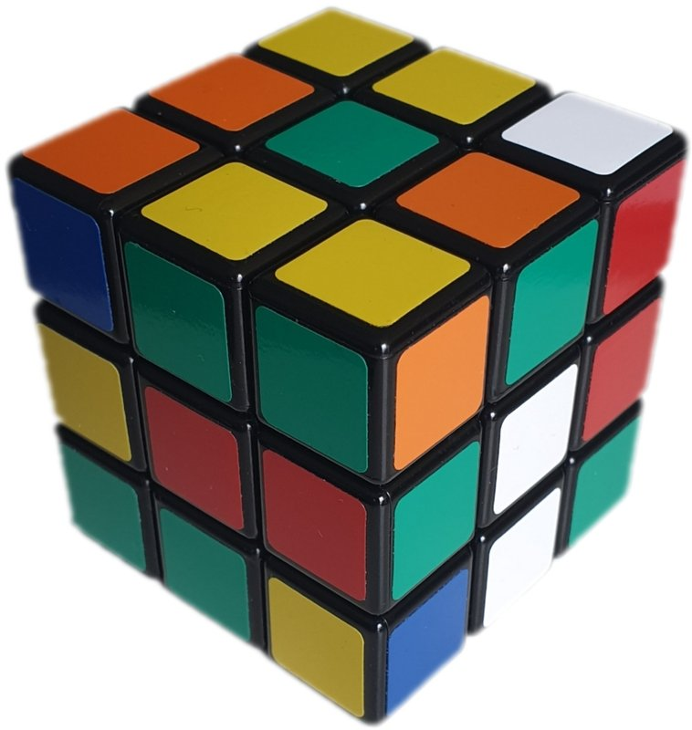

# Capítulo 75 — Proyecto: el cubo de Rubik

El cubo de Rubik tiene seis caras de nueve casillas, y cada cara gira sobre
su centro arrastrando las casillas de los bordes de las cuatro caras
vecinas. Mezclarlo es fácil; volver al estado inicial exige conocer
secuencias de giros que cambian pocas piezas y dejan el resto en su lugar.



Un cubo de Rubik mezclado. Se ven tres de sus caras: cada una tiene
casillas de varios colores, y el problema es devolverla a un solo color
con giros de las caras. Las piezas de las esquinas muestran tres
casillas, las de las aristas dos, y los centros no se mueven.
Imagen: Imk3nnyma, [CC BY-SA 4.0](https://creativecommons.org/licenses/by-sa/4.0/),
vía [Wikimedia Commons](https://commons.wikimedia.org/wiki/File:Scrumbled_Rubik%27s_Cube.jpg);
reducida a 758 × 800 píxeles.

Este capítulo construye un programa que lo resuelve. La salida siguiente es
la de `sesion(7, 20)`, de la versión 7: mezcla el cubo con veinte giros
elegidos a partir de la semilla 7, lo muestra desplegado y lo arma en cinco
etapas.

```text
Mezcla de 20 cuartos de vuelta: F L B F U' D' F U D' R' F' R' U D B' R D' F U R
┌────────────────────────────┐
│        U R D               │
│        L U D               │
│        F B U               │
│ F U R  U D R  B F L  B U L │
│ D L F  R F B  L R B  U B L │
│ F F B  D D B  U B L  F F D │
│        R R L               │
│        L D R               │
│        R U D               │
└────────────────────────────┘
1. la cruz de abajo (12 cuartos de vuelta):
   B D U F2 U2 R B' D' F D
2. las esquinas de abajo (32 cuartos de vuelta):
   B U2 B' U' B U B' L U L' F' U' F B U2 B' U' B U2 B' F U2 F' U2 F U F'
3. las aristas del medio (32 cuartos de vuelta):
   U L U' L' U' B' U B U L U' L' U' B' U B U' R' U R U B U' B' U L' U L U F U' F'
4. las aristas de arriba (14 cuartos de vuelta):
   B L U L' U' B' L F U F' U' L' U2
5. las esquinas de arriba (28 cuartos de vuelta):
   B U' F' U B' U' F U R' D' R D R' D' R D U2 D' R' D R D' R' D R U2
Total: 118 cuartos de vuelta. El cubo queda resuelto.
```

Cada letra es la inicial de una cara, en la notación de David Singmaster:
U arriba, D abajo, F adelante, B atrás, R derecha, L izquierda. Una letra
sola es un cuarto de vuelta de esa cara en el sentido de las agujas del
reloj, mirándola de frente; con apóstrofo, en el sentido contrario; con un
2, media vuelta.

El proyecto parte del capítulo «Rubik's Cube» de *Building Expert Systems
in Prolog*, de Dennis Merritt. De allí toma cuatro ideas: el cubo como un
término plano de 54 argumentos, un giro como un hecho cuyos dos
argumentos son el cubo antes y después, de modo que girar es una sola
unificación; las secuencias de giros compiladas de antemano en el mismo
formato, y la solución por etapas, en la que un cubo **criterio** con
variables libres unifica solamente con los cubos que tienen colocadas las
piezas pedidas. Lo que se toma de cada fuente está en las
Referencias de cada página. El código es propio.

El programa carga, sin copiarlos, el módulo de pantalla del
[capítulo 37](../capitulo-37-interfaces-de-usuario/index.md) y las
búsquedas del [capítulo 41](../capitulo-41-busqueda-y-planificacion/index.md),
y usa la inspección de términos del
[capítulo 33](../capitulo-33-inspeccion-de-terminos/index.md) y la
expansión de términos al cargar del
[capítulo 36](../capitulo-36-transformacion-de-programas-y-compilacion/index.md).
Todas las versiones son `% solo-local`, salvo la primera, que corre en
SWISH.

## Objetivos del capítulo

Al terminar el capítulo, el lector puede:

- representar un objeto con muchas partes como un término plano y escribir
  cada transformación como una unificación entre dos términos que
  comparten variables;
- generar esos hechos al cargar el programa, calculándolos a partir de la
  geometría del problema en lugar de escribirlos a mano;
- componer transformaciones aplicándolas a un término de variables libres,
  y leer en el resultado qué partes cambian;
- plantear un problema como un espacio de estados, medir el crecimiento de
  una búsqueda ciega y explicar por qué no alcanza;
- resolver por etapas con metas parciales expresadas como términos con
  variables libres;
- medir la longitud de las soluciones y el esfuerzo de búsqueda de cada
  mejora sobre cientos de mezclas reproducibles;
- pasar de una representación a otra con una sola unificación, y decidir
  con mediciones si una heurística previa a la búsqueda conviene.

!!! info "Tiempo estimado"
    Leer el capítulo, ejecutar sus ejemplos y hacer las actividades: **2:40 h**.
    Resolver los 6 ejercicios marcados con ★: **1:25 h**.
    Resolver los 13 ejercicios del capítulo: **4:20 h**.

## 75.1 El programa terminado

| Versión | Archivo | Agrega | Lo que no puede hacer todavía |
|---|---|---|---|
| 1 | `cubo.pl` | el cubo como término; los seis giros, generados al cargar | mostrar el cubo de manera legible |
| 2 | `vista.pl` | el cubo desplegado en texto; la notación; las mezclas | resolver una mezcla |
| 3 | `espacio.pl` | las búsquedas del [capítulo 41](../capitulo-41-busqueda-y-planificacion/index.md) sobre el cubo, medidas | resolver mezclas de más de siete giros |
| 4 | `macros.pl` | las secuencias compiladas y su efecto | encontrar secuencias útiles sin escribirlas a mano |
| 5 | `descubrir.pl` | los conmutadores que mueven solo tres esquinas | usarlas para resolver |
| 6 | `etapas.pl` | la solución por etapas, pieza por pieza | dar soluciones cortas |
| 7 | `mejoras.pl` | la simplificación y la pieza más cercana | — |
| 8 | `piezas.pl` | el cubo como lista de piezas; dónde está una pieza; una ayuda previa a la búsqueda, medida | — |

`capitulo41.pl` carga las búsquedas del
[capítulo 41](../capitulo-41-busqueda-y-planificacion/index.md) en
módulos propios y les agrega los problemas del cubo, como hace el
[capítulo 78](../capitulo-78-proyecto-mundo-wumpus/index.md) con la vuelta
del Wumpus. Cada versión carga la anterior con `ensure_loaded/1`.

## 75.2 Versión 1: el cubo como término

El cubo es un término `c/54`, con un argumento por casilla. Las casillas
se numeran cara por cara, en el orden U, R, F, D, L, B, y dentro de cada
cara por filas, mirándola de frente; las caras U y D se miran con F
hacia abajo y hacia arriba, respectivamente:

```text
             1  2  3
             4  5  6
             7  8  9
37 38 39   19 20 21   10 11 12   46 47 48
40 41 42   22 23 24   13 14 15   49 50 51
43 44 45   25 26 27   16 17 18   52 53 54
             28 29 30
             31 32 33
             34 35 36
```

Cada argumento es el átomo de la cara a la que pertenece el color de la
casilla: en el cubo resuelto, los nueve primeros son `u`, los nueve
siguientes `r`, y así. Es una representación limpia en el sentido del
[capítulo 33](../capitulo-33-inspeccion-de-terminos/index.md#336-representaciones-limpias):
cada casilla es un argumento fijo, y un color es un átomo.

Un giro es un hecho `giro(Cara, Antes, Despues)`. Sus dos argumentos son
términos `c/54` con las mismas 54 variables, en otro orden. El giro de la
cara U, escrito a mano, empezaría así:

```text
giro(u, c(A1, A2, A3, A4, A5, A6, A7, A8, A9, A10, A11, A12, ...),
        c(A7, A4, A1, A8, A5, A2, A9, A6, A3, A46, A47, A48, ...)).
```

Al unificar `Antes` con un cubo, cada variable queda ligada al color de
una casilla, y `Despues` es el cubo girado: no se ejecuta ninguna
instrucción, Prolog solo unifica. Merritt escribe los hechos a mano. Aquí
se calculan al cargar el archivo, a partir de la geometría del cubo. Cada
casilla está en un cubito `p(X, Y, Z)`, con coordenadas −1, 0 o 1, y mira
en una dirección, un vector de la misma forma. Girar una cara es rotar un
cuarto de vuelta los cubitos de su capa, los que tienen coordenada 1 en la
dirección de la cara, junto con la dirección de sus casillas:

<!-- ejemplo: capitulo-75/cubo.pl predicado: rotar/3 destino/3 -->
```prolog
%!  rotar(+Eje, +V, -W) is det.
%
%   W es el vector V girado un cuarto de vuelta en el sentido de las
%   agujas del reloj, visto desde la punta del vector Eje:
%   W = (Eje . V) Eje - Eje x V.
rotar(p(A, B, C), p(X, Y, Z), p(X1, Y1, Z1)) :-
    E is A * X + B * Y + C * Z,
    X1 is E * A - (B * Z - C * Y),
    Y1 is E * B - (C * X - A * Z),
    Z1 is E * C - (A * Y - B * X).

%!  destino(+Cara, +I:integer, -J:integer) is det.
%
%   Al girar Cara, la casilla I pasa al lugar de la casilla J. Las
%   casillas fuera de la capa de Cara no se mueven.
destino(Cara, I, J) :-
    cara(Cara, _, Eje),
    casilla(I, _, P, N),
    Eje = p(A, B, C),
    P = p(X, Y, Z),
    (   A * X + B * Y + C * Z =:= 1
    ->  rotar(Eje, P, P1),
        rotar(Eje, N, N1),
        casilla(J, _, P1, N1)
    ;   J = I
    ).
```

`rotar/3` es la fórmula de la rotación de un cuarto de vuelta alrededor
de un eje, con aritmética entera. `destino/3` dice adónde va cada casilla:
la que está fuera de la capa se queda. Con esos destinos,
`giro_calculado/3` arma los dos términos: una lista de 54 variables para
`Antes`, y la misma lista reordenada por el destino de cada casilla para
`Despues`. `term_expansion/2`, como en la
[sección 36.1](../capitulo-36-transformacion-de-programas-y-compilacion/index.md#361-term_expansion2-y-goal_expansion2-en-swi-prolog),
reemplaza el término `generar_cubo` del archivo por los siete hechos
calculados, el del cubo resuelto y los seis giros ([Patrón 49](../patrones.md#49-expandir-al-cargar)):

<!-- ejemplo: capitulo-75/cubo.pl predicado: term_expansion/2 giro_calculado/3 -->
```prolog
%!  term_expansion(+Termino, -Clausulas:list) is semidet.
%
%   El término generar_cubo se reemplaza, al cargar el archivo, por el
%   hecho resuelto/1 y un hecho giro/3 por cara. Falla con cualquier
%   otro término.
term_expansion(generar_cubo, [resuelto(Resuelto)|Giros]) :-
    findall(Cara, ( between(1, 54, I), casilla(I, Cara, _, _) ), Caras),
    Resuelto =.. [c|Caras],
    findall(giro(Cara, Antes, Despues),
            ( cara(Cara, _, _),
              giro_calculado(Cara, Antes, Despues) ),
            Giros).

%!  giro_calculado(+Cara, -Antes, -Despues) is det.
%
%   Antes y Despues son dos términos c/54 con las mismas variables:
%   Despues es Antes con la capa de Cara girada.
giro_calculado(Cara, Antes, Despues) :-
    findall(J, ( between(1, 54, I), destino(Cara, I, J) ), Destinos),
    length(Vs, 54),
    Antes =.. [c|Vs],
    pairs_keys_values(Pares, Destinos, Vs),
    keysort(Pares, Ordenados),
    pairs_values(Ordenados, Ws),
    Despues =.. [c|Ws].
```

El giro inverso no necesita otro hecho. Si `giro(u, A, D)` lleva `A` a
`D`, leído en sentido inverso lleva `D` a `A`: basta con pasar el cubo en
el tercer argumento. `mover/3` lo hace para el movimiento `-Cara`, y
funciona con cualquiera de los dos cubos instanciado:

<!-- ejemplo: capitulo-75/cubo.pl predicado: mover/3 -->
```prolog
%!  mover(+Movimiento, ?Antes, ?Despues) is det.
%
%   Despues es Antes con Movimiento aplicado. Movimiento es una cara (un
%   cuarto de vuelta en el sentido de las agujas del reloj) o -Cara (el
%   giro inverso: el mismo hecho, leído en sentido inverso). Basta con que
%   llegue instanciado uno de los dos cubos.
mover(-Cara, Antes, Despues) :-
    !,
    giro(Cara, Despues, Antes).
mover(Cara, Antes, Despues) :-
    giro(Cara, Antes, Despues).
```

`aplicar/3` aplica una lista de movimientos con `foldl/4`, `inversa/2` da
la secuencia que la deshace, y `orden/2` cuenta cuántas veces hay que
repetir una secuencia para volver al cubo resuelto:

```prolog
?- color_tras([u], 19, Color).
Color = r.

?- cambiadas([r, u, -r, -u], N).
N = 12.

?- orden([r, u], N).
N = 105.

?- inversa([r, -u, f], I).
I = [-f, u, -r].
```

La casilla 19 es la esquina superior izquierda de la cara F: después de U
tiene el color de R, porque la fila de arriba gira de la derecha hacia el
frente. La secuencia R U, repetida, vuelve al estado inicial recién en la
repetición 105. Las pruebas verifican que cada cara repetida cuatro veces
es la identidad, que tres cuartos de vuelta equivalen al giro inverso y
que la secuencia inversa deshace la original.

!!! question "Actividad"
    Predecir cuántas casillas cambia `[u, u]`, cuántas cambia `[u, d]` y
    cuál es el orden de `[u, d]`. Comprobarlo con `cambiadas/2` y
    `orden/2`, y explicar por qué el orden de `[r, l]` es el mismo que el
    de `[u, d]`.

**Lo que falta.** Un término de 54 argumentos no se lee a simple vista.

## 75.3 Versión 2: el cubo a la vista

`red/2` arma las nueve líneas del cubo desplegado en cruz, con la letra de
cada casilla en mayúscula, y `mostrar/1` las encierra con `caja/3` del
módulo `pantalla` del
[capítulo 37](../capitulo-37-interfaces-de-usuario/index.md#372-pantalla-completa-en-la-terminal)
y las escribe. Es el [Patrón 51](../patrones.md#51-modelo-de-pantalla):
`red/2` es puro y se prueba comparando cadenas; solo `mostrar/1` escribe.

<!-- ejemplo: capitulo-75/vista.pl predicado: mostrar/1 -->
```prolog
%!  mostrar(+Cubo) is det.
%
%   Escribe Cubo desplegado, dentro de un recuadro.
mostrar(Cubo) :-
    red(Cubo, Lineas),
    caja("", Lineas, Caja),
    forall(member(Linea, Caja), writeln(Linea)).
```

Las secuencias se leen y se escriben en la notación de Singmaster.
`leer_notacion/2` es una gramática sobre los códigos del texto, como las
del [capítulo 22](../capitulo-22-gramaticas-dcg/index.md): cada palabra es
una letra de cara seguida, a lo sumo, de un apóstrofo o de un 2.
`escribir_notacion/2` hace lo inverso y agrupa dos cuartos de vuelta
iguales en una media vuelta:

```prolog
?- mostrar_giros("R U R' U'").
┌────────────────────────────┐
│        U U L               │
│        U U F               │
│        U U F               │
│ B L L  F F D  R R U  B R R │
│ L L L  F F U  B R R  B B B │
│ L L L  F F F  U R R  B B B │
│        D D R               │
│        D D D               │
│        D D D               │
└────────────────────────────┘
true.

?- leer_notacion("F2 U' R", Ms).
Ms = [f, f, -u, r].

?- mezcla(7, 6, Ms), escribir_notacion(Ms, T).
Ms = [f, l, b, f, -u, -d],
T = "F L B F U' D'".
```

`mezcla/3` elige cada giro con un generador congruencial lineal cuyo
estado pasa de una llamada a la siguiente como argumento, sin repetir la
cara del giro anterior: la misma semilla da la misma mezcla en cualquier
instalación, y las pruebas y las mediciones del capítulo son
reproducibles.

**Lo que falta.** El programa mezcla, pero no resuelve.

El capítulo continúa en la página
[El cubo como espacio de estados y los macrooperadores](espacio.md#754-version-3-el-cubo-como-espacio-de-estados),
con las versiones 3 a 7, que buscan la solución: primero con las
búsquedas ciegas del
[capítulo 41](../capitulo-41-busqueda-y-planificacion/index.md), después
con macrooperadores y por etapas. La página siguiente,
[Piezas y una ayuda para la búsqueda](piezas.md#759-version-8-piezas-y-una-ayuda-para-la-busqueda),
lo termina con la versión 8. Antes, los [ejercicios](#ejercicios) de
esta página practican las versiones 1 y 2.

## Ejercicios

Las soluciones están en [la página de soluciones](soluciones.md). La dificultad
va de 1 (se resuelve consultando el capítulo) a 3 (requiere elaboración propia).
Los marcados con ★ son los que no conviene saltear: cubren lo que el capítulo
tiene de propio. Los ejercicios que piden código se resuelven en archivos
que cargan los del capítulo, sin modificarlos.

1. ★ **(2)** Escribir `giro_medio(Eje, Antes, Despues)`, el giro de la
   capa del medio perpendicular a la cara `Eje`, con la misma geometría de
   `destino/3`: la capa es la de coordenada 0 en esa dirección. Verificar
   que cuatro giros medios son la identidad y que el giro de una cara, el
   de la capa del medio y el inverso de la cara opuesta hacen girar el cubo
   entero.
2. ★ **(2)** Escribir `leer_red(Lineas, Cubo)`, la relación inversa de
   `red/2`: arma el cubo a partir de las nueve líneas del cubo desplegado,
   como el editor del programa de Merritt. Comprobar sobre las mezclas de
   las semillas 1 a 20 que `red/2` seguido de `leer_red/2` devuelve el
   mismo cubo.
3. **(2)** Escribir `mostrar_color/1`, que escribe el cubo desplegado con
   cada casilla sobre un fondo de color, con las secuencias de escape ANSI
   del [capítulo 37](../capitulo-37-interfaces-de-usuario/index.md). Separar
   la parte pura, que arma las líneas con las secuencias de escape, de la
   que escribe, y probar la parte pura.

## Referencias

- Dennis Merritt, *Building Expert Systems in Prolog*, Springer-Verlag,
  1989 — capítulo «Rubik's Cube» (las secciones sobre el cubo, la rotación,
  las reglas de alto nivel, la búsqueda y las heurísticas) y el apéndice
  con el código del programa.
  [Edición en línea](https://www.amzi.com/ExpertSystemsInProlog/), de
  Amzi!. Esta página toma de allí las ideas y no el código: el cubo como
  un término plano de 54 casillas; cada giro como un hecho que unifica
  dos términos, y el giro inverso con los argumentos intercambiados.
- David Singmaster, *Notes on Rubik's «Magic Cube»*, Enslow, 1981. Sin
  edición en línea de acceso libre verificada. Esta página toma la
  notación de los giros.
