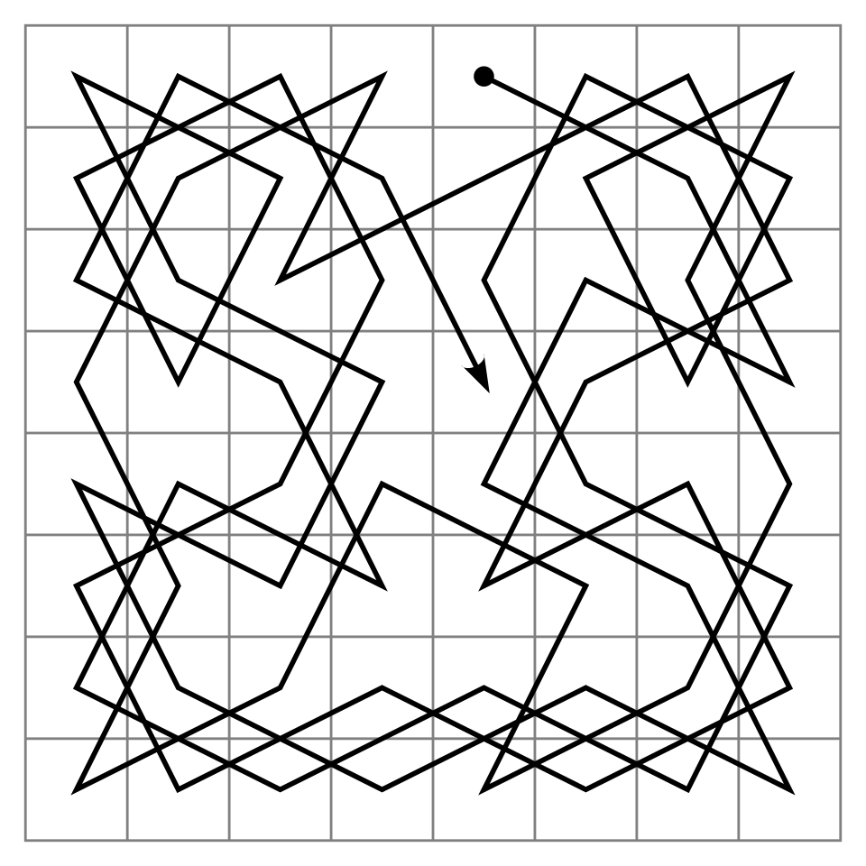

# El caballo, de una casilla a otra, y su recorrido

Esta página continúa el [capítulo 77](index.md) después de la
[sección 77.6](laberinto.md#776-version-5-el-laberinto-de-compuertas), con
las secciones [77.7](#777-version-6-el-caballo-de-una-casilla-a-otra) y
[77.8](#778-version-7-el-recorrido-del-caballo): el caballo que va de una
casilla a otra, con las heurísticas de Csenki y la heurística entera, y el
recorrido del caballo por todo el tablero, con el orden fijo de los saltos
y con la regla de Warnsdorff. Los programas son `caballo.pl` y
`recorrido.pl`, en `ejemplos/capitulo-77/`, con sus pruebas.

## 77.7 Versión 6: el caballo, de una casilla a otra

En un tablero de N × N, la casilla `X-Y` está en la columna X y la fila Y;
en el de 8 × 8, la columna 1 es la a y la fila 1 la de abajo, así que a8
es `1-8`. Un salto del caballo avanza dos casillas en una dirección y una
en la otra, y cuesta 1:

<!-- ejemplo: capitulo-77/caballo.pl predicado: salto/4 vector/2 -->
```prolog
%!  salto(+N:integer, +Desde, ?Hasta, -Vector) is nondet.
%
%   Hasta es una casilla del tablero de N x N a la que el caballo llega
%   desde Desde con un salto de Vector DX-DY.
salto(N, X-Y, X1-Y1, DX-DY) :-
    vector(DX, DY),
    X1 is X + DX,
    Y1 is Y + DY,
    X1 >= 1, X1 =< N,
    Y1 >= 1, Y1 =< N.

% vector(DX, DY): los ocho saltos del caballo.
vector(1, 2).
vector(2, 1).
vector(2, -1).
vector(1, -2).
vector(-1, -2).
vector(-2, -1).
vector(-2, 1).
vector(-1, 2).
```

Las heurísticas son las de Csenki. Un salto avanza 3 en la distancia de
Manhattan y √5 en línea recta, así que n saltos avanzan a lo sumo 3n y
√5·n: dividir cada distancia por lo que avanza un salto da una cota
inferior de los saltos. `manhattan` y `euclidea` son esas dos;
`combinada`, la mayor de ellas, que también es una cota. `minima`, la
menor de las diferencias de columna y de fila, no lo es: de (7, 2) a
(1, 8) estima 6, y bastan 4 saltos. `entera(H)` redondea H hacia arriba:
la cantidad de saltos es entera, así que si H no supera la cantidad real,
tampoco la supera el entero siguiente a H.

<!-- ejemplo: capitulo-77/caballo.pl predicado: estimar/4 -->
```prolog
%!  estimar(+Nombre, +A, +B, -H:number) is det.
%
%   H es lo que estima la heurística Nombre de la cantidad de saltos entre
%   las casillas A y B.
estimar(cero, _, _, 0).
estimar(manhattan, X1-Y1, X2-Y2, H) :-
    H is (abs(X1 - X2) + abs(Y1 - Y2)) / 3.
estimar(euclidea, X1-Y1, X2-Y2, H) :-
    H is sqrt((X1 - X2)**2 + (Y1 - Y2)**2) / sqrt(5).
estimar(combinada, A, B, H) :-
    estimar(manhattan, A, B, H1),
    estimar(euclidea, A, B, H2),
    H is max(H1, H2).
estimar(minima, X1-Y1, X2-Y2, H) :-
    H is min(abs(X1 - X2), abs(Y1 - Y2)).
estimar(entera(Nombre), A, B, H) :-
    estimar(Nombre, A, B, H0),
    H is ceiling(H0).
```

```prolog
?- saltos_entre(a8, h1, Casillas).
Casillas = [a8, c7, e8, g7, h5, g3, h1].

?- estimar(manhattan, 4-3, 7-4, M), estimar(euclidea, 4-3, 7-4, E).
M = 1.3333333333333333,
E = 1.4142135623730951.

?- estimar(manhattan, 4-3, 6-1, M), estimar(euclidea, 4-3, 6-1, E).
M = 1.3333333333333333,
E = 1.2649110640673518.
```

`saltos_entre/3` reproduce la sesión de Csenki: de a8 a h1 en 6 saltos,
con IDA\*. Los dos pares siguientes son los suyos para mostrar que
ninguna de las dos heurísticas domina a la otra; por eso la combinada
mejora a las dos. La heurística que estima de más produce lo que
Csenki anuncia:

```prolog
?- caballo(8, ida_estrella, minima, 7-2, 1-8, Camino, Saltos, K).
Camino = [7-2, 8-4, 6-5, 7-7, 5-6, 3-7, 1-8],
Saltos = 6,
K = 9.

?- caballo(8, ida_estrella, combinada, 7-2, 1-8, Camino, Saltos, K).
Camino = [7-2, 5-3, 3-4, 2-6, 1-8],
Saltos = K, K = 4.
```

Con `minima`, IDA\* empieza con la cota 6 y acepta el primer camino que
encuentra dentro de ella; con `combinada` encuentra el de 4, el mismo que
da Csenki. De a8 a h1, los nodos expandidos:

| Heurística | A\* | IDA\* |
|---|---|---|
| `cero` | 63 | 2 016 |
| `manhattan` | 42 | 225 |
| `euclidea` | 36 | 1 148 |
| `combinada` | 31 | 657 |
| `entera(combinada)` | — | 35 |

A\* ordena bien con cualquiera de ellas. IDA\* con `euclidea` expande cinco
veces más que con `manhattan`, aunque `euclidea` estima más en este par:
sus valores son números irracionales casi todos distintos, y cada
iteración de IDA\* sube la cota apenas hasta el menor valor que la pasó,
de modo que hay decenas de iteraciones —la sesión de Csenki muestra
veintidós cotas entre 1 y 6— y cada una repite la búsqueda desde el
principio. Redondear hacia arriba deja una cota por cantidad de saltos; es
el [Patrón 78](../patrones.md#78-heuristica-entera), que se enuncia después de la consulta:

```prolog
?- caballo(8, ida_estrella, combinada, 1-8, 8-1, _, S, K).
S = 6,
K = 657.

?- caballo(8, ida_estrella, entera(combinada), 1-8, 8-1, _, S, K).
S = 6,
K = 35.
```

!!! example "Patrón 78 — Heurística entera"
    **Problema.** Los costos del problema son enteros —saltos, pasos—,
    pero la heurística admisible natural es un número de punto flotante,
    como una distancia en línea recta dividida por √5.

    **Versión ingenua.** Usar la heurística tal como sale de la fórmula.
    Cada nodo tiene un f distinto, IDA\* sube la cota de a un valor
    irracional por vez y repite la búsqueda en cada iteración: de a8 a h1
    con `combinada`, 657 nodos expandidos donde alcanzan 35.

    **Patrón.** Redondear la heurística hacia arriba, `ceiling/1`. Si h no
    supera el costo real c, que es entero, el menor entero mayor o igual
    que h tampoco lo supera: la heurística sigue siendo admisible, y es
    mejor informada. Las cotas de IDA\* pasan a ser enteras, una por
    costo posible, y A\* desempata menos: en el tablero de 50 × 50, de una
    esquina a la otra, expande 506 nodos en lugar de 840. En
    `estimar/4` es una cláusula, `entera(H)`, que envuelve cualquier otra
    heurística.

    **Cuándo no usarlo.** Cuando los costos no son enteros, como las
    longitudes de una red de caminos medidas en línea recta: el entero
    siguiente a h puede pasar el costo real, y la heurística deja de ser
    admisible. Cuando la heurística ya da enteros, como `manhattan` en el
    plano del robot: no cambia nada. Y cuando todos los costos son
    múltiplos de un mismo número, como los 10 y 11 de los giros: el
    redondeo a enteros sigue siendo admisible, pero las cotas de IDA\*
    siguen siendo muchas, porque los valores de f se distinguen igual.

En tableros grandes la heurística decide si la búsqueda es posible. De
una esquina a la opuesta de un tablero de 100 × 100:

```prolog
?- caballo(100, a_estrella, cero, 1-1, 100-100, _, S, K).
S = 66,
K = 9997.

?- caballo(100, a_estrella, combinada, 1-1, 100-100, _, S, K).
S = K, K = 66.
```

Sin heurística, A\* expande casi las 10 000 casillas; con la combinada,
solo las del camino.

!!! question "Actividad"
    Predecir cuántos saltos necesita el caballo de a1 a b2, que están en
    diagonal, y si `combinada` lo estima bien. Comprobarlo con `caballo/8`
    y `estimar/4`, y explicar el resultado dibujando las casillas a las
    que se llega con un salto desde a1.

## 77.8 Versión 7: el recorrido del caballo

Un **recorrido del caballo** pasa por todas las casillas del tablero
exactamente una vez.



Un recorrido abierto del caballo en el tablero de 8 × 8: la línea une las
64 casillas en el orden de los saltos, desde el punto hasta la flecha.
Imagen: Ilmari Karonen, dominio público, vía
[Wikimedia Commons](https://commons.wikimedia.org/wiki/File:Knight%27s_tour.svg)
(versión PNG de 960 píxeles del archivo SVG).

No hay una meta a la que acercarse, y ninguna
distancia que estimar: es una búsqueda en profundidad con la vuelta atrás
de Prolog, con las casillas visitadas en un assoc
([sección 23.5](../capitulo-23-estructuras-de-datos-de-la-biblioteca/index.md#235-libraryassoc-y-libraryrbtrees)).

<!-- ejemplo: capitulo-77/recorrido.pl predicado: recorrido/4 continuar/7 candidatas/5 sin_visitar/4 libres_desde/4 -->
```prolog
%!  recorrido(+Orden, +N:integer, +Desde, -Camino:list) is nondet.
%
%   Camino es un recorrido del caballo por el tablero de N x N que empieza
%   en Desde: N x N casillas distintas, cada una a un salto de la
%   anterior. Orden es ingenuo o warnsdorff, el orden en que se prueban los
%   saltos; por reintento da los demás recorridos.
recorrido(Orden, N, Desde, [Desde|Camino]) :-
    Total is N * N,
    list_to_assoc([Desde-si], Visitadas),
    continuar(Orden, N, Total, 1, Desde, Visitadas, Camino).

%!  continuar(+Orden, +N:integer, +Total:integer, +K:integer, +Casilla,
%!            +Visitadas, -Camino:list) is nondet.
%
%   Camino completa el recorrido desde Casilla, la K-ésima, sin pasar por
%   las Visitadas.
continuar(_, _, Total, Total, _, _, []).
continuar(Orden, N, Total, K, Casilla, Visitadas, [Siguiente|Camino]) :-
    K < Total,
    candidatas(Orden, N, Casilla, Visitadas, Candidatas),
    member(Siguiente, Candidatas),
    put_assoc(Siguiente, Visitadas, si, Visitadas1),
    K1 is K + 1,
    continuar(Orden, N, Total, K1, Siguiente, Visitadas1, Camino).

%!  candidatas(+Orden, +N:integer, +Casilla, +Visitadas,
%!             -Candidatas:list) is det.
%
%   Candidatas son las casillas sin visitar a un salto de Casilla, en el
%   orden en que se prueban.
candidatas(ingenuo, N, Casilla, Visitadas, Candidatas) :-
    findall(S, sin_visitar(N, Casilla, Visitadas, S), Candidatas).
candidatas(warnsdorff, N, Casilla, Visitadas, Candidatas) :-
    findall(L-S,
            ( sin_visitar(N, Casilla, Visitadas, S),
              libres_desde(N, S, Visitadas, L) ),
            Pares),
    keysort(Pares, Ordenados),
    pairs_values(Ordenados, Candidatas).

%!  sin_visitar(+N:integer, +Casilla, +Visitadas, -S) is nondet.
%
%   S es una casilla sin visitar a un salto de Casilla.
sin_visitar(N, Casilla, Visitadas, S) :-
    salto(N, Casilla, S, _),
    \+ get_assoc(S, Visitadas, _).

%!  libres_desde(+N:integer, +S, +Visitadas, -L:integer) is det.
%
%   L es la cantidad de casillas sin visitar a un salto de S.
libres_desde(N, S, Visitadas, L) :-
    aggregate_all(count, sin_visitar(N, S, Visitadas, _), L).
```

Con el orden `ingenuo`, las casillas se prueban en el orden fijo de
`salto/4`. Con `warnsdorff`, la regla que H. C. von Warnsdorff publicó en
1823, se prueban primero las casillas desde las que quedan menos saltos
libres: las que más pronto quedarían aisladas se visitan antes de que eso
ocurra. `candidatas/5` arma pares `Libres-Casilla` y los ordena con
`keysort/2`, que conserva el orden de `salto/4` entre las de igual
cantidad. Es una heurística en otro sentido que el de A\*: no estima nada,
ordena los hijos de una búsqueda en profundidad, y la vuelta atrás sigue
disponible por si el orden falla. `mostrar_recorrido/3` escribe el número
de orden de cada casilla en el primer recorrido:

```prolog
?- mostrar_recorrido(ingenuo, 5, 1-1).
  25  18   3  12  23
   8  13  24  17   4
  19   2   7  22  11
  14   9  20   5  16
   1   6  15  10  21
true.

?- mostrar_recorrido(warnsdorff, 8, 1-1).
  22   7  44  39  24   9  28  63
  43  40  23   8  45  62  25  10
   6  21  42  59  38  27  64  29
  41  58  37  46  61  54  11  26
  20   5  60  53  36  47  30  51
  57   2  35  48  55  52  15  12
   4  19  56  33  14  17  50  31
   1  34   3  18  49  32  13  16
true.

?- mostrar_recorrido(ingenuo, 4, 1-1).
false.
```

En el tablero de 4 × 4 no hay recorrido, y la búsqueda lo prueba agotando
las alternativas. Medido desde la esquina (1, 1):

| Tablero | `ingenuo` | `warnsdorff` |
|---|---|---|
| 5 × 5 | 816 228 inferencias, 0,14 s | 37 830 inferencias |
| 6 × 6 | 24 169 331 inferencias, 4,5 s | — |
| 7 × 7 | más de 60 s | — |
| 8 × 8 | — | 21 906 inferencias |
| 20 × 20 | — | 182 715 inferencias, 0,03 s |
| 50 × 50 | — | 1 280 310 inferencias, 0,3 s |

Sin orden, la búsqueda llega a callejones sin salida muy tarde, con medio
tablero recorrido, y deshace millones de pasos; con la regla de
Warnsdorff, en estos tableros no hace falta deshacer ninguno, y el costo
crece con la cantidad de casillas. La regla no garantiza nada: el
[ejercicio 12](#ejercicios) muestra que, si se piden todos los recorridos, ordenar no
ahorra trabajo.

!!! success "Criterios de calidad"
    | Criterio | En este capítulo |
    |---|---|
    | C1 | cada predicado declara modos y determinación; las cláusulas que el puente agrega a predicados de otro módulo también |
    | C2 | representaciones limpias: el problema es un término con un functor por clase de problema, y la celda, la compuerta y la casilla son términos `X-Y`, `g(F, P)` y `X-Y`; los dibujos se convierten en hechos al cargar |
    | C4 | `giros_de/2` y `casilla/2` se escribieron sin alternativas pendientes después de que las pruebas las encontraron: las listas se recorren con el elemento anterior como argumento, y las columnas son hechos indexados en las dos direcciones |
    | C6 | lo que se dibuja se calcula aparte: `lineas/3` y `tablero/3` devuelven las filas, y `mostrar/2`, `mostrar_laberinto/2` y `mostrar_recorrido/3` solo las escriben |
    | C7 | 63 pruebas en siete archivos, y 17 más para las soluciones; las cantidades de nodos expandidos están en las pruebas, así que un cambio en una búsqueda o en una heurística se nota |

## Ejercicios

Las soluciones están en [la página de soluciones](soluciones.md). La dificultad
va de 1 (se resuelve consultando el capítulo) a 3 (requiere elaboración propia).
Los marcados con ★ son los que no conviene saltear: cubren lo que el capítulo
tiene de propio. Los ejercicios que piden código se resuelven en archivos
que cargan los del capítulo, sin modificarlos.

9. ★ **(2)** Escribir `sobreestimaciones(Heuristica, Pares)`, los pares de
   casillas del tablero de 8 × 8 en los que la heurística estima más
   saltos que los necesarios, calculando las distancias reales con una
   búsqueda en anchura. Contar los de `minima` y verificar que
   `combinada` no tiene ninguno.
10. **(2)** Escribir `admisible(N, Heuristica)`, que comprueba la
    admisibilidad sobre todos los pares de casillas de un tablero de
    N × N, y aplicarlo a las cinco heurísticas del caballo y a
    `entera(combinada)`.
11. ★ **(2)** Un recorrido es **cerrado** si la última casilla está a un
    salto de la primera. Escribir `recorrido_cerrado/3` con la regla de
    Warnsdorff y buscar uno en el tablero de 8 × 8. Explicar por qué no
    hay recorridos cerrados en tableros con una cantidad impar de casillas
    (pista: el color de la casilla cambia en cada salto) y medir qué
    ocurre en el de 6 × 6.
12. **(2)** Contar los recorridos del tablero de 5 × 5 que empiezan en una
    esquina, con los dos órdenes, y comparar los tiempos. Explicar por qué
    la regla de Warnsdorff, que encuentra el primero mucho antes, no
    ayuda a encontrarlos todos.

## Resumen

| | |
|---|---|
| **problema de otro módulo** | el puente agrega a la búsqueda una cláusula por predicado para los problemas `Modulo:Problema`, y cada problema define su interfaz en su propio módulo |
| **dibujo expandido al cargar** | `term_expansion/2` convierte cada plano en hechos `libre/3` que la búsqueda consulta indexados |
| **caminos del mismo largo** | en una grilla, entre dos celdas hay muchos caminos mínimos; una búsqueda que no recuerda los estados los expande todos |
| **costo con giros** | 10 por paso y 1 por giro: elige entre los caminos más cortos el que menos gira; no reemplaza al registro de visitados |
| **heurística entera** | con costos enteros, una heurística admisible redondeada hacia arriba sigue siendo admisible, y IDA\* hace menos iteraciones |
| **heurística no admisible** | puede dar un plan que no es el más corto: IDA\* con `minima` da 6 saltos donde bastan 4 |
| **regla de Warnsdorff** | en el recorrido del caballo, probar primero la casilla con menos salidas libres; ordena la búsqueda en profundidad, no estima distancias |
| `buscar_sin_visitados/5` | el bucle del [capítulo 41](../capitulo-41-busqueda-y-planificacion/index.md) sin registro de visitados, con A\* |
| `plano/2`, `medidas/3`, `libre/3`, `vecina/4`, `lineas/3` | el plano |
| `camino/7`, `camino_sin_visitados/6`, `camino_ida/6` | el robot con A\*, sin visitados y con IDA\* |
| `camino_con_giros/6`, `giros_de/2` | los caminos con menos giros |
| `laberinto/2`, `sembrado/5`, `salida/4`, `salida_con/6`, `mostrar_laberinto/2` | el laberinto de compuertas |
| `caballo/8`, `saltos_entre/3`, `casilla/2`, `estimar/4` | el caballo de una casilla a otra |
| `recorrido/4`, `es_recorrido/2`, `libres_desde/4`, `mostrar_recorrido/3` | el recorrido del caballo |
| **[Patrón 77](../patrones.md#77-problema-de-otro-modulo)** | problema de otro módulo |
| **[Patrón 78](../patrones.md#78-heuristica-entera)** | heurística entera |

## Temas que se retoman

| Tema | Se retoma en |
|---|---|
| El tablero de ajedrez como coordenadas y las piezas como saltos: el final de rey y torre contra rey | [capítulo 80](../capitulo-80-proyecto-lenguaje-consejos-ajedrez/index.md) |
| Problemas pequeños resueltos como búsqueda en un espacio de estados | [capítulo 82](../capitulo-82-proyecto-coleccion-problemas/index.md) |

## Referencias

- Attila Csenki, *Applications of Prolog*, Ventus Publishing (Bookboon),
  2009 — capítulo «Informed Search», apartados «The Network Search Problem
  with Costs» (el algoritmo A, la admisibilidad, IDA\* e IDA\*-ε) y
  «Project: Moving a Knight».
  [Página de la editorial, copia de archivo](https://web.archive.org/web/20260216182045/https://bookboon.com/en/applications-of-prolog-ebook).
  La editorial ya no ofrece el libro;
  [Google Libros](https://books.google.com/books?id=copBGLD4LKwC) muestra
  páginas seleccionadas.
  Esta página toma de allí el proyecto del caballo; las heurísticas del
  caballo divididas por 3 y por √5, la combinada, los pares que muestran
  que ninguna domina a la otra, y la heurística `minima`, que no es
  admisible, con el par (7, 2) → (1, 8).
- Richard E. Korf, «Depth-First Iterative-Deepening: An Optimal Admissible
  Tree Search», *Artificial Intelligence* 27(1), 1985, págs. 97–109.
  [Página del editor](https://doi.org/10.1016/0004-3702(85)90084-0).
  Define IDA\*: profundidad acotada por f, con la cota siguiente igual al
  menor f que pasó la anterior, y memoria proporcional al largo del
  camino. Es la referencia de Csenki para IDA\*.
- Ivan Bratko, *Prolog Programming for Artificial Intelligence*,
  Addison-Wesley, 1986 — capítulo «Best-first: a heuristic search
  principle». Sin edición en línea de acceso libre. De allí se toma la
  observación de que una heurística que estima de más puede guiar bien y
  aun así no dar el plan más corto.
- H. C. von Warnsdorff, *Des Rösselsprunges einfachste und allgemeinste
  Lösung*, Schmalkalden, 1823, a través del artículo
  [«Knight's tour» de Wikipedia](https://en.wikipedia.org/wiki/Knight%27s_tour),
  que resume la regla, su eficacia y sus límites, y las condiciones para
  que existan recorridos abiertos y cerrados. El capítulo toma la regla
  y la cantidad de recorridos del tablero de 5 × 5 para comparar.

El código del capítulo es propio, escrito para el curso: Csenki da los
enunciados, los datos del laberinto y las heurísticas, no el código de sus
soluciones, y las búsquedas son las del
[capítulo 41](../capitulo-41-busqueda-y-planificacion/index.md), cargadas
sin modificarlas. Los planos, los laberintos sembrados, el puente entre
módulos, el recorrido del caballo y todas las mediciones son del curso.
