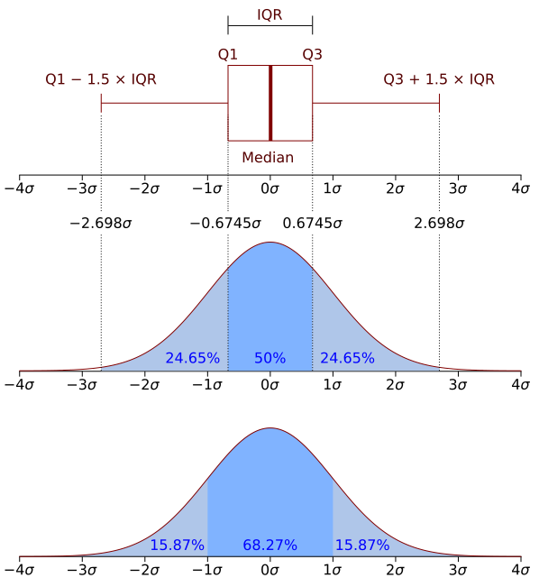

# Umbrales ajustados a los datos y un umbral aprendido

Esta página continúa la página
[Lectura de los registros, métricas e informes](lectura.md#855-version-3-metricas-por-hora-e-informes)
del [capítulo 85](index.md), con las secciones
[85.6](#856-version-4-umbrales-ajustados-a-partir-de-los-datos) y
[85.7](#857-version-5-un-umbral-aprendido): la versión 4, que ajusta los
umbrales a partir de los datos de los días de referencia, con la media y el desvío o con la
mediana, y la versión 5, que arma un perfil por cliente y por hora y
aprende con el perceptrón del
[capítulo 70](../capitulo-70-proyecto-perceptron/index.md) el límite que
separa a los atacantes. Los programas son `umbrales.pl` y `aprendido.pl`,
en `ejemplos/capitulo-85/`, con sus pruebas.

## 85.6 Versión 4: umbrales ajustados a partir de los datos

El segundo modelo de Denning es el de la **media y el desvío**: lo normal
se aprende de las observaciones, y un valor es anómalo si se aleja de la
media más de D desvíos estándar. Por la desigualdad de Chebyshev, que no
supone nada sobre la distribución de los valores, la probabilidad de un
valor normal fuera de ese intervalo es a lo sumo 1/D²: con D = 3, un
11 %. Si los valores siguen una distribución normal, es mucho menor, un
0,3 %:



Una distribución normal vista de dos maneras: abajo, la densidad, con
el 68,27 % de los valores a menos de un desvío de la media y casi todos a
menos de tres; arriba, el diagrama de caja, construido con la mediana y
los cuartiles, que no dependen de los valores extremos. Imagen: Jhguch
(Wikipedia en inglés), obra derivada de Chen-Pan Liao,
[CC BY-SA 2.5](https://creativecommons.org/licenses/by-sa/2.5), vía
[Wikimedia Commons](https://commons.wikimedia.org/wiki/File:Boxplot_vs_PDF.svg).

La media y el desvío se calculan con tres cantidades: la cantidad de
valores, su suma y la suma de sus cuadrados, que son lo que Denning guarda
en cada perfil. El desvío es la raíz de la media de los cuadrados menos el
cuadrado de la media. El otro modelo usa la **mediana**, el valor del
medio, y la **desviación absoluta mediana** (MAD), la mediana de las
distancias de cada valor a la mediana. El manual de estadística del NIST,
siguiendo a Iglewicz y Hoaglin, recomienda el **puntaje z modificado**,
0,6745 (x − mediana) / MAD, y considerar posibles atípicos los valores
cuyo puntaje pasa de 3,5 en valor absoluto. La constante 0,6745 hace que,
con datos normales, la MAD dividida por ella estime el desvío.

<!-- ejemplo: capitulo-85/umbrales.pl predicado: media_desvio/3 mediana/2 mad/3 ajustar/3 -->
```prolog
%!  media_desvio(+Valores:list(number), -Media:float, -Desvio:float) is det.
%
%   Media es la media de los Valores y Desvio su desvío estándar, la raíz
%   de la media de los cuadrados menos el cuadrado de la media. Valores no
%   es vacía.
media_desvio(Valores, Media, Desvio) :-
    length(Valores, N),
    sum_list(Valores, Suma),
    foldl(sumar_cuadrado, Valores, 0, Cuadrados),
    Media is Suma / N,
    Desvio is sqrt(max(0, Cuadrados / N - Media ** 2)).

%!  mediana(+Valores:list(number), -Mediana:number) is det.
%
%   Mediana es el valor del medio de los Valores ordenados, o la media de
%   los dos del medio si son una cantidad par. Valores no es vacía.
mediana(Valores, Mediana) :-
    msort(Valores, Ordenados),
    length(Ordenados, N),
    (   N mod 2 =:= 1
    ->  K is N // 2,
        nth0(K, Ordenados, Mediana)
    ;   K is N // 2 - 1,
        nth0(K, Ordenados, A),
        K1 is K + 1,
        nth0(K1, Ordenados, B),
        Mediana is (A + B) / 2
    ).

%!  mad(+Valores:list(number), -Mediana:number, -Mad:number) is det.
%
%   Mediana es la mediana de los Valores, y Mad la mediana de las
%   distancias de cada valor a ella: la desviación absoluta mediana.
mad(Valores, Mediana, Mad) :-
    mediana(Valores, Mediana),
    maplist(distancia(Mediana), Valores, Distancias),
    mediana(Distancias, Mad).

%!  ajustar(+Modelo, +Valores:list(number), -Intervalo) is det.
%
%   Intervalo es entre(Inferior, Superior): los valores normales según el
%   Modelo, ajustado con los Valores. Con media_desvio(D), la media más o
%   menos D desvíos; con mediana_mad(Z), los valores cuyo puntaje z
%   modificado no pasa de Z en valor absoluto, es decir, la mediana más o
%   menos Z · Mad / 0.6745.
ajustar(media_desvio(D), Valores, entre(Inferior, Superior)) :-
    media_desvio(Valores, Media, Desvio),
    Inferior is Media - D * Desvio,
    Superior is Media + D * Desvio.
ajustar(mediana_mad(Z), Valores, entre(Inferior, Superior)) :-
    mad(Valores, Mediana, Mad),
    Ancho is Z * Mad / 0.6745,
    Inferior is Mediana - Ancho,
    Superior is Mediana + Ancho.
```

La diferencia entre los dos modelos aparece con un solo valor extremo.
En `[1, 1, 2, 2, 4, 6, 900]`, la mediana es 2 y la MAD es 1, como si el 900
fuera un 9; la media pasa a 131 y el desvío a 314, y con ellos ningún
valor, ni siquiera el 900, está a más de tres desvíos:

```prolog
?- mad([1, 1, 2, 2, 4, 6, 900], Me, Ma), media_desvio([1, 1, 2, 2, 4, 6, 900], Mu, D).
Me = 2,
Ma = 1,
Mu = 130.85714285714286,
D = 314.0056544401839.
```

Los días de referencia son los tres primeros. Sus 36 horas dan, para los
fallos, una media de 4,6 con un desvío de 4,8, y una mediana de 4 con una
MAD de 2:

<!-- ejemplo: capitulo-85/umbrales.pl predicado: dias_de_referencia/1 referencia/1 valores/3 valores_de_referencia/2 umbrales/3 umbrales_de_referencia/2 umbrales_del_dia/3 -->
```prolog
% dias_de_referencia(Archivos): los registros con los que se ajustan los
% umbrales.
dias_de_referencia([ registros('2026-09-28.log'),
                     registros('2026-09-29.log'),
                     registros('2026-09-30.log')
                   ]).

%!  referencia(-Horas:list) is det.
%
%   Horas son las métricas por hora de todos los días de referencia, una
%   lista de hora(H, Metricas) por día, concatenadas.
referencia(Horas) :-
    dias_de_referencia(Archivos),
    maplist(horas_del_dia, Archivos, Listas),
    append(Listas, Horas).

%!  valores(+Metrica, +Horas:list, -Valores:list(number)) is det.
%
%   Valores son los de la Metrica en cada una de las Horas.
valores(Metrica, Horas, Valores) :-
    maplist(valor(Metrica), Horas, Valores).

%!  valores_de_referencia(+Metrica, -Valores:list(number)) is det.
%
%   Valores son los de la Metrica en las horas de los días de referencia.
valores_de_referencia(Metrica, Valores) :-
    referencia(Horas),
    valores(Metrica, Horas, Valores).

%!  umbrales(+Modelo, +Horas:list, -Umbrales:list) is det.
%
%   Umbrales son los límites, con la forma de los de la versión 3, para
%   los pedidos, los fallos y el tiempo de CPU, ajustados con el Modelo a
%   las métricas de las Horas. Los pedidos tienen límite inferior y
%   superior; las otras dos, solo superior, porque un valor bajo no es
%   anómalo.
umbrales(Modelo, Horas, [ pedidos-menor(PI), pedidos-mayor(PS),
                          fallos-mayor(FS), cpu-mayor(CS) ]) :-
    valores(pedidos, Horas, Ps),
    ajustar(Modelo, Ps, entre(PI, PS)),
    valores(fallos, Horas, Fs),
    ajustar(Modelo, Fs, entre(_, FS)),
    valores(cpu, Horas, Cs),
    ajustar(Modelo, Cs, entre(_, CS)).

%!  umbrales_de_referencia(+Modelo, -Umbrales:list) is det.
%
%   Umbrales son los de umbrales/3 ajustados con el Modelo a las horas de
%   los días de referencia.
umbrales_de_referencia(Modelo, Umbrales) :-
    referencia(Horas),
    umbrales(Modelo, Horas, Umbrales).

%!  umbrales_del_dia(+Modelo, +Archivo, -Umbrales:list) is det.
%
%   Umbrales son los de umbrales/3 ajustados con el Modelo a las horas del
%   mismo registro Archivo que se va a examinar.
umbrales_del_dia(Modelo, Archivo, Umbrales) :-
    leer_registro(Archivo, Pedidos),
    metricas(Pedidos, Horas),
    umbrales(Modelo, Horas, Umbrales).
```

```prolog
?- valores_de_referencia(fallos, Vs), media_desvio(Vs, M, D), mad(Vs, Me, Ma).
Vs = [5, 5, 3, 6, 8, 7, 3, 9, 6|...],
M = 4.611111111111111,
D = 4.832056025347676,
Me = 4,
Ma = 2.

?- umbrales_de_referencia(media_desvio(3), U).
U = [pedidos-menor(3.429179336810968), pedidos-mayor(70.57082066318904), fallos-mayor(19.107279187154138), cpu-mayor(1.1859522595036043)].

?- umbrales_de_referencia(mediana_mad(3.5), U).
U = [pedidos-menor(10.554855448480357), pedidos-mayor(62.44514455151965), fallos-mayor(14.378057820607857), cpu-mayor(0.9787626460340991)].
```

`umbrales/3` devuelve la misma lista de pares que `umbrales_fijos/1`, y
`anomalias/3` de la versión 3 la usa sin cambios: los límites eran un
argumento, el [Patrón 92](../patrones.md#92-limites-como-argumento). Los
pedidos tienen límite inferior y superior, porque muy pocos también es
anómalo; los fallos y la CPU, solo superior. Los dos modelos,
ajustados con los días de referencia, encuentran en el jueves todo lo que
encontraban los límites fijos, y dos anomalías más: el exceso de pedidos
de las 10, que es el mismo ataque, y la CPU de las 14, que pasa del nuevo
límite. El informe con la mediana es el de la
[sección 85.2](index.md#852-el-programa-terminado); el de la media da las mismas
ocho líneas, con otros límites.

### Ajustar con los datos que se examinan

Los días de referencia no siempre están: un servicio nuevo, o uno cuyo
tráfico cambió, solo tiene los datos del día que se quiere examinar. Con
la media y el desvío del mismo jueves, los valores anómalos entran en el
cálculo del límite:

```prolog
?- umbrales_del_dia(media_desvio(3), registros('2026-10-01.log'), U).
U = [pedidos-menor(-40.13789681884034), pedidos-mayor(109.97123015217366), fallos-mayor(60.62743589163029), cpu-mayor(3.933368894530561)].
```

Los 62 fallos de las 10 llevan la media a casi 10 y el desvío a más de 16:
el límite de los fallos sube a 60,6, y el ataque de las 10 queda apenas
por encima. El de las 14, la hora lenta y la caída desaparecen del
informe:

```text
?- umbrales_del_dia(media_desvio(3), registros('2026-10-01.log'), _U), informe_anomalias(registros('2026-10-01.log'), _U).
10 h  fallos 62 > 60.63       203.0.113.7, 60 pedidos
```

Es el **enmascaramiento**: un atípico grande infla el desvío y esconde a
los atípicos menores, y a sí mismo si fuera un poco más chico. La mediana
y la MAD del mismo día casi no se mueven, porque los valores extremos son
unos pocos de doce:

```text
?- umbrales_del_dia(mediana_mad(3.5), registros('2026-10-01.log'), _U), informe_anomalias(registros('2026-10-01.log'), _U).
10 h  pedidos 98 > 81.89      203.0.113.7, 60 pedidos
10 h  fallos 62 > 22.16       203.0.113.7, 60 pedidos
10 h  cpu 3.17 > 1.94         /sesion, 3.11 s
12 h  cpu 2.86 > 1.94         /sesion, 2.49 s
14 h  fallos 24 > 22.16       198.51.100.61, 17 pedidos
```

Lo único que pierde es la caída: con dos horas en cero de doce, el límite
inferior de los pedidos queda por debajo de cero. Los modelos robustos
toleran atípicos mientras sean menos de la mitad; un día con media
jornada sin servicio ya no tiene un «normal» del que alejarse. Y la MAD
tiene un caso degenerado: si más de la mitad de los valores son iguales,
es 0, y el intervalo se reduce a un punto. Les pasa a los pedidos a rutas
inexistentes, que en los días de referencia son 0 en 35 horas de 36; el
[ejercicio 6](#ejercicios) lo resuelve.

!!! example "Patrón 93 — Ajuste robusto"
    **Problema.** Los límites de lo normal se ajustan con valores
    observados, y entre esos valores puede haber los mismos atípicos que
    los límites deben detectar: los ataques ya ocurridos en los días de
    referencia, o todos los del día cuando el ajuste usa el mismo día que
    se examina.

    **Versión ingenua.** El modelo de la media y el desvío,
    `ajustar(media_desvio(D), …)`: un solo valor extremo desplaza la media
    e infla el desvío. En `[1, 1, 2, 2, 4, 6, 900]`, el desvío es 314 y ni
    el 900 queda a más de tres desvíos; ajustado con el mismo jueves, el
    límite de los fallos sube a 60,6, y de las ocho anomalías que
    encuentran los límites de referencia queda una.

    **Patrón.** Ajustar con la mediana y la MAD, que un atípico no
    desplaza mientras los atípicos sean menos de la mitad:
    `ajustar(mediana_mad(Z), …)` calcula las dos con `mad/3` y da la
    mediana más o menos Z · MAD / 0,6745, con el 3,5 del NIST. Con el
    mismo jueves, encuentra cinco anomalías y pierde solo la caída. Si
    más de la mitad de los valores son iguales, la MAD es 0 y el
    intervalo se reduce a un punto, como el `entre(0.0, 0.0)` de las rutas
    inexistentes de los días de referencia; hace falta una dispersión
    mínima, la MAD o un mínimo, la que sea mayor. Con un mínimo de 1, la
    resolución de un contador, `ajustar_con_minimo/4` del
    [ejercicio 6](#ejercicios) pone el límite en 5,2.

    **Cuándo no usarlo.** Cuando los valores anómalos son la mitad o más,
    como un día con media jornada sin servicio: ningún ajuste con esos
    datos tiene un normal del que alejarse, y los límites salen de otros
    días. Y cuando los valores llegan de a uno o se resumen por partes: la
    media y el desvío se actualizan con tres números, la cantidad, la suma
    y la suma de los cuadrados, mientras que la mediana necesita todos los
    valores o su histograma, como en la
    [sección 85.8](paralelo.md#858-version-6-muchos-dias-en-paralelo).

!!! question "Actividad"
    Calcular a mano, con los valores de `valores_de_referencia/2`, el
    límite superior de los fallos con `mediana_mad(3.5)`, y predecir si el
    martes, con 28 fallos a las 15, lo pasa. Comprobarlo con
    `umbrales_de_referencia/2` y `informe_anomalias/2`.

## 85.7 Versión 5: un umbral aprendido

El ataque lento del miércoles no se ve en ninguna versión anterior: los
umbrales ajustados con la mediana ponen el límite de los fallos en 14,4, y
esas horas tienen 10. Una métrica que suma a todos los clientes mezcla al
atacante con los alumnos. Denning propone también perfiles por sujeto: la
misma métrica, para cada cliente. El **perfil** de un cliente en una hora
es `perfil(Ip, H, N, F)`: hizo N pedidos, F de ellos inicios de sesión
rechazados.

<!-- ejemplo: capitulo-85/aprendido.pl predicado: perfiles/2 clave_fallo/2 perfil/2 -->
```prolog
%!  perfiles(+Pedidos:list, -Perfiles:list) is det.
%
%   Perfiles tiene un perfil(Ip, H, N, F) por cada cliente Ip y hora H en
%   la que el cliente hizo pedidos: N pedidos, F de ellos inicios de sesión
%   rechazados. Están ordenados por cliente y por hora.
perfiles(Pedidos, Perfiles) :-
    maplist(clave_fallo, Pedidos, Pares),
    keysort(Pares, Ordenados),
    group_pairs_by_key(Ordenados, Grupos),
    maplist(perfil, Grupos, Perfiles).

% clave_fallo(Pedido, (Ip-H)-F): el cliente y la hora del Pedido, y F, 1 si
% es un inicio de sesión rechazado y 0 si no.
clave_fallo(pedido(Instante, Ip, M, R, C, _), (Ip-H)-F) :-
    hora(Instante, H),
    (   M == post,
        R == '/sesion',
        C =:= 401
    ->  F = 1
    ;   F = 0
    ).

% perfil(Grupo, Perfil): el perfil de un cliente en una hora.
perfil((Ip-H)-Fs, perfil(Ip, H, N, F)) :-
    length(Fs, N),
    sum_list(Fs, F).
```

Los incidentes de los días de referencia ya se investigaron, y sus
clientes están en hechos de `atacante/2`. Con ellos, cada perfil de esos
días es un ejemplo marcado, `ej([N, F], Clase)`, con la forma de los
ejemplos del
[capítulo 70](../capitulo-70-proyecto-perceptron/index.md#702-version-1-la-regla-del-perceptron):

<!-- ejemplo: capitulo-85/aprendido.pl predicado: atacante/2 ejemplos/2 ejemplo/3 ejemplos_de_referencia/1 -->
```prolog
% atacante(Archivo, Ip): en el registro Archivo, los pedidos del cliente Ip
% fueron un intento de adivinar contraseñas, ya investigado.
atacante(registros('2026-09-29.log'), ip(198, 51, 100, 23)).
atacante(registros('2026-09-30.log'), ip(198, 51, 100, 40)).

%!  ejemplos(+Archivo, -Ejemplos:list) is det.
%
%   Ejemplos son los perfiles del registro Archivo como ejemplos del
%   capítulo 70, ej([N, F], Clase): Clase es 1 si el cliente es un
%   atacante de ese día, y -1 si no.
ejemplos(Archivo, Ejemplos) :-
    leer_registro(Archivo, Pedidos),
    perfiles(Pedidos, Perfiles),
    maplist(ejemplo(Archivo), Perfiles, Ejemplos).

% ejemplo(Archivo, Perfil, Ejemplo): el Perfil como ejemplo marcado.
ejemplo(Archivo, perfil(Ip, _, N, F), ej([N, F], Clase)) :-
    (   atacante(Archivo, Ip)
    ->  Clase = 1
    ;   Clase = -1
    ).

%!  ejemplos_de_referencia(-Ejemplos:list) is det.
%
%   Ejemplos son los de todos los días de referencia.
ejemplos_de_referencia(Ejemplos) :-
    dias_de_referencia(Archivos),
    maplist(ejemplos, Archivos, Listas),
    append(Listas, Ejemplos).
```

Los 158 perfiles de referencia tienen tres de atacantes: `[25, 25]`,
`[5, 5]` y `[3, 3]`. ¿Alcanza un límite sobre los fallos solos? No: el
atacante que menos falló lo hizo 3 veces, y un alumno que olvidó su
contraseña falló 7 antes de entrar e hizo después 16 consultas:

<!-- ejemplo: capitulo-85/aprendido.pl predicado: separa_con_fallos/1 extremos_de_fallos/2 -->
```prolog
%!  separa_con_fallos(+Ejemplos:list) is semidet.
%
%   Algún límite sobre los fallos solos deja de un lado los ejemplos de
%   clase 1 y del otro los de clase -1: el menor fallo de un atacante es
%   mayor que el mayor fallo de los demás.
separa_con_fallos(Ejemplos) :-
    aggregate_all(min(F), member(ej([_, F], 1), Ejemplos), MinAtaque),
    aggregate_all(max(F), member(ej([_, F], -1), Ejemplos), MaxNormal),
    MinAtaque > MaxNormal.

%!  extremos_de_fallos(-MinAtaque:integer, -MaxNormal:integer) is det.
%
%   En los ejemplos de referencia, MinAtaque es la menor cantidad de fallos
%   de un perfil de atacante y MaxNormal la mayor de un perfil normal.
extremos_de_fallos(MinAtaque, MaxNormal) :-
    ejemplos_de_referencia(Ejemplos),
    aggregate_all(min(F), member(ej([_, F], 1), Ejemplos), MinAtaque),
    aggregate_all(max(F), member(ej([_, F], -1), Ejemplos), MaxNormal).
```

```prolog
?- extremos_de_fallos(A, B).
A = 3,
B = 7.
```

Lo que distingue al atacante no es cuántas veces falla, sino que no hace
otra cosa: sus pedidos son todos fallos. Es lo que Denning llama un
modelo multivariado, con más de una métrica a la vez. En el plano de los
pedidos y los fallos, los atacantes están sobre la diagonal y los alumnos
debajo, y una recta los separa. El perceptrón del
[capítulo 70](../capitulo-70-proyecto-perceptron/index.md#703-version-2-epocas-y-curva-de-aprendizaje)
busca esa recta; `aprendido.pl` carga `epocas.pl` sin copiarlo, y
entrena con tasa 1 desde pesos nulos:

<!-- ejemplo: capitulo-85/aprendido.pl predicado: pesos_aprendidos/1 aprendizaje/2 -->
```prolog
%!  pesos_aprendidos(-Pesos:list(integer)) is semidet.
%
%   Pesos son los del perceptrón entrenado con tasa 1, desde pesos nulos,
%   con los ejemplos de referencia. Falla si el entrenamiento no termina en
%   el máximo de épocas del capítulo 70.
pesos_aprendidos(Pesos) :-
    ejemplos_de_referencia(Ejemplos),
    entrenar(1, Ejemplos, [0, 0, 0], Pesos, _).

%!  aprendizaje(-Pesos:list(integer), -Curva:list(integer)) is semidet.
%
%   Pesos y Curva son los del entrenamiento de pesos_aprendidos/1: los
%   pesos finales y los errores de cada época.
aprendizaje(Pesos, Curva) :-
    ejemplos_de_referencia(Ejemplos),
    entrenar(1, Ejemplos, [0, 0, 0], Pesos, Curva).
```

```prolog
?- aprendizaje(Pesos, Curva).
Pesos = [-18, -56, 70],
Curva = [7, 1, 4, 2, 1, 1, 1, 0].
```

En ocho épocas, los pesos clasifican bien los 158 ejemplos. Leídos como
límite, dicen que un perfil es de atacante si −18 − 56·N + 70·F ≥ 0, es
decir, si F ≥ 0,8·N + 0,26: los fallos son al menos el 80 % de los
pedidos, y algo más con pocos pedidos. Un perfil `[6, 5]`, cinco fallos y
un inicio de sesión aceptado, queda del lado normal. Con esos pesos, el
miércoles y el jueves:

<!-- ejemplo: capitulo-85/aprendido.pl predicado: sospechosos/3 sospechoso/2 sospechosos_del_dia/3 -->
```prolog
%!  sospechosos(+Pesos:list, +Pedidos:list, -Sospechosos:list) is det.
%
%   Sospechosos son los perfiles de los Pedidos a los que el perceptrón con
%   Pesos da la clase 1.
sospechosos(Pesos, Pedidos, Sospechosos) :-
    perfiles(Pedidos, Perfiles),
    include(sospechoso(Pesos), Perfiles, Sospechosos).

% sospechoso(Pesos, Perfil): el perceptrón da al Perfil la clase 1.
sospechoso(Pesos, perfil(_, _, N, F)) :-
    salida(Pesos, [N, F], 1).

%!  sospechosos_del_dia(+Pesos:list, +Archivo, -Sospechosos:list) is det.
%
%   sospechosos/3 con los pedidos del registro Archivo.
sospechosos_del_dia(Pesos, Archivo, Sospechosos) :-
    leer_registro(Archivo, Pedidos),
    sospechosos(Pesos, Pedidos, Sospechosos).
```

```prolog
?- sospechosos_del_dia([-18, -56, 70], registros('2026-09-30.log'), S).
S = [perfil(ip(198, 51, 100, 40), 16, 5, 5), perfil(ip(198, 51, 100, 40), 17, 3, 3)].

?- sospechosos_del_dia([-18, -56, 70], registros('2026-10-01.log'), S).
S = [perfil(ip(198, 51, 100, 61), 14, 17, 17), perfil(ip(203, 0, 113, 7), 10, 60, 60)].
```

El miércoles aparece el atacante lento, en sus dos horas; el jueves, los
dos atacantes, y ningún alumno, aunque el jueves no estuvo entre los
datos del entrenamiento. Los pesos son un umbral ajustado con datos, como
los de la versión 4, pero sobre dos rasgos y con ejemplos marcados: lo
que la versión 4 aprende de lo habitual, la versión 5 lo aprende de lo
que ya se sabe anómalo. Lo que no puede aprender es un ataque distinto de
los que vio: un atacante que intercale consultas entre sus intentos
quedaría debajo de la recta.

!!! question "Actividad"
    Predecir si `sospechosos_del_dia/3`, con los pesos `[-18, -56, 70]`,
    encuentra al atacante del martes, cuyos perfiles estuvieron entre los
    ejemplos del entrenamiento, y en qué horas. Comprobarlo, y comparar
    con lo que encuentran los umbrales de la versión 4 ese día.

El capítulo continúa en la página
[Muchos días en paralelo](paralelo.md#858-version-6-muchos-dias-en-paralelo),
con la versión 6: los umbrales de la versión 4 ajustados con muchos días, cada uno leído
y resumido en un hilo, en un término que se combina con los de los
otros.

## Ejercicios

Las soluciones están en [la página de soluciones](soluciones.md). La dificultad
va de 1 (se resuelve consultando el capítulo) a 3 (requiere elaboración propia).
Los marcados con ★ son los que no conviene saltear: cubren lo que el capítulo
tiene de propio. Los ejercicios que piden código se resuelven en archivos
que cargan los del capítulo, sin modificarlos.

5. ★ **(2)** Denning advierte que los períodos sin eventos deben contarse.
   Escribir `metricas_presentes/2`, como `metricas/2` pero solo con las
   horas que aparecen en los pedidos, y buscar las anomalías del jueves
   con ella y los umbrales de referencia de `mediana_mad(3.5)`. Decir qué
   anomalías desaparecen y por qué.
6. ★ **(2)** En los días de referencia, los pedidos a rutas inexistentes
   son 0 en 35 horas y 10 en una. Calcular el intervalo de
   `mediana_mad(3.5)` para esa métrica, y explicar por qué no sirve.
   Escribir `ajustar_con_minimo(+Z, +Minimo, +Valores, -Intervalo)`, que
   use la MAD o `Minimo`, la que sea mayor, y elegir un mínimo que separe
   la hora del miércoles de las otras.
7. **(2)** Escribir `ajustar_cuantil(+P, +Valores, -Limite)`: el valor que
   deja por debajo una fracción P de los valores ordenados. Calcular el
   límite de los fallos con P = 0.95 en los días de referencia, y comparar
   el informe del jueves con el de la mediana.
8. ★ **(1)** Predecir la clase que dan los pesos `[-18, -56, 70]` a los
   perfiles `[1, 1]`, `[4, 4]`, `[12, 10]` y `[40, 31]`, y la recta que
   separa las clases en el plano de los pedidos y los fallos. Comprobarlo
   con `salida/3`.
9. **(2)** Escribir `perfiles_diarios/2`, con un perfil por cliente y por
   día en lugar de por hora, entrenar el perceptrón con ellos y comparar
   los pesos y los sospechosos del miércoles y del jueves con los de la
   [sección 85.7](#857-version-5-un-umbral-aprendido).
10. **(3)** Denning sugiere pesar más las observaciones recientes. Escribir
    `ajustar_ponderado(+D, +Alfa, +Valores, -Intervalo)`, con la media y
    el desvío exponencialmente ponderados: cada valor nuevo pesa Alfa y lo
    anterior 1 − Alfa. Aplicarlo a los fallos de los días de referencia,
    en orden, con Alfa = 0.1, y explicar qué pasa con el límite después
    del ataque del martes.

## Referencias

- Dorothy E. Denning, «An Intrusion-Detection Model», *IEEE Transactions
  on Software Engineering*, volumen SE-13, número 2, 1987, páginas
  222–232. [Copia de la autora](https://faculty.nps.edu/dedennin/publications/IDS%20model.pdf).
  Esta página toma de allí el modelo de media y desvío, con la cota de
  Chebyshev; el perfil por sujeto y el modelo multivariado, que motivan
  la versión 5; y la advertencia de contar los períodos sin eventos, del
  [ejercicio 5](#ejercicios). La fórmula del desvío del artículo divide la
  suma de cuadrados por n + 1; el capítulo divide por n.
- NIST/SEMATECH, *e-Handbook of Statistical Methods*, sección 1.3.5.17,
  «Detection of Outliers».
  [Edición en línea, de dominio público](https://www.itl.nist.gov/div898/handbook/eda/section3/eda35h.htm).
  Esta página toma de allí el puntaje z modificado con la mediana y la MAD
  y el límite de 3,5, que el manual atribuye a Boris Iglewicz y David
  Hoaglin, *How to Detect and Handle Outliers*, ASQC Quality Press, 1993,
  sin edición en línea de acceso libre.
- Attila Csenki, *Prolog Techniques*, Ventus Publishing (Bookboon), 2009
  — apartado 1.6, «Case Study: The Perceptron Training Algorithm».
  [Página de la editorial, copia de archivo](https://web.archive.org/web/20220123025207/https://bookboon.com/en/prolog-techniques-applications-of-prolog-ebook?mediaType=ebook).
  Esta página lo toma a través del
  [capítulo 70](../capitulo-70-proyecto-perceptron/index.md), cuyo
  programa la versión 5 carga sin cambios.
