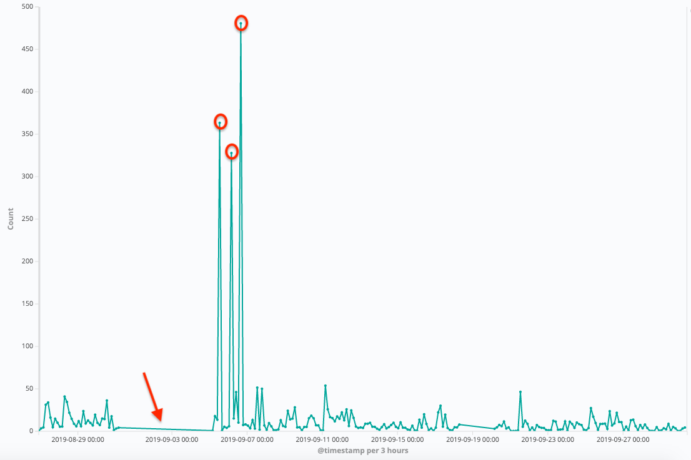
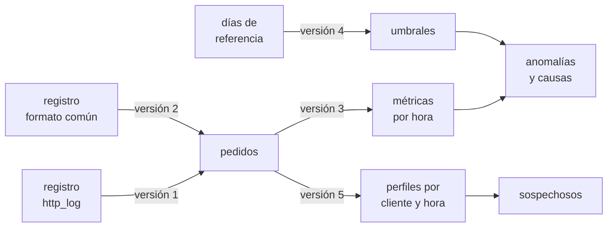

# Capítulo 85 — Proyecto: análisis de registros

Un servicio web anota cada pedido que recibe en un **registro**: quién lo
hizo, cuándo, qué pidió y qué se le respondió. El registro sirve para
responder preguntas que nadie hizo de antemano: si algún pedido quedó sin
respuesta, a qué hora hay más tráfico, quién está probando contraseñas.
El servicio de *Inscripciones* de los
[capítulos 31](../capitulo-31-servicios-web-rest/index.md#319-el-proyecto-inscripciones-como-servicio)
y [83](../capitulo-83-proyecto-criptografia/index.md#835-version-3-fichas-de-sesion),
con `library(http/http_log)` activada, escribe por cada pedido dos
términos de Prolog: uno al llegar y otro al responder.

```text
/*Thu Oct 01 10:21:11 2026*/ request(94, 1790860871.002, [peer(ip(203,0,113,7)),method(post),request_uri('/sesion'),path('/sesion'),http_version(1-1),host(localhost),port(8083)]).
completed(94, 0.043267, 36, 401, ok).
```

El pedido 94 llegó a las 10:21:11 del 1 de octubre desde 203.0.113.7,
intentó iniciar una sesión y recibió el código 401: la contraseña no era
la correcta. Un 401 aislado es un alumno que escribió mal su contraseña;
sesenta en cuatro minutos desde el mismo cliente son un intento de
adivinarla. Este capítulo escribe un programa que lee registros de cuatro
días del servicio, los resume por hora y por cliente, y separa lo normal
de lo anómalo con **umbrales** que no se escriben a mano: se ajustan con
los datos de días anteriores o se aprenden de incidentes ya investigados.
Cada anomalía se informa con su causa:

```text
10 h  fallos 62 > 14.38       203.0.113.7, 60 pedidos
12 h  cpu 2.86 > 0.98         /sesion, 2.49 s
17 h  pedidos 0 < 10.55       sin tráfico
```



Pedidos a un servidor web por tramos de tres horas durante un mes. Los
tres picos, marcados, y el tramo sin pedidos, señalado con la flecha, son
las dos clases de anomalía que busca el capítulo: demasiada actividad y
ninguna. Imagen: Sal Borrelli,
[CC BY-SA 4.0](https://creativecommons.org/licenses/by-sa/4.0), vía
[Wikimedia Commons](https://commons.wikimedia.org/wiki/File:Anomalous_Web_Traffic.png).

El punto de partida es el capítulo «Prolog Business Cases» de *The Power
of Prolog* de Markus Triska, que propone escribir el registro del
servidor como hechos, cargarlo y consultarlo, y generar informes con
reglas sobre datos que no cambian. Los modelos que deciden qué es anómalo
vienen del artículo «An Intrusion-Detection Model» de Dorothy Denning
(1987): un límite fijo, o la media de lo observado más algunos desvíos. El
modelo robusto, con la mediana, es el que recomienda el manual de
estadística del NIST. Las fuentes, con lo que se toma de cada una, están
en las [Referencias](#referencias) de cada página.

El capítulo cumple tres anuncios. El del
[capítulo 70](../capitulo-70-proyecto-perceptron/index.md): umbrales
ajustados a partir de datos para separar lo normal de lo anómalo, que
aquí aprende el mismo perceptrón. El del
[capítulo 84](../capitulo-84-proyecto-procesamiento-textos/index.md):
leer las líneas de un registro, extraer sus campos y separar lo normal de
lo anómalo, con el paso por línea de su filtro. Y el del
[capítulo 83](../capitulo-83-proyecto-criptografia/index.md): los inicios
de sesión rechazados con 401 que su servicio responde aparecen aquí como
anomalías. Usa las gramáticas del
[capítulo 22](../capitulo-22-gramaticas-dcg/index.md), los pares y los
`assoc` del [capítulo 23](../capitulo-23-estructuras-de-datos-de-la-biblioteca/index.md),
la lectura de términos y de líneas del
[capítulo 28](../capitulo-28-archivos-streams-y-formatos/index.md) y los
hilos del [capítulo 38](../capitulo-38-concurrencia-y-paralelismo/index.md).
Todos los archivos son `% solo-local`: leen archivos, y la versión 5 carga
los programas del [capítulo 70](../capitulo-70-proyecto-perceptron/index.md).

## Objetivos del capítulo

Al terminar el capítulo, el lector puede:

- cargar un registro escrito como hechos de Prolog y consultarlo, y
  reconocer cuándo la carga como programa da respuestas falsas;
- leer un registro como datos, término por término o línea por línea,
  con un paso que acumula estado y no se detiene ante una línea
  defectuosa;
- escribir una gramática para un formato de texto de otro programa, y
  comparar lo que leen dos lectores del mismo día;
- resumir eventos en métricas por período, incluidos los períodos sin
  eventos, y escribir informes con `format/2`;
- expresar las anomalías como reglas sobre las métricas y un argumento de
  límites, y buscar la causa de cada una;
- ajustar límites con la media y el desvío y con la mediana y la MAD, y
  explicar por qué el primero se desplaza con los mismos valores que debe
  detectar;
- entrenar el perceptrón del
  [capítulo 70](../capitulo-70-proyecto-perceptron/index.md) con perfiles
  marcados, y leer sus pesos como un límite sobre dos rasgos;
- calcular resúmenes que se combinan, en paralelo, y distinguir los que no
  se combinan sin guardar los valores.

!!! info "Tiempo estimado"
    Leer el capítulo, ejecutar sus ejemplos y hacer las actividades: **3:25 h**.
    Resolver los 5 ejercicios marcados con ★: **1:10 h**.
    Resolver los 11 ejercicios del capítulo: **3:00 h**.

## 85.1 El problema: cuatro días del servicio

Los datos del capítulo son los registros de cuatro días del servicio,
del lunes 28 de septiembre al jueves 1 de octubre de 2026, de 8 a 20 horas
en Buenos Aires. Están en `ejemplos/capitulo-85/archivos/`, uno por día, y
el último día también en el **formato común** de los servidores web, una
línea de texto por pedido. Los escribe `generar.pl`, que simula las
sesiones de los alumnos con un generador de números de semilla fija:
inicios de sesión, a veces con la contraseña mal escrita, y consultas
de materias, promedios e inscripciones. Sobre ese tráfico, el generador
agrega lo que un servicio real recibe de vez en cuando; el capítulo no lo
dice de antemano, porque encontrarlo es el problema.

Un registro de `http_log` tiene tres clases de términos:

| Término | Se escribe | Contiene |
|---|---|---|
| `request(Id, Instante, Campos)` | al llegar el pedido | el número del pedido en la corrida del servidor, el instante Unix y los campos del pedido: `peer(ip(A, B, C, D))`, `method(M)`, `path(Ruta)`, … |
| `completed(Id, Cpu, Bytes, Codigo, Estado)` | al responderlo | el tiempo de CPU que usó, en segundos, los bytes de la respuesta y el código HTTP |
| `server(Motivo, Instante)` | al arrancar y al detener el servidor | `started` o `stopped` |

El programa responde cuatro preguntas, de la más simple a la más
difícil: qué pedidos quedaron sin respuesta; cuántos pedidos, fallos y
segundos de CPU hay en cada hora; cuáles de esas horas son anómalas y
por qué; y qué clientes, aunque no muevan los totales de la hora, se
comportan como atacantes. El recorrido de los datos es siempre el mismo:



## 85.2 El programa terminado

| Versión | Archivo | Agrega | Lo que no puede hacer todavía |
|---|---|---|---|
| 1 | `registro.pl` | el registro cargado como programa; el registro leído como datos, con los rearranques | leer otros formatos |
| 2 | `comun.pl` | el formato común, con una gramática y un paso por línea | resumir |
| 3 | `informes.pl` | métricas por hora, umbrales fijos, causas e informes | saber de dónde salen los límites |
| 4 | `umbrales.pl` | umbrales ajustados con la media y el desvío o con la mediana y la MAD | ver a un atacante lento entre los alumnos |
| 5 | `aprendido.pl` | perfiles por cliente y hora; un límite aprendido con el perceptrón | — |
| 6 | `paralelo.pl` | resúmenes de cada día que se combinan, leídos en paralelo | — |

Cada versión carga la anterior con `reexport/1`, de modo que sus
predicados quedan a la vista de quien carga la nueva. Con la versión 4,
los umbrales ajustados con los tres primeros días encuentran en el
cuarto las tres horas del principio del capítulo, entre otras; con la
versión 5, los dos atacantes del cuarto día:

```text
?- umbrales_de_referencia(mediana_mad(3.5), _U), informe_anomalias(registros('2026-10-01.log'), _U).
10 h  pedidos 98 > 62.45      203.0.113.7, 60 pedidos
10 h  fallos 62 > 14.38       203.0.113.7, 60 pedidos
10 h  cpu 3.17 > 0.98         /sesion, 3.11 s
12 h  cpu 2.86 > 0.98         /sesion, 2.49 s
14 h  fallos 24 > 14.38       198.51.100.61, 17 pedidos
14 h  cpu 1.32 > 0.98         /sesion, 1.29 s
17 h  pedidos 0 < 10.55       sin tráfico
18 h  pedidos 0 < 10.55       sin tráfico
```

El capítulo continúa en la página
[Lectura de los registros, métricas e informes](lectura.md#853-version-1-el-registro-como-hechos),
con las versiones 1 y 2, que leen el registro de dos formas, y la
versión 3, que resume los pedidos leídos en métricas por hora e informes.

## Referencias

- Markus Triska, *The Power of Prolog*, capítulo «Prolog Business Cases»,
  secciones «Analyzing events and anomalies» y «Rule-based reporting».
  [Edición en línea](https://www.metalevel.at/prolog/business). Es el
  punto de partida del capítulo: el registro del servidor como hechos y
  los informes como reglas sobre datos que no cambian. La página
  [Lectura de los registros, métricas e informes](lectura.md#referencias) dice lo que se toma.
- Dorothy E. Denning, «An Intrusion-Detection Model», *IEEE Transactions
  on Software Engineering*, volumen SE-13, número 2, 1987, páginas
  222–232. [Copia de la autora](https://faculty.nps.edu/dedennin/publications/IDS%20model.pdf).
  El origen de los modelos que deciden qué es anómalo, que las páginas
  siguientes desarrollan.
- NIST/SEMATECH, *e-Handbook of Statistical Methods*, sección 1.3.5.17,
  «Detection of Outliers».
  [Edición en línea, de dominio público](https://www.itl.nist.gov/div898/handbook/eda/section3/eda35h.htm).
  El modelo robusto, con la mediana, que la página
  [Umbrales ajustados a los datos y un umbral aprendido](aprendido.md#referencias) usa.
- *SWI-Prolog Reference Manual* y la documentación de
  `library(http/http_log)`:
  [manual en línea](https://www.swi-prolog.org/pldoc/man?section=httplog).
  El formato de `request/3`, `completed/5` y `server/2` se verificó con un
  servidor de prueba en SWI-Prolog 9.2.9.
