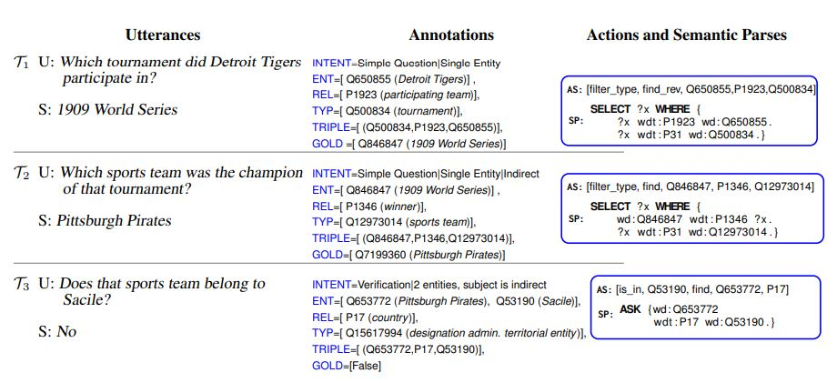
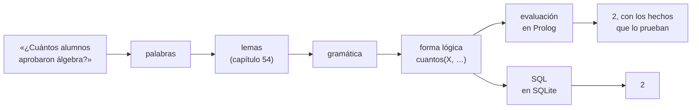

# Capítulo 88 — Proyecto: preguntas en castellano

Una **interfaz en lenguaje natural** para una base de datos responde
preguntas escritas como las escribe una persona: «¿quién cursa lógica?»,
«¿cuántos aprobaron álgebra?», «¿todos los alumnos de civil cursan
análisis 1?». Quien pregunta no necesita conocer el esquema de las tablas,
ni SQL, ni Prolog. El programa tiene que reconocer las palabras aunque
aparezcan flexionadas, construir el significado de la pregunta, buscar la
respuesta en la base y, en un programa que se precie, decir por qué la
respuesta es esa. Este capítulo construye esa interfaz sobre la base de
*Inscripciones* del [capítulo 43](../capitulo-43-prolog-y-sql/index.md),
y traduce cada pregunta, además, a una sentencia SQL que da el mismo
resultado en SQLite.



Un sistema actual de preguntas sobre una base de conocimiento: cada
pregunta del usuario (U) se convierte en una secuencia de acciones y en
una consulta formal, aquí en SPARQL, que la base ejecuta. El capítulo hace
lo mismo con una forma lógica en Prolog y con SQL. Imagen: Laura
Perez-Beltrachini, Parag Jain, Emilio Monti y Mirella Lapata (Universidad
de Edimburgo y Amazon Alexa), del artículo que presenta el conjunto de
datos SPICE,
[CC BY-SA 4.0](https://creativecommons.org/licenses/by-sa/4.0/deed.es), vía
[Wikimedia Commons](https://commons.wikimedia.org/wiki/File:Question_Answer_Semantic_Parsing.jpg).

El programa crece en cinco versiones. La primera busca palabras clave y
llena plantillas, y muestra por qué no alcanza. La segunda es una
gramática que produce la **forma lógica** de la pregunta, con
cuantificadores, sobre palabras reducidas a su lema por el analizador
morfológico del [capítulo 54](../capitulo-54-proyecto-morfologia-castellano/index.md).
La tercera evalúa la forma lógica con un intérprete que construye el
árbol de prueba, como los del
[capítulo 34](../capitulo-34-introspeccion-y-metainterpretes/index.md), y
explica tanto un «sí» como un «no». La cuarta traduce la forma lógica a
SQL, con `NOT EXISTS` para la negación y `WITH RECURSIVE` para las
correlativas, y la ejecuta contra la base SQLite del
[capítulo 43](../capitulo-43-prolog-y-sql/index.md). La quinta reúne todo
en un programa con un bucle de preguntas, una página web y un servicio
con hilos. Un último apartado agrega una clase de pregunta nueva, el
horario de una materia, sin modificar ninguna de las anteriores.

El proyecto parte del apartado 5.2, «A Simple Dialogue Program», de
*Prolog and Natural-Language Analysis* de Fernando Pereira y Stuart
Shieber, que presenta `talk`, un programa que analiza una oración, la
convierte en una cláusula y responde con las soluciones de `setof/3`; y
del apartado 4.1 del mismo libro, que construye las formas lógicas de
los sintagmas cuantificados. Toma de Chat-80, el sistema de David Warren y
Fernando Pereira, la traducción de los determinantes a la lógica de
primer orden, y de los sistemas de consulta en castellano de Veronica
Dahl, los tipos de los argumentos y las presuposiciones. Las fuentes,
con lo que se toma de cada una, están en las
[Referencias](#referencias) de cada página; el código es propio.

El capítulo cumple los anuncios de los capítulos
[34](../capitulo-34-introspeccion-y-metainterpretes/index.md) (las explicaciones de las respuestas),
[37](../capitulo-37-interfaces-de-usuario/index.md) (las preguntas desde una interfaz),
[38](../capitulo-38-concurrencia-y-paralelismo/index.md) (desde un servicio con hilos),
[40](../capitulo-40-tabulacion/index.md) (evaluadas con tablas),
[43](../capitulo-43-prolog-y-sql/index.md) (traducidas a SQL y ejecutadas contra `base.pl`),
[45](../capitulo-45-proyecto-aventura-de-texto/index.md),
[56](../capitulo-56-proyecto-dialogos-plantillas/index.md) y
[57](../capitulo-57-proyecto-ordenes-castellano/index.md) (preguntas sobre una base de datos,
traducidas a formas lógicas), [54](../capitulo-54-proyecto-morfologia-castellano/index.md) (las
formas de los nombres y los verbos reducidas a su lema con `forma/2`),
[55](../capitulo-55-proyecto-traduccion-castellanoingles/index.md) (una gramática que produce formas
lógicas como interlingua para consultar una base) y
[74](../capitulo-74-proyecto-horarios-inscripciones/index.md) (el horario de una materia). Carga sin
copiarlos `base.pl` y `sqlite.pl` del [capítulo 43](../capitulo-43-prolog-y-sql/index.md), el
analizador del [capítulo 54](../capitulo-54-proyecto-morfologia-castellano/index.md) y `oferta.pl`
del [capítulo 74](../capitulo-74-proyecto-horarios-inscripciones/index.md). Todos los archivos son
`% solo-local`, porque son módulos que cargan otros; las pruebas que ejecutan SQL necesitan, además,
el controlador ODBC de SQLite de la [sección
43.7](../capitulo-43-prolog-y-sql/odbc.md#la-base-en-sqlite).

## Objetivos del capítulo

Al terminar el capítulo, el lector puede:

- explicar por qué una búsqueda de palabras clave responde mal las
  preguntas con negaciones, modificadores o cuantificadores;
- escribir una gramática que construye la forma lógica de una pregunta,
  con los sintagmas nominales como funciones sobre la propiedad que el
  resto de la oración les aplica;
- usar los tipos de los argumentos y la concordancia para descartar los
  análisis que no tienen sentido;
- evaluar una forma lógica con un intérprete que devuelve el árbol de
  prueba, y explicar por qué una pregunta de sí o no da «no»;
- traducir una forma lógica a SQL, con la negación como `NOT EXISTS` y la
  recursión como `WITH RECURSIVE`, y comparar las dos evaluaciones;
- extender un programa en módulos con una clase nueva de pregunta sin
  modificar los módulos.

!!! info "Tiempo estimado"
    Leer el capítulo, ejecutar sus ejemplos y hacer las actividades: **3:05 h**.
    Resolver los 5 ejercicios marcados con ★: **1:05 h**.
    Resolver los 11 ejercicios del capítulo: **3:15 h**.

## 88.1 Preguntas sobre *Inscripciones*

La base del [capítulo 43](../capitulo-43-prolog-y-sql/index.md) tiene
siete alumnos, siete materias, siete correlativas y diecisiete
inscripciones. Una pregunta típica es «¿cuántos alumnos aprobaron
álgebra?». La respuesta se obtiene en cuatro pasos:

1. **Las palabras.** El texto se separa en
   `["cuántos", "alumnos", "aprobaron", "álgebra"]`.
2. **Los lemas y los nombres.** «alumnos» es el plural de *alumno*,
   «aprobaron» es la tercera persona del plural del pretérito de
   *aprobar*, y «álgebra» es el nombre de la materia `alg`.
3. **La forma lógica.** La pregunta pide cuántos X cumplen dos
   condiciones: `cuantos(X, y(alumno(X), aprobar(X, alg)))`.
4. **La evaluación.** Las inscripciones en `alg` son las de los legajos
   101 (nota 9), 102 (2), 103 (5) y 104 (7). Aprueban, con 6 o más, ana y
   diego: la respuesta es 2, y la prueban `inscripcion(101, alg, 9)` e
   `inscripcion(104, alg, 7)`.



Pereira y Shieber describen así su programa `talk`: analizar la oración y
construir a la vez su forma lógica; convertirla en una cláusula de Horn,
si se puede; y agregarla a la base, si es una afirmación, o ejecutarla como
consulta, si es una pregunta. La respuesta a una pregunta son las
soluciones de `setof/3`, o `[no]` si no hay ninguna, y una oración que no
se analiza recibe la respuesta `error('too difficult')`. Las respuestas
son **extensionales**: «¿qué escribió Bertrand?» se responde con los
libros que se prueba que escribió, nunca con «todos los libros». Este
capítulo conserva esas tres fases y esa respuesta extensional, y se
limita a las preguntas, como los sistemas de consulta de bases de datos
que los autores citan.

Lo que hace difícil el problema aparece en cuanto las preguntas dejan de
ser las del ejemplo. Las palabras llegan flexionadas («aprobó»,
«aprueba», «aprobaron») y con tildes o sin ellas. «¿Quién no aprobó
álgebra?» tiene las mismas palabras importantes que «¿quién aprobó
álgebra?». «De sistemas» y «que cursan paradigmas» restringen el conjunto
del que se habla. «Todos» y «algún» son cuantificadores, y su alcance hay
que construirlo. El castellano admite el sujeto después del verbo:
en «¿qué materias cursa ana?», ana es el sujeto. Y las correlativas de las
correlativas forman una relación recursiva que, escrita con la recursión
a la izquierda, no termina sin tablas.

## 88.2 El programa terminado

| Versión | Archivo | Agrega | Lo que no puede hacer todavía |
|---|---|---|---|
| 1 | `claves.pl` | la clase de respuesta, el verbo y los nombres propios, por palabras clave; una plantilla por clase | leer la negación, los modificadores y los cuantificadores |
| — | `palabras.pl`, `lemas.pl`, `nombres.pl` | las palabras de una pregunta; su lema, con el [capítulo 54](../capitulo-54-proyecto-morfologia-castellano/index.md) y una tabla; los nombres propios de la base | — |
| 2 | `gramatica.pl` | la forma lógica, con cuantificadores, tipos y concordancia | responder |
| 3 | `evaluar.pl` | la evaluación, el árbol de prueba, por qué no, las presuposiciones; las correlativas con una tabla | dar la sentencia SQL |
| 4 | `sql.pl`, `consulta_sql.pl` | la traducción a SQL y su ejecución con ODBC | conversar |
| 5 | `preguntas.pl`, `servicio.pl` | las respuestas en castellano, el bucle, la página web y el servicio con hilos | — |
| — | `horario.pl` | una clase de pregunta más: el horario del [capítulo 74](../capitulo-74-proyecto-horarios-inscripciones/index.md) | — |
| — | `costos.pl` | las mediciones que el capítulo imprime, con sus pruebas | — |

El programa completo se carga con `preguntas.pl`. `preguntar/1` escribe la
respuesta y los hechos de la base que la prueban, y `sql/1` escribe la
sentencia SQL de la misma pregunta:

<!-- contexto: capitulo-88/preguntas.pl -->
```prolog
?- preguntar("¿Cuántos aprobaron álgebra?").
2
  ana: inscripcion(101, alg, 9), 9 >= 6
  diego: inscripcion(104, alg, 7), 7 >= 6
true.

?- sql("¿Cuántos aprobaron álgebra?").
SELECT COUNT(DISTINCT t1.legajo)
FROM alumnos t1, inscripciones t2
WHERE t2.legajo = t1.legajo
  AND t2.materia = 'alg'
  AND t2.nota >= 6
true.
```

SQLite responde 2 a esa sentencia, sobre la base del
[capítulo 43](../capitulo-43-prolog-y-sql/index.md). Una pregunta de sí o
no que da «no» se explica con el hecho que falta o que no alcanza:

```prolog
?- preguntar("¿Bruno aprueba álgebra?").
No
  inscripcion(102, alg, 2), y 2 < 6
true.
```

## 88.3 Versión 1: palabras clave

La forma más simple de responder una pregunta es reconocer en ella unas
pocas palabras y llenar una plantilla, como los programas de diálogo del
[capítulo 56](../capitulo-56-proyecto-dialogos-plantillas/index.md). La
versión 1 reduce la pregunta a tres datos: la **clase de respuesta**
(«quién» y «qué» piden una lista, «cuántos» un número, y una pregunta sin
palabra interrogativa pide sí o no), el **verbo**, reconocido por el
comienzo de la palabra («curs», «aprob», «necesit»), y los **nombres
propios** que menciona. Una plantilla por clase consulta la base:

<!-- ejemplo: capitulo-88/claves.pl predicado: plantilla/4 respuestas/3 -->
```prolog
%!  plantilla(+Clase, +Verbo, +Entidades:list, -Respuesta) is semidet.
%
%   Respuesta responde la plantilla de Clase con Verbo y Entidades. Con una
%   materia y una lista o un número, la pregunta es por los alumnos; con
%   un alumno, por las materias; sí o no necesita un alumno y una materia.
plantilla(lista, Verbo, Entidades, lista(Nombres)) :-
    respuestas(Verbo, Entidades, Claves),
    maplist(nombre_de, Claves, Nombres).
plantilla(numero, Verbo, Entidades, numero(N)) :-
    respuestas(Verbo, Entidades, Claves),
    length(Claves, N).
plantilla(si_no, Verbo, Entidades, Respuesta) :-
    memberchk(alumno-Legajo, Entidades),
    memberchk(materia-Materia, Entidades),
    (   relacion(Verbo, Legajo, Materia)
    ->  Respuesta = si
    ;   Respuesta = no
    ).

%!  respuestas(+Verbo, +Entidades:list, -Claves:list) is semidet.
%
%   Claves son, ordenadas, las entidades que cumplen Verbo con la primera
%   entidad que se menciona: los alumnos de una materia, las materias de
%   un alumno, o los requisitos de una materia.
respuestas(Verbo, [Tipo-Entidad|_], Claves) :-
    (   Tipo == materia, Verbo \== necesitar
    ->  findall(L, relacion(Verbo, L, Entidad), Ls)
    ;   findall(M, relacion(Verbo, Entidad, M), Ls)
    ),
    sort(Ls, Claves).
```

Con las preguntas para las que fue pensada, la versión responde bien:

<!-- contexto: capitulo-88/claves.pl -->
```prolog
?- responder_claves("¿Quién cursa lógica?", R).
R = lista(["ana", "bruno", "diego", "facundo"]).

?- responder_claves("¿Cuántos aprobaron álgebra?", R).
R = numero(2).
```

Con las demás, responde mal sin advertirlo:

```prolog
?- responder_claves("¿Quién no aprobó álgebra?", R).
R = lista(["ana", "diego"]).

?- responder_claves("¿Cuántos alumnos de sistemas aprobaron álgebra?", R).
R = numero(0).

?- datos_clave("¿Cuántos alumnos de sistemas aprobaron álgebra?", C, V, Es).
C = numero,
V = aprobar,
Es = [carrera-sistemas, materia-alg].

?- responder_claves("¿Qué necesita bases de datos?", R).
R = lista(["paradigmas", "sintaxis"]).

?- responder_claves("¿Quién aprueba lógica?", R).
false.
```

Cada error tiene una causa distinta. La negación no es una palabra clave,
y «¿quién no aprobó álgebra?» da los que aprobaron. La plantilla toma la
primera entidad que la pregunta nombra, y en la segunda pregunta es la
carrera, de modo que cuenta las materias que «sistemas» aprobó: ninguna;
la respuesta correcta es 2, porque ana y diego son de sistemas. Las
correlativas de bases de datos son, de forma directa, paradigmas y
sintaxis, pero bases de datos también necesita lógica y álgebra, que son
correlativas de esas dos. Y «aprueba» no empieza con «aprob». Ninguno de
estos errores se arregla agregando palabras clave: la negación tiene un
alcance, «de sistemas» modifica a «alumnos» y no al verbo, y la
recursión de las correlativas no es una palabra. Hace falta la estructura
de la pregunta.

!!! question "Actividad"
    Predecir qué responde `responder_claves/2` a «¿Cuántas materias aprobó
    ana?» y a «¿Bruno aprobó lógica?». Comprobarlo, y escribir otra
    pregunta que la versión 1 responda mal por una causa distinta de las
    cuatro anteriores.

El capítulo continúa en la página [Las palabras de la
pregunta](palabras.md#884-las-palabras-de-la-pregunta), con los módulos que
preparan las palabras de una pregunta y la versión 2, la gramática que
construye su forma lógica.

## Referencias

- Fernando C. N. Pereira y Stuart M. Shieber, *Prolog and
  Natural-Language Analysis*, CSLI, 1987; reedición digital de Microtome
  Publishing, 2002 — apartado 5.2, «A Simple Dialogue Program»
  (apartados 5.2.1 a 5.2.4), y el listado del programa `talk` en el
  apéndice A.2. [Edición digital de Microtome](http://www.mtome.com/Publications/PNLA/pnla-digital.html).
  Esta página toma de allí las tres fases del programa, la respuesta
  extensional y la respuesta para una oración que no se analiza.
- David H. D. Warren y Fernando C. N. Pereira, «An Efficient Easily
  Adaptable System for Interpreting Natural Language Queries»,
  *American Journal of Computational Linguistics* 8 (3–4), 1982,
  páginas 110–122. [ACL Anthology](https://aclanthology.org/J82-3002/).
  Describe Chat-80.
  Esta página lo nombra como la fuente de la traducción de los
  determinantes a la lógica de primer orden, que presenta la
  [sección 88.5](palabras.md#885-version-2-la-gramatica-y-la-forma-logica).
- Veronica Dahl, «Translating Spanish into Logic through Logic», *American
  Journal of Computational Linguistics* 7 (3), 1981, páginas 149–164. [ACL
  Anthology](https://aclanthology.org/J81-3002/). Los sistemas de consulta de
  bases de datos en castellano, escritos en Prolog en la Universidad de Buenos
  Aires desde 1976, de los que partió Chat-80. Esta página lo nombra como la
  fuente de los tipos de los argumentos y de las presuposiciones, que presentan
  las secciones [88.5](palabras.md#885-version-2-la-gramatica-y-la-forma-logica)
  y [88.6](sql.md#886-version-3-evaluar-y-explicar).
- Laura Perez-Beltrachini, Parag Jain, Emilio Monti y Mirella Lapata,
  «Semantic Parsing for Conversational Question Answering over Knowledge
  Graphs», 2023. [arXiv:2301.12217](https://arxiv.org/abs/2301.12217).
  La figura del comienzo del capítulo, CC BY-SA 4.0, vía Wikimedia
  Commons.
